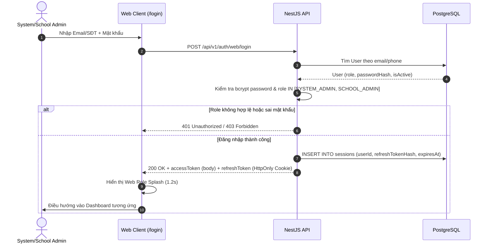
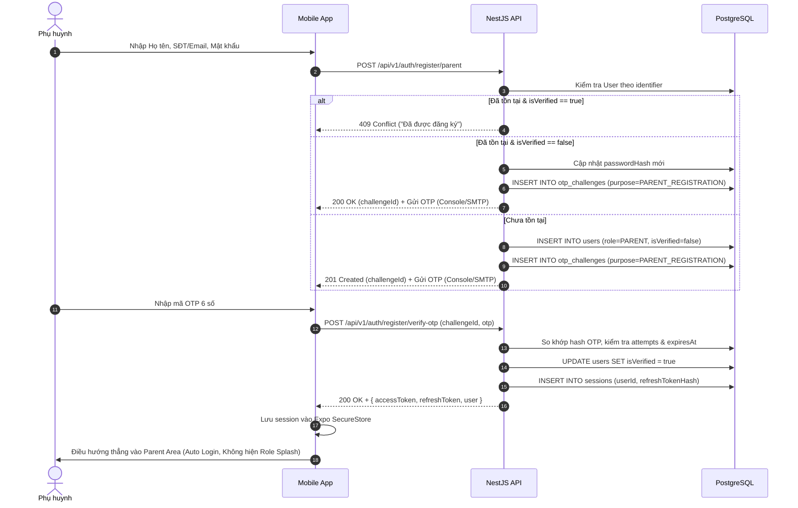
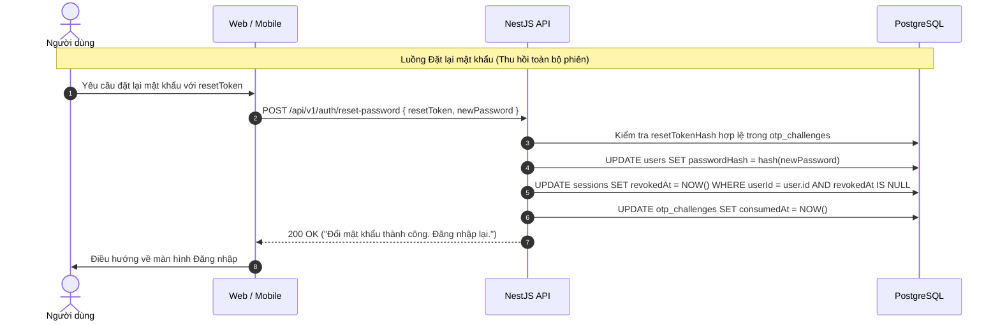

# RoadToSchool — AI Review Report: Phase 1 — Stage B Technical Design & Wireframes

## 1. Task Information
- **Task Name**: Phase 1 — Authentication & Account Access: Stage B — Technical Design & Wireframes
- **Date**: 2026-10-22
- **Project Scope**: API (`api/`), Web (`web/`), Mobile (`mobile/`), Architecture (`docs/architecture/`)
- **Task Type**: Technical Design, Schema Design, API Contract Specification, UI/UX Wireframes
- **Status**: WAITING_APPROVAL (Tuyệt đối KHÔNG viết mã nguồn, KHÔNG sửa Database, KHÔNG chạy migration, KHÔNG seed dữ liệu)

---

## 2. Approved Decisions
Tất cả các quyết định nghiệp vụ và kỹ thuật cốt lõi từ phản hồi Stage A đã được Product Owner chính thức phê duyệt (APPROVED):

1. **Phân tách luồng đăng nhập Web và Mobile (Separate Web & Mobile Login Flows)**:
   - Web: `POST /api/v1/auth/web/login` — Chỉ cho phép `SYSTEM_ADMIN` và `SCHOOL_ADMIN`.
   - Mobile: `POST /api/v1/auth/mobile/login` — Chỉ cho phép `DRIVER`, `BUS_ATTENDANT` và `PARENT`.
   - Dùng chung core authentication logic ở tầng backend Service, Role được truy vấn và xác minh trực tiếp từ Database. Không có Role Selector trên giao diện, client không tự quyết định Role.
2. **Thu hồi Token tức thì qua Database Session (Immediate Access Token Revocation)**:
   - Access Token JWT chứa `sid: sessionId`. Mọi protected request đều phải kiểm tra trạng thái Session trong PostgreSQL (`revokedAt IS NULL AND expiresAt > NOW()`).
   - Logout: Thu hồi phiên hiện tại (`revokedAt = NOW()`).
   - Password Reset: Thu hồi **toàn bộ** các phiên của người dùng (`revokedAt = NOW() WHERE userId = ...`).
   - Không sử dụng Redis, không tạo blacklist riêng khi chưa cần thiết.
3. **Lưu trữ tài khoản Phụ huynh chưa xác thực (Unverified Account Persistence)**:
   - Đăng ký Phụ huynh tạo bản ghi `User` với `isVerified = false`.
   - Tài khoản chưa kích hoạt **không bị xóa** khi OTP hết hạn; không được phép đăng nhập.
   - Nếu đăng ký lại với cùng identifier chưa kích hoạt, hệ thống cho phép cập nhật thông tin và cấp OTP mới để tiếp tục. Không tạo bản ghi trùng lặp.
4. **Giới hạn SMS Console trong giai đoạn Development**:
   - SMS sử dụng `console` mode (ghi log terminal). Chấp nhận giới hạn phát triển.
   - Email hỗ trợ cả 2 chế độ `console` và `smtp` cấu hình qua `.env`.
   - Tuyệt đối không trả OTP trong response API.
5. **Mô hình Một bảng User duy nhất cho 5 Roles (Single User Table)**:
   - Bảng `User` dùng chung cho `SYSTEM_ADMIN`, `SCHOOL_ADMIN`, `DRIVER`, `BUS_ATTENDANT`, `PARENT`.
   - Ràng buộc: `email != null OR phone != null` (cho phép chỉ có Email, chỉ có Phone, hoặc cả hai; không được phép thiếu cả hai).
6. **Tự động đăng nhập cho Phụ huynh sau khi xác thực OTP đăng ký (Parent Auto Login)**:
   - Xác thực OTP đăng ký thành công -> Kích hoạt `isVerified = true` -> Tạo Session -> Cấp Access/Refresh Token -> Vào thẳng ứng dụng Phụ huynh.
7. **Quy tắc hiển thị Splash**:
   - Mobile Application Splash: Khởi động app, chỉ có Logo RoadToSchool, không text thừa.
   - Role Splash: **Chỉ xuất hiện sau khi người dùng đăng nhập thủ công từ form Login** (1 - 1.5 giây). Không hiển thị khi refresh trang, khôi phục session, tự động refresh token, hoặc auto-login sau đăng ký.
8. **Cấu hình thời hạn linh hoạt qua `.env`**:
   - Token TTL: Access Token (15m / `900s`), Refresh Token (7d / `604800s`), Reset Token (10m / `600s`).
   - OTP: Chiều dài 6 số, TTL (5m / `300s`), Cooldown gửi lại (60s), Tối đa 5 lần nhập sai, Tối đa 3 lần gửi lại.

---

## 3. Updated Authentication Flows

### 3.1. Web Authentication Flows


### 3.2. Mobile Parent Registration & Auto-Login Flow


### 3.3. Session Invalidation & Password Reset Flow


---

## 4. Proposed Database Schema

Sử dụng **một bảng `User` duy nhất**, kết hợp bảng `Session` và `OtpChallenge`:

```prisma
// datasource db { provider = "postgresql", url = env("DATABASE_URL") }
// generator client { provider = "prisma-client-js" }

enum Role {
  SYSTEM_ADMIN
  SCHOOL_ADMIN
  DRIVER
  BUS_ATTENDANT
  PARENT
}

enum OtpPurpose {
  PARENT_REGISTRATION
  PASSWORD_RESET
}

enum DeliveryChannel {
  EMAIL
  SMS
}

model User {
  id           String    @id @default(uuid())
  email        String?   @unique
  phone        String?   @unique
  fullName     String    @map("full_name")
  passwordHash String    @map("password_hash")
  role         Role
  isVerified   Boolean   @default(false) @map("is_verified")
  isActive     Boolean   @default(true) @map("is_active")
  createdAt    DateTime  @default(now()) @map("created_at")
  updatedAt    DateTime  @updatedAt @map("updated_at")

  sessions      Session[]
  otpChallenges OtpChallenge[]

  @@map("users")
}

model Session {
  id               String    @id @default(uuid())
  userId           String    @map("user_id")
  refreshTokenHash String    @map("refresh_token_hash")
  deviceInfo       String?   @map("device_info")
  ipAddress        String?   @map("ip_address")
  expiresAt        DateTime  @map("expires_at")
  revokedAt        DateTime? @map("revoked_at")
  createdAt        DateTime  @default(now()) @map("created_at")
  updatedAt        DateTime  @updatedAt @map("updated_at")

  user User @relation(fields: [userId], references: [id], onDelete: Cascade)

  @@index([userId])
  @@index([expiresAt])
  @@index([revokedAt])
  @@map("sessions")
}

model OtpChallenge {
  id             String          @id @default(uuid())
  userId         String?         @map("user_id")
  identifier     String
  channel        DeliveryChannel
  purpose        OtpPurpose
  otpHash        String          @map("otp_hash")
  resetTokenHash String?         @map("reset_token_hash")
  attempts       Int             @default(0)
  maxAttempts    Int             @default(5) @map("max_attempts")
  resendCount    Int             @default(0) @map("resend_count")
  maxResends     Int             @default(3) @map("max_resends")
  cooldownUntil  DateTime        @map("cooldown_until")
  expiresAt      DateTime        @map("expires_at")
  consumedAt     DateTime?       @map("consumed_at")
  createdAt      DateTime        @default(now()) @map("created_at")
  updatedAt      DateTime        @updatedAt @map("updated_at")

  user User? @relation(fields: [userId], references: [id], onDelete: Cascade)

  @@index([identifier, purpose])
  @@index([expiresAt])
  @@map("otp_challenges")
}
```

### Phân tích kỹ thuật & Migration Impact
- **Check Constraint Identifier**: Tại migration SQL bổ sung:
  `ALTER TABLE "users" ADD CONSTRAINT "user_has_identifier" CHECK ("email" IS NOT NULL OR "phone" IS NOT NULL);`
- **Không duplicate Account table**: Bảng `User` lưu trữ trực tiếp cả 5 Roles, sẵn sàng cho các bảng nghiệp vụ tương lai (`DriverProfile`, `Student`, `School`) liên kết khóa ngoại qua `userId` mà không làm thay đổi cấu trúc bảng Auth.

---

## 5. Proposed API Contracts

Toàn bộ 11 Endpoints được thiết kế theo chuẩn RESTful, tích hợp đầy đủ Swagger decorators và DTO validation:

| # | HTTP Method | Endpoint | Actor cho phép | Mô tả chính |
|---|---|---|---|---|
| 1 | `POST` | `/api/v1/auth/web/login` | `SYSTEM_ADMIN`, `SCHOOL_ADMIN` | Đăng nhập trên Web, cấp Session & JWT, Cookie Refresh Token. |
| 2 | `POST` | `/api/v1/auth/mobile/login` | `DRIVER`, `BUS_ATTENDANT`, `PARENT` | Đăng nhập trên Mobile, trả tokens trong Body. |
| 3 | `POST` | `/api/v1/auth/register/parent` | Public | Đăng ký tài khoản Phụ huynh, tạo User (`isVerified=false`), gửi OTP. |
| 4 | `POST` | `/api/v1/auth/register/verify-otp` | Public | Xác thực OTP đăng ký, kích hoạt User và tự động đăng nhập (Auto Login). |
| 5 | `POST` | `/api/v1/auth/register/resend-otp` | Public | Gửi lại mã OTP đăng ký (áp dụng cooldown 60s, tối đa 3 lần). |
| 6 | `POST` | `/api/v1/auth/forgot-password` | Public | Yêu cầu OTP đặt lại mật khẩu (Anti-enumeration: luôn trả 200 OK). |
| 7 | `POST` | `/api/v1/auth/verify-reset-otp` | Public | Xác thực OTP quên mật khẩu, cấp `resetToken` 1 lần (TTL 10m). |
| 8 | `POST` | `/api/v1/auth/reset-password` | Public | Dùng `resetToken` đổi mật khẩu, thu hồi tất cả Sessions của User. |
| 9 | `POST` | `/api/v1/auth/refresh` | Public / Session | Xoay vòng Refresh Token, cấp Access Token mới nếu Session chưa bị thu hồi. |
| 10 | `GET` | `/api/v1/auth/me` | Authenticated | Lấy thông tin tài khoản hiện tại, kiểm tra tức thì trạng thái Session. |
| 11 | `POST` | `/api/v1/auth/logout` | Authenticated | Thu hồi phiên hiện tại (`revokedAt = NOW()`), vô hiệu hóa token lập tức. |

*Chi tiết toàn bộ Request/Response DTO, Business Logic, mã lỗi HTTP và kế hoạch Swagger đã được tài liệu hóa chi tiết tại [docs/architecture/auth-technical-design.md](file:///c:/Users/chuon/Documents/work/road-to-school-v2/docs/architecture/auth-technical-design.md).*

---

## 6. JWT/Session Strategy & Immediate Revocation

### 6.1. Cấu trúc Token Payload
- **Access Token (15 phút)**:
  ```json
  {
    "sub": "user-uuid-v4",
    "role": "SYSTEM_ADMIN",
    "sid": "session-uuid-v4",
    "iat": 1729584000,
    "exp": 1729584900
  }
  ```
- **Refresh Token (7 ngày)**: Chuỗi ngẫu nhiên 64-hex mã hóa an toàn (`crypto.randomBytes(32).toString('hex')`). Trong DB chỉ lưu bản băm SHA-256.

### 6.2. Cơ chế Thu hồi Tức thì (Immediate Revocation Mechanics)
- Tại `AuthGuard` của NestJS:
  1. Kiểm tra chữ ký và hạn của Access Token (JWT verify).
  2. Trích xuất `sid` (Session ID).
  3. Thực hiện truy vấn nhanh trên PostgreSQL qua index khóa chính:
     ```sql
     SELECT id, revoked_at, expires_at FROM sessions WHERE id = $1;
     ```
  4. Nếu không tìm thấy bản ghi, hoặc `revoked_at IS NOT NULL`, hoặc `expires_at < NOW()`: Trả về ngay `401 Unauthorized`.
- **Đánh giá chi phí truy vấn**:
  - Truy vấn theo khóa chính UUID trên PostgreSQL local mất ~0.5ms.
  - Phù hợp hoàn hảo với quy mô Project Sinh viên, loại bỏ hoàn toàn sự phụ thuộc vào Redis.
  - Đảm bảo 100% tính tức thì: Khi người dùng bấm Logout hoặc Đổi mật khẩu, mọi request tiếp theo dùng Access Token cũ đều bị chặn đứng ngay lập tức.

---

## 7. OTP/Reset Token Strategy

### 7.1. So sánh Phương án Reset Password (Yêu cầu Mục 5)
- **Phương án A (Khuyên dùng — Đã chọn vào Thiết kế)**:
  - *Luồng 2 bước*: Verify OTP thành công -> Server sinh `resetToken` ngẫu nhiên 64-hex (lưu SHA-256 hash vào `OtpChallenge.resetTokenHash`, TTL 10 phút, dùng 1 lần) -> Client chuyển sang màn hình "Đặt lại mật khẩu" -> Gửi `{ resetToken, newPassword }`.
  - *Đánh giá*: Trải nghiệm UI phân tách sạch sẽ, người dùng không bị mất mã OTP nếu nhập sai quy tắc xác nhận mật khẩu; Reset Token độc lập, không tái sử dụng được, bị vô hiệu hóa ngay khi đổi mật khẩu thành công.
- **Phương án B (Gộp OTP + Password trong 1 request)**:
  - *Luồng*: Màn hình nhập OTP phải hiển thị luôn 2 ô nhập mật khẩu mới, gửi gộp 1 request.
  - *Nhược điểm*: Xấu về mặt UX di động, nếu mật khẩu mới vi phạm validation thì OTP có nguy cơ bị hủy và phải yêu cầu gửi lại từ đầu.

### 7.2. Quản lý Thử thách OTP (Anti-Abuse & Rate Limiting)
- Độ dài mã OTP: 6 chữ số ngẫu nhiên (`crypto.randomInt(100000, 999999)`).
- Thời hạn: 5 phút (`300s`).
- Cooldown gửi lại: 60 giây (`AUTH_OTP_RESEND_COOLDOWN_SECONDS=60`).
- Số lần thử tối đa: 5 lần. Quá 5 lần, challenge bị khóa (`consumedAt = NOW()`).
- Số lần gửi lại tối đa: 3 lần.

---

## 8. Web Wireframes (Minimal UI Copy)
*Tuân thủ bộ màu RoadToSchool: Primary `#FFCB56`, Background `#FFFDF6`, Foreground `#1E293B`, Surface `#FFFFFF`.*

### Screen W1: Web Login (`/login`)
```text
+-------------------------------------------------------------+
|                                                             |
|                   [ Logo RoadToSchool ]                     |
|                                                             |
|            +-------------------------------+                |
|            |      Đăng nhập Quản trị       |                |
|            +-------------------------------+                |
|            |                               |                |
|            |  Email hoặc Số điện thoại     |                |
|            |  [ admin@r2s.com            ] |                |
|            |                               |                |
|            |  Mật khẩu                     |                |
|            |  [ **********               ] |                |
|            |                               |                |
|            |              [ Quên mật khẩu?]|                |
|            |                               |                |
|            |  +-------------------------+  |                |
|            |  |        ĐĂNG NHẬP        |  |  (Nút Primary) |
|            |  +-------------------------+  |                |
|            +-------------------------------+                |
|                                                             |
+-------------------------------------------------------------+
```

### Screen W2: Web Forgot Password & Reset Password
```text
[ Quên mật khẩu ]                     [ Đặt lại mật khẩu ]
+-------------------------------+     +-------------------------------+
|        Quên mật khẩu          |     |       Đặt lại mật khẩu        |
+-------------------------------+     +-------------------------------+
|  Email hoặc Số điện thoại     |     |  Mật khẩu mới                 |
|  [ admin@r2s.com            ] |     |  [ Tối thiểu 8 ký tự        ] |
|                               |     |                               |
|  +-------------------------+  |     |  Xác nhận mật khẩu            |
|  |         GỬI MÃ          |  |     |  [ Nhập lại mật khẩu mới    ] |
|  +-------------------------+  |     |                               |
|                               |     |  +-------------------------+  |
|      < Quay lại đăng nhập     |     |  |       HOÀN TẤT          |  |
+-------------------------------+     +--+-------------------------+--+
```

### Screen W3: Web Role Splash (1.2 giây sau Manual Login)
```text
   [ SYSTEM_ADMIN Splash ]                  [ SCHOOL_ADMIN Splash ]
+-------------------------------+        +-------------------------------+
|                               |        |                               |
|            (🛡️)               |        |            (🏫)               |
|                               |        |                               |
|       Quản trị Hệ thống       |        |      Quản trị Trường học      |
|                               |        |                               |
|        [ Loader bar ]         |        |        [ Loader bar ]         |
|                               |        |                               |
+-------------------------------+        +-------------------------------+
```

---

## 9. Mobile Wireframes (Minimal UI Copy)

### Screen M1 & M2: Application Splash & Mobile Login
```text
  [ Screen M1: App Splash ]               [ Screen M2: Mobile Login ]
+---------------------------+        +---------------------------+
|                           |        | 9:41                  📶  |
|                           |        +---------------------------+
|                           |        |            (🚌)           |
|            (🚌)           |        |        RoadToSchool       |
|        RoadToSchool       |        |                           |
|                           |        |   Email hoặc Số điện thoại|
|                           |        |   [ 0912345678          ] |
|                           |        |   Mật khẩu                |
|                           |        |   [ **********        👁️ ]|
|                           |        |             Quên mật khẩu?|
|                           |        |   +-------------------+   |
|                           |        |   |     ĐĂNG NHẬP     |   |
+---------------------------+        |   +-------------------+   |
(Chỉ có logo, nền #FFFDF6)           |   [ Đăng ký Phụ huynh ]   |
                                     +---------------------------+
```

### Screen M3 & M4: Parent Registration & OTP Verification
```text
[ Screen M3: Đăng ký Phụ huynh ]     [ Screen M4: Xác thực OTP ]
+---------------------------+        +---------------------------+
| < Đăng ký Phụ huynh       |        | < Nhập mã xác nhận        |
+---------------------------+        +---------------------------+
|   Họ và tên               |        |   Mã 6 số gửi đến:        |
|   [ Trần Thị B          ] |        |   0987654321              |
|                           |        |                           |
|   Hình thức xác minh:     |        |    [ 1 ] [ 2 ] [ 3 ]      |
|   (o) SĐT     ( ) Email   |        |    [ 4 ] [ 5 ] [ 6 ]      |
|                           |        |                           |
|   Số điện thoại           |        |   Gửi lại mã (45s)        |
|   [ 0987654321          ] |        |                           |
|                           |        |   +-------------------+   |
|   Mật khẩu (>= 8 ký tự)   |        |   |     XÁC NHẬN      |   |
|   [ **********        👁️ ]|        |   +-------------------+   |
|   +-------------------+   |        +---------------------------+
|   |      TIẾP TỤC     |   |        (Nhập đúng -> Tự động đăng  |
|   +-------------------+   |         nhập vào Parent Area)      |
+---------------------------+                                    
```

### Screen M5: Mobile Role Splashes (1.2 giây sau Manual Login)
```text
   [ DRIVER Splash ]            [ ATTENDANT Splash ]           [ PARENT Splash ]
+---------------------+        +---------------------+       +---------------------+
|                     |        |                     |       |                     |
|        (🚗)         |        |        (📋)         |       |        (👨‍👩‍👧)        |
|       Tài xế        |        | Giáo viên phụ trách |       |      Phụ huynh      |
|                     |        |                     |       |                     |
|     [ • • • ]       |        |     [ • • • ]       |       |     [ • • • ]       |
+---------------------+        +---------------------+       +---------------------+
```

---

## 10. Initial Admin Bootstrap Design

- **Tài khoản**: `admin@r2s.com` / `Pass@123` (Role: `SYSTEM_ADMIN`, Web-only).
- **Cơ chế**: Script chạy độc lập `api/src/bootstrap/seed-admin.ts` (lệnh `npm run db:seed:admin`).
- **Tính Idempotent**:
  1. Kiểm tra tồn tại `prisma.user.findUnique({ where: { email: 'admin@r2s.com' } })`.
  2. Nếu đã tồn tại -> Ghi log thông báo và bỏ qua (KHÔNG ghi đè mật khẩu hiện tại).
  3. Nếu chưa tồn tại -> Băm mật khẩu bằng `bcrypt.hash(..., 10)`, tạo User với `isVerified = true`, `isActive = true`.
- **Bảo vệ**: Credentials được đọc từ biến môi trường `BOOTSTRAP_ADMIN_EMAIL` và `BOOTSTRAP_ADMIN_PASSWORD` (với fallback mặc định local). Không commit bí mật lên repository.

---

## 11. Unresolved Questions (PROPOSED)

Các đề xuất dưới đây ở trạng thái **PROPOSED**, chờ ý kiến của Product Owner:

1. **Phương án Reset Password Token (Option A)**:
   - *Đề xuất*: Phê duyệt chính thức Phương án A (Luồng 2 bước trả `resetToken` dùng 1 lần, hạn 10 phút, hash trong DB) để bảo đảm UI/UX di động sạch sẽ và chuẩn bảo mật.
2. **Thời lượng hiển thị Role Splash**:
   - *Đề xuất*: Thiết lập cố định là **1.2 giây** (kèm hiệu ứng fade out 300ms) để mang lại cảm giác mượt mà, định vị vai trò người dùng trước khi vào giao diện làm việc.
3. **Cơ chế dọn dẹp các Session đã hết hạn**:
   - *Đề xuất*: Bổ sung một cron job định kỳ (chạy mỗi 24 giờ lúc 03:00 AM) để xóa các Session có `expiresAt < NOW() - 30 days` nhằm tối ưu dung lượng PostgreSQL mà vẫn giữ dữ liệu kiểm toán gần nhất.

---

## 12. Risks & Tradeoffs

| Rủi ro / Đánh đổi | Mức độ | Biện pháp giảm thiểu |
|---|---|---|
| **Truy vấn DB kiểm tra Session ở mọi API** | Thấp | Bảng `sessions` được đánh index trên `id`, `user_id`, `revoked_at`. Truy vấn local < 1ms, không nghẽn cổ chai cho hệ thống dưới hàng trăm ngàn CCU. |
| **Giả lập SMS Console ở Development** | Chấp nhận được | Đã được Product Owner phê duyệt. Thiết kế kiến trúc dạng Adapter/Strategy để sau này cắm SMS Provider thật mà không phải sửa logic nghiệp vụ. |
| **Tài khoản Phụ huynh chưa xác thực bị giữ lại** | Trung bình | Kẻ xấu có thể đăng ký chiếm Email/SĐT người khác nhưng không có OTP. Giảm thiểu bằng cách: Cho phép chủ sở hữu thật đăng ký lại sẽ tự động ghi đè thông tin và nhận OTP mới. |
| **Độ trễ khi gửi Email SMTP thật** | Trung bình | Trong giai đoạn sau, các tác vụ gửi email nên được đưa vào hàng đợi nền (job queue) hoặc xử lý bất đồng bộ (`void sendMail()`) để không block HTTP request. |

---

## 13. AI Reviewer Focus Checklist

AI Reviewer độc lập cần tập trung kiểm tra các điểm cốt lõi sau:
- [ ] Thiết kế Database có đúng **1 bảng User duy nhất** cho 5 Roles không? Có bị overengineering không?
- [ ] Ràng buộc `email != null OR phone != null` đã được thiết kế chặt chẽ ở cả tầng Code và Database chưa?
- [ ] Cơ chế thu hồi Access Token tức thì có bảo đảm chặn đứng request ngay sau Logout hoặc Reset Password mà không cần Redis không?
- [ ] Các API Contracts có phân định rõ ràng giữa Web và Mobile Login không? Role restrictions có được kiểm tra từ DB không?
- [ ] Flow xác thực OTP và Reset Password (Phương án A) có bảo đảm tính dùng một lần và an toàn trước tấn công replay không?
- [ ] Wireframes có tuân thủ tuyệt đối quy tắc Minimal UI Copy và bảng màu RoadToSchool không?

---

## 14. Suggested Next Step

- **Bước tiếp theo duy nhất**: Người dùng thẩm định và phê duyệt toàn bộ tài liệu **Stage B (Technical Design & Wireframes)**. Sau khi có lệnh phê duyệt chính thức, AI Agent sẽ bắt đầu chuyển sang **Stage C (Triển khai Prisma Schema, Database Migration, Bootstrap Script và Backend API)**.
- **TRẠNG THÁI HIỆN TẠI**: DỪNG LẠI VÀ CHỜ PHÊ DUYỆT.
