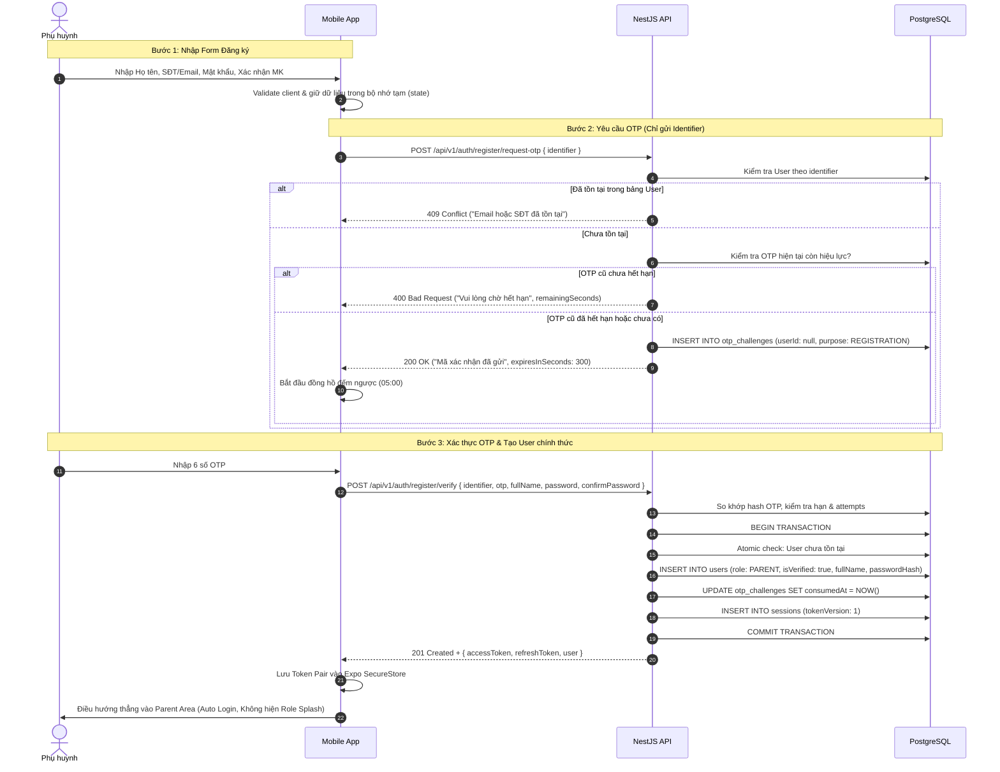
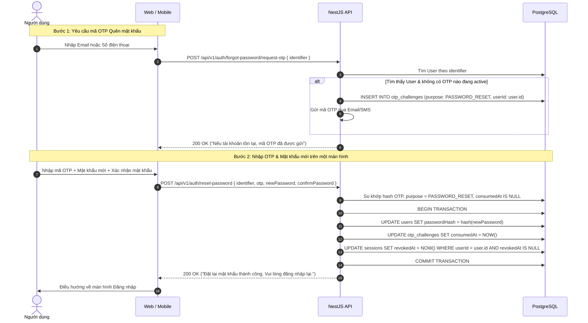

# RoadToSchool — AI Review Report: Phase 1 — Stage B Revision (Technical Design & Wireframes)

## 1. Task Information
- **Task Name**: Phase 1 — Authentication & Account Access: Stage B Revision (Technical Design & Wireframes)
- **Date**: 2026-10-22
- **Project Scope**: Architecture, Database Schema, API Contracts, UI/UX Wireframes
- **Task Type**: Technical Design Revision & Architectural Refinement
- **Status**: WAITING_APPROVAL (Tuyệt đối KHÔNG viết mã nguồn, KHÔNG sửa Schema thực tế, KHÔNG chạy Migration, KHÔNG seed dữ liệu)

---

## 2. Approved Changes Summary
Các quyết định kiến trúc và nghiệp vụ mới đã được Product Owner chính thức phê duyệt (APPROVED):

1. **Chặn trùng lặp tài khoản (Block Duplicate Users) & Không tạo User trước khi xác minh OTP**:
   - Chỉ được phép yêu cầu OTP khi Email hoặc Phone chưa từng tồn tại trong bảng `User`.
   - **Loại bỏ hoàn toàn logic tạo User với `isVerified = false` khi người dùng vừa gửi Form đăng ký**. Nếu người dùng đóng app khi chưa nhập OTP, không có bản ghi User rác nào được lưu lại trong DB.
   - Khi xác thực OTP thành công tại `POST /auth/register/verify`, User mới chính thức được tạo trong Database với `role: PARENT` và `isVerified: true`.
2. **Loại bỏ hoàn toàn Reset Token — Xác thực trực tiếp qua OTP (OTP-Only Authorization)**:
   - Xóa bỏ toàn bộ khái niệm Reset Token (không dùng JWT Reset Token, không dùng Random Token Hash, không có endpoint cấp Reset Token trung gian).
   - Nghiệp vụ đặt lại mật khẩu gửi trực tiếp `{ identifier, otp, newPassword, confirmPassword }` tại `POST /auth/reset-password`.
3. **Quy tắc gửi lại OTP mới — Chờ hết hạn thay vì đếm lượt (No Resend Count)**:
   - Loại bỏ các trường `resendCount` và `maxResends`.
   - Người dùng chỉ được phép yêu cầu cấp OTP mới khi mã OTP hiện tại **đã hết hạn hiệu lực** (TTL = 300s). Nếu OTP cũ còn hạn, Backend từ chối và trả về số giây còn lại để Frontend đếm ngược.
4. **Bổ sung `avatarUrl` vào bảng `User`**:
   - Thêm trường `avatarUrl String? @map("avatar_url")`, cho phép nullable, không bắt buộc khi đăng ký, không làm tính năng upload trong Auth Phase.
5. **Phân phối Token qua Response Body cho cả Web và Mobile**:
   - Cả Web và Mobile nhận cặp `{ accessToken, refreshToken, user }` qua HTTP Response Body (tạm thời không sử dụng Cookie trong Phase này).
   - Web lưu trữ tập trung tại `localStorage`.
   - Mobile lưu trữ tại `Expo SecureStore` (không dùng AsyncStorage).
6. **Xoay vòng toàn bộ cặp Token (Rotate the Entire Token Pair)**:
   - Bổ sung trường `tokenVersion` vào bảng `Session` và claim `ver` trong Access Token JWT.
   - Khi refresh token thành công, `tokenVersion` tăng lên 1, Refresh Token mới được cấp -> **Cả Access Token cũ và Refresh Token cũ đều mất hiệu lực tức thì**.
7. **Script khởi tạo System Admin độc lập**:
   - Chuyển logic khởi tạo Admin thành script độc lập tại `api/scripts/seed-admin.ts` (lệnh `npm run db:seed:admin`), tách biệt hoàn toàn khỏi NestJS application bootstrap.
   - Bắt buộc đọc từ biến môi trường `BOOTSTRAP_ADMIN_EMAIL` và `BOOTSTRAP_ADMIN_PASSWORD`, báo lỗi ngay nếu thiếu, không hardcode mật khẩu fallback.

---

## 3. Những nội dung thiết kế cũ đã bị thay thế (Replaced Old Designs)

| Nội dung cũ (Stage B ban đầu) | Nội dung mới thay thế (Stage B Revision) | Lý do thay đổi |
|---|---|---|
| Tạo tài khoản `User` với `isVerified = false` ngay khi gửi Registration Form. | **Chưa xác thực OTP thì tuyệt đối chưa tạo User**. Chỉ tạo User khi OTP hợp lệ. | Ngăn ngừa spam dữ liệu rác trong bảng `User` khi người dùng bỏ dở đăng ký. |
| Nếu User tồn tại mà `isVerified = false`, cho phép ghi đè thông tin khi đăng ký lại. | **Không bao giờ ghi đè User hiện có**. Nếu email/phone đã có trong `User` thì từ chối đăng ký ngay từ bước request OTP. | Bảo vệ tính toàn vẹn dữ liệu, tránh tấn công chiếm quyền hoặc ghi đè tài khoản. |
| Luồng Reset Password 2 bước qua `resetToken` trung gian (hash trong `OtpChallenge`). | **Bỏ hoàn toàn Reset Token**. Nhập OTP và mật khẩu mới cùng lúc gửi lên `POST /auth/reset-password`. | Đơn giản hóa kiến trúc, loại bỏ bảng/cột thừa, tối ưu trải nghiệm người dùng. |
| Giới hạn tổng lượt gửi lại OTP bằng `resendCount` và `maxResends = 3`. | **Không giới hạn tổng lượt resend**, chỉ cho phép gửi lại khi mã OTP cũ đã hết hạn (`expiresAt <= NOW()`). | Đơn giản, tự nhiên theo chu kỳ thời gian (5 phút), tránh khóa vĩnh viễn người dùng vô ý. |
| Refresh Token chỉ xoay Refresh Token; Web dùng HttpOnly Cookie. | **Xoay vòng cả cặp Token** qua `tokenVersion`. Cả Web & Mobile đều nhận Token qua Response Body. | Đảm bảo Access Token cũ mất hiệu lực ngay; đồng bộ kiến trúc lưu trữ giữa Web và Mobile. |
| Seed script System Admin nằm trong `api/src/bootstrap/`. | Chuyển thành script độc lập tại `api/scripts/seed-admin.ts`. | Tách biệt hoàn toàn việc vận hành thủ công với mã nguồn runtime của ứng dụng. |

---

## 4. Updated Database Schema Proposal (Prisma Specification)

```prisma
// ==========================================
// ENUMS
// ==========================================

enum Role {
  SYSTEM_ADMIN
  SCHOOL_ADMIN
  DRIVER
  BUS_ATTENDANT
  PARENT
}

enum OtpPurpose {
  PARENT_REGISTRATION
  PASSWORD_RESET
}

enum DeliveryChannel {
  EMAIL
  SMS
}

// ==========================================
// MODELS
// ==========================================

/// Bảng người dùng dùng chung cho toàn bộ 5 Roles
model User {
  id           String    @id @default(uuid())
  email        String?   @unique
  phone        String?   @unique
  fullName     String    @map("full_name")
  passwordHash String    @map("password_hash")
  role         Role
  avatarUrl    String?   @map("avatar_url")
  isVerified   Boolean   @default(true) @map("is_verified")
  isActive     Boolean   @default(true) @map("is_active")
  createdAt    DateTime  @default(now()) @map("created_at")
  updatedAt    DateTime  @updatedAt @map("updated_at")

  sessions      Session[]
  otpChallenges OtpChallenge[]

  @@map("users")
}

/// Bảng quản lý phiên đăng nhập đa thiết bị và xoay vòng toàn bộ Token Pair
model Session {
  id               String    @id @default(uuid())
  userId           String    @map("user_id")
  refreshTokenHash String    @map("refresh_token_hash")
  tokenVersion     Int       @default(1) @map("token_version")
  deviceInfo       String?   @map("device_info")
  ipAddress        String?   @map("ip_address")
  expiresAt        DateTime  @map("expires_at")
  revokedAt        DateTime? @map("revoked_at")
  createdAt        DateTime  @default(now()) @map("created_at")
  updatedAt        DateTime  @updatedAt @map("updated_at")

  user User @relation(fields: [userId], references: [id], onDelete: Cascade)

  @@index([userId])
  @@index([expiresAt])
  @@index([revokedAt])
  @@map("sessions")
}

/// Bảng quản lý thử thách OTP trực tiếp
model OtpChallenge {
  id          String          @id @default(uuid())
  userId      String?         @map("user_id") // Nullable: Khi đăng ký, User chưa tồn tại trong DB
  identifier  String
  channel     DeliveryChannel
  purpose     OtpPurpose
  otpHash     String          @map("otp_hash")
  attempts    Int             @default(0)
  maxAttempts Int             @default(5) @map("max_attempts")
  expiresAt   DateTime        @map("expires_at")
  consumedAt  DateTime?       @map("consumed_at")
  createdAt   DateTime        @default(now()) @map("created_at")
  updatedAt   DateTime        @updatedAt @map("updated_at")

  user User? @relation(fields: [userId], references: [id], onDelete: Cascade)

  @@index([identifier, purpose])
  @@index([expiresAt])
  @@map("otp_challenges")
}
```

### Ràng buộc & Đặc tính kỹ thuật:
- **Identifier Check Constraint**: SQL migration sẽ bổ sung `CHECK (email IS NOT NULL OR phone IS NOT NULL)`.
- **Quan hệ `OtpChallenge.userId` Nullable**: Khi đăng ký tài khoản Phụ huynh, `userId` là `null` do người dùng chưa tồn tại trong DB. Khi quên mật khẩu, `userId` được liên kết với User.

---

## 5. Updated API Contracts (9 Endpoints Chuẩn hóa)

| # | Phương thức | Endpoint | Actor | Mô tả tóm tắt |
|---|---|---|---|---|
| 1 | `POST` | `/api/v1/auth/web/login` | `SYSTEM_ADMIN`, `SCHOOL_ADMIN` | Đăng nhập Quản trị Web, trả Token Pair qua Response Body. |
| 2 | `POST` | `/api/v1/auth/mobile/login` | `DRIVER`, `BUS_ATTENDANT`, `PARENT` | Đăng nhập Mobile, trả Token Pair qua Response Body. |
| 3 | `POST` | `/api/v1/auth/register/request-otp` | Public | Yêu cầu mã OTP đăng ký Phụ huynh (chưa tạo User). |
| 4 | `POST` | `/api/v1/auth/register/verify` | Public | Xác thực OTP, tạo User, cấp Token Pair (Auto Login). |
| 5 | `POST` | `/api/v1/auth/forgot-password/request-otp` | Public | Yêu cầu mã OTP quên mật khẩu (Anti-enumeration response). |
| 6 | `POST` | `/api/v1/auth/reset-password` | Public | Xác thực OTP & đổi mật khẩu trực tiếp, thu hồi tất cả Sessions. |
| 7 | `POST` | `/api/v1/auth/refresh` | Public / Session | Xoay vòng cả cặp Token (tăng `tokenVersion`, cấp Token Pair mới). |
| 8 | `GET` | `/api/v1/auth/me` | Authenticated | Lấy profile người dùng, kiểm tra `tokenVersion` và Session hiệu lực. |
| 9 | `POST` | `/api/v1/auth/logout` | Authenticated | Thu hồi phiên hiện tại (`revokedAt = NOW()`). |

*Chi tiết toàn bộ Request/Response DTOs, logic nghiệp vụ và mã lỗi đã được đồng bộ trong [docs/architecture/auth-technical-design.md](file:///c:/Users/chuon/Documents/work/road-to-school-v2/docs/architecture/auth-technical-design.md#L148-L387).*

---

## 6. Updated Registration Flow (Chưa xác minh OTP thì chưa tạo User)



---

## 7. Updated Forgot / Reset Password Flow (OTP-Only Authorization)



---

## 8. Updated OTP Resend Rules & Rate Limiting

- **Loại bỏ giới hạn số lần**: Bỏ hoàn toàn các trường `resendCount` và `maxResends`.
- **Cơ chế chờ hết hạn (Expiration-based Cooldown)**:
  - Khi người dùng gửi yêu cầu phát OTP tại `request-otp`: Nếu bảng `otp_challenges` có bản ghi chưa `consumed` và có `expiresAt > NOW()`, request bị từ chối với mã `400 Bad Request`.
  - Response trả về trường `remainingSeconds = Math.ceil((expiresAt - now) / 1000)`.
  - Frontend sử dụng `remainingSeconds` để chạy đồng hồ đếm ngược. Nút "Gửi lại mã" bị disable và chỉ cho phép bấm lại khi đồng hồ về `00:00`.
- **Chống Brute-force**:
  - Tối đa 5 lần nhập sai (`maxAttempts = 5`). Nếu nhập sai 5 lần, bản ghi OTP lập tức bị khóa (`consumedAt = NOW()`), vô hiệu hóa hoàn toàn mã này.

---

## 9. Updated JWT & Token Pair Rotation Strategy

### 9.1. Cấu trúc Token Payload
- **Access Token (15 phút)**:
  ```json
  {
    "sub": "user-uuid-v4",
    "role": "SYSTEM_ADMIN",
    "sid": "session-uuid-v4",
    "ver": 1,
    "iat": 1729584000,
    "exp": 1729584900
  }
  ```
- **Refresh Token (7 ngày)**: Chuỗi ngẫu nhiên 64-hex mã hóa an toàn bằng `crypto.randomBytes(32).toString('hex')`. Chỉ lưu bản băm SHA-256 trong Database.

### 9.2. Cơ chế Xoay vòng Toàn bộ Cặp Token
1. Khi gọi `POST /api/v1/auth/refresh` với `refreshToken`:
   - Kiểm tra hash refresh token trong DB.
   - Kiểm tra `revokedAt IS NULL` và `expiresAt > NOW()`.
2. **Cập nhật nguyên tử**:
   - Tăng `tokenVersion = tokenVersion + 1`.
   - Sinh Refresh Token mới, cập nhật `refreshTokenHash` mới.
   - Sinh Access Token mới mang `ver: session.tokenVersion`.
3. **Hiệu lực vô hiệu hóa tức thì**:
   - Refresh Token cũ: Bị thay thế bằng hash mới trong DB -> Không thể dùng lại.
   - Access Token cũ: Bất kỳ request nào mang Access Token cũ (chứa `ver` cũ) sẽ bị `AuthGuard` phát hiện không khớp với `session.tokenVersion` trong DB -> Từ chối ngay lập tức `401 Unauthorized`.
4. **Kiểm soát Race Condition phía Client**:
   - Frontend thiết lập cơ chế khóa đơn lẻ (`refreshPromise` mutex) để khi nhiều component gọi API đồng thời lúc token hết hạn, chỉ có đúng 1 request refresh được thực thi; các request khác đợi token mới để retry.

---

## 10. Updated Web & Mobile Token Storage

- **Web Storage**:
  - Lưu cặp Token trong `localStorage` (`r2s_access_token`, `r2s_refresh_token`).
  - *Rủi ro & Biện pháp giảm thiểu*: Lưu trong `localStorage` có rủi ro bị tấn công XSS. Giảm thiểu bằng cách: Áp dụng Content Security Policy (CSP), sanitize toàn bộ HTML input/output qua React DOM, không dùng `dangerouslySetInnerHTML`.
- **Mobile Storage**:
  - Lưu cặp Token trong `Expo SecureStore` (mã hóa cấp phần cứng qua Keychain trên iOS và Keystore/EncryptedSharedPreferences trên Android).
  - Tuyệt đối không lưu token trong `AsyncStorage`.
- **Đồng bộ hóa**: Cả Web và Mobile đều nhận cùng một schema Response Body từ API, đơn giản hóa tối đa logic xử lý.

---

## 11. Updated UI Wireframes (Minimal UI Copy)

### 11.1. Web Wireframes
- **Screen W1 (Đăng nhập Quản trị)**: Form đăng nhập tối giản (Email/SĐT, Mật khẩu, Nút Đăng nhập Primary `#FFCB56`).
- **Screen W2 (Quên mật khẩu & Đặt lại mật khẩu — 2 Bước)**:
  - Bước 1: Nhập Email/SĐT -> Nút "Gửi mã".
  - Bước 2: Nhập Mã xác nhận (kèm đồng hồ đếm ngược `04:59`), Mật khẩu mới, Xác nhận mật khẩu -> Nút "Hoàn tất".
- **Screen W3 (Web Role Splash Screens)**: Hiển thị 1.2s sau khi submit login form thành công (`SYSTEM_ADMIN`, `SCHOOL_ADMIN`).

### 11.2. Mobile Wireframes
- **Screen M1 (App Splash)**: Chỉ chứa Logo RoadToSchool, nền `#FFFDF6`.
- **Screen M2 (Mobile Login)**: Đăng nhập tối giản dành cho Tài xế, Giáo viên phụ trách, Phụ huynh.
- **Screen M3 (Đăng ký Phụ huynh)**: Nhập Họ tên, chọn SĐT/Email, Mật khẩu, Xác nhận mật khẩu -> Nút "Tiếp tục".
- **Screen M4 (Nhập mã xác nhận OTP)**: Nhập 6 ô số, hiển thị countdown gửi lại (chỉ bấm được khi đồng hồ về `00:00`). Nhập đúng -> Auto login vào ứng dụng.
- **Screen M5 (Mobile Role Splashes)**: Hiển thị 1.2s sau khi đăng nhập thủ công (`DRIVER`, `BUS_ATTENDANT`, `PARENT`).

*Chi tiết toàn bộ ASCII Wireframes đã được cập nhật trực quan tại [docs/architecture/auth-technical-design.md#L388-L586](file:///c:/Users/chuon/Documents/work/road-to-school-v2/docs/architecture/auth-technical-design.md#L388-L586).*

---

## 12. Independent Admin Seed Script Proposal

- **Vị trí**: `api/scripts/seed-admin.ts`.
- **Lệnh npm**: `npm run db:seed:admin`.
- **Cấu hình biến môi trường**:
  - `BOOTSTRAP_ADMIN_EMAIL=admin@r2s.com`
  - `BOOTSTRAP_ADMIN_PASSWORD=Pass@123`
- **Tính an toàn**:
  - Nếu thiếu một trong hai biến môi trường trên, script ném lỗi rõ ràng và dừng lại ngay lập tức. Không có mật khẩu mặc định hardcoded trong source code.
  - Script độc lập với luồng chạy `npm run start:dev` của NestJS, chỉ chạy thủ công khi cần.
  - Tính Idempotent: Kiểm tra trước qua `prisma.user.findUnique`, nếu đã có tài khoản admin thì bỏ qua, không sửa mật khẩu hay role.

---

## 13. Security Considerations

1. **Phòng chống User Enumeration**: Endpoint Quên mật khẩu luôn trả về `200 OK` với thông điệp trung tính dù tài khoản có tồn tại hay không.
2. **Atomic Verification**: Xác thực OTP, tạo User/đổi Password và thu hồi Sessions đều được bọc trong Prisma Interactive Transaction (`prisma.$transaction`).
3. **Phòng chống Brute-force OTP**: Giới hạn 5 lần nhập sai và thời hạn 5 phút.
4. **Vô hiệu hóa tức thì cả 2 Token**: `tokenVersion` trong `Session` bảo đảm Access Token cũ bị vô hiệu ngay khi token pair được xoay vòng.

---

## 14. Unresolved Questions (PROPOSED)

Các đề xuất dưới đây ở trạng thái **PROPOSED**, chờ ý kiến của Product Owner:

1. **Hiển thị Avatar Placeholder**:
   - *Đề xuất*: Khi `avatarUrl` là `null`, UI hiển thị chữ cái đầu tiên của Họ tên trên nền màu Primary `#FFCB56`.
2. **Thời lượng hiệu ứng Role Splash**:
   - *Đề xuất*: Cố định 1.2 giây kèm hiệu ứng mờ dần (fade out 300ms).

---

## 15. Reviewer Focus Checklist

AI Reviewer độc lập cần kiểm tra các điểm cốt lõi sau:
- [ ] Logic đăng ký có đảm bảo **chưa xác minh OTP thì chưa tạo User** không?
- [ ] Đã xóa hoàn toàn Reset Token khỏi Prisma Schema, API Contracts và DTOs chưa?
- [ ] Cơ chế Resend OTP đã chuyển sang quy tắc chờ hết hạn (`expiresAt <= NOW()`) và bỏ các trường đếm lượt chưa?
- [ ] Bảng `User` đã bổ sung `avatarUrl` (nullable) chưa?
- [ ] Cả Web và Mobile đã chuyển sang nhận Token Pair qua HTTP Response Body chưa?
- [ ] Cơ chế `tokenVersion` có đảm bảo vô hiệu hóa tức thì cả Access Token và Refresh Token cũ sau khi refresh không?
- [ ] Script Seed Admin đã được chuyển ra thư mục độc lập `api/scripts/seed-admin.ts` chưa?

---

## 16. Proposed Implementation Plan (Stage C Sẵn sàng)

Sau khi Product Owner phê duyệt Stage B Revision:
1. **Bước 1 — Prisma Schema & Migration**: Cập nhật `api/prisma/schema.prisma` và chạy `npx prisma migrate dev --name init_auth_tables`.
2. **Bước 2 — Independent Admin Seed Script**: Tạo `api/scripts/seed-admin.ts` và thêm script `"db:seed:admin"` vào `api/package.json`.
3. **Bước 3 — Backend Auth Module**: Triển khai `AuthService`, `AuthController`, `AuthGuard`, `OtpService`, DTOs và đồng bộ Swagger trên `/api/docs`.
4. **Bước 4 — Web Authentication**: Xây dựng Form Login, Quên mật khẩu, Auth Store và Role Splash trên Next.js.
5. **Bước 5 — Mobile Authentication**: Xây dựng App Splash, Login, Đăng ký Phụ huynh, OTP Verification và Role Splash trên Expo.

---

## 17. Git Diff Notice
```text
# No application code changes for Stage B Revision.
# Scope: Architecture, Prisma Schema Proposal, API Contract Specification, UI Wireframes Revision.
# Application code in api/, web/, and mobile/ remains clean and untouched.
```
- **TRẠNG THÁI HIỆN TẠI**: DỪNG LẠI VÀ CHỜ PHÊ DUYỆT STAGE C.
