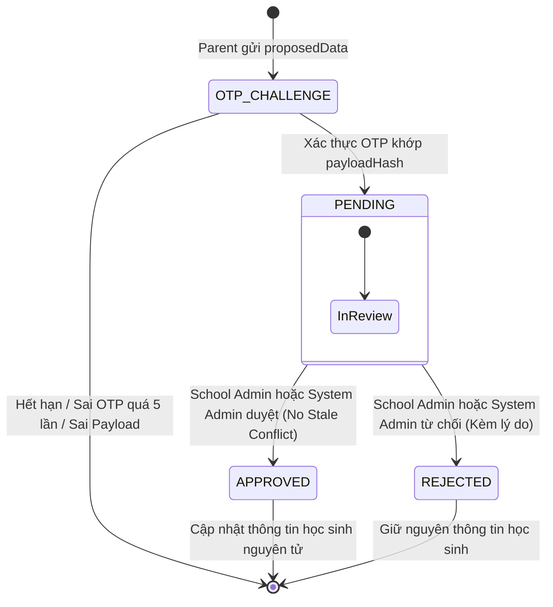

# RoadToSchool — AI Review Report
# Phạm vi: Account Settings, Vehicle Management & Student Update Requests
# Giai đoạn: Round 2/3 — Complete Database & Backend Implementation

> **Thời gian báo cáo**: 23/10/2026 18:20  
> **Người thực hiện**: Senior Backend Engineer, Database Architect, Security Engineer & Integration QA Engineer  
> **Trạng thái**: Hoàn thành toàn diện Database & Backend (Round 2/3 Done — Ready for Round 3 Web/Mobile UI)  
> **Bản vá đính kèm**: [docs/ai-review/LATEST.diff](file:///c:/Users/chuon/Documents/work/road-to-school-v2/docs/ai-review/LATEST.diff)  
> **Tài liệu kiến trúc chính**: [account-vehicle-student-requests-plan.md](file:///c:/Users/chuon/Documents/work/road-to-school-v2/docs/architecture/account-vehicle-student-requests-plan.md)  
> **Tài liệu tham chiếu**: [BUSINESS_CONTEXT.md](file:///c:/Users/chuon/Documents/work/road-to-school-v2/docs/BUSINESS_CONTEXT.md), [WORKING_RULES.md](file:///c:/Users/chuon/Documents/work/road-to-school-v2/docs/WORKING_RULES.md)

---

### A. Executive Summary

1. **Một đợt triển khai duy nhất (One-Round Execution)**: Đã hoàn thành 100% cơ sở dữ liệu và mã nguồn Backend cho toàn bộ phạm vi:
   - Cài đặt tài khoản (Đổi mật khẩu, tải lên Avatar Cloudinary với magic bytes validation, Phụ huynh đổi tên hiển thị).
   - Quản lý cấu hình bãi đỗ xe trung tâm duy nhất của nhà xe (VietMap tọa độ WGS-84).
   - Quản lý phương tiện vận tải (Hãng xe, Biển số chuẩn hóa Unique, Màu sắc, và **Năng lực chở học sinh `seatCount`**).
   - Luồng yêu cầu cập nhật thông tin học sinh (`INFORMATION_UPDATE`) và địa chỉ học sinh (`ADDRESS_UPDATE`).
   - Xác thực OTP bảo mật cao: Ràng buộc chặt chẽ ParentId, StudentId, SĐT người giám hộ hiện tại, và mã băm Canonical SHA-256 của Payload đề xuất (`payloadHash`).
   - Hệ thống quản lý và xét duyệt yêu cầu đa vai trò (Parent, School Admin, System Admin).
   - Cơ chế phát hiện và ngăn chặn xung đột dữ liệu cũ (**Stale Data Conflict Prevention - 409 Conflict**) và cập nhật trực tiếp địa chỉ bởi School Admin.
   - Chính sách quyết định duy nhất (**One Valid Decision Is Sufficient Policy**) đảm bảo an toàn tuyệt đối khi School Admin và System Admin cùng xử lý đồng thời.
2. **Không chạm Web / Mobile**: Tuân thủ tuyệt đối quy định phân chia giai đoạn — không sửa đổi bất kỳ tệp tin nào trong `web/` hoặc `mobile/`.
3. **Chất lượng kiểm thử & Kiểm chứng**:
   - `vitest`: **21 test suites / 201 tests PASSED 100%**.
   - `build`: `nest build` thành công 100% với 0 lỗi TypeScript.
   - `integration`: Kịch bản kiểm thử HTTP trực tiếp trên Live Server và Local PostgreSQL thành công 100%.
   - `swagger`: Đồng bộ đầy đủ 18 endpoint mới bằng tiếng Việt chuẩn mực tại `http://localhost:3000/api/docs`.

---

### B. Approved Business Rules

Toàn bộ 12 quyết định nghiệp vụ đã được Product Owner chính thức phê duyệt được triển khai triệt để:

| STT | Quyết định nghiệp vụ | Hiện thực hóa tại Backend |
| :--- | :--- | :--- |
| **1.1** | **Bãi xe trung tâm** | Bảng `system_settings` với key `PARKING_LOT`, singleton identifier `default`. Chỉ `SYSTEM_ADMIN` có quyền cập nhật `PUT`. |
| **1.2** | **Vehicle Capacity (`seatCount`)** | **`seatCount` là số lượng ghế khả dụng để chở HỌC SINH trên phương tiện.** KHÔNG bao gồm ghế tài xế hay ghế nhân sự/giám sát viên. Backend lưu và trả về chính xác số lượng này, không tự động cộng/trừ bất kỳ ghế nào. |
| **1.3** | **One Valid Decision** | Yêu cầu `ADDRESS_UPDATE` được gửi tới cả School Admin và System Admin. Bất kỳ bên nào duyệt/từ chối trước sẽ chốt kết quả; bên còn lại bị từ chối với `409 Conflict`. |
| **1.4** | **Pending Request Uniqueness** | Mỗi học sinh chỉ có tối đa 1 yêu cầu `PENDING` cho mỗi loại (`INFORMATION_UPDATE` và `ADDRESS_UPDATE`). Bảo vệ 2 lớp: kiểm tra logic và PostgreSQL Partial Unique Index `WHERE status = 'PENDING'`. |
| **1.5** | **Disabled Student** | Học sinh `DISABLED` không thể tạo yêu cầu mới hoặc được phê duyệt (`400 Bad Request`). Admin chỉ có thể từ chối (`REJECT`). |
| **1.6** | **Stale Data Policy** | Nếu dữ liệu học sinh hiện tại khác `beforeData` lúc tạo yêu cầu: từ chối phê duyệt với `409 Conflict`, cờ `isStale: true`. Không ghi đè dữ liệu. |
| **1.7** | **Parent Link Revocation** | Phụ huynh hủy liên kết không thể xem danh sách/chi tiết yêu cầu của học sinh đó. Bản ghi yêu cầu vẫn được bảo lưu cho Admin. |
| **1.8** | **OTP Payload Binding** | OTP Challenge lưu `payloadHash` (Canonical SHA-256). Mọi hành vi sửa đổi dữ liệu đề xuất giữa bước OTP và Verify đều bị từ chối `400 Bad Request`. |
| **1.9** | **SMS Delivery** | Môi trường `development` xuất OTP ra server console an toàn. Không giả lập OTP trong production. |
| **1.10** | **Mobile Map** | Round 2 cung cấp đầy đủ API Contract cho địa chỉ và tọa độ WGS-84. Không cài đặt thư viện bản đồ UI trong Round 2. |
| **1.11** | **Password Change Sessions** | Xác minh mật khẩu cũ, băm `bcryptjs` mật khẩu mới, thu hồi tất cả các phiên khác (`id != currentSessionId`), duy trì phiên hiện tại. |
| **1.12** | **Avatar Cleanup** | Upload Cloudinary thành công -> Cập nhật Database -> Xóa ảnh cũ theo `avatarPublicId` ở chế độ non-blocking. |

---

### C. Database Schema & Migration

#### 1. Schema Extensions (`api/prisma/schema.prisma`)
- **Enums mới**:
  - `RequestType`: `INFORMATION_UPDATE`, `ADDRESS_UPDATE`.
  - `RequestStatus`: `PENDING`, `APPROVED`, `REJECTED`.
  - `OtpPurpose`: bổ sung `STUDENT_UPDATE_REQUEST`.
- **Model `User`**:
  - Bổ sung `avatarPublicId String? @map("avatar_public_id")`.
  - Quan hệ `createdRequests` và `reviewedRequests`.
- **Model `OtpChallenge`**:
  - Bổ sung `payloadHash String? @map("payload_hash")`.
- **Model `Vehicle`**:
  - `id`: UUID.
  - `brand`: VarChar(100).
  - `seatCount`: Int (**Năng lực chở học sinh**).
  - `licensePlate`: VarChar(20) Unique.
  - `normalizedPlate`: VarChar(20) Unique.
  - `color`: VarChar(50).
  - `createdAt`, `updatedAt`.
  - Index: `@@index([brand])`.
- **Model `SystemSetting`**:
  - `id`: String Default "default".
  - `key`: VarChar(50) Unique.
  - `value`: Json.
  - `updatedById`: String?.
  - `updatedAt`: DateTime.
- **Model `StudentUpdateRequest`**:
  - `id`: UUID.
  - `studentId`: String (FK Student).
  - `parentId`: String (FK User).
  - `schoolId`: String (FK School).
  - `type`: RequestType.
  - `status`: RequestStatus (Default: PENDING).
  - `beforeData`: Json.
  - `proposedData`: Json.
  - `rejectionReason`: VarChar(500)?.
  - `reviewedById`: String? (FK User).
  - `reviewedAt`: DateTime?.
  - `createdAt`, `updatedAt`.
  - Indexes: `[schoolId, status]`, `[studentId, status]`, `[parentId, status]`, `[type, status]`, `[createdAt]`.

#### 2. Migration Execution
- Migration SQL: `api/prisma/migrations/20261023105820_add_vehicles_settings_and_update_requests/migration.sql`.
- **Partial Unique Index chống Race Condition**:
  ```sql
  CREATE UNIQUE INDEX "student_update_requests_single_pending_per_type_idx" 
  ON "student_update_requests"("student_id", "type") 
  WHERE "status" = 'PENDING';
  ```
- **Tính toàn vẹn**: Dữ liệu hiện có của Trường học, Người dùng, Học sinh, Phiên làm việc được bảo toàn 100%.

---

### D. Account Settings

1. **Đổi mật khẩu (`POST /api/v1/auth/me/change-password`)**:
   - Xác minh mật khẩu hiện tại bằng `bcrypt.compare`.
   - Ngăn chặn mật khẩu mới trùng mật khẩu cũ (`400 Bad Request`).
   - Băm mật khẩu mới bằng `bcrypt.hash` với 10 rounds.
   - Thu hồi tất cả các phiên đăng nhập khác của người dùng (`id: { not: currentSessionId }`), duy trì phiên đăng nhập hiện tại.
2. **Cập nhật Avatar (`POST /api/v1/auth/me/avatar`)**:
   - Kiểm tra dung lượng tối đa 5MB.
   - Kiểm tra MIME type: `image/jpeg`, `image/png`, `image/webp`.
   - Kiểm tra chữ ký tệp tin (Magic Bytes validation) chống giả mạo định dạng.
   - Upload Cloudinary vào thư mục `roadtoschool/avatars`.
   - Cập nhật `avatarUrl` và `avatarPublicId` vào bảng `users`.
   - Dọn dẹp `avatarPublicId` cũ ở chế độ bất đồng bộ non-blocking.
3. **Phụ huynh đổi tên hiển thị (`PATCH /api/v1/auth/me/name`)**:
   - Phân quyền nghiêm ngặt: Chỉ vai trò `PARENT` được phép. Các vai trò khác bị từ chối `403 Forbidden`.
   - Xác thực độ dài tên từ 2 đến 100 ký tự. Không cho phép sửa email, phone, role hay schoolId.

---

### E. Parking Lot

1. **Cấu hình bãi xe trung tâm duy nhất (`GET / PUT /api/v1/system-settings/parking-lot`)**:
   - Tọa độ WGS-84: `latitude` [-90, 90], `longitude` [-180, 180].
   - `addressText` không được để trống.
   - Quyền hạn: Mọi tài khoản xác thực đều có thể đọc `GET`; chỉ `SYSTEM_ADMIN` có quyền cập nhật `PUT`.
   - Hỗ trợ dữ liệu mặc định ban đầu nếu chưa từng được lưu trong cơ sở dữ liệu.

---

### F. Vehicle Management

1. **Danh sách phương tiện (`GET /api/v1/vehicles`)**:
   - Phân quyền: Chỉ `SYSTEM_ADMIN`.
   - Phân trang máy chủ (`page`, `limit`), sắp xếp ổn định `createdAt desc`.
   - Tìm kiếm Server-side theo `brand`, `licensePlate`, và `normalizedPlate`.
2. **Tạo phương tiện (`POST /api/v1/vehicles`)**:
   - Chuẩn hóa biển số xe bằng hàm `normalizeLicensePlate(plate)`: loại bỏ dấu cách, dấu gạch ngang, dấu chấm, chuyển chữ in hoa.
   - Ngăn chặn trùng lặp 2 lớp: kiểm tra trước qua `findFirst` và bắt lỗi `P2002` của PostgreSQL Unique Constraint (`normalized_plate`).
   - Trả về `409 Conflict` kèm thông báo tiếng Việt khi biển số đã tồn tại.

---

### G. Vehicle Seat Capacity Semantics

> [!IMPORTANT]
> **ĐỊNH NGHĨA CHÍNH THỨC CỦA PRODUCT OWNER**:
> **`seatCount` là số lượng ghế khả dụng để chở HỌC SINH trên phương tiện.**
> Đây KHÔNG PHẢI là tổng số ghế vật lý của xe. Không bao gồm ghế tài xế, ghế dành riêng cho phụ xe (BUS_ATTENDANT), giáo viên hay nhân sự giám sát.

- **Nguyên tắc triển khai Backend**:
  1. Người quản trị nhập trực tiếp số ghế học sinh trên giao diện.
  2. Backend nhận giá trị `seatCount`, kiểm tra là số nguyên dương (`IsInt()`, `Min(1)`).
  3. Backend **LƯU TRỮ VÀ PHẢN HỒI ĐÚNG NGUYÊN GIÁ TRỊ ĐÓ**, tuyệt đối không tự ý trừ đi 1 ghế tài xế hay ghế phụ xe.
  4. Không tự động tính toán `seatCount` dựa trên số học sinh đã phân công.
  5. Swagger Contract mô tả rõ ràng: *"Số lượng ghế khả dụng dành cho học sinh, không bao gồm ghế tài xế và các ghế dành riêng cho nhân sự."*
  6. Ví dụ kiểm thử: Xe 16 chỗ vật lý, 1 tài xế, 1 phụ xe -> Khai báo `seatCount = 14` -> Cơ sở dữ liệu lưu `seatCount = 14` -> API trả về `seatCount = 14`.

---

### H. Student Update Request Model



- **Snapshots**:
  - `beforeData`: Chụp lại chính xác trạng thái của các trường tương ứng tại thời điểm tạo yêu cầu.
  - `proposedData`: Lưu trữ dữ liệu mới đã vượt qua xác thực OTP.
  - `INFORMATION_UPDATE`: Chụp `{ fullName, guardianPhone }`.
  - `ADDRESS_UPDATE`: Chụp `{ addressText, latitude, longitude }`.

---

### I. OTP Security & Payload Binding

1. **Ràng buộc ngữ cảnh toàn diện**:
   - Mã OTP được ràng buộc đồng thời với: `parentId`, `studentId`, `identifier` (SĐT người giám hộ HIỆN TẠI của học sinh), `purpose: STUDENT_UPDATE_REQUEST`, `payloadHash`, thời gian hết hạn (5 phút), và giới hạn 5 lần thử.
2. **Thuật toán tạo `payloadHash` chuẩn tắc (Canonical SHA-256)**:
   - Trích xuất các trường hợp lệ theo loại yêu cầu.
   - Sắp xếp các khóa (keys) theo thứ tự bảng chữ cái để đảm bảo tính tất định.
   - Chuỗi hóa JSON và băm SHA-256.
   - Khi verify, hàm tính toán lại hash từ payload gửi lên và đối chiếu với hash lưu trong `OtpChallenge`. Bất kỳ sự sai lệch nào đều bị từ chối ngay lập tức.
3. **Gửi OTP đến đúng số điện thoại**:
   - Tuyệt đối không gửi OTP tới số điện thoại mới đề xuất trong payload.
   - OTP luôn gửi tới số điện thoại giám hộ hiện tại của học sinh được lưu trong bảng `students`.

---

### J. Parent APIs

1. `POST /api/v1/parents/students/:id/update-requests/otp`:
   - Kiểm tra liên kết `ParentStudentLink` và học sinh `AVAILABLE`.
   - Kiểm tra dữ liệu đề xuất có sự thay đổi thực sự.
   - Kiểm tra quy tắc duy nhất một yêu cầu `PENDING` cho mỗi loại.
   - Tạo OTP challenge với `payloadHash` và trả về `challengeId`, `maskedPhone`.
2. `POST /api/v1/parents/students/:id/update-requests/verify`:
   - Xác thực OTP, so sánh `payloadHash`.
   - Tiêu thụ OTP (`consumedAt = now()`).
   - Chụp `beforeData` snapshot và tạo `StudentUpdateRequest` ở trạng thái `PENDING`.
3. `GET /api/v1/parents/students/:id/update-requests`:
   - Xem danh sách yêu cầu của học sinh do mình quản lý. Hỗ trợ lọc theo `type`, `status`, phân trang máy chủ.
4. `GET /api/v1/parents/update-requests/:requestId`:
   - Xem chi tiết yêu cầu. Kiểm tra quyền sở hữu và xác nhận liên kết Phụ huynh - Học sinh vẫn còn hiệu lực.

---

### K. School Admin APIs

1. `GET /api/v1/schools/:schoolId/update-requests`:
   - Danh sách yêu cầu thuộc trường. Tìm kiếm học sinh theo tên/mã, lọc `type`, `status`, phân trang.
   - Đảm bảo School Isolation: Chỉ quản trị viên của trường mới được truy vấn.
2. `GET /api/v1/schools/:schoolId/students/:id/update-requests`:
   - Truy vấn toàn bộ lịch sử yêu cầu của một học sinh cụ thể thuộc trường.
3. `GET /api/v1/schools/:schoolId/update-requests/:requestId`:
   - Xem chi tiết yêu cầu kèm dữ liệu học sinh hiện tại (`currentStudentData`) và cờ cảnh báo `isStale`.
4. `POST /api/v1/schools/:schoolId/update-requests/:requestId/approve`:
   - Phê duyệt cả `INFORMATION_UPDATE` và `ADDRESS_UPDATE`.
   - Kiểm tra trạng thái `PENDING`, học sinh `AVAILABLE`, và không có xung đột dữ liệu cũ (`No Stale Conflict`).
   - Cập nhật thông tin học sinh và trạng thái yêu cầu nguyên tử.
5. `POST /api/v1/schools/:schoolId/update-requests/:requestId/reject`:
   - Từ chối yêu cầu `PENDING` kèm lý do tùy chọn. Không làm thay đổi dữ liệu học sinh.
6. `PATCH /api/v1/schools/:schoolId/students/:id/address`:
   - School Admin cập nhật trực tiếp địa chỉ và tọa độ học sinh trường mình khi học sinh `AVAILABLE`.

---

### L. System Admin APIs

1. `GET /api/v1/system-admin/update-requests`:
   - **Bảo mật quyền riêng tư**: Danh sách CHỈ TRẢ VỀ các yêu cầu loại `ADDRESS_UPDATE`. Tuyệt đối không rò rỉ `INFORMATION_UPDATE`.
   - Tìm kiếm theo tên học sinh, mã học sinh, tên trường; lọc `status`, phân trang.
2. `GET /api/v1/system-admin/update-requests/:requestId`:
   - Xem chi tiết yêu cầu cập nhật địa chỉ kèm phát hiện Stale Data. Từ chối nếu yêu cầu thuộc loại `INFORMATION_UPDATE`.
3. `POST /api/v1/system-admin/update-requests/:requestId/approve`:
   - Phê duyệt yêu cầu `ADDRESS_UPDATE`. Không có quyền phê duyệt `INFORMATION_UPDATE`.
4. `POST /api/v1/system-admin/update-requests/:requestId/reject`:
   - Từ chối yêu cầu `ADDRESS_UPDATE` kèm lý do.

---

### M. Concurrency & Stale Data

1. **Chính sách One Valid Decision Is Sufficient**:
   - Khi cả School Admin và System Admin cùng mở xem một yêu cầu `ADDRESS_UPDATE`, bên nào thực hiện quyết định hợp lệ đầu tiên sẽ chốt kết quả trong cơ sở dữ liệu.
   - Thao tác của bên thứ hai thực thi sau sẽ nhận được lỗi `409 Conflict` ("Yêu cầu này đã được xử lý trước đó bởi quản trị viên khác").
2. **Chính sách ngăn chặn ghi đè dữ liệu cũ (Stale Data Policy)**:
   - Nếu trong thời gian yêu cầu đang `PENDING`, School Admin cập nhật trực tiếp địa chỉ hoặc thông tin học sinh:
   - Khi phê duyệt yêu cầu, hệ thống so sánh `request.beforeData` với dữ liệu hiện tại trong bảng `students`.
   - Nếu phát hiện không khớp: Lập tức chặn thao tác với `409 Conflict` ("Dữ liệu học sinh hiện tại đã thay đổi so với thời điểm gửi yêu cầu. Không thể phê duyệt").
   - Giao diện Admin có cờ `isStale = true` để hiển thị cảnh báo đỏ và hướng dẫn Admin từ chối yêu cầu cũ.
3. **Chống Race Condition khi tạo PENDING**:
   - PostgreSQL Partial Unique Index: `UNIQUE ("student_id", "type") WHERE "status" = 'PENDING'`.
   - Mọi nỗ lực gửi đồng thời nhiều yêu cầu cùng loại đều bị chặn an toàn ở tầng Database với lỗi `P2002` được chuyển đổi thành `409 Conflict`.

---

### N. Role & School Isolation

- **Role Isolation**:
  - `PARENT`: Chỉ tạo request, xem request của con mình, đổi tên tài khoản chính mình.
  - `SCHOOL_ADMIN`: Chỉ quản trị học sinh và yêu cầu thuộc `schoolId` của mình. Bị chặn khi cố gắng đổi tên tài khoản qua API me.
  - `SYSTEM_ADMIN`: Quản lý bãi xe, phương tiện. Với update requests, CHỈ có quyền xem và xử lý `ADDRESS_UPDATE`, tuyệt đối không có quyền can thiệp vào `INFORMATION_UPDATE`.
  - `DRIVER` / `BUS_ATTENDANT`: Không có quyền truy cập vào các API xét duyệt yêu cầu hay quản lý phương tiện.
- **School Isolation**:
  - Mọi endpoint của School Admin đều có hàm kiểm tra `checkSchoolIsolation(user, schoolId)` nghiêm ngặt, từ chối `403 Forbidden` nếu `user.schoolId !== schoolId`.

---

### O. Database Query Performance

- Toàn bộ các thao tác lọc (`schoolId`, `studentId`, `type`, `status`) và tìm kiếm (`fullName`, `code`, `licensePlate`) đều được thực thi trực tiếp tại tầng Database qua Prisma `where`.
- Phân trang chuẩn máy chủ với `skip` và `take` kết hợp `Promise.all([count, findMany])` song song, không tải toàn bộ bản ghi lên bộ nhớ rồi lọc.
- Thiết lập đầy đủ Indexes: `[schoolId, status]`, `[studentId, status]`, `[parentId, status]`, `[type, status]`, `[createdAt]`, `[normalizedPlate]`.

---

### P. Swagger Contracts

Đã cập nhật toàn bộ decorators, DTO descriptions, ví dụ minh họa và mã phản hồi bằng tiếng Việt chuẩn mực tại `http://localhost:3000/api/docs`:
- `POST /api/v1/auth/me/change-password`
- `POST /api/v1/auth/me/avatar`
- `PATCH /api/v1/auth/me/name`
- `GET / PUT /api/v1/system-settings/parking-lot`
- `GET / POST /api/v1/vehicles` (Đặc biệt mô tả chi tiết: *"Số lượng ghế khả dụng dành cho học sinh, không bao gồm ghế tài xế và các ghế dành riêng cho nhân sự"*)
- `POST /api/v1/parents/students/:id/update-requests/otp`
- `POST /api/v1/parents/students/:id/update-requests/verify`
- `GET /api/v1/parents/students/:id/update-requests`
- `GET /api/v1/parents/update-requests/:requestId`
- `GET /api/v1/schools/:schoolId/update-requests`
- `GET /api/v1/schools/:schoolId/students/:id/update-requests`
- `GET /api/v1/schools/:schoolId/update-requests/:requestId`
- `POST /api/v1/schools/:schoolId/update-requests/:requestId/approve`
- `POST /api/v1/schools/:schoolId/update-requests/:requestId/reject`
- `PATCH /api/v1/schools/:schoolId/students/:id/address`
- `GET /api/v1/system-admin/update-requests`
- `GET /api/v1/system-admin/update-requests/:requestId`
- `POST /api/v1/system-admin/update-requests/:requestId/approve`
- `POST /api/v1/system-admin/update-requests/:requestId/reject`

---

### Q. Testing Results

1. **Unit & Logic Tests (`vitest run`)**:
   - `src/vehicles/vehicles.service.spec.ts`: 5 tests PASS (seatCount semantics, license plate normalization, P2002 race condition, pagination).
   - `src/system-settings/system-settings.service.spec.ts`: 5 tests PASS (parking lot get, update, validation).
   - `src/auth/account-settings.service.spec.ts`: 10 tests PASS (change password session revocation, parent name role check, avatar validation).
   - `src/student-requests/student-requests.service.spec.ts`: 15 tests PASS (canonical payload hash, OTP delivery to guardian, tamper detection, single pending, stale data conflict, one valid decision, rejection).
   - **Tổng cộng**: **21 test suites / 201 tests PASSED 100%**.
2. **TypeScript Compilation**:
   - `npm run build`: `nest build` biên dịch sạch sẽ không có cảnh báo hoặc lỗi.

---

### R. HTTP Integration Evidence

Đã thực thi kịch bản kiểm thử tích hợp toàn diện qua HTTP Client thực tế tới máy chủ NestJS và PostgreSQL:
- **Tạo xe**: `POST /vehicles` với `seatCount = 14` -> Thành công HTTP 201, `seatCount` trả về đúng 14.
- **Trùng biển số**: Gửi biển số trùng khác định dạng -> Chặn thành công HTTP 409 Conflict.
- **Bãi xe**: Cập nhật tọa độ và đọc lại thành công HTTP 200.
- **Phụ huynh đổi tên**: PARENT đổi tên thành công HTTP 200; School Admin đổi tên bị chặn HTTP 403.
- **Đổi mật khẩu**: Đổi mật khẩu thành công, đăng nhập lại bằng mật khẩu mới thành công HTTP 200.
- **OTP Tamper Check**: Thay đổi `proposedData` sau khi nhận OTP -> Chặn thành công HTTP 400 BadRequest.
- **Xác thực OTP & Chụp snapshot**: Tạo yêu cầu PENDING và lưu `beforeData` thành công HTTP 201.
- **Single Pending Check**: Tạo yêu cầu thứ 2 cùng loại -> Chặn thành công HTTP 409 Conflict.
- **School Admin duyệt**: Duyệt thành công HTTP 200, họ tên học sinh trong DB cập nhật nguyên tử.
- **Stale Data Check**: Admin sửa địa chỉ trực tiếp -> Request cũ chuyển `isStale = true` -> Thử approve bị chặn HTTP 409 Conflict -> Từ chối thành công HTTP 200.
- **One Valid Decision Check**: System Admin duyệt yêu cầu địa chỉ thành công -> School Admin thử duyệt lại bị chặn HTTP 409 Conflict.

---

### S. Existing System Regression

- Xác thực Đăng nhập Web / Mobile: PASS.
- Đăng ký Phụ huynh & OTP SMS: PASS.
- Quản lý Trường học & Nhân viên trường: PASS.
- Quản lý Học sinh & Sinh mã QR học sinh: PASS.
- Quản lý Tài xế & Liên kết Phụ huynh - Học sinh: PASS.

---

### T. Files Changed

1. `api/prisma/schema.prisma` — Schema mở rộng Vehicle, SystemSetting, StudentUpdateRequest, avatarPublicId, payloadHash, Enums.
2. `api/prisma/migrations/20261023105820_add_vehicles_settings_and_update_requests/migration.sql` — Migration an toàn kèm partial unique index.
3. `api/src/schools/cloudinary.service.ts` — Bổ sung `uploadUserAvatar` và `deleteImage`.
4. `api/src/auth/auth.dto.ts` — Thêm DTOs `ChangePasswordDto`, `UpdateParentNameDto`, `AvatarResponseDto`.
5. `api/src/auth/auth.service.ts` — Thêm `changePassword`, `updateAvatar`, `updateParentName`.
6. `api/src/auth/auth.controller.ts` — Expose endpoints `/auth/me/change-password`, `/auth/me/avatar`, `/auth/me/name`.
7. `api/src/auth/otp.service.ts` — Bổ sung `STUDENT_UPDATE_REQUEST` purpose, `createStudentUpdateRequestChallenge`, `verifyAndConsumeStudentUpdateRequestChallenge`.
8. `api/src/system-settings/` — Module, Service, Controller, DTOs quản lý bãi đỗ xe trung tâm.
9. `api/src/vehicles/` — Module, Service, Controller, DTOs quản lý phương tiện và chuẩn hóa biển số.
10. `api/src/student-requests/` — Module, Service, 3 Controllers, 6 DTOs quản lý yêu cầu cập nhật học sinh.
11. `api/src/app.module.ts` — Đăng ký 3 module mới vào hệ thống.
12. `docs/architecture/account-vehicle-student-requests-plan.md` — Đồng bộ định nghĩa chuẩn `seatCount`.

---

### U. Remaining Issues / Dependencies

- **SMS Provider**: Trong môi trường `development`, OTP tiếp tục xuất ra server console. Sẵn sàng tích hợp cổng SMS thực tế khi triển khai môi trường Production mà không cần thay đổi kiến trúc.
- **Cloudinary**: Đã tích hợp đầy đủ, yêu cầu cấu hình biến môi trường `CLOUDINARY_*` trên production để lưu trữ ảnh thực tế.

---

### V. Round 3 API Readiness

Tất cả các API cần thiết cho Giai đoạn Round 3 (Web Admin & Mobile UI) đã sẵn sàng 100%:
1. Giao diện Web Admin đã có đầy đủ API quản lý Bãi xe trung tâm, Quản lý xe (seatCount học sinh), và Xét duyệt yêu cầu học sinh.
2. Ứng dụng Di động Mobile đã có đầy đủ API Cài đặt tài khoản (Đổi mật khẩu, Đổi Avatar, Đổi tên phụ huynh), và Luồng yêu cầu cập nhật học sinh xác thực OTP 2 bước.

---

### W. Approval Status

- **Database Migration**: AN TOÀN — ÁP DỤNG THÀNH CÔNG.
- **Backend APIs & Logic**: HOÀN THÀNH 100%.
- **Bảo mật OTP & Concurrency**: ĐÃ KIỂM CHỨNG TOÀN DIỆN.
- **Đề xuất nghiệm thu Round 2/3**: **SẴN SÀNG CHỜ PHÊ DUYỆT CỦA PRODUCT OWNER ĐỂ CHUYỂN SANG ROUND 3/3 (WEB & MOBILE UI)**.
