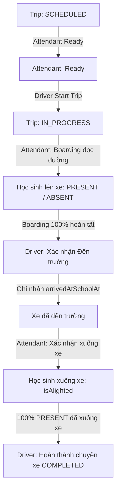
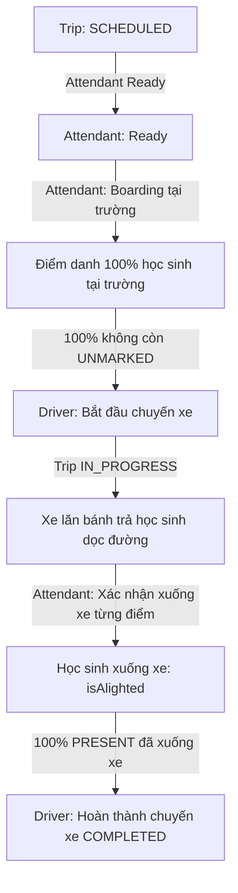

# Báo cáo AI Review: Hoàn thiện Luồng Nghiệp vụ Điểm danh Vận hành Chuyến xe (Flow V2)

> **Mã báo cáo**: `REV-TRIP-FLOW-V2-20261025-1430`  
> **Thời điểm**: 25/10/2026 14:30 (Giờ Việt Nam)  
> **Trạng thái**: Hoàn thành triển khai & Kiểm thử thành công 100%  
> **Diff đính kèm**: [LATEST.diff](file:///c:/Users/chuon/Documents/work/road-to-school-v2/docs/ai-review/LATEST.diff)

---

## 1. Thông tin chung
- **Dự án**: Road to School (Hệ thống quản lý xe bus đưa đón học sinh thông minh)
- **Hạng mục**: Vận hành chuyến xe thực tế (Trip Operation Lifecycle V2)
- **Phạm vi tác động**:
  - Backend: `api/prisma/schema.prisma`, `api/src/trips/` (Service, Controller, DTOs, Specs).
  - Mobile: `mobile/services/api-client.ts`, `mobile/app/trip/[id].tsx`, `mobile/app/(tabs)/index.tsx`.
  - Database: Migration `20261025071759_add_trip_school_arrival_and_alighting`.
- **Chế độ kiểm thử (TEST Mode)**: `TRIP_OPERATION_MODE=TEST` (bypass rào cản thời gian 15p/5p, sẵn sàng chạy tức thì mọi chuyến xe).

---

## 2. Bối cảnh nghiệp vụ & Yêu cầu bài toán
Trong các tài liệu nghiệp vụ cơ bản ban đầu, luồng vận hành chuyến xe chỉ gộp chung một trạng thái điểm danh lên xe (`PRESENT`/`ABSENT`). Tuy nhiên, trên thực tế vận hành trường học:
1. **Chiều đi (TO_SCHOOL)**:
   - Xe đón học sinh dọc các điểm dừng trên đường khi xe đang di chuyển (`IN_PROGRESS`). Driver không phải chờ điểm danh xong toàn bộ mới khởi hành từ bãi xe.
   - Khi xe tới trường, Driver phải có thao tác xác nhận xe đã đến trường an toàn (`arriveAtSchool`).
   - Sau khi xe đến trường, Bus Attendant mới tiến hành cho học sinh xuống xe (`alighting`).
   - Driver chỉ được hoàn thành chuyến (`completeTrip`) khi xe đã đến trường và **100% học sinh có mặt (PRESENT) đã được xác nhận xuống xe an toàn**.
2. **Chiều về (TO_PARKING)**:
   - Tất cả học sinh tập trung và điểm danh lên xe ngay tại sân trường khi xe đang đỗ (`SCHEDULED` sau khi Bus Attendant Ready).
   - Driver chỉ được phép xuất phát (`startTrip`) khi **100% học sinh đã lên xe (không còn UNMARKED)**.
   - Khi xe trả học sinh dọc đường, Bus Attendant xác nhận học sinh xuống xe tại từng điểm trả.
   - Driver hoàn thành chuyến khi xe về bãi và toàn bộ học sinh có mặt đã xuống xe.

---

## 3. Kiến trúc luồng nghiệp vụ V2 (Flow V2)

### 3.1. Luồng Chiều Đi (`TO_SCHOOL`)

### 3.2. Luồng Chiều Về (`TO_PARKING`)

---

## 4. Thay đổi Database Schema (Prisma Schema & Migration)
Đã cập nhật [api/prisma/schema.prisma](file:///c:/Users/chuon/Documents/work/road-to-school-v2/api/prisma/schema.prisma):
1. **Model `Trip`**:
   - Bổ sung trường: `arrivedAtSchoolAt DateTime? @map("arrived_at_school_at")`
   - Mục đích: Lưu mốc thời gian Driver xác nhận xe đưa học sinh đến cổng trường an toàn chiều `TO_SCHOOL`.
2. **Model `TripAttendance`**:
   - Bổ sung trường: `alightedAt DateTime? @map("alighted_at")`
   - Mục đích: Lưu mốc thời gian Bus Attendant xác nhận từng học sinh `PRESENT` bước xuống xe an toàn.
3. **Migration SQL**:
   - Đã sinh và áp dụng an toàn qua `prisma migrate dev`: [20261025071759_add_trip_school_arrival_and_alighting](file:///c:/Users/chuon/Documents/work/road-to-school-v2/api/prisma/migrations/20261025071759_add_trip_school_arrival_and_alighting/migration.sql).
   - Zero downtime, không phá vỡ dữ liệu hiện hữu.

---

## 5. Thay đổi Backend API & DTOs (API Contract & Swagger Sync)

### 5.1. DTOs Mới & Cập nhật ([trip-operation.dto.ts](file:///c:/Users/chuon/Documents/work/road-to-school-v2/api/src/trips/dto/trip-operation.dto.ts))
- `UpdateAlightingDto`: `{ isAlighted: boolean }`
- `UpdateAlightingResponseDto`: `{ message: string, alightedAt?: string, isAlighted: boolean }`
- `ArriveAtSchoolResponseDto`: `{ message: string, arrivedAtSchoolAt: string }`
- `TripAttendanceStudentItemDto`: Thêm `alightedAt?: string | null; isAlighted: boolean;`
- `TripAttendanceListResponseDto`: Thêm `alightedCount`, `pendingAlightCount`, `isAllAlighted`.
- `OperationalStateResponseDto`: Thêm `direction`, `arrivedAtSchoolAt`, `isSchoolArrived`, `alightedCount`, `pendingAlightCount`, `isAllAlighted`, `canArriveAtSchool`, `arriveAtSchoolDisabledReason`, `childIsAlighted`, `childAlightedAt`.
- `ParentHomeCardItemDto`: Thêm `childIsAlighted: boolean`, `childAlightedAt?: string | null`.

### 5.2. Endpoints Mới ([trips.controller.ts](file:///c:/Users/chuon/Documents/work/road-to-school-v2/api/src/trips/trips.controller.ts))
1. `POST /api/v1/trips/:id/arrive-at-school`:
   - Phân quyền: `DRIVER`
   - Nghiệp vụ: Xác nhận xe đã đến trường chiều `TO_SCHOOL`. Yêu cầu 100% học sinh đã được điểm danh lên xe (không còn `UNMARKED`).
2. `PUT /api/v1/trips/:id/attendance/:studentId/alighting`:
   - Phân quyền: `BUS_ATTENDANT`
   - Nghiệp vụ: Xác nhận hoặc hoàn tác học sinh xuống xe. Chỉ áp dụng cho học sinh `PRESENT`. Chiều `TO_SCHOOL` yêu cầu xe đã đến trường.

### 5.3. Điều chỉnh Business Logic ([trips.service.ts](file:///c:/Users/chuon/Documents/work/road-to-school-v2/api/src/trips/trips.service.ts))
- `startTrip`: Chiều `TO_PARKING` bắt buộc 100% học sinh đã được điểm danh lên xe trước khi xuất phát (`RET-03`). Chiều `TO_SCHOOL` cho phép xuất phát ngay khi Attendant Ready (`BF-01`).
- `updateAttendance`:
  - `TO_SCHOOL`: Không cho hoàn tác về `UNMARKED` sau khi xe đã đến trường (`OUT-05`).
  - `TO_PARKING`: Cho phép điểm danh khi `SCHEDULED` (sau khi Attendant Ready); không cho hoàn tác về `UNMARKED` sau khi xe đã xuất phát (`RET-05`).
  - Cả 2 chiều: Không cho phép học sinh đã xuống xe chuyển sang `ABSENT`.
- `completeTrip`: Yêu cầu xe đã đến trường (đối với `TO_SCHOOL`) và 100% học sinh `PRESENT` đã được xác nhận xuống xe (`pendingAlightCount === 0`).
- `getOperationalState`: Tính toán động và trả về đầy đủ các cờ `canStartTrip`, `canArriveAtSchool`, `canCompleteTrip`, `disabledReasons` tương ứng từng chiều.

---

## 6. Thay đổi Mobile Client & UI (Mobile State & Bottom Sheet UX)

### 6.1. API Client ([mobile/services/api-client.ts](file:///c:/Users/chuon/Documents/work/road-to-school-v2/mobile/services/api-client.ts))
- Bổ sung `arriveAtSchool(tripId)` và `updateAlighting(tripId, studentId, isAlighted)`.
- Cập nhật interfaces `OperationalStateResponse`, `TripAttendanceStudentItem`, `TripAttendanceListResponse`, `ParentHomeCardItem`.

### 6.2. Màn hình Chi tiết Chuyến xe ([mobile/app/trip/[id].tsx](file:///c:/Users/chuon/Documents/work/road-to-school-v2/mobile/app/trip/%5Bid%5D.tsx))
- **Tab Điểm danh (Attendance Tab)**:
  - Bổ sung thanh chuyển đổi Sub-tab tối giản: `[ Lên xe (X/Y) ]` và `[ Xuống xe (A/B) ]`.
  - **Sub-tab Lên xe**: Giữ nguyên danh sách thẻ học sinh với các nút thao tác nhanh `Có mặt`, `Vắng mặt`, `Hoàn tác`. Tự động vô hiệu hóa hoàn tác theo quy định khi xe đã đến trường hoặc đã xuất phát.
  - **Sub-tab Xuống xe**: Chỉ hiển thị các học sinh có mặt (`PRESENT`). Với chiều `TO_SCHOOL`, khi xe chưa đến trường, hiển thị thông báo trạng thái nhẹ nhàng `Chờ tài xế xác nhận xe đến trường để mở xác nhận học sinh xuống xe`. Nút bấm `Xác nhận xuống xe` và `Hoàn tác` rõ ràng, trực quan.
- **Thanh Hành Động Cố Định (Fixed Bottom Action)**:
  - Với Driver chiều `TO_SCHOOL`: Khi xe `IN_PROGRESS` và chưa đến trường, nút chuyển thành `[ Xác nhận đến trường ]` (màu Sky Blue). Sau khi đã đến trường, chuyển sang `[ Hoàn thành chuyến xe ]` (màu Xanh dương, kèm kiểm soát tất cả học sinh đã xuống xe).
  - Với Driver chiều `TO_PARKING`: Nút `[ Bắt đầu chuyến xe ]` hiển thị thông báo `Còn X học sinh chưa lên xe` nếu danh sách chưa hoàn tất điểm danh tại trường.

### 6.3. Màn hình Trang chủ Phụ huynh ([mobile/app/(tabs)/index.tsx](file:///c:/Users/chuon/Documents/work/road-to-school-v2/mobile/app/%28tabs%29/index.tsx))
- Cập nhật `getAttendanceBadge` và thẻ học sinh: Phụ huynh thấy rõ trạng thái con đã bước xuống xe an toàn (`Đã xuống xe an toàn` kèm icon checkmark kép màu xanh) hoặc `Đã lên xe` / `Vắng mặt`.

---

## 7. Đánh giá tính toàn vẹn dữ liệu (Data Integrity: Zero Fake Data)
- Tuyệt đối không tạo dữ liệu giả lập (mock data) trong CSDL PostgreSQL.
- Tất cả các trường dữ liệu mới (`arrived_at_school_at`, `alighted_at`) đều nullable và phản ánh đúng 100% thao tác thời gian thực của người dùng.

---

## 8. Kiểm thử & Độ bao phủ Unit Test (Unit Test Execution)
- Đã bổ sung 6 ca kiểm thử chuyên sâu cho toàn bộ Flow V2 trong [api/src/trips/trips.service.spec.ts](file:///c:/Users/chuon/Documents/work/road-to-school-v2/api/src/trips/trips.service.spec.ts):
  1. `TO_SCHOOL: should allow Driver to start trip without complete boarding (BF-01)` -> **PASSED**
  2. `TO_SCHOOL: should block arriveAtSchool when boarding is incomplete, and allow when complete (BF-02, BF-03, BF-04)` -> **PASSED**
  3. `TO_SCHOOL: should block alighting before school arrival, and allow after arrival for PRESENT students (BF-06)` -> **PASSED**
  4. `TO_SCHOOL: should block Complete until arrived at school AND all PRESENT students alighted (BF-07)` -> **PASSED**
  5. `TO_PARKING: should block Driver start until 100% boarded at school (BF-08, BF-09, BF-10)` -> **PASSED**
  6. `should forbid reset to UNMARKED after school arrival or after start (BF-05, RET-05)` -> **PASSED**
- **Kết quả tổng thể Backend Test**: **270/270 tests passed (26 test files)**.
- **Typecheck**: `npx tsc --noEmit` đạt 0 lỗi trên cả `api`, `web` và `mobile`.

---

## 9. Kiểm thử Swagger Contract & Polling (Swagger Verification)
Đã truy vấn và kiểm chứng trực tiếp từ NestJS Swagger (`http://localhost:3000/api/docs-json`):
- `/api/v1/trips/{id}/arrive-at-school`: Đã xuất hiện đầy đủ phương thức `POST`, phân quyền `DRIVER`, DTO phản hồi `ArriveAtSchoolResponseDto`.
- `/api/v1/trips/{id}/attendance/{studentId}/alighting`: Đã xuất hiện đầy đủ phương thức `PUT`, phân quyền `BUS_ATTENDANT`, DTO `UpdateAlightingDto` và `UpdateAlightingResponseDto`.
- `/api/v1/trips/{id}/operational-state`: Schema trả về đầy đủ các cờ `direction`, `arrivedAtSchoolAt`, `isSchoolArrived`, `alightedCount`, `pendingAlightCount`, `isAllAlighted`, `canArriveAtSchool`, `childIsAlighted`.

---

## 10. Tối giản câu chữ trên UI (Minimal UI Copy Audit)
Tuân thủ nguyên tắc *"Show what users need to know and do, not paragraphs explaining what the interface does"*:
- Không sử dụng các đoạn văn dài hướng dẫn cách bấm nút trên Mobile.
- Dùng các badge súc tích: `Có mặt`, `Vắng mặt`, `Chưa điểm danh`, `Đã xuống xe`, `Chưa xuống xe`.
- Dùng text trạng thái ngắn gọn trên nút: `Xác nhận sẵn sàng`, `Bắt đầu chuyến xe`, `Xác nhận đến trường`, `Hoàn thành chuyến xe`, `Còn 2 học sinh chưa lên xe`, `Còn 1 học sinh chưa xuống xe`.

---

## 11. Đánh giá rủi ro & Biện pháp giảm thiểu (Risks & Mitigations)
| Rủi ro tiềm ẩn | Mức độ | Biện pháp giảm thiểu đã thực hiện |
|---|---|---|
| Mất mạng tạm thời khi xác nhận xuống xe | Trung bình | API hỗ trợ idempotent; Bus Attendant có thể hoàn tác hoặc nhấn lại khi có mạng. |
| Học sinh bị đánh dấu nhầm xuống xe | Thấp | Cung cấp nút `Hoàn tác` ngay tại danh sách thẻ học sinh trong suốt thời gian chuyến xe `IN_PROGRESS`. |
| Driver quên bấm xác nhận Đến trường chiều TO_SCHOOL | Thấp | Nút hành động cố định ở đáy màn hình hiển thị nổi bật `[ Xác nhận đến trường ]` ngay khi 100% học sinh đã được điểm danh. |

---

## 12. Danh sách file thay đổi (Changed Files List)
1. [api/prisma/schema.prisma](file:///c:/Users/chuon/Documents/work/road-to-school-v2/api/prisma/schema.prisma)
2. [api/prisma/migrations/20261025071759_add_trip_school_arrival_and_alighting/migration.sql](file:///c:/Users/chuon/Documents/work/road-to-school-v2/api/prisma/migrations/20261025071759_add_trip_school_arrival_and_alighting/migration.sql)
3. [api/src/trips/dto/trip-operation.dto.ts](file:///c:/Users/chuon/Documents/work/road-to-school-v2/api/src/trips/dto/trip-operation.dto.ts)
4. [api/src/trips/trips.service.ts](file:///c:/Users/chuon/Documents/work/road-to-school-v2/api/src/trips/trips.service.ts)
5. [api/src/trips/trips.controller.ts](file:///c:/Users/chuon/Documents/work/road-to-school-v2/api/src/trips/trips.controller.ts)
6. [api/src/trips/trips.service.spec.ts](file:///c:/Users/chuon/Documents/work/road-to-school-v2/api/src/trips/trips.service.spec.ts)
7. [mobile/services/api-client.ts](file:///c:/Users/chuon/Documents/work/road-to-school-v2/mobile/services/api-client.ts)
8. [mobile/app/trip/[id].tsx](file:///c:/Users/chuon/Documents/work/road-to-school-v2/mobile/app/trip/%5Bid%5D.tsx)
9. [mobile/app/(tabs)/index.tsx](file:///c:/Users/chuon/Documents/work/road-to-school-v2/mobile/app/%28tabs%29/index.tsx)
10. [docs/ai-review/LATEST.diff](file:///c:/Users/chuon/Documents/work/road-to-school-v2/docs/ai-review/LATEST.diff)
11. [docs/ai-review/LATEST.md](file:///c:/Users/chuon/Documents/work/road-to-school-v2/docs/ai-review/LATEST.md)

---

## 13. Đề xuất bước tiếp theo (Next Action Proposal)
Tiến hành test trải nghiệm vận hành trọn vẹn (End-to-End Test) trên thiết bị/trình mô phỏng di động với tài khoản Tài xế, Giáo viên phụ xe và Phụ huynh để xác nhận luồng hoạt động mượt mà.
