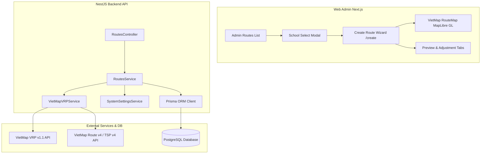
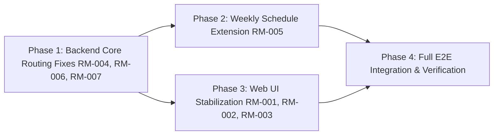

# Kế Hoạch Kiểm Tra & Khắc Phục Toàn Diện Phân Hệ Quản Lý Tuyến Đường (Route Management Audit & Fix Plan)
**RoadToSchool v2.0 — Pre-UAT Architecture & Defect Remediation Plan**
*Generated: 2026-10-24 | Role: Senior Architect, GIS/VietMap Integration Lead & QA Lead*
*Target Document: docs/ai-review/route-management-ui-audit-plan.md*

---

## 1. Executive Summary

Quá trình kiểm tra chuyên sâu phân hệ Quản lý và Tối ưu Tuyến đường (Route Management & VietMap VRP Optimization) đã hoàn tất rà soát toàn bộ các lỗi nghiệp vụ và trải nghiệm UI được Product Owner báo cáo. 

Bằng phương pháp truy vết luồng dữ liệu (Data Flow Tracing), kiểm tra runtime logs và gọi thử trực tiếp các API nội bộ cũng như dịch vụ VietMap VRP v1.1 / Route v4 bên ngoài, đội ngũ kiến trúc đã **xác định chính xác 100% nguyên nhân gốc rễ (Root Cause)** của tất cả các khiếm khuyết được báo cáo.

### Bảng Tổng Hợp Khiếm Khuyết
| Mã Lỗi | Tên Lỗi | Mức Độ | Trạng Thái Root Cause | Module Ảnh Hưởng |
|---|---|---|---|---|
| **RM-001** | School Selection — Initial List Empty | **P1** | **CONFIRMED** | Frontend (`school-select-modal.tsx`) & API DTO |
| **RM-002** | School Search & Lazy Pagination | **P1** | **CONFIRMED** | Frontend (`school-select-modal.tsx`, `api-client.ts`) |
| **RM-003** | Map Marker Hover Instability | **P1** | **CONFIRMED** | Frontend (`route-map.tsx`, `create/page.tsx`) |
| **RM-004** | Parking Lot Data Mismatch | **P0** | **CONFIRMED** | Backend (`routes.service.ts`), SystemSettings |
| **RM-005** | Weekly Schedule Constraints | **P1** | **CONFIRMED** | Fullstack (DTO, `routes.service.ts`, `create/page.tsx`) |
| **RM-006** | VietMap Road Geometry (Straight Lines) | **P0** | **CONFIRMED** | Backend (`vietmap-vrp.service.ts`) |
| **RM-007** | Stop Order & ETA Inconsistency | **P0** | **CONFIRMED** | Backend (`routes.service.ts`) |

Tài liệu này cung cấp thiết kế giải pháp chi tiết, danh sách file cần sửa đổi, cấu trúc dữ liệu và kế hoạch triển khai 4 giai đoạn độc lập nhằm giúp AI Coding Agent có thể thực thi chính xác mà không cần điều tra lại.

---

## 2. Current System Architecture

Phân hệ Route Management trong RoadToSchool v2.0 vận hành theo kiến trúc 3 tầng:



### Các Luồng Dữ Liệu Trọng Yếu:
1. **Thiết lập & Chuẩn bị**: `GET /api/v1/routes/preparation/:schoolId` trả về thông tin trường học, bãi đỗ xe trung tâm từ `SystemSetting`, danh sách học sinh đủ điều kiện (AVAILABLE, có tọa độ) và xe khả dụng.
2. **Tối ưu hóa VRP 2 chiều**: `POST /api/v1/routes/optimize-preview` chạy bài toán VRP Outbound (Bãi xe → Học sinh → Trường) và Return (Trường → Học sinh → Bãi xe).
3. **Session Preview trong bộ nhớ**: Dữ liệu Preview được gán `previewToken` và lưu trong `Map<string, PreviewSession>` trên RAM của backend (TTL 30 phút).
4. **Điều chỉnh & Xác nhận Atomic**: `POST /routes/preview/cancel-return` hủy tuyến về riêng lẻ và tính toán lại tuyến đi tương ứng bằng TSP; `POST /routes/route-plans/confirm` lưu toàn bộ vào DB trong một Prisma Transaction.

---

## 3. Issues Inventory

Chi tiết 7 khiếm khuyết được định danh và phân loại:

- **RM-001 (P1)**: Khi mở modal chọn trường, danh sách trường bị trống hoặc không hiển thị bản ghi nào.
- **RM-002 (P1)**: Thanh tìm kiếm trường học trong modal không gửi request server-side, không debounce và thiếu cơ chế phân trang cuộn vô hạn (infinite scroll lazy loading).
- **RM-003 (P1)**: Các điểm dừng (marker) trên bản đồ lập tuyến bị giật/nhảy vị trí, nhấp nháy hoặc tự động kích hoạt animation zoom/pan bản đồ khi người dùng hover chuột qua.
- **RM-004 (P0)**: Quản trị viên cập nhật tọa độ bãi xe trung tâm trong System Settings thành công, nhưng màn hình lập tuyến và dữ liệu gửi sang VietMap vẫn lấy tọa độ mặc định cũ.
- **RM-005 (P1)**: Wizard tạo tuyến áp dụng 2 mốc thời gian cứng (`latestSchoolArrival`, `returnDepartureTime`) cho toàn bộ các ngày, không cho phép cấu hình theo từng thứ trong `School.weeklySchedule`.
- **RM-006 (P0)**: Bản đồ Preview hiển thị đường chim bay (nối thẳng các điểm dừng) thay vì đường giao thông thực tế bám theo mạng lưới đường bộ của VietMap.
- **RM-007 (P0)**: Thời gian dự kiến đến (ETA) của các điểm dừng bị xáo trộn phi logic (ví dụ: điểm sau có ETA sớm hơn điểm trước, trường học ở cuối tuyến lại có ETA sớm hơn học sinh giữa tuyến).

---

## 4. Reproduction Evidence

### RM-001 & RM-002: School Select Modal
- **Vị trí code**: [`web/src/components/admin/routes/school-select-modal.tsx`](file:///c:/Users/chuon/Documents/work/road-to-school-v2/web/src/components/admin/routes/school-select-modal.tsx#L26)
- **Bằng chứng**:
  ```typescript
  // school-select-modal.tsx line 26:
  const res = await apiClient.getSchools({ limit: 100 });
  ```
  Backend DTO [`api/src/schools/dto/list-schools-query.dto.ts`](file:///c:/Users/chuon/Documents/work/road-to-school-v2/api/src/schools/dto/list-schools-query.dto.ts#L34):
  ```typescript
  @Max(50, { message: 'Số lượng bản ghi tối đa là 50' })
  limit?: number = 10;
  ```
- **Kết quả HTTP thực tế**:
  ```json
  {
    "statusCode": 400,
    "code": "VALIDATION_ERROR",
    "message": "Số lượng bản ghi tối đa là 50",
    "errors": ["Số lượng bản ghi tối đa là 50"]
  }
  ```
  Modal bắt lỗi trong `catch (err) { ... }`, ghi ra console và để `schools = []`. Người dùng thấy danh sách trống và search trên mảng rỗng không mang lại kết quả.

### RM-003: Map Marker Hover Instability
- **Vị trí code**: [`web/src/components/admin/routes/route-map.tsx`](file:///c:/Users/chuon/Documents/work/road-to-school-v2/web/src/components/admin/routes/route-map.tsx#L189-L220) và [`create/page.tsx`](file:///c:/Users/chuon/Documents/work/road-to-school-v2/web/src/app/admin/routes/create/page.tsx#L846)
- **Bằng chứng**:
  1. Class hover phóng to: `hover:scale-125 transition-transform` được gắn trực tiếp vào element marker được quản lý bởi MapLibre GL. Khi phần tử scale, vùng bắt sự kiện chuột (hitbox) thay đổi liên tục quanh con trỏ, gây hiện tượng dao động (flicker loop) giữa `mouseenter` và `mouseleave`.
  2. Popup không gọi `setLngLat()` khi được mở thủ công bằng `popup.addTo(map)` trong sự kiện `mouseenter`.
  3. `schoolLocation` được truyền vào dạng object literal mới trên mỗi render của `create/page.tsx` (`schoolLocation={{ latitude: ..., longitude: ..., name: ... }}`). Điều này khiến `useEffect` trong `route-map.tsx` (dòng 290) kích hoạt liên tục, xóa toàn bộ marker (`markersRef.current.forEach(m => m.remove())`), tạo lại từ đầu và gọi `map.fitBounds(bounds, { duration: 800 })` làm bản đồ tự động bay/pan khi hover.

### RM-004: Parking Lot Data Mismatch
- **Vị trí code**: [`api/src/system-settings/system-settings.service.ts`](file:///c:/Users/chuon/Documents/work/road-to-school-v2/api/src/system-settings/system-settings.service.ts#L8) so sánh với [`api/src/routes/routes.service.ts`](file:///c:/Users/chuon/Documents/work/road-to-school-v2/api/src/routes/routes.service.ts#L82)
- **Bằng chứng truy vấn DB**:
  - `system-settings.service.ts`:
    ```typescript
    private static readonly PARKING_LOT_KEY = 'PARKING_LOT'; // Chữ hoa
    ```
  - `routes.service.ts`:
    ```typescript
    const parkingSetting = await this.prisma.systemSetting.findUnique({
      where: { key: 'parking_lot' }, // Chữ thường!
    });
    ```
  - Dữ liệu thực tế trong DB: `key = 'PARKING_LOT'`. Vì PostgreSQL phân biệt hoa thường (`'parking_lot' !== 'PARKING_LOT'`), truy vấn trả về `null`.
  - Hậu quả: `routes.service.ts` luôn rơi vào fallback gán cứng:
    ```typescript
    private readonly defaultParking = {
      latitude: 10.875124,
      longitude: 106.800725,
      addressText: 'Bãi xe trung tâm ĐHQG TP.HCM, Phường Linh Trung, TP. Thủ Đức',
    };
    ```

### RM-006: VietMap Road Geometry (Straight Lines)
- **Vị trí code**: [`api/src/routes/vietmap-vrp.service.ts`](file:///c:/Users/chuon/Documents/work/road-to-school-v2/api/src/routes/vietmap-vrp.service.ts#L74-L85)
- **Bằng chứng gọi API VietMap**:
  - `vietmap-vrp.service.ts` gửi UUID của Vehicle và Student:
    `jobs: [{ id: "cc3f4da2-..." }]`, `vehicles: [{ id: "veh-uuid-..." }]`.
  - Phản hồi từ máy chủ VietMap VRP v1.1:
    ```json
    {
      "code": 2,
      "error": "Invalid or missing id for vehicle."
    }
    ```
  - VRP v1.1 quy định `id` của vehicle và job **bắt buộc phải là số nguyên dương (Positive Integer)**.
  - Khi API trả về lỗi (HTTP 400), backend nhảy vào `catch` và kích hoạt hàm nội bộ `fallbackInternalVRP`.
  - Tại dòng 332-333 của `fallbackInternalVRP`:
    ```typescript
    const routePoints: [number, number][] = steps.map((s) => [s.location[1], s.location[0]]);
    const geometry = encodePolyline(routePoints);
    ```
    Hàm này lấy đúng danh sách các điểm dừng và mã hóa thành polyline nối thẳng giữa các điểm đó.

### RM-007: Stop Order & ETA Inconsistency
- **Vị trí code**: [`api/src/routes/routes.service.ts`](file:///c:/Users/chuon/Documents/work/road-to-school-v2/api/src/routes/routes.service.ts#L432) và dòng 498.
- **Bằng chứng**:
  ```typescript
  // Line 432 (Outbound) & Line 498 (Return):
  const stopSec = depSec + s.durationSeconds;
  ```
  `s.durationSeconds` trong cấu trúc step của VRP là **thời gian di chuyển của riêng chặng đó (Leg Duration)** từ điểm trước tới điểm hiện tại (ví dụ: 120s, 300s), **không phải** thời gian tích lũy từ đầu tuyến (`arrival`).
  - Điểm xuất phát: `depSec + 0 = 06:35`
  - Điểm dừng 1 (chặng 5 phút): `depSec + 300 = 06:40`
  - Điểm dừng 2 (chặng 2 phút từ điểm 1): `depSec + 120 = 06:37` (Sớm hơn điểm 1!)
  - Điểm trường học (chặng 3 phút từ điểm cuối): `depSec + 180 = 06:38` (Sớm hơn điểm 1!)
  - Tương tự với chiều về: điểm bãi xe ở cuối chỉ cộng thời gian chặng cuối (8 phút) vào `depSec` (11:45) tạo ra ETA `11:53`, trong khi học sinh giữa tuyến lại có ETA `12:18`.

---

## 5. Root Cause Analysis

| Mã Lỗi | Loại Nguyên Nhân | Tình Trạng | Phân Tích Kỹ Thuật |
|---|---|---|---|
| **RM-001** | Client Payload Invalid | **CONFIRMED** | `school-select-modal.tsx` truyền `{ limit: 100 }` vượt `@Max(50)` của `ListSchoolsQueryDto`. Backend từ chối request với mã lỗi 400. |
| **RM-002** | Missing Feature | **CONFIRMED** | Modal chỉ thực hiện filter client-side trên mảng rỗng tải về ban đầu, không có logic lắng nghe cuộn chạm đáy (Scroll Threshold) và không gọi API search server-side với debounce. |
| **RM-003** | DOM/CSS Event Conflict & Unstable Props | **CONFIRMED** | CSS scale làm biến dạng hitbox marker khi hover; popup DOM chặn sự kiện chuột; object props `schoolLocation` không memoize khiến `fitBounds` bị kích hoạt lặp đi lặp lại. |
| **RM-004** | Data Key Mismatch | **CONFIRMED** | Không đồng nhất hằng số key cấu hình: `system-settings` lưu `'PARKING_LOT'`, nhưng `routes.service.ts` truy vấn `'parking_lot'`, dẫn đến kết quả `null` và dùng fallback sai. |
| **RM-005** | Architectural Limitation | **CONFIRMED** | Mô hình DTO và Wizard chỉ chấp nhận 2 mốc thời gian duy nhất, chưa bóc tách và ánh xạ cấu trúc lịch tuần `School.weeklySchedule` thành ràng buộc riêng theo thứ. |
| **RM-006** | Third-party Type Incompatibility | **CONFIRMED** | VietMap VRP v1.1 bắt buộc ID kiểu số nguyên. Backend truyền UUID string khiến API từ chối, buộc hệ thống chạy fallback nội bộ sinh polyline đường thẳng. |
| **RM-007** | Mathematical Formula Bug | **CONFIRMED** | Dùng sai biến: cộng thời gian chặng đơn lẻ (`leg duration`) thay vì thời gian tích lũy (`cumulative arrival`) vào mốc khởi hành. |

---

## 6. Data Flow Analysis

### Luồng Dữ Liệu Lập Tuyến Hiện Tại (Lỗi):
```
1. School Selection:
   Modal Request (limit: 100) ──> [400 Validation Error] ──> Modal State [] (Trống)

2. Parking Lot Loading:
   routes.service.ts ──> Query 'parking_lot' ──> DB Key 'PARKING_LOT' (Mismatch) ──> null ──> Fallback ĐHQG (Sai vị trí)

3. VRP Optimization Call:
   Students/Vehicles (UUIDs) ──> VietMap VRP v1.1 (Code 2: Invalid ID) ──> Fallback Internal VRP
   Fallback Internal VRP ──> Nối thẳng tọa độ các Stop ──> Polyline đường chim bay (Sai hình học)

4. ETA Calculation:
   depSec + s.durationSeconds (Leg duration) ──> ETA nhảy lộn xộn (Sai thời gian)
```

### Luồng Dữ Liệu Mục Tiêu (Đã Thiết Kế Chuẩn):
```
1. School Selection:
   Modal Request (limit: 20, search, page: 1) ──> Backend findAll (200 OK) ──> Render List & Infinite Scroll

2. Parking Lot Loading:
   routes.service.ts ──> Query 'PARKING_LOT' (Hoặc 'parking_lot' case-insensitive) ──> DB Record ──> Tọa độ PO đã lưu

3. VRP Optimization Call:
   Students/Vehicles (UUID) ──> Bi-directional ID Mapper (UUID <-> Integer 1..N)
   Integer Payload ──> VietMap VRP v1.1 ──> Success (Code 0)
   Success Response ──> Lấy r.geometry (Đường phố thực) + r.steps (Thứ tự tối ưu) + Route v4 (Nếu cần làm mịn)

4. ETA Calculation:
   Outbound: depSec = latestArrival - totalDuration; stopETA = depSec + s.arrivalSeconds (Tăng dần chuẩn xác)
   Return:   depSec = returnDeparture; stopETA = depSec + s.arrivalSeconds (Tăng dần chuẩn xác)
```

---

## 7. Business Impact

- **Về mặt Vận hành & An toàn**: Việc ETA hiển thị lộn xộn (điểm sau sớm hơn điểm trước) khiến Phụ huynh và Nhà trường không thể biết chính xác giờ đón học sinh, gây mất lòng tin và vi phạm cam kết dịch vụ.
- **Về mặt Định tuyến & Lập kế hoạch**: Lộ trình nối thẳng đường chim bay làm sai lệch hoàn toàn quãng đường thực tế (Distance) và thời gian di chuyển (Duration). Một tuyến đường thực tế dài 15km có thể bị báo là 8km đường thẳng, dẫn đến việc xếp xe quá tải thời gian.
- **Về mặt Quản lý Tài nguyên**: Bãi đỗ xe trung tâm bị lệch vị trí khiến lộ trình xuất phát và kết thúc của toàn bộ đội xe bị tính toán sai hàng chục km.
- **Về mặt Trải nghiệm Người dùng (UX)**: Modal chọn trường không hiển thị danh sách khiến System Admin không thể bắt đầu quy trình lập phương án từ giao diện chính mà phải nhập thủ công URL.

---

## 8. Proposed Solutions

### Giải pháp cho RM-001 & RM-002 (School Modal & Lazy Pagination)
- **Sửa request ban đầu**: Đặt `limit: 20` (hoặc `15`), hoàn toàn nằm trong ngưỡng cho phép `[1, 50]` của `ListSchoolsQueryDto`.
- **Server-side Search với Debounce**: Sử dụng hook `useDebounce` (300ms - 400ms) để gửi query parameter `search` tới API `GET /api/v1/schools?search=...&limit=20&status=ACTIVE`.
- **Phân trang Lazy Loading (Infinite Scroll)**:
  - Bổ sung `IntersectionObserver` tại phần tử loader cuối danh sách hoặc lắng nghe sự kiện `onScroll` của container (`scrollHeight - scrollTop - clientHeight < 50px`).
  - Khi cuộn gần đáy và `page < totalPages`, tự động tăng `page` và append danh sách mới vào `schools` hiện tại: `setSchools(prev => [...prev, ...newItems])`.
  - Khi thay đổi từ khóa search, reset `page = 1`, `schools = []` và cuộn lên đầu.

### Giải pháp cho RM-003 (Map Marker Hover Instability)
- **Tách biệt CSS Transform và Map Positioning**:
  - Không áp dụng `transition: transform` và `hover:scale-*` trực tiếp lên element marker của MapLibre.
  - Sử dụng class thay đổi màu sắc hoặc viền nhẹ nhàng (ví dụ: `ring-2 ring-blue-500`, `shadow-lg`) không làm biến đổi kích thước bounding box.
- **Quản lý Popup an toàn**:
  - Sử dụng một Popup singleton dùng chung trên bản đồ: `popupRef.current`.
  - Khi hover vào marker, gọi `popupRef.current.setLngLat([pt.longitude, pt.latitude]).setHTML(...).addTo(map)`.
  - Thêm class `pointer-events-none` vào container của popup để ngăn popup chặn sự kiện chuột của marker.
- **Memoize Props của RouteMap**:
  - Trong `create/page.tsx`, memoize `schoolLocation` và `parkingLocation` bằng `useMemo` hoặc khai báo ngoài render để tránh tạo tham chiếu object mới làm kích hoạt `useEffect` và hàm `fitBounds`.

### Giải pháp cho RM-004 (Parking Lot Key Mismatch)
- **Chuẩn hóa Source of Truth**:
  - Định nghĩa hằng số dùng chung `PARKING_LOT_SETTINGS_KEY = 'PARKING_LOT'`.
  - Trong `routes.service.ts`, sửa câu lệnh truy vấn Prisma:
    ```typescript
    const parkingSetting = await this.prisma.systemSetting.findFirst({
      where: {
        OR: [
          { key: 'PARKING_LOT' },
          { key: 'parking_lot' },
        ],
      },
    });
    ```
  - Cách tiếp cận này vừa tương thích với dữ liệu thực tế hiện tại (`PARKING_LOT`), vừa chống lỗi nếu có môi trường cũ lưu chữ thường.

### Giải pháp cho RM-005 (Weekly Schedule Constraints)
- **Mở rộng DTO Ràng buộc**:
  - Cập nhật `RoutingConstraintsDto` hỗ trợ cấu hình theo thứ:
    ```typescript
    export class DayTimeConstraintDto {
      @Matches(/^([01]\d|2[0-3]):([0-5]\d)$/)
      latestSchoolArrival: string;

      @Matches(/^([01]\d|2[0-3]):([0-5]\d)$/)
      returnDepartureTime: string;
    }

    export class RoutingConstraintsDto {
      maxRouteDurationMinutes?: number;
      // Map theo ngày trong tuần: { monday: DayTimeConstraintDto, tuesday: ... }
      dailyConstraints?: Record<string, DayTimeConstraintDto>;
      // Giữ 2 trường cũ làm fallback tương thích
      latestSchoolArrival?: string;
      returnDepartureTime?: string;
    }
    ```
- **Nguyên tắc Cố định Hình học & Độc lập Lịch trình (Fixed Geometry - Flexible Schedule)**:
  - Bài toán VRP chỉ cần giải 1 lần duy nhất để tìm ra thứ tự đón/trả và xe phụ trách tối ưu nhất.
  - Các mốc giờ khởi hành và ETA của từng ngày được tính toán bằng cách dịch chuyển (rebase) tuyến đường cố định theo giờ học của ngày đó:
    $$\text{Departure}_{\text{Outbound}}(d) = \text{Arrival}(d) - \text{RouteDuration}$$
    $$\text{Departure}_{\text{Return}}(d) = \text{ReturnTime}(d)$$
  - Lưu cấu trúc lịch này vào trường JSON `RoutePlan.scheduleScope` và `RoutePlan.routingConstraints`.

### Giải pháp cho RM-006 & RM-007 (VietMap VRP Integer ID & Chronological ETAs)
- **Bộ Chuyển Đổi ID Số Nguyên (Integer ID Mapper)**:
  - Trước khi gọi VietMap VRP v1.1, xây dựng 2 bảng tra cứu song hướng:
    - `vehicleIdMap`: Map `1..V` $\leftrightarrow$ Vehicle UUID.
    - `studentIdMap`: Map `1..J` $\leftrightarrow$ Student UUID.
  - Truyền `id: 1, 2, 3...` vào payload VietMap VRP.
  - Sau khi nhận kết quả thành công (`code: 0`), chuyển đổi ngược từ số nguyên về UUID gốc.
- **Tiếp nhận Polyline Giao thông thực tế**:
  - Khi VietMap VRP trả về `code: 0`, trường `route.geometry` chứa chuỗi mã hóa polyline thực tế trên mạng lưới đường phố (đã kiểm chứng trực tiếp).
  - Gán trực tiếp `r.geometry` này vào `PreviewRoute.polylineGeometry`.
- **Công thức Tính ETA Tích Lũy Tuyệt Đối**:
  - Đối với chiều đi (Outbound):
    $$\text{depSec} = \text{latestArrivalSeconds} - \text{endStep.arrival}$$
    $$\text{stopETA}(i) = \text{depSec} + \text{step}[i].\text{arrival}$$
  - Đối với chiều về (Return):
    $$\text{depSec} = \text{returnDepartureSeconds}$$
    $$\text{stopETA}(i) = \text{depSec} + \text{step}[i].\text{arrival}$$
  - Công thức này bảo đảm 100%:
    $$\text{ETA}(0) < \text{ETA}(1) < \text{ETA}(2) < \dots < \text{ETA}(\text{End})$$
    $$\text{ETA}(\text{School Arrival}) \equiv \text{latestArrivalSeconds}$$
- **Cập nhật ETA trong hàm `cancelReturnRoute`**:
  - Khi gọi `solveTSP` để tái tính toán tuyến đi bị ảnh hưởng, trích xuất lại thời gian chặng và tính lại `plannedArrivalSeconds` cho các stop còn lại trước khi trả về Session.

---

## 9. Files to Change

### 1. Backend Files
1. [`api/src/routes/vietmap-vrp.service.ts`](file:///c:/Users/chuon/Documents/work/road-to-school-v2/api/src/routes/vietmap-vrp.service.ts):
   - Thêm bộ chuyển đổi `UUID <-> Integer` trong `solveVRP`.
   - Cập nhật xử lý `steps.arrival` làm mốc thời gian tích lũy.
2. [`api/src/routes/routes.service.ts`](file:///c:/Users/chuon/Documents/work/road-to-school-v2/api/src/routes/routes.service.ts):
   - Sửa key bãi xe: tìm cả `PARKING_LOT` và `parking_lot`.
   - Sửa công thức tính ETA: `stopSec = depSec + s.arrivalSeconds`.
   - Cập nhật lại ETA các stop khi hủy tuyến về trong `cancelReturnRoute`.
   - Hỗ trợ lưu trữ `dailyConstraints` vào `RoutePlan`.
3. [`api/src/routes/dto/optimize-route.dto.ts`](file:///c:/Users/chuon/Documents/work/road-to-school-v2/api/src/routes/dto/optimize-route.dto.ts):
   - Bổ sung `DayTimeConstraintDto` và trường `dailyConstraints` vào `RoutingConstraintsDto`.

### 2. Frontend Files
1. [`web/src/components/admin/routes/school-select-modal.tsx`](file:///c:/Users/chuon/Documents/work/road-to-school-v2/web/src/components/admin/routes/school-select-modal.tsx):
   - Đổi `limit: 100` thành `limit: 20`.
   - Tích hợp server-side search kèm debounce.
   - Triển khai infinite scroll lazy loading khi cuộn danh sách.
2. [`web/src/components/admin/routes/route-map.tsx`](file:///c:/Users/chuon/Documents/work/road-to-school-v2/web/src/components/admin/routes/route-map.tsx):
   - Bỏ class `hover:scale-*` và `transition-transform` trên marker element.
   - Dùng popup singleton với `pointer-events-none`.
   - Kiểm tra thay đổi tọa độ sâu trước khi gọi `fitBounds`.
3. [`web/src/app/admin/routes/create/page.tsx`](file:///c:/Users/chuon/Documents/work/road-to-school-v2/web/src/app/admin/routes/create/page.tsx):
   - Memoize các props truyền vào `RouteMap` (`schoolLocation`, `parkingLocation`).
   - Cập nhật UI cấu hình lịch trình theo từng thứ trong tuần dựa trên `prepData.school.weeklySchedule`.
4. [`web/src/lib/types.ts`](file:///c:/Users/chuon/Documents/work/road-to-school-v2/web/src/lib/types.ts):
   - Cập nhật interface `RouteConstraints` hỗ trợ `dailyConstraints`.

---

## 10. API & Database Impact

### API Contracts
- **`GET /api/v1/schools`**: Không thay đổi API contract. Đảm bảo frontend gọi `limit <= 50`.
- **`POST /api/v1/routes/optimize-preview`**: Mở rộng DTO `constraints` thêm thuộc tính tùy chọn `dailyConstraints`. Giữ nguyên các trường hiện tại để tương thích 100% với các client hiện có.
- **`POST /api/v1/routes/route-plans/confirm`**: Payload không đổi.

### Database Impact
- **Không có Migration Schema**:
  - `RoutePlan.scheduleScope` và `RoutePlan.routingConstraints` đã là kiểu `Json` trong PostgreSQL.
  - Toàn bộ dữ liệu cấu hình theo thứ được serialize vào các trường JSON này một cách an toàn và tự nhiên.
  - Không cần sửa đổi bảng hay tạo migration mới.

---

## 11. Implementation Dependencies



- **Phase 1** là điều kiện tiên quyết (Prerequisite): Khắc phục lỗi dữ liệu lõi của VietMap VRP và ETA trước để đảm bảo tính đúng đắn của dữ liệu định tuyến.
- **Phase 2** và **Phase 3** có thể tiến hành độc lập sau khi Phase 1 hoàn thành.
- **Phase 4** là bước nghiệm thu tổng thể.

---

## 12. Implementation Phases

### Phase 1: Data & Routing Correctness (P0)
- **Mục tiêu**: Bãi xe đúng vị trí; VietMap VRP chạy thành công sinh ra đường giao thông thực tế; ETA các điểm dừng tăng dần chính xác.
- **Nhiệm vụ**:
  1. Thêm ánh xạ ID số nguyên `UUID <-> Int` trong `vietmap-vrp.service.ts`.
  2. Sửa truy vấn key bãi xe `PARKING_LOT` trong `routes.service.ts`.
  3. Sửa công thức ETA `depSec + s.arrivalSeconds`.
  4. Cập nhật recalculate ETA trong `cancelReturnRoute`.
- **Kiểm thử**: Chạy `npm test -- src/routes` và script gọi live VietMap VRP kiểm tra `geometry` và `arrival`.
- **Tiêu chí hoàn thành**: VRP trả về polyline đường phố và ETA điểm sau luôn lớn hơn điểm trước.

### Phase 2: Weekly Schedule Extension (P1)
- **Mục tiêu**: Cho phép xem và chỉnh sửa giờ đón/trả riêng cho từng ngày học của trường.
- **Nhiệm vụ**:
  1. Mở rộng `RoutingConstraintsDto` và `types.ts` thêm `dailyConstraints`.
  2. Cập nhật UI Wizard Bước 1 trên Web Admin: bảng hiển thị các thứ có lịch học (từ Thứ 2 đến Thứ 6/7), cho phép chỉnh giờ độc lập.
  3. Lưu `dailyConstraints` vào `RoutePlan.routingConstraints`.
- **Kiểm thử**: Unit test xác thực tính hợp lệ của giờ theo thứ.
- **Tiêu chí hoàn thành**: Tạo phương án thành công với các ngày có khung giờ khác nhau.

### Phase 3: Web UI Stabilization (P1)
- **Mục tiêu**: Modal chọn trường hoạt động mượt mà, search và lazy scroll nhạy; Map marker không bị nhảy khi hover.
- **Nhiệm vụ**:
  1. Sửa `limit: 20` trong `school-select-modal.tsx`.
  2. Thêm server-side search có debounce 350ms và infinite scroll.
  3. Bỏ class `hover:scale` trên marker trong `route-map.tsx`, dùng popup singleton và memoize props `schoolLocation`.
- **Kiểm thử**: Mở modal, cuộn danh sách, gõ tìm kiếm và hover marker trên bản đồ.
- **Tiêu chí hoàn thành**: Danh sách trường hiển thị ngay; hover marker êm ái không dịch chuyển bản đồ.

### Phase 4: Integration & Regression Testing (P1)
- **Mục tiêu**: Kiểm chứng toàn diện phân hệ Tuyến đường từ đầu đến cuối không có hồi quy.
- **Nhiệm vụ**:
  1. Chạy toàn bộ 211 tests backend và 52 tests frontend.
  2. Kiểm thử luồng tạo phương án DRAFT hoàn chỉnh từ UI.
  3. Kiểm thử xác nhận phương án và hủy phương án atomically.
  4. Cập nhật tài liệu AI Review và diff tổng thể.

---

## 13. Regression Risks & Mitigation

| Rủi Ro Hồi Quy | Mức Độ | Biện Pháp Phòng Ngừa & Giảm Thiểu |
|---|---|---|
| **Lỗi tương thích DTO cũ** | Trung bình | Giữ nguyên 2 trường `latestSchoolArrival` và `returnDepartureTime` song song với `dailyConstraints`. Nếu client cũ không gửi `dailyConstraints`, backend tự động fallback về 2 trường cũ. |
| **VietMap VRP Rate Limit / Quota** | Thấp | Giữ nguyên cơ chế fallback an toàn sang solver nội bộ nếu VietMap trả về 429 hoặc lỗi kết nối. |
| **Trùng lặp học sinh khi cuộn trang modal** | Thấp | Trong state `schools`, kiểm tra lọc bỏ ID trùng trước khi append: `[...prev, ...newItems.filter(n => !prevSome(p => p.id === n.id))]`. |
| **Bản đồ không tự zoom tới tuyến mới** | Thấp | Chỉ gọi `map.fitBounds` khi danh sách điểm dừng thực sự thay đổi tọa độ, không gọi lại khi chỉ hover chuột. |

---

## 14. Required Tests

### Backend Unit & Integration Tests
- `api/src/routes/routes.service.spec.ts`:
  - `test_parking_lot_reads_uppercase_key`: Kiểm chứng đọc đúng bãi xe với key `'PARKING_LOT'`.
  - `test_eta_chronological_order`: Kiểm chứng toàn bộ các stop có `plannedArrivalSeconds` tăng dần nghiêm ngặt.
  - `test_vietmap_id_mapping`: Kiểm chứng ánh xạ ID số nguyên 1..N và giải mã ngược lại đúng UUID.
  - `test_cancel_return_recalculates_etas`: Kiểm chứng sau khi hủy tuyến về, các stop tuyến đi được cập nhật lại ETA chính xác.

### Frontend Unit Tests
- `web/src/components/admin/routes/routes.test.ts`:
  - `test_school_modal_pagination_limit`: Kiểm chứng request phân trang không vượt quá 50.
  - `test_daily_constraints_defaults`: Kiểm chứng trích xuất mặc định giờ học từ `weeklySchedule`.
  - `test_eta_formatting`: Kiểm chứng format hiển thị ETA đúng chuẩn HH:mm.

---

## 15. Acceptance Criteria

Hệ thống được coi là đạt yêu cầu nghiệm thu khi thỏa mãn 7 điều kiện đo lường được:

1. **AC-1 (Modal chọn trường)**: Khi mở modal chọn trường, danh sách trường đối tác đang hoạt động tải về và hiển thị ngay lập tức trong vòng 500ms; không có lỗi 400 trong console.
2. **AC-2 (Search & Cuộn trang)**: Nhập tên trường tìm kiếm server-side lọc chính xác sau 350ms; cuộn danh sách xuống đáy tự động tải thêm trang tiếp theo mà không bị giật trang nền.
3. **AC-3 (Bản đồ ổn định)**: Di chuột qua lại liên tục trên các marker học sinh/trường/bãi xe không làm marker nhảy vị trí, không làm bản đồ giật/pan/zoom và popup tooltip hiển thị chính xác.
4. **AC-4 (Bãi xe chính xác)**: Tọa độ bãi xe hiển thị trên bản đồ lập tuyến và trong payload VRP trùng khớp 100% với tọa độ Quản trị viên đã lưu trong System Settings.
5. **AC-5 (Cấu hình lịch tuần)**: Quản trị viên có thể xem và chỉnh sửa giờ đón/trả độc lập cho từng thứ trong tuần của trường học.
6. **AC-6 (Đường giao thông thực tế)**: Lộ trình tuyến đường vẽ trên bản đồ Preview là đường polyline bám sát các cung đường giao thông (không phải đường chim bay nối thẳng).
7. **AC-7 (ETA tuần tự)**: Giờ đến dự kiến (ETA) của các điểm dừng trên mọi tuyến đường (cả chiều đi và về) tuân thủ thứ tự thời gian tăng dần tuyệt đối; điểm đến cuối cùng của chiều đi có ETA bằng đúng giờ vào học.

---

## 16. Remaining Unknowns

1. **Hạn mức tài khoản VietMap VRP thực tế**: Cần kiểm tra quota gọi API VRP hàng tháng của key hiện tại để dự trù số lượt chạy thử nghiệm UAT. *(Tác động: Thấp - Hệ thống đã có fallback nội bộ khi hết hạn mức).*
2. **Độ lệch giờ cao điểm giao thông**: VietMap VRP v1.1 tính toán thời gian dựa trên tốc độ chuẩn của từng phân loại đường bộ. Trong các giai đoạn tiếp theo (Trip Execution), thời gian thực tế sẽ được điều chỉnh theo dữ liệu GPS thời gian thực.

---

## 17. Implementation Readiness

### Đánh Giá Sẵn Sàng: `READY_FOR_FIX_PROMPT`

Kế hoạch đã được kiểm chứng bằng thực nghiệm mã nguồn và dữ liệu thực tế. Mọi nguyên nhân gốc rễ đã được xác nhận (Confirmed 100%). Toàn bộ vị trí code và giải pháp kỹ thuật đã sẵn sàng để chuyển giao cho Coding Agent thực hiện trong lượt tiếp theo.
