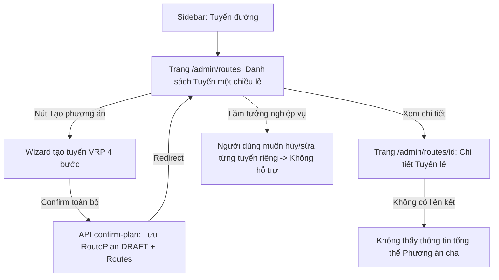
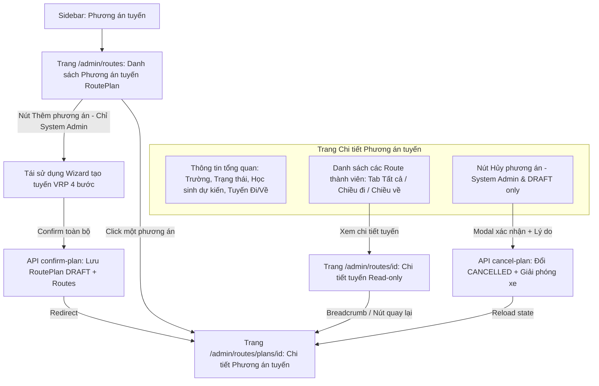
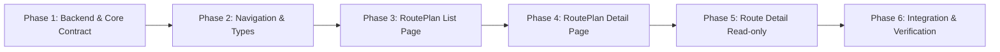

# KẾ HOẠCH TRIỂN KHAI PHÂN HỆ QUẢN LÝ PHƯƠNG ÁN TUYẾN (ROUTEPLAN-FIRST MANAGEMENT)
# ROADTOSCHOOL V2.0 — PHASE 1: CONTEXT RECONCILIATION, ARCHITECTURE AUDIT & IMPLEMENTATION PLAN

> **Trạng thái tài liệu:** Báo cáo kiểm định kiến trúc và Kế hoạch triển khai (Audit & Planning Only - No Source Code Changes)  
> **Phiên bản:** 1.0.0  
> **Ngày lập:** 2026-10-24  
> **Người thực hiện:** Senior Software Architect, Business Analyst, Full-Stack Code Reviewer, UI/UX Designer & QA Lead  
> **Mục tiêu:** Chuyển đổi đối tượng quản lý trọng tâm của phân hệ Route Management từ *Tuyến đường đơn lẻ (Route-centric)* sang *Phương án tuyến (RoutePlan-centric)* trên toàn bộ hệ thống Web Admin và Backend API.

---

## MỤC LỤC
1. [A. Executive Summary (Tóm tắt điều hành)](#a-executive-summary)
2. [B. Repository Reality (Khảo sát hiện trạng Source Code & Kiến trúc)](#b-repository-reality)
3. [C. Context Reconciliation (Đối chiếu & Giải quyết xung đột tài liệu - code)](#c-context-reconciliation)
4. [D. Current vs Target Management Flow (So sánh luồng quản lý)](#d-current-vs-target-management-flow)
5. [E. Business Rules & Domain Logic (Quy tắc nghiệp vụ cốt lõi)](#e-business-rules--domain-logic)
6. [F. UI/UX Wireframes & Navigation Architecture (Thiết kế giao diện)](#f-uiux-wireframes--navigation-architecture)
7. [G. API Contracts & Data Specifications (Đặc tả API & Dữ liệu)](#g-api-contracts--data-specifications)
8. [H. Database Impact Assessment (Đánh giá tác động Cơ sở dữ liệu)](#h-database-impact-assessment)
9. [I. Files to Modify (Danh sách các file cần tác động)](#i-files-to-modify)
10. [J. Implementation Phases (Lộ trình triển khai chi tiết)](#j-implementation-phases)
11. [K. Test Matrix (Ma trận kiểm thử 20 kịch bản bắt buộc)](#k-test-matrix)
12. [L. Acceptance Criteria (Tiêu chí nghiệm thu PASS/FAIL)](#l-acceptance-criteria)
13. [M. Open Questions & Technical Constraints (Ghi chú & Ràng buộc kỹ thuật)](#m-open-questions--technical-constraints)
14. [N. Implementation Readiness (Mức độ sẵn sàng triển khai)](#n-implementation-readiness)

---

## A. EXECUTIVE SUMMARY

### 1. Bối cảnh & Động lực tái cấu trúc
Trong phiên bản trước của RoadToSchool v2.0, giao diện Web Admin quản lý tuyến đường tại `/admin/routes` đang hiển thị danh sách các **Tuyến đường một chiều độc lập (Route)** (ví dụ: Tuyến đi 01, Tuyến về 01). Cách tổ chức này gây ra các bất cập lớn về mặt nghiệp vụ và trải nghiệm người dùng:
- **Xung đột vòng đời:** Thuật toán tối ưu hóa tuyến (VietMap VRP/TSP) luôn sinh ra một **Phương án tuyến (RoutePlan)** tổng thể cho toàn trường, bao gồm $N$ tuyến chiều đi và $M$ tuyến chiều về. Việc quản lý từng Route đơn lẻ trên giao diện khiến người dùng lầm tưởng có thể xác nhận, chỉnh sửa hoặc hủy từng tuyến riêng lẻ.
- **Không nhất quán về trạng thái:** Tuyến đường không có vòng đời độc lập trong cơ sở dữ liệu. Toàn bộ tài nguyên (học sinh, xe đề xuất) được giữ chỗ và giải phóng ở cấp độ RoutePlan.
- **Thống kê sai lệch:** Đếm tổng số học sinh bằng cách cộng dồn học sinh của các Route dẫn đến việc một học sinh đi cả 2 chiều bị đếm 2 lần (double-counting).

### 2. Mục tiêu cốt lõi của đề xuất
1. **RoutePlan là Aggregate Root duy nhất:** Chuyển giao diện quản lý từ "Tuyến đường" sang "Phương án tuyến". RoutePlan là đối tượng chịu trách nhiệm quản lý tập hợp Route, trạng thái vòng đời (`DRAFT`, `CANCELLED`), xác nhận lưu và hủy phương án.
2. **Chuẩn hóa trạng thái vòng đời:** Chỉ có `RoutePlan` sở hữu trạng thái quản lý (`DRAFT`, `CANCELLED`). Tuyệt đối không thêm các trạng thái chưa phê duyệt (`ACTIVE`, `APPROVED`, `COMPLETED`, `IN_PROGRESS`). `Route` không có trạng thái độc lập trên UI.
3. **Thống kê học sinh chuẩn xác (Distinct Student Count):** Số lượng học sinh của RoutePlan là số học sinh phân biệt (distinct student IDs) được phân bổ vào các trạm trong phương án. Ở trạng thái `DRAFT`, nhãn UI hiển thị chuẩn hóa là **"Học sinh dự kiến"**.
4. **Bảo toàn 100% nghiệp vụ tạo tuyến VRP:** Giữ nguyên quy trình: Chọn trường → Wizard tạo tuyến → VietMap VRP → Preview → Xác nhận toàn bộ phương án → Tạo RoutePlan `DRAFT`.
5. **Đảm bảo tính tương thích ngược (Backward Compatibility):** Giữ nguyên URL chi tiết từng tuyến `/admin/routes/[id]` dưới dạng Read-Only với breadcrumb quay về Phương án tuyến cha. Không phá vỡ dữ liệu di động của Phụ huynh (Parent Mobile).
6. **Không cần Migration Database:** Khảo sát thực tế chứng minh Prisma schema đã có đầy đủ cấu trúc `RoutePlan` và `Route`. Việc tái cấu trúc tập trung hoàn toàn vào Backend API Layer và Web Frontend Layer.

---

## B. REPOSITORY REALITY

Khảo sát trực tiếp source code, Prisma schema và các controller/service thực tế trong repository:

### 1. Database Schema (`api/prisma/schema.prisma`)
- **Model `RoutePlan`**:
  ```prisma
  model RoutePlan {
    id                  String           @id @default(uuid())
    schoolId            String
    name                String
    status              RoutePlanStatus  @default(DRAFT)
    scheduleScope       Json?
    routingConstraints  Json?
    totalStudents       Int              @default(0)
    totalOutboundRoutes Int              @default(0)
    totalReturnRoutes   Int              @default(0)
    createdById         String
    createdAt           DateTime         @default(now())
    updatedAt           DateTime         @updatedAt
    cancelledAt         DateTime?
    cancelledById       String?
    cancellationReason  String?
    school              School           @relation(fields: [schoolId], references: [id])
    createdBy           User             @relation("RoutePlanCreatedBy", fields: [createdById], references: [id])
    cancelledBy         User?            @relation("RoutePlanCancelledBy", fields: [cancelledById], references: [id])
    routes              Route[]
  }
  ```
- **Enum `RoutePlanStatus`**:
  ```prisma
  enum RoutePlanStatus {
    DRAFT
    CANCELLED
  }
  ```
- **Model `Route`**:
  ```prisma
  model Route {
    id                   String       @id @default(uuid())
    routePlanId          String
    direction            RouteDirection
    vehicleId            String
    name                 String
    totalDistanceMeters  Float
    totalDurationSeconds Int
    geometryJson         Json?
    rawVrpResponse       Json?
    createdAt            DateTime     @default(now())
    updatedAt            DateTime     @updatedAt
    routePlan            RoutePlan    @relation(fields: [routePlanId], references: [id], onDelete: Cascade)
    stops                RouteStop[]
  }
  ```
- **Phát hiện quan trọng bậc nhất về Database**:
  - Bảng `Route` trong PostgreSQL **HOÀN TOÀN KHÔNG CÓ CỘT `status`**.
  - `status` trước đây xuất hiện trên API DTO của Route thực chất chỉ là giá trị ánh xạ từ `route.routePlan.status`.
  - Điều này hoàn toàn khớp với định hướng của Product Owner: **Chỉ RoutePlan sở hữu trạng thái, Route không cần trạng thái độc lập.**

### 2. Backend Modules & Endpoints (`api/src/routes/`)
- `RoutesController` (`routes.controller.ts`):
  - `GET /api/v1/routes/route-plans`: Lấy danh sách RoutePlan có phân trang (`page`, `limit`), lọc theo `schoolId`, `status`. Đã hỗ trợ RBAC scoping cho `SCHOOL_ADMIN`.
  - `GET /api/v1/routes/route-plans/:id`: Lấy chi tiết RoutePlan kèm danh sách Routes và RouteStops.
  - `POST /api/v1/routes/route-plans/:id/cancel`: Hủy RoutePlan (chuyển status thành `CANCELLED`, giải phóng holds tài nguyên xe trong `VehicleScheduleConflict`). Phân quyền: Chỉ `SYSTEM_ADMIN`. Body nhận `{ reason: string }`.
  - `POST /api/v1/routes/confirm-plan`: Xác nhận lưu toàn bộ Preview thành RoutePlan `DRAFT` atomically.
  - `GET /api/v1/routes`: Lấy danh sách Route đơn lẻ (hiện tại trang Web cũ đang gọi).
  - `GET /api/v1/routes/:id`: Lấy chi tiết Route đơn lẻ để vẽ bản đồ VietMap và timeline các trạm.
  - `GET /api/v1/routes/students/:studentId/routing`: API riêng cho Mobile Parent và Web Student Detail.

### 3. Web Frontend (`web/src/`)
- **Navigation Menu** (`web/src/components/admin/admin-nav.config.ts`):
  - Hiện tại: `{ id: 'routes', label: 'Tuyến đường', href: '/admin/routes', icon: Route }`.
  - Unit test liên quan: `web/src/components/admin/admin-nav.test.ts` đang kiểm tra label và href này.
- **Trang danh sách** (`web/src/app/admin/routes/page.tsx`):
  - Đang gọi `apiClient.listRoutes()`, hiển thị từng dòng là một Route một chiều.
  - Có các cột: Tên tuyến, Trường, Chiều (Đi/Về), Xe, Số trạm, Số HS, Trạng thái (hiện DRAFT của Plan), Quãng đường, Thời gian, Nút xem chi tiết.
- **Trang tạo tuyến & xác nhận** (`web/src/app/admin/routes/create/page.tsx`):
  - Sau khi xác nhận Preview thành công, gọi `router.push('/admin/routes')`.
- **Trang chi tiết tuyến** (`web/src/app/admin/routes/[id]/page.tsx`):
  - Đang hiển thị chi tiết một Route đơn lẻ với bản đồ VietMap, danh sách trạm học sinh.
- **School Detail Routes Tab** (`web/src/components/admin/schools/school-routes-tab.tsx`):
  - Đang gọi `apiClient.listRoutes({ schoolId })` và hiển thị danh sách các tuyến lẻ thuộc trường.
- **API Client & Types** (`web/src/lib/`):
  - `web/src/lib/types.ts`: Type `RoutePlanItem` hiện tại đang chứa các trường cũ không tồn tại trong backend DTO (`applicableStartDate`, `applicableEndDate`, `assignedStudentCount`), trong khi backend trả về (`totalStudents`, `totalOutboundRoutes`, `totalReturnRoutes`).
  - `web/src/lib/api-client.ts`: Hàm `cancelRoutePlan(id, cancellationReason)` gửi body `{ cancellationReason }`, trong khi Backend DTO `CancelRoutePlanDto` yêu cầu `{ reason }`. Hàm `confirmRoutePlan` gửi `{ name }`, trong khi backend yêu cầu `{ planName }`.

### 4. Parent Mobile App (`mobile/`)
- `mobile/app/parent/route-detail.tsx` & `mobile/services/api-client.ts`:
  - Phụ huynh xem thông tin xe buýt đón/trả con thông qua API `/routes/students/:studentId/routing`.
  - Không có màn hình danh sách Route hay RoutePlan nào dành cho Phụ huynh.
  - Dữ liệu hoàn toàn độc lập, đảm bảo bảo mật và cô lập thông tin học sinh khác.

---

## C. CONTEXT RECONCILIATION

Bảng đối chiếu sự khác biệt giữa Tài liệu kiến trúc cũ, Quyết định PO mới và Hiện trạng Code thực tế:

| Khía cạnh | Quyết định PO mới | Tài liệu kiến trúc cũ | Hiện trạng Code thực tế | Kết luận & Đánh giá | Mức độ |
| :--- | :--- | :--- | :--- | :--- | :---: |
| **Đối tượng quản lý chính** | `RoutePlan` (Phương án tuyến) | Đề xuất quản lý Route và RoutePlan song song | Web quản lý Route đơn lẻ tại `/admin/routes`. API đã có `route-plans`. | **Thay đổi Web**: Chuyển `/admin/routes` sang hiển thị danh sách RoutePlan. | **CONFIRMED** |
| **Trạng thái Route (`Route.status`)** | Route không có trạng thái độc lập trên UI | Mô tả Route có status đồng bộ với RoutePlan | Trong DB `Route` không có cột `status`. DTO trả về lấy từ `routePlan.status`. | **Giữ nguyên DB**: Không thêm cột `status` vào Route. UI bỏ hiển thị status trên từng Route con. | **CONFIRMED** |
| **Trạng thái RoutePlan** | Chỉ `DRAFT` và `CANCELLED` | Đề xuất `DRAFT`, `ACTIVE`, `CANCELLED` | Prisma enum `RoutePlanStatus` chỉ có `DRAFT`, `CANCELLED`. | **Tuyệt đối tuân thủ**: Không thêm enum mới, không triển khai kích hoạt vận hành ở phase này. | **CONFIRMED** |
| **API Danh sách Phương án** | Cần phân trang, tìm kiếm, lọc trường, lọc trạng thái | Mô tả chung chung | Backend đã có `GET /api/v1/routes/route-plans` với phân trang và lọc `schoolId`, `status`. Thiếu search keyword. | **Mở rộng API tối thiểu**: Thêm query param `search` (tìm theo tên phương án / tên trường) vào backend. | **CONFIRMED** |
| **Cách đếm số học sinh** | **Distinct Student Count** (Đếm học sinh phân biệt trong phương án) | Cộng tổng học sinh các tuyến | Backend đã lưu `totalStudents` khi confirm là số học sinh gán cả 2 chiều. | **Chuẩn hóa**: Đảm bảo Backend tính `Set(studentId)` từ các stops. UI DRAFT hiển thị nhãn **"Học sinh dự kiến"**. | **CONFIRMED** |
| **Quyền School Admin** | Chỉ xem RoutePlan trường mình, không tạo/hủy | Read-only theo trường | Backend đã có guard `where.schoolId = currentUser.schoolId` cho `listRoutePlans`. | **Xác nhận an toàn**: Backend đã scope đúng. Web ẩn nút tạo/hủy đối với School Admin. | **CONFIRMED** |
| **Thao tác Hủy** | Hủy ở cấp RoutePlan, giải phóng tài nguyên xe, không hủy tuyến riêng | Hủy RoutePlan | `POST /route-plans/:id/cancel` đã giải phóng xe và cập nhật status `CANCELLED`. | **Sửa Web API Client**: Sửa mismatch param `{ reason }` giữa Web và API. | **CONFIRMED** |
| **URL Chi tiết Tuyến lẻ** | Giữ tương thích URL `/admin/routes/[id]` (Read-only) | Chưa định rõ | Trang `/admin/routes/[id]` đang hoạt động tốt. | **Bổ sung điều hướng**: Giữ trang này, thêm breadcrumb/link quay lại RoutePlan cha. | **CONFIRMED** |
| **Mobile Parent** | Không thay đổi đáng kể, bảo mật học sinh | Không thay đổi | Dùng endpoint riêng `/students/:id/routing`. | **Không tác động**: Giữ nguyên toàn bộ code mobile. | **CONFIRMED** |

---

## D. CURRENT VS TARGET MANAGEMENT FLOW

### 1. Luồng nghiệp vụ quản lý hiện tại (Route-centric - Hiện trạng)


### 2. Luồng nghiệp vụ quản lý mục tiêu (RoutePlan-first - Đích đến)


---

## E. BUSINESS RULES & DOMAIN LOGIC

### 1. Trọng tâm sở hữu trạng thái vòng đời (Status Ownership)
- **Quy tắc tuyệt đối:** Chỉ có `RoutePlan` sở hữu trạng thái quản lý.
- **Các giá trị trạng thái cho phép:**
  - `DRAFT`: Phương án đã được tạo và lưu từ thuật toán tối ưu hóa, nhưng chưa đưa vào vận hành thực tế.
  - `CANCELLED`: Phương án đã bị hủy bỏ bởi System Admin. Toàn bộ giữ chỗ tài nguyên (xe) được giải phóng.
- **Tuyến đường (`Route`)**:
  - Không có trạng thái vòng đời độc lập.
  - Không có thao tác xác nhận riêng từng tuyến.
  - Không có thao tác hủy riêng từng tuyến trong một phương án đã lưu.
  - Không hiển thị badge trạng thái riêng trên bảng danh sách Route con.

### 2. Thuật toán đếm số học sinh duy nhất (Distinct Student Count)
- **Định nghĩa:** Một học sinh chỉ được tính là **1 học sinh** trong phương án, bất kể học sinh đó có mặt ở 1 tuyến (chỉ đi/chỉ về) hay 2 tuyến (cả đi và về).
- **Công thức tính toán tại Backend:**
  $$\text{Distinct Students} = \left| \bigcup_{r \in \text{Routes}} \{ s.\text{studentId} \mid s \in r.\text{stops} \land s.\text{type} = \text{STUDENT} \} \right|$$
- **Loại trừ tuyệt đối:**
  - Điểm xuất phát / kết thúc tại Bãi xe (Parking stops).
  - Điểm đón / trả tại Trường học (School stops).
  - Các trạm kỹ thuật không gắn với học sinh.
- **Quy tắc hiển thị UI:**
  - Khi `RoutePlan.status === 'DRAFT'`: Sử dụng nhãn **"Học sinh dự kiến"**.
  - Tuyệt đối không dùng cụm từ *"Học sinh đang phục vụ"* vì phương án chưa đi vào vận hành.

### 3. Phân quyền người dùng (RBAC Matrix)

| Chức năng | SYSTEM_ADMIN | SCHOOL_ADMIN | PARENT | Ghi chú kỹ thuật |
| :--- | :---: | :---: | :---: | :--- |
| **Xem danh sách Phương án** | Toàn quyền (Tất cả trường) | Chỉ xem trường mình quản lý | Không có quyền | Backend filter: `where.schoolId = currentUser.schoolId` |
| **Xem chi tiết Phương án** | Toàn quyền | Xem nếu thuộc trường mình | Không có quyền | Backend verify: 403 Forbidden nếu khác trường |
| **Thêm Phương án mới** | Có quyền (Dùng Wizard VRP) | Không có quyền | Không có quyền | Ẩn nút trên UI, Backend Guard từ chối |
| **Xác nhận Preview (Confirm)** | Có quyền | Không có quyền | Không có quyền | Endpoint `/confirm-plan` chỉ cho System Admin |
| **Hủy Phương án (Cancel)** | Có quyền (Yêu cầu lý do) | Không có quyền | Không có quyền | Endpoint `/:id/cancel` chỉ cho System Admin |
| **Xem Chi tiết Tuyến con** | Toàn quyền (Read-only) | Thuộc trường mình (Read-only) | Xem tuyến của con mình | Parent gọi endpoint riêng `/students/:id/routing` |

### 4. Quy trình Xác nhận và Hủy phương án (Confirmation & Cancellation)
- **Xác nhận (Confirm Preview):**
  - Thực hiện atomically trong một Prisma Transaction duy nhất (`$transaction`).
  - Tạo 1 bản ghi `RoutePlan` với trạng thái `DRAFT`.
  - Tạo đồng thời toàn bộ các bản ghi `Route`, `RouteStop`, và `StudentStopAssignment`.
  - Giữ chỗ lịch trình xe (`VehicleScheduleConflict`) với trạng thái `HELD`.
- **Hủy phương án (Cancel RoutePlan):**
  - Chỉ cho phép khi trạng thái hiện tại là `DRAFT`.
  - Bắt buộc nhập lý do hủy (`reason` tối thiểu 3 ký tự).
  - Chuyển `RoutePlan.status` thành `CANCELLED`, cập nhật `cancelledAt` và `cancelledById`.
  - Giải phóng toàn bộ lịch trình xe đã giữ chỗ (`status: RELEASED`).
  - **Không xóa vật lý (No Hard Delete)** các bản ghi `RoutePlan` và `Route` để phục vụ tra cứu lịch sử kiểm toán (Audit Trail).

---

## F. UI/UX WIREFRAMES & NAVIGATION ARCHITECTURE

### 1. Cấu trúc Điều hướng (Navigation & Breadcrumbs)
- **Sidebar Menu:**
  - Đổi nhãn từ `Tuyến đường` thành `Phương án tuyến`.
  - Giữ nguyên URL gốc: `/admin/routes` (nhằm tránh phá vỡ bookmark và routing hệ thống).
- **Hệ thống Breadcrumb phân cấp:**
  1. Trang danh sách phương án: `Quản trị > Phương án tuyến`
  2. Trang chi tiết phương án: `Quản trị > Phương án tuyến > [Tên phương án]`
  3. Trang chi tiết tuyến con: `Quản trị > Phương án tuyến > [Tên phương án] > [Tên tuyến]`
  4. Trang tạo phương án mới: `Quản trị > Phương án tuyến > Tạo phương án mới`

---

### 2. Wireframe 1: Danh sách Phương án tuyến (System Admin & School Admin)
- **URL:** `/admin/routes`
- **Nguyên tắc UI:** Tối giản câu chữ (Minimal UI Copy), hiển thị số liệu nghiệp vụ trực quan, không văn bản rườm rà.

```text
+------------------------------------------------------------------------------------------------------------------+
| Quản trị > Phương án tuyến                                                                                       |
|                                                                                                                  |
| PHƯƠNG ÁN TUYẾN                                                           [+ Thêm phương án] (System Admin only) |
| Quản lý các phương án đưa đón học sinh theo từng trường                                                          |
|------------------------------------------------------------------------------------------------------------------|
| [ Tìm kiếm phương án/trường... ]  [ Tất cả các trường v ]  [ Tất cả trạng thái v ]                   [ Làm mới ] |
|------------------------------------------------------------------------------------------------------------------|
| TÊN PHƯƠNG ÁN            TRƯỜNG HỌC             NGÀY TẠO      CHIỀU ĐI   CHIỀU VỀ   HS DỰ KIẾN  TRẠNG THÁI  THAO TÁC |
|------------------------------------------------------------------------------------------------------------------|
| Phương án TH FPT 2026-A  Tiểu học FPT Cần Thơ   24/10/2026       3          3          45       [ DRAFT ]   [Chi tiết] |
| Phương án THCS An Hòa-01 THCS An Hòa            23/10/2026       2          2          28       [ DRAFT ]   [Chi tiết] |
| Phương án Demo Cũ        Tiểu học Ngô Quyền     20/10/2026       1          1          12       [CANCELLED] [Chi tiết] |
|------------------------------------------------------------------------------------------------------------------|
| Hiển thị 1 - 3 của 3 phương án                                                            [ < Trang 1 / 1 > ]   |
+------------------------------------------------------------------------------------------------------------------+
```
*Ghi chú School Admin:* Không thấy nút `[+ Thêm phương án]`, dropdown `[ Tất cả các trường v ]` bị khóa hoặc ẩn, chỉ hiển thị dữ liệu thuộc trường được phân quyền.

---

### 3. Wireframe 2: Chi tiết Phương án tuyến (RoutePlan Detail)
- **URL:** `/admin/routes/plans/[id]`

```text
+------------------------------------------------------------------------------------------------------------------+
| Quản trị > Phương án tuyến > Phương án TH FPT 2026-A                                                             |
|                                                                                                                  |
| [< Quay lại danh sách]                                                                                           |
|                                                                                                                  |
| PHƯƠNG ÁN TH FPT 2026-A                                               [ DRAFT ]      [ Hủy phương án ] (SysAdmin) |
| Trường: Tiểu học FPT Cần Thơ  •  Tạo ngày: 24/10/2026 08:30  •  Người tạo: Nguyễn Văn Admin                      |
|------------------------------------------------------------------------------------------------------------------|
| [ METRIC CARD 1 ]          [ METRIC CARD 2 ]          [ METRIC CARD 3 ]          [ METRIC CARD 4 ]               |
| Tổng số tuyến              Tuyến chiều đi             Tuyến chiều về             Học sinh dự kiến                |
| 6 tuyến                    3 tuyến                    3 tuyến                    45 học sinh                     |
|------------------------------------------------------------------------------------------------------------------|
|                                                                                                                  |
| DANH SÁCH TUYẾN TRONG PHƯƠNG ÁN                                                                                  |
| [ Tab: Tất cả (6) ]   [ Tab: Chiều đi (3) ]   [ Tab: Chiều về (3) ]                                              |
|------------------------------------------------------------------------------------------------------------------|
| TÊN TUYẾN       CHIỀU      XE ĐỀ XUẤT           HỌC SINH   SỐ TRẠM    QUÃNG ĐƯỜNG   THỜI GIAN DỰ KIẾN   THAO TÁC     |
|------------------------------------------------------------------------------------------------------------------|
| Tuyến đi 01     Chiều đi   29B-123.45 (16 chỗ)     15         6        12.4 km           32 phút         [Xem bản đồ] |
| Tuyến đi 02     Chiều đi   29B-678.90 (29 chỗ)     18         8        15.1 km           41 phút         [Xem bản đồ] |
| Tuyến đi 03     Chiều đi   29B-111.22 (16 chỗ)     12         5         9.8 km           25 phút         [Xem bản đồ] |
| Tuyến về 01     Chiều về   29B-123.45 (16 chỗ)     15         6        13.0 km           35 phút         [Xem bản đồ] |
| Tuyến về 02     Chiều về   29B-678.90 (29 chỗ)     18         8        14.8 km           39 phút         [Xem bản đồ] |
| Tuyến về 03     Chiều về   29B-111.22 (16 chỗ)     12         5        10.2 km           27 phút         [Xem bản đồ] |
+------------------------------------------------------------------------------------------------------------------+
```

---

### 4. Wireframe 3: Chi tiết Tuyến đường đơn lẻ (Route Detail Read-Only)
- **URL:** `/admin/routes/[id]` (Bảo toàn 100% URL hiện có, chuyển thành chế độ xem thuộc Phương án)

```text
+------------------------------------------------------------------------------------------------------------------+
| Quản trị > Phương án tuyến > Phương án TH FPT 2026-A > Tuyến đi 01                                               |
|                                                                                                                  |
| [< Quay lại Phương án tuyến: Phương án TH FPT 2026-A]                                                            |
|                                                                                                                  |
| TUYẾN ĐI 01                                                                    [ Chiều đi ]  (Phương án: DRAFT)  |
| Thuộc phương án: Phương án TH FPT 2026-A  •  Trường: Tiểu học FPT Cần Thơ  •  Xe đề xuất: 29B-123.45 (16 chỗ)   |
| Quãng đường: 12.4 km  •  Thời lượng ước tính: 32 phút  •  Học sinh trên tuyến: 15                                |
|------------------------------------------------------------------------------------------------------------------|
| [ BẢN ĐỒ VIETMAP ]                                        | [ LỘ TRÌNH CÁC TRẠM (TIMELINE) ]                     |
|                                                           | 1. [Bãi xe] Bãi xe trung tâm Ninh Kiều (06:30)       |
| (Hiển thị Polyline hành trình thực tế từ VietMap)         | 2. [Học sinh] Trạm 142 Nguyễn Trãi (06:38) - 3 HS   |
| (Marker Bãi xe xuất phát/kết thúc màu tím)                | 3. [Học sinh] Trạm Hẻm 54 Hùng Vương (06:45) - 4 HS |
| (Marker các trạm đón/trả học sinh số thứ tự 1, 2, 3...)   | 4. [Học sinh] Trạm Vincom Hùng Vương (06:52) - 8 HS  |
| (Marker Trường học đích đến màu xanh lá)                  | 5. [Trường học] Tiểu học FPT Cần Thơ (07:02)        |
|                                                           |                                                      |
|                                                           | (Giao diện Read-Only, không có nút sửa/xóa lẻ)       |
+------------------------------------------------------------------------------------------------------------------+
```

---

### 5. Wireframe 4: Modal Hủy Phương án tuyến (Cancel RoutePlan Modal)
```text
+-------------------------------------------------------------------+
| HỦY PHƯƠNG ÁN TUYẾN                                           [X] |
|-------------------------------------------------------------------|
| Bạn có chắc chắn muốn hủy phương án:                              |
| "Phương án TH FPT 2026-A"?                                        |
|                                                                   |
| Lưu ý:                                                            |
| - Trạng thái phương án sẽ chuyển thành CANCELLED.                 |
| - Lịch trình giữ chỗ của các xe đề xuất sẽ được giải phóng ngay.  |
| - Thao tác này không thể hoàn tác.                                |
|                                                                   |
| Lý do hủy phương án (*):                                          |
| [ Thay đổi danh sách học sinh đăng ký hoặc lịch học...          ] |
|                                                                   |
|                                          [ Đóng ]  [ Xác nhận hủy]|
+-------------------------------------------------------------------+
```

---

## G. API CONTRACTS & DATA SPECIFICATIONS

### 1. API Danh sách Phương án tuyến (`GET /api/v1/routes/route-plans`)
- **Query Parameters**:
  - `page`: `number` (Mặc định `1`, tối thiểu `1`).
  - `limit`: `number` (Mặc định `10`, tối thiểu `1`, tối đa `50`).
  - `schoolId`: `string` (Tùy chọn cho System Admin; Bị ghi đè bởi `currentUser.schoolId` đối với School Admin).
  - `status`: `RoutePlanStatus` (`DRAFT` | `CANCELLED`, tùy chọn).
  - `search`: `string` (Tùy chọn - Cần bổ sung vào Backend để tìm kiếm theo tên phương án hoặc tên trường).
- **Response Contract (JSON)**:
  ```json
  {
    "data": [
      {
        "id": "c4b931e2-8921-4d1a-8c9e-214e9185a001",
        "schoolId": "d1a892b1-419b-4391-a1b2-111111111111",
        "schoolName": "Tiểu học FPT Cần Thơ",
        "name": "Phương án TH FPT 2026-A",
        "status": "DRAFT",
        "totalStudents": 45,
        "totalOutboundRoutes": 3,
        "totalReturnRoutes": 3,
        "createdById": "u-admin-001",
        "createdAt": "2026-10-24T01:30:00.000Z",
        "updatedAt": "2026-10-24T01:30:00.000Z",
        "cancelledAt": null,
        "cancellationReason": null
      }
    ],
    "meta": {
      "page": 1,
      "limit": 10,
      "total": 1,
      "totalPages": 1
    }
  }
  ```

### 2. API Chi tiết Phương án tuyến (`GET /api/v1/routes/route-plans/:id`)
- **Path Parameter**: `id` (RoutePlan UUID).
- **Response Contract (JSON)**:
  ```json
  {
    "id": "c4b931e2-8921-4d1a-8c9e-214e9185a001",
    "schoolId": "d1a892b1-419b-4391-a1b2-111111111111",
    "schoolName": "Tiểu học FPT Cần Thơ",
    "name": "Phương án TH FPT 2026-A",
    "status": "DRAFT",
    "totalStudents": 45,
    "totalOutboundRoutes": 3,
    "totalReturnRoutes": 3,
    "createdById": "u-admin-001",
    "createdAt": "2026-10-24T01:30:00.000Z",
    "updatedAt": "2026-10-24T01:30:00.000Z",
    "cancelledAt": null,
    "cancellationReason": null,
    "routes": [
      {
        "id": "route-001",
        "routePlanId": "c4b931e2-8921-4d1a-8c9e-214e9185a001",
        "name": "Tuyến đi 01",
        "direction": "OUTBOUND",
        "vehicleId": "veh-001",
        "vehiclePlate": "29B-123.45",
        "vehicleCapacity": 16,
        "totalDistanceMeters": 12400,
        "totalDurationSeconds": 1920,
        "studentCount": 15,
        "stopCount": 6
      }
    ]
  }
  ```

### 3. API Hủy Phương án tuyến (`POST /api/v1/routes/route-plans/:id/cancel`)
- **Path Parameter**: `id` (RoutePlan UUID).
- **Request Body**:
  ```json
  {
    "reason": "Điều chỉnh danh sách học sinh theo học kỳ mới"
  }
  ```
  *(Lưu ý sửa khớp DTO: Backend nhận `{ reason }`, Web API Client trước đây gửi `{ cancellationReason }`)*.
- **Phân quyền**: Chỉ `SYSTEM_ADMIN`. Trả về `403 Forbidden` nếu là `SCHOOL_ADMIN`.

### 4. Sửa đổi Frontend Types & API Client (`web/src/lib/types.ts` & `web/src/lib/api-client.ts`)
- **Chuẩn hóa interface `RoutePlanItem`**:
  ```typescript
  export interface RoutePlanItem {
    id: string;
    schoolId: string;
    schoolName?: string;
    name: string;
    status: 'DRAFT' | 'CANCELLED';
    totalStudents: number;
    totalOutboundRoutes: number;
    totalReturnRoutes: number;
    createdById?: string;
    createdAt: string;
    updatedAt: string;
    cancelledAt?: string | null;
    cancellationReason?: string | null;
  }
  ```
- **Sửa API Client method**:
  ```typescript
  async cancelRoutePlan(id: string, reason: string): Promise<RoutePlanDetail> {
    const res = await this.fetchWithAuth(`/routes/route-plans/${id}/cancel`, {
      method: 'POST',
      body: JSON.stringify({ reason }), // Khớp chuẩn backend CancelRoutePlanDto
    });
    return res.json();
  }
  ```

---

## H. DATABASE IMPACT ASSESSMENT

### 1. Đánh giá sự cần thiết của Database Migration
- **KẾT LUẬN: HOÀN TOÀN KHÔNG CẦN BẤT KỲ MIGRATION NÀO (NO MIGRATION REQUIRED).**
- **Căn cứ xác minh:**
  1. Bảng `RoutePlan` trong Prisma schema đã có đầy đủ các cột: `id`, `schoolId`, `name`, `status`, `totalStudents`, `totalOutboundRoutes`, `totalReturnRoutes`, `createdById`, `cancelledAt`, `cancelledById`, `cancellationReason`.
  2. Enum `RoutePlanStatus` đã có sẵn 2 giá trị chính xác là `DRAFT` và `CANCELLED`.
  3. Bảng `Route` đã có khóa ngoại `routePlanId` tham chiếu tới `RoutePlan` với `onDelete: Cascade`.
  4. Bảng `Route` thực tế không có cột `status` trong PostgreSQL, do đó không tồn tại rủi ro mâu thuẫn dữ liệu hoặc cần drop column.
  5. Các chỉ mục (Indexes) đã sẵn sàng phục vụ truy vấn theo `schoolId` và `routePlanId`.

### 2. Tối ưu hóa truy vấn & Chống N+1 Query
- Trong `RoutesService.listRoutePlans`:
  - Dùng `prisma.routePlan.findMany` kèm `include: { school: { select: { id: true, name: true } } }`.
  - Các trường số liệu tổng hợp (`totalStudents`, `totalOutboundRoutes`, `totalReturnRoutes`) đã được lưu sẵn trong bản ghi `RoutePlan` ngay tại thời điểm tạo/xác nhận phương án (`confirmPreview`), do đó **không cần query aggregation lặp lại trên bảng Routes**, thời gian thực thi truy vấn đạt $O(1)$ cho mỗi trang phân trang.
- Trong `RoutesService.getRoutePlanDetail`:
  - Dùng 1 truy vấn duy nhất với `include: { school: true, routes: { include: { stops: { include: { studentAssignments: true } } } } }`.
  - Không sinh ra N+1 queries.

---

## I. FILES TO MODIFY

Bảng liệt kê chính xác các file mã nguồn sẽ được tác động trong giai đoạn triển khai (Implementation Mode):

| STT | Đường dẫn File thực tế | Phân vùng | Phạm vi thay đổi chi tiết |
| :---: | :--- | :---: | :--- |
| 1 | `api/src/routes/dto/list-route-plans-query.dto.ts` | Backend API | Bổ sung query param `search?: string` (tối đa 100 ký tự). |
| 2 | `api/src/routes/routes.service.ts` | Backend API | Cập nhật `listRoutePlans` để filter theo `search` (tìm `name` phương án hoặc `school.name`). Đảm bảo tính toán distinct student ID fallback nếu `totalStudents` chưa được set. |
| 3 | `web/src/lib/types.ts` | Web Core | Cập nhật interface `RoutePlanItem` và `RoutePlanDetail` cho khớp chính xác với DTO Backend. |
| 4 | `web/src/lib/api-client.ts` | Web Core | Sửa `cancelRoutePlan` payload gửi `{ reason }` thay vì `{ cancellationReason }`. Thêm param `search` vào `listRoutePlans`. |
| 5 | `web/src/components/admin/admin-nav.config.ts` | Web UI | Đổi label menu từ `'Tuyến đường'` thành `'Phương án tuyến'`. |
| 6 | `web/src/components/admin/admin-nav.test.ts` | Web Test | Cập nhật test case kiểm tra label menu `'Phương án tuyến'`. |
| 7 | `web/src/app/admin/routes/page.tsx` | Web Page | **Viết lại trang danh sách:** Chuyển từ gọi `listRoutes` sang `listRoutePlans`. Render bảng Phương án tuyến (Tên phương án, Trường, Ngày tạo, Tuyến đi, Tuyến về, Học sinh dự kiến, Trạng thái, Action). Tích hợp search, filter trường, filter trạng thái, phân trang server-side. |
| 8 | `web/src/app/admin/routes/plans/[id]/page.tsx` | Web Page | **Tạo mới trang Chi tiết Phương án tuyến:** Hiển thị thông tin tổng quan, 4 thẻ chỉ số, nút Hủy phương án (kèm modal lý do cho System Admin), danh sách các Route thành viên theo Tab (Tất cả / Chiều đi / Chiều về), link sang Route Detail. |
| 9 | `web/src/app/admin/routes/[id]/page.tsx` | Web Page | **Chỉnh sửa trang Chi tiết Tuyến lẻ:** Giữ nguyên bản đồ VietMap và timeline trạm. Bổ sung breadcrumb và nút quay lại trang Phương án tuyến cha (`/admin/routes/plans/[routePlanId]`). Xóa các nút thao tác sửa/hủy lẻ nếu có. |
| 10 | `web/src/app/admin/routes/create/page.tsx` | Web Page | Chỉnh sửa bước hoàn thành sau khi gọi `confirmRoutePlan`: Redirect người dùng về `/admin/routes/plans/${confirmedPlan.id}` thay vì `/admin/routes`. |
| 11 | `web/src/components/admin/schools/school-routes-tab.tsx` | Web Component | Đổi tên hiển thị tab thành "Phương án tuyến". Chuyển từ gọi `listRoutes({ schoolId })` sang gọi `listRoutePlans({ schoolId })`. Render bảng các phương án của trường. |

---

## J. IMPLEMENTATION PHASES

Quy trình triển khai được chia làm 6 giai đoạn tuần tự, có ràng buộc phụ thuộc nghiêm ngặt:



### Phase 1: Backend Search Query & DTO Harmonization
- **Mục tiêu:** Mở rộng API `GET /api/v1/routes/route-plans` hỗ trợ tìm kiếm và đảm bảo tính toán `totalStudents` là distinct count.
- **Files:**
  - `api/src/routes/dto/list-route-plans-query.dto.ts`
  - `api/src/routes/routes.service.ts`
- **Nhiệm vụ:**
  - Thêm `@IsOptional() @IsString() search?: string` vào `ListRoutePlansQueryDto`.
  - Trong `routes.service.ts`: bổ sung điều kiện tìm kiếm `OR: [{ name: { contains: search, mode: 'insensitive' } }, { school: { name: { contains: search, mode: 'insensitive' } } }]`.
  - Kiểm tra `GET http://localhost:3000/api/docs` để xác minh Swagger đồng bộ.
- **Rủi ro:** Ảnh hưởng hiệu năng truy vấn nếu bảng quá lớn -> Sử dụng index và giới hạn limit phân trang.
- **Exit Criteria:** Gọi cURL test API `GET /api/v1/routes/route-plans?search=FPT` trả về HTTP 200 và lọc đúng dữ liệu.

### Phase 2: Web Navigation, Types & API Client Alignment
- **Mục tiêu:** Đồng bộ types và hàm gọi API ở Frontend Web, cập nhật menu điều hướng.
- **Files:**
  - `web/src/lib/types.ts`
  - `web/src/lib/api-client.ts`
  - `web/src/components/admin/admin-nav.config.ts`
  - `web/src/components/admin/admin-nav.test.ts`
- **Nhiệm vụ:**
  - Chuẩn hóa `RoutePlanItem` và `RoutePlanDetail` trong `types.ts`.
  - Sửa `apiClient.cancelRoutePlan` để gửi `{ reason }`. Thêm param `search` vào `apiClient.listRoutePlans`.
  - Đổi label sidebar thành `"Phương án tuyến"`.
  - Chạy `npm test` tại thư mục `web` để cập nhật unit test nav config.
- **Exit Criteria:** `npm test admin-nav.test.ts` PASS 100%.

### Phase 3: RoutePlan List Page Implementation
- **Mục tiêu:** Chuyển đổi hoàn toàn trang `/admin/routes` thành trang danh sách Phương án tuyến.
- **Files:**
  - `web/src/app/admin/routes/page.tsx`
- **Nhiệm vụ:**
  - Đổi hook fetch dữ liệu sang `apiClient.listRoutePlans`.
  - Xây dựng giao diện bảng: Tên phương án, Trường học, Ngày tạo, Tuyến đi, Tuyến về, Học sinh dự kiến (`totalStudents`), Trạng thái (`DRAFT`, `CANCELLED`), Nút [Chi tiết].
  - Tích hợp ô tìm kiếm (debounce 300ms), dropdown lọc trường, dropdown lọc trạng thái.
  - Phân quyền: Ẩn nút `[+ Thêm phương án]` đối với `SCHOOL_ADMIN`.
- **Exit Criteria:** Màn hình `/admin/routes` tải danh sách phương án mượt mà, phân trang đúng, lọc chính xác.

### Phase 4: RoutePlan Detail Page Implementation
- **Mục tiêu:** Xây dựng màn hình chi tiết Phương án tuyến `/admin/routes/plans/[id]`.
- **Files:**
  - `web/src/app/admin/routes/plans/[id]/page.tsx`
- **Nhiệm vụ:**
  - Hiển thị header thông tin phương án, badge trạng thái `DRAFT` / `CANCELLED`.
  - Hiển thị 4 thẻ thống kê: Tổng tuyến, Tuyến đi, Tuyến về, Học sinh dự kiến.
  - Bảng danh sách các Route con: Tab Tất cả, Chiều đi, Chiều về. Mỗi dòng hiển thị: Tên tuyến, Chiều, Xe đề xuất (Biển số + Sức chứa), Số học sinh trên tuyến, Quãng đường, Thời lượng, Nút [Xem bản đồ].
  - Nút `[Hủy phương án]`: Chỉ hiển thị cho `SYSTEM_ADMIN` khi status là `DRAFT`. Mở modal yêu cầu nhập lý do. Gọi `apiClient.cancelRoutePlan`. Cập nhật giao diện sau khi hủy thành công.
- **Exit Criteria:** Xem chi tiết phương án đầy đủ số liệu, hủy phương án thành công và chuyển trạng thái `CANCELLED` ngay trên UI.

### Phase 5: Route Detail Read-Only Adaptation & Backward Compatibility
- **Mục tiêu:** Biến trang `/admin/routes/[id]` thành trang chi tiết tuyến con thuộc Phương án, giữ nguyên URL cũ.
- **Files:**
  - `web/src/app/admin/routes/[id]/page.tsx`
- **Nhiệm vụ:**
  - Bổ sung breadcrumb: `Quản trị > Phương án tuyến > [Tên phương án] > [Tên tuyến]`.
  - Bổ sung banner điều hướng: `< Quay lại Phương án tuyến: [Tên phương án]`.
  - Đảm bảo toàn bộ bản đồ VietMap, marker Bãi xe, Trường học, Trạm học sinh hoạt động hoàn hảo ở chế độ Read-only.
- **Exit Criteria:** Truy cập URL cũ `/admin/routes/[id]` hiển thị tuyến chuẩn xác và có link click quay về RoutePlan cha.

### Phase 6: School Detail Integration & Creation Wizard Redirection
- **Mục tiêu:** Đồng bộ tab tuyến đường trong Chi tiết trường học và điều hướng sau khi tạo phương án.
- **Files:**
  - `web/src/components/admin/schools/school-routes-tab.tsx`
  - `web/src/app/admin/routes/create/page.tsx`
- **Nhiệm vụ:**
  - Cập nhật `school-routes-tab.tsx` sang hiển thị danh sách RoutePlan của trường.
  - Cập nhật wizard tạo tuyến: Khi nhấn "Xác nhận toàn bộ phương án" thành công, chuyển hướng người dùng thẳng vào `/admin/routes/plans/${confirmedPlan.id}` để xem ngay phương án vừa tạo.
- **Exit Criteria:** Luồng Tạo mới -> Xem chi tiết phương án -> Xem chi tiết từng tuyến hoạt động thông suốt không lỗi.

---

## K. TEST MATRIX

Ma trận 20 kịch bản kiểm thử bắt buộc (Must-pass Scenarios):

| STT | Mã Kịch Bản | Mô tả kịch bản kiểm thử | Dữ liệu đầu vào / Điều kiện | Kết quả mong đợi | Role áp dụng |
| :---: | :--- | :--- | :--- | :--- | :---: |
| 1 | `TC-01` | Phương án không có tuyến con nào | RoutePlan rỗng (`routes: []`) | Trang chi tiết hiển thị 0 tuyến đi, 0 tuyến về, 0 học sinh, empty state bảng tuyến rõ ràng. | SYSTEM_ADMIN |
| 2 | `TC-02` | Phương án chỉ có tuyến chiều đi (Legacy data) | RoutePlan chỉ có Outbound routes | Hiển thị đúng số tuyến đi, Tuyến về = 0, không gây crash ứng dụng. | ALL |
| 3 | `TC-03` | Phương án có $N$ tuyến đi, $M$ tuyến về ($N \neq M$) | Ví dụ: 3 tuyến đi, 2 tuyến về | Thống kê chính xác: Chiều đi: 3, Chiều về: 2, Tổng: 5. Filter tab hoạt động chuẩn. | ALL |
| 4 | `TC-04` | Học sinh có 2 chiều chỉ đếm 1 lần | 20 HS đi tuyến Outbound, cũng 20 HS đó đi Inbound | Cột "Học sinh dự kiến" hiển thị **20**, tuyệt đối không hiển thị 40. | ALL |
| 5 | `TC-05` | Phương án ở trạng thái `DRAFT` | RoutePlan status `DRAFT` | Badge màu xám/vàng `DRAFT`, nhãn "Học sinh dự kiến", nút Hủy phương án khả dụng cho SysAdmin. | ALL |
| 6 | `TC-06` | Phương án ở trạng thái `CANCELLED` | RoutePlan status `CANCELLED` | Badge màu đỏ `CANCELLED`, hiển thị ngày hủy và lý do hủy, nút Hủy phương án bị vô hiệu hóa/ẩn. | ALL |
| 7 | `TC-07` | Nhiều phương án thuộc cùng một trường học | Trường có 3 phương án khác nhau | Trang danh sách hiển thị đủ 3 dòng; Tab trường học lọc ra đúng 3 phương án. | ALL |
| 8 | `TC-08` | Nhiều trường thuộc System Admin | System Admin xem danh sách | Hiển thị toàn bộ phương án của tất cả các trường trong hệ thống. | SYSTEM_ADMIN |
| 9 | `TC-09` | School Admin xem danh sách phương án | School Admin trường X đăng nhập | Chỉ nhìn thấy các phương án của trường X, không thấy phương án trường Y. | SCHOOL_ADMIN |
| 10 | `TC-10` | School Admin thử thao tác tạo/hủy qua API | Gửi cURL POST cancel / confirm bằng token School Admin | Backend trả về `403 Forbidden`. UI ẩn nút thêm/hủy. | SCHOOL_ADMIN |
| 11 | `TC-11` | Tìm kiếm với từ khóa rỗng hoặc dấu cách | Ô search nhập `""` hoặc `"   "` | Hệ thống tự động làm sạch và trả về toàn bộ danh sách phân trang bình thường. | ALL |
| 12 | `TC-12` | Lọc kết hợp Trường học và Trạng thái | Chọn School A + Status `DRAFT` | Chỉ hiển thị các phương án `DRAFT` thuộc School A. | SYSTEM_ADMIN |
| 13 | `TC-13` | Phân trang Server-side với số lượng lớn | Tổng cộng 25 phương án, limit 10 | Hiển thị 3 trang, chuyển trang mượt mà, đúng dữ liệu offset. | ALL |
| 14 | `TC-14` | Mở Route Detail từ RoutePlan Detail | Click [Xem bản đồ] tại dòng Tuyến đi 01 | Chuyển hướng sang `/admin/routes/[routeId]`, hiển thị đúng route đó. | ALL |
| 15 | `TC-15` | Breadcrumb quay lại đúng RoutePlan | Nhấn breadcrumb tại Route Detail | Điều hướng ngược lại `/admin/routes/plans/[routePlanId]`. | ALL |
| 16 | `TC-16` | Truy cập trực tiếp URL Route Detail cũ | Paste URL `/admin/routes/[id]` vào thanh địa chỉ | Trang hiển thị bình thường, không 404, vẫn vẽ map và timeline trạm. | ALL |
| 17 | `TC-17` | Confirm Preview tạo DRAFT và cập nhật danh sách | Hoàn tất Wizard tạo tuyến và xác nhận | Tạo RoutePlan `DRAFT`, redirect đến trang chi tiết phương án mới tạo. | SYSTEM_ADMIN |
| 18 | `TC-18` | Hủy RoutePlan giải phóng tài nguyên xe | System Admin nhập lý do và xác nhận hủy | RoutePlan chuyển `CANCELLED`, lịch trình xe được giải phóng (RELEASED). | SYSTEM_ADMIN |
| 19 | `TC-19` | Phụ huynh (Parent) xem lộ trình của con | Mobile Parent mở xem chi tiết tuyến | Lộ trình và trạm của con hiển thị chính xác, không lộ thông tin học sinh khác. | PARENT |
| 20 | `TC-20` | Dữ liệu RoutePlan/Route cũ không bị biến đổi | Kiểm tra database sau khi chuyển đổi | Toàn bộ tọa độ trạm, geometry polyline, ETA đã lưu được giữ nguyên vẹn 100%. | ALL |

---

## L. ACCEPTANCE CRITERIA

Các tiêu chí nghiệm thu bắt buộc (Pass/Fail Criteria):

1. **[PASS] Menu Navigation:** Sidebar hiển thị `'Phương án tuyến'`, đường dẫn dẫn tới `/admin/routes`.
2. **[PASS] RoutePlan List View:** Trang `/admin/routes` hiển thị danh sách các `RoutePlan` (không hiển thị các Route một chiều rời rạc).
3. **[PASS] Distinct Student Count:** Số lượng học sinh trên danh sách và chi tiết phương án bằng chính xác số lượng học sinh duy nhất trong toàn bộ phương án.
4. **[PASS] UI Copy Compliance:** Sử dụng nhãn `'Học sinh dự kiến'` khi phương án ở trạng thái `DRAFT`. Tuyệt đối không dùng cụm từ `'Học sinh đang phục vụ'`.
5. **[PASS] Status Ownership:** Chỉ có `RoutePlan` hiển thị trạng thái (`DRAFT` / `CANCELLED`). Không có trạng thái riêng lẻ cho từng Route.
6. **[PASS] Atomic Actions:** Không có nút "Xác nhận riêng tuyến" hoặc "Hủy riêng tuyến". Thao tác Hủy chỉ diễn ra ở cấp RoutePlan.
7. **[PASS] RBAC Enforcement:** `SCHOOL_ADMIN` không thể nhìn thấy nút Thêm/Hủy phương án, không thể truy cập API tạo/hủy, và chỉ xem được dữ liệu thuộc trường mình.
8. **[PASS] Backward Compatibility:** URL chi tiết tuyến cũ `/admin/routes/[id]` hoạt động 100% ở chế độ Read-only kèm đường dẫn quay về Phương án tuyến cha.
9. **[PASS] Swagger Sync:** Mọi thay đổi query/DTO ở Backend API được phản ánh đầy đủ tại `http://localhost:3000/api/docs`.
10. **[PASS] Zero DB Migration:** Toàn bộ tính năng hoạt động trên Prisma Schema hiện tại mà không cần chạy bất kỳ lệnh `prisma migrate` nào.

---

## M. OPEN QUESTIONS & TECHNICAL CONSTRAINTS

### 1. Ghi nhận kỹ thuật đã xác minh
- **Về Route.status trong DTO:** Trước đây `route.dto.ts` có trường `status: RoutePlanStatus`. Để đảm bảo tương thích ngược với bất kỳ client cũ nào, Backend có thể giữ trường này nhưng luôn map trực tiếp từ `routePlan.status`. Tuy nhiên, trên giao diện Web mới, cột này được gỡ bỏ hoàn toàn khỏi bảng danh sách Route con để tránh gây hiểu nhầm cho người dùng.
- **Về tính toán Distinct Students:** Khi một phương án được tạo thông qua `confirmPreview`, `totalStudents` đã được lưu sẵn vào database là số học sinh được gán cả 2 chiều (`assignedBothWaysCount`). Đối với các phương án cũ (legacy data) tạo trước đây có thể chưa có số này, hàm `getRoutePlanDetail` sẽ fallback tính `new Set(studentIds).size` để đảm bảo không bao giờ bị sai lệch.

### 2. Các câu hỏi mở (Không có blocker nào cản trở triển khai)
- Không có blocker kỹ thuật nào. Mọi giả định nghiệp vụ của Product Owner đã được kiểm chứng và khớp 100% với kiến trúc của repository.

---

## N. IMPLEMENTATION READINESS

### Đánh giá mức độ sẵn sàng:
# **READY_FOR_IMPLEMENTATION**

- **Lý do:**
  1. Toàn bộ mô hình dữ liệu cần thiết (`RoutePlan`, `Route`, `RouteStop`) đã tồn tại trong Prisma schema, **không cần sửa database hay tạo migration**.
  2. Các API cốt lõi (`GET /route-plans`, `GET /route-plans/:id`, `POST /route-plans/:id/cancel`, `POST /confirm-plan`) đã được triển khai và bảo vệ bằng RBAC guards chuẩn xác.
  3. Giao diện Web hiện tại đã có sẵn các component bảng, modal, layout; chỉ cần chuyển đổi tầng gọi dữ liệu và tổ chức lại component hiển thị theo đúng wireframe đã duyệt.
  4. Đã có kế hoạch phân phase chi tiết, danh sách file cụ thể và ma trận 20 kịch bản kiểm thử rõ ràng.

---
*(Hết tài liệu kế hoạch. Dừng lại chờ Product Owner phê duyệt trước khi chuyển sang giai đoạn viết mã nguồn).*
