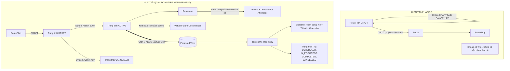
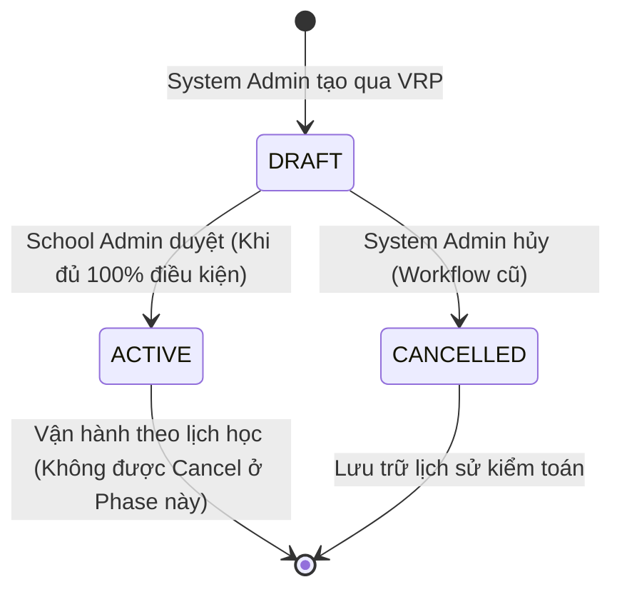
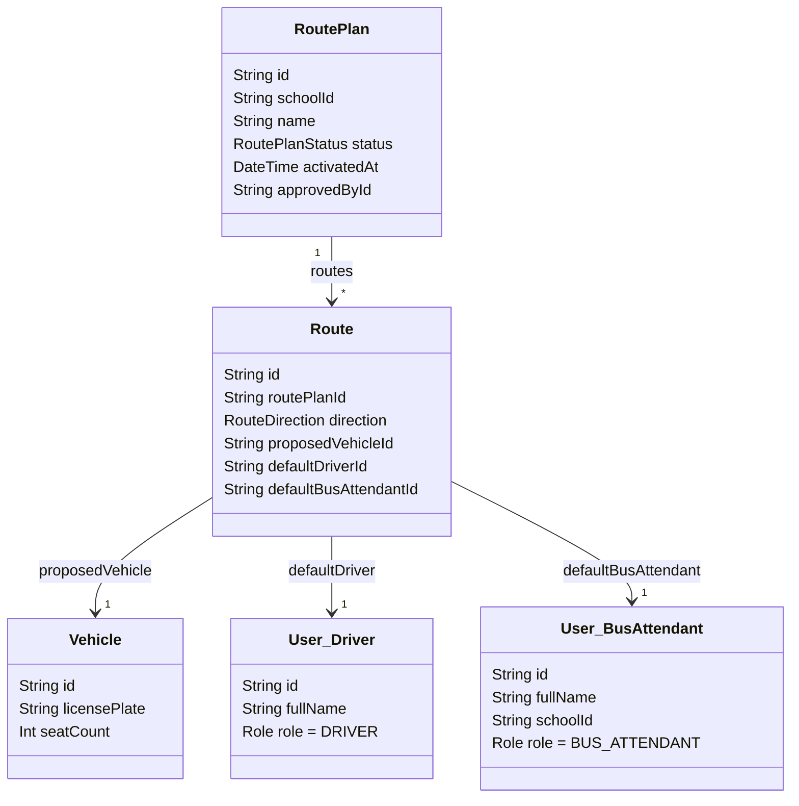
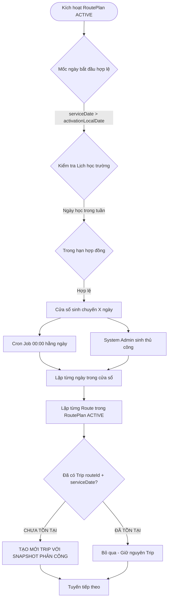
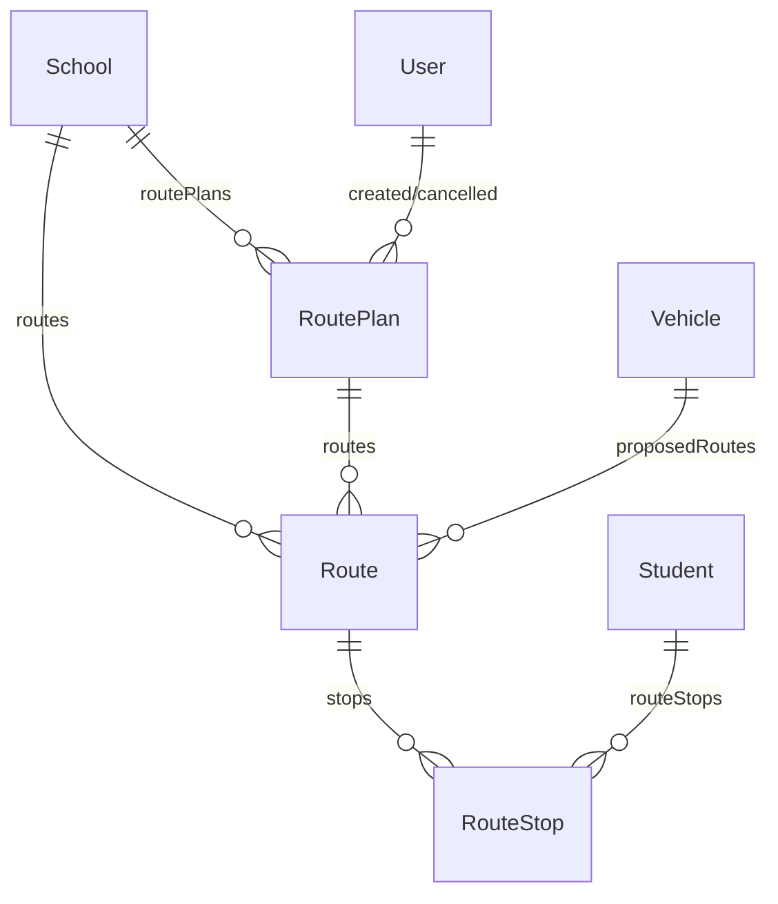
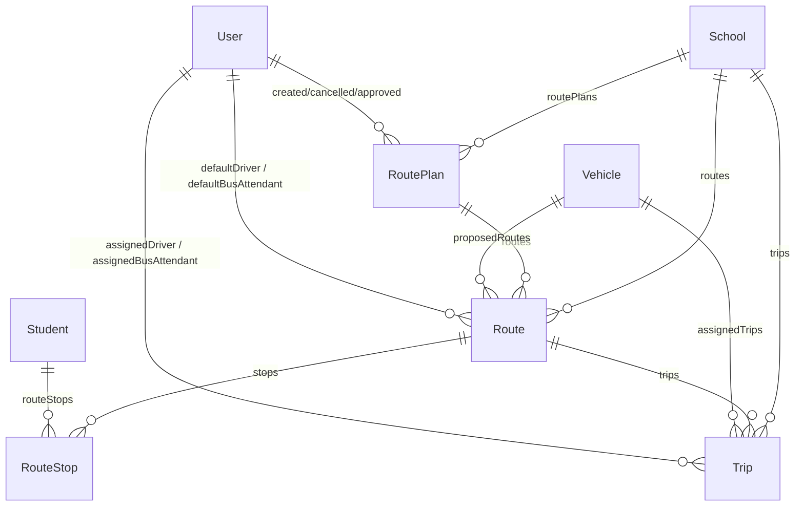
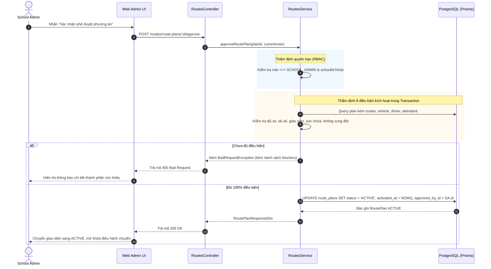
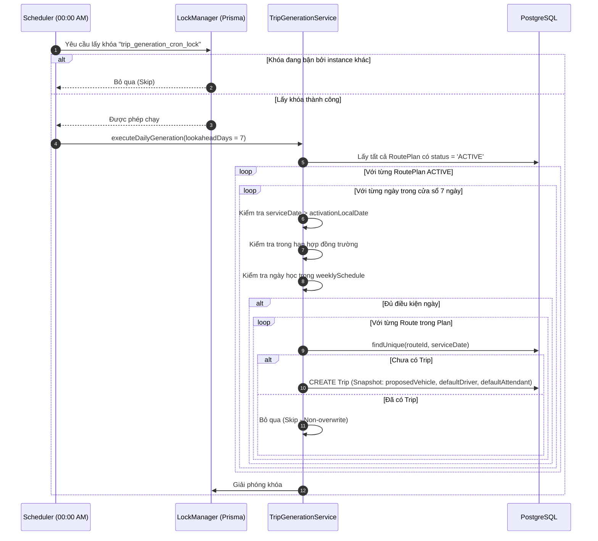
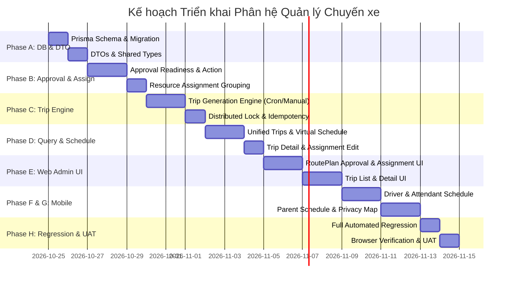

# BẢN THIẾT KẾ KIẾN TRÚC & KẾ HOẠCH TRIỂN KHAI TOÀN DIỆN
# PHÊ DUYỆT PHƯƠNG ÁN TUYẾN · PHÂN CÔNG NGUỒN LỰC · TỰ ĐỘNG SINH CHUYẾN XE · QUẢN LÝ CHUYẾN XE WEB & MOBILE
# ROADTOSCHOOL V2.0 — PHASE 1: ARCHITECTURE AUDIT & IMPLEMENTATION BLUEPRINT

> **Tài liệu chuẩn bị bởi:** Senior Solution Architect, Senior Backend Engineer (NestJS/Prisma), Full-Stack Engineer, Database Architect & QA Architect  
> **Thời điểm lập:** 24/10/2026 (GMT+7)  
> **Trạng thái:** DỰ THẢO THIẾT KẾ (AUDIT & PLANNING ONLY — ZERO CODE MODIFICATIONS)  
> **Tài liệu tham chiếu:**  
> - [docs/BUSINESS_CONTEXT.md](file:///c:/Users/chuon/Documents/work/road-to-school-v2/docs/BUSINESS_CONTEXT.md)  
> - [docs/WORKING_RULES.md](file:///c:/Users/chuon/Documents/work/road-to-school-v2/docs/WORKING_RULES.md)  
> - [docs/ai-review/LATEST.md](file:///c:/Users/chuon/Documents/work/road-to-school-v2/docs/ai-review/LATEST.md)  
> - [docs/ai-review/routeplan-first-management-plan.md](file:///c:/Users/chuon/Documents/work/road-to-school-v2/docs/ai-review/routeplan-first-management-plan.md)  
> - Mã nguồn thực tế: `api/prisma/schema.prisma`, `api/src/`, `web/src/`, `mobile/app/`

---

## MỤC LỤC CHI TIẾT

- [A. TÓM TẮT ĐIỀU HÀNH (EXECUTIVE SUMMARY)](#a-tóm-tắt-điều-hành-executive-summary)
- [B. HIỆN TRẠNG REPOSITORY ĐÃ XÁC MINH (VERIFIED REPOSITORY CONTEXT)](#b-hiện-trạng-repository-đã-xác-minh-verified-repository-context)
- [C. SỔ ĐĂNG KÝ QUYẾT ĐỊNH NGHIỆP VỤ (BUSINESS DECISION REGISTER)](#c-sổ-đăng-ký-quyết-định-nghiệp-vụ-business-decision-register)
- [D. SO SÁNH MÔ HÌNH HIỆN TẠI VÀ MỤC TIÊU (CURRENT VS TARGET ARCHITECTURE)](#d-so-sánh-mô-hình-hiện-tại-và-mục-tiêu-current-vs-target-architecture)
- [E. THIẾT KẾ QUY TRÌNH PHÊ DUYỆT PHƯƠNG ÁN (ROUTEPLAN APPROVAL DESIGN)](#e-thiết-kế-quy-trình-phê-duyệt-phương-án-routeplan-approval-design)
- [F. KIẾN TRÚC PHÂN CÔNG NGUỒN LỰC (RESOURCE ASSIGNMENT ARCHITECTURE)](#f-kiến-trúc-phân-công-nguồn-lực-resource-assignment-architecture)
- [G. ĐỘNG CƠ SINH CHUYẾN XE (TRIP GENERATION ENGINE)](#g-động-cơ-sinh-chuyến-xe-trip-generation-engine)
- [H. THIẾT KẾ CƠ SỞ DỮ LIỆU TỐI GIẢN (MINIMAL DATABASE DESIGN)](#h-thiết-kế-cơ-sở-dữ-liệu-tối-giản-minimal-database-design)
- [I. ĐẶC TẢ HỢP ĐỒNG API (API CONTRACTS & DTO SPECIFICATION)](#i-đặc-tả-hợp-đồng-api-api-contracts--dto-specification)
- [J. THIẾT KẾ WIREFRAME GIAO DIỆN WEB (WEB UI/UX WIREFRAMES)](#j-thiết-kế-wireframe-giao-diện-web-web-uiux-wireframes)
- [K. THIẾT KẾ WIREFRAME GIAO DIỆN MOBILE (MOBILE UI/UX WIREFRAMES)](#k-thiết-kế-wireframe-giao-diện-mobile-mobile-uiux-wireframes)
- [L. SƠ ĐỒ LUỒNG DỮ LIỆU & TUẦN TỰ (DATA FLOW & SEQUENCE DIAGRAMS)](#l-sơ-đồ-luồng-dữ-liệu--tuần-tự-data-flow--sequence-diagrams)
- [M. BẢO MẬT & QUYỀN RIÊNG TƯ (SECURITY & PRIVACY ARCHITECTURE)](#m-bảo-mật--quyền-riêng-tư-security--privacy-architecture)
- [N. ĐÁNH GIÁ 25 RỦI RO KỸ THUẬT & XUNG ĐỘT (TECHNICAL RISK ASSESSMENT)](#n-đánh-giá-25-rủi-ro-kỹ-thuật--xung-đột-technical-risk-assessment)
- [O. KẾ HOẠCH TRIỂN KHAI PHÂN PHASE (PHASED IMPLEMENTATION PLAN)](#o-kế-hoạch-triển-khai-phân-phase-phased-implementation-plan)
- [P. MA TRẬN KIỂM THỬ TOÀN DIỆN (COMPREHENSIVE TEST MATRIX)](#p-ma-trận-kiểm-thử-toàn-diện-comprehensive-test-matrix)
- [Q. TIÊU CHÍ NGHIỆM THU THỰC TẾ (ACCEPTANCE CRITERIA)](#q-tiêu-chí-nghiệm-thu-thực-tế-acceptance-criteria)
- [R. CÁC CÂU HỎI MỞ CẦN PO QUYẾT ĐỊNH (OPEN QUESTIONS)](#r-các-câu-hỏi-mở-cần-po-quyết-định-open-questions)
- [S. KẾT LUẬN MỨC ĐỘ SẴN SÀNG (IMPLEMENTATION READINESS)](#s-kết-luận-mức-độ-sẵn-sàng-implementation-readiness)

---

## A. TÓM TẮT ĐIỀU HÀNH (EXECUTIVE SUMMARY)

### 1. Bối cảnh & Sứ mệnh
RoadToSchool V2.0 đã hoàn tất giai đoạn thiết lập phương án tuyến với triết lý **RoutePlan-First Management**. Trong giai đoạn tiếp theo, hệ thống chuyển giao từ giai đoạn thiết kế tĩnh sang **vận hành thực tế theo ngày**:
$$\text{RoutePlan (Thiết kế)} \xrightarrow[\text{School Admin}]{\text{Phê duyệt}} \text{ACTIVE} \xrightarrow[\text{Cron / Manual}]{\text{Sinh chuyến lười}} \text{Trip (Chuyến xe hằng ngày)} \xrightarrow{\text{Điều hành}} \text{Web / Mobile UI}$$

### 2. Ba lớp dữ liệu độc lập
1. **RoutePlan (Phương án tuyến):** Aggregate Root quản lý phạm vi học sinh, ràng buộc, xe đề xuất, tài xế/giáo viên mặc định, trạng thái phê duyệt (`DRAFT`, `ACTIVE`, `CANCELLED`).
2. **Route (Định nghĩa hành trình):** Định nghĩa hình học đường đi (Polyline), trạm đón/trả (RouteStop), thời gian tích lũy, thời lượng dự kiến. Route là bất biến và không có trạng thái vòng đời riêng.
3. **Trip (Chuyến xe thực tế theo ngày):** Thực thể biểu diễn một lần thực thi Route vào một ngày dịch vụ cụ thể (`serviceDate`). Sở hữu snapshot phân công độc lập (Xe, Tài xế, Giáo viên) và trạng thái vận hành (`SCHEDULED`, `IN_PROGRESS`, `COMPLETED`, `CANCELLED`).

### 3. Phân định quyền hạn cốt lõi
- **`SYSTEM_ADMIN` (Nhà xe):** Tạo phương án, tối ưu VRP, lưu DRAFT, gán/đổi Xe mặc định, gán/đổi Tài xế mặc định, sinh chuyến xe thủ công (Manual Trip Generation), quản lý danh sách chuyến toàn hệ thống. **TUYỆT ĐỐI KHÔNG ĐƯỢC PHÉP PHÊ DUYỆT ROUTEPLAN (DRAFT $\rightarrow$ ACTIVE) TRONG BẤT KỲ TRƯỜNG HỢP NÀO.**
- **`SCHOOL_ADMIN` (Nhà trường):** Xem phương án trường mình, gán/đổi Giáo viên giám sát mặc định (Bus Attendant), **duy nhất có quyền Phê duyệt RoutePlan DRAFT $\rightarrow$ ACTIVE** khi đủ 100% điều kiện, quản lý chuyến xe trường mình, tinh chỉnh nhân sự/xe cho chuyến xe đơn lẻ. **Không được tạo RoutePlan, không được sinh chuyến thủ công.**
- **`DRIVER` / `BUS_ATTENDANT`:** Ứng dụng di động xem lịch tuần 7 ngày (Thứ 2 – Chủ nhật), xem chi tiết chuyến với bản đồ toàn màn hình và Bottom Sheet thông tin + danh sách học sinh theo thứ tự đón/trả.
- **`PARENT`:** Ứng dụng di động xem lịch học của con, xem lộ trình chuyến xe đưa đón với cơ chế **bảo vệ quyền riêng tư tuyệt đối (Privacy Masking)**: Chỉ hiển thị tên con mình, ẩn toàn bộ danh tính và địa chỉ nhà của học sinh khác.

---

## B. HIỆN TRẠNG REPOSITORY ĐÃ XÁC MINH (VERIFIED REPOSITORY CONTEXT)

Khảo sát trực tiếp mã nguồn thực tế tại repository:

### 1. Cơ sở dữ liệu (`api/prisma/schema.prisma`)
- **Model `User`:** Đã có `role: Role` (`SYSTEM_ADMIN`, `SCHOOL_ADMIN`, `DRIVER`, `BUS_ATTENDANT`, `PARENT`). Trường `schoolId String?` đã có sẵn và trỏ tới `School`. Đối với `BUS_ATTENDANT`, `schoolId` bắt buộc thuộc trường họ công tác. Đối với `DRIVER`, `schoolId` là null (thuộc quyền quản lý tập trung của Nhà xe).
- **Model `School`:** Đã có `contractStartDate @db.Date`, `contractEndDate @db.Date`, `weeklySchedule Json`.
- **Model `Vehicle`:** Đã có `licensePlate`, `brand`, `seatCount`, `color`.
- **Model `RoutePlan`:** Đã có `id`, `schoolId`, `name`, `status: RoutePlanStatus` (`DRAFT`, `CANCELLED`), `totalStudents`, `totalOutboundRoutes`, `totalReturnRoutes`, `createdById`, `cancelledAt`, `cancelledById`, `cancellationReason`.
- **Model `Route`:** Đã có `routePlanId`, `direction` (`TO_SCHOOL`, `TO_PARKING`), `proposedVehicleId`, `totalDistanceMeters`, `estimatedDurationSeconds`, `polylineGeometry`, `departureTime`, `arrivalTime`.
- **Model `RouteStop`:** Đã có `routeId`, `stopOrder`, `stopType` (`PARKING_START`, `PICKUP`, `SCHOOL_ARRIVAL`, `SCHOOL_DEPARTURE`, `DROPOFF`, `PARKING_END`), `studentId`, `addressText`, `latitude`, `longitude`, `plannedArrivalTime`.
- **Chưa có trong Prisma Schema:**
  - `model Trip` chưa tồn tại.
  - `enum TripStatus` chưa tồn tại.
  - `RoutePlanStatus` mới chỉ có `DRAFT`, `CANCELLED` (chưa có `ACTIVE`).
  - `RoutePlan` chưa có các trường kiểm toán phê duyệt: `activatedAt`, `approvedById`.
  - `Route` chưa có `defaultDriverId` và `defaultBusAttendantId`.

### 2. Kiến trúc API Backend (`api/src/`)
- Đang vận hành NestJS 12, Prisma 6.
- Đã có các modules: `AuthModule`, `SchoolsModule`, `StudentsModule`, `DriversModule`, `VehiclesModule`, `StudentRequestsModule`, `RoutesModule`, `SystemSettingsModule`.
- `schedule.validator.ts` trong `SchoolsModule` chuẩn hóa `weeklySchedule` dạng:
  ```json
  {
    "monday": { "start": "07:15", "end": "16:30" },
    "tuesday": { "start": "07:15", "end": "16:30" }
  }
  ```
- **Hạ tầng Cron/Scheduler:** Hiện tại `package.json` của `api` **chưa cài đặt `@nestjs/schedule`**. Chưa có bất kỳ cron job nào chạy nền.

### 3. Giao diện Quản trị Web (`web/src/`)
- Next.js 16 (Turbopack, App Router, TypeScript, Tailwind CSS).
- Menu Admin (`web/src/components/admin/admin-nav.config.ts`) hiện có 9 mục: `Tổng quan`, `Trường học`, `Tài xế`, `Phương tiện`, `Phương án tuyến` (`/admin/routes`), `Học sinh`, `Giáo viên` (`/admin/teachers`), `Yêu cầu`, `Cài đặt`.
- Đã hoàn thiện trang danh sách phương án `/admin/routes` và chi tiết phương án `/admin/routes/plans/[id]`.

### 4. Ứng dụng Di động Mobile (`mobile/app/`)
- Expo 58, React 19, React Native 0.88, React Native Reanimated 4.7.1, React Native WebView 14.0.1.
- Màn hình lịch trình `mobile/app/(tabs)/schedule.tsx` hiện là giao diện tĩnh (placeholder).
- Thư viện Bản đồ: Sử dụng `react-native-webview` nhúng MapLibre GL JS với Raster Tile VietMap (`EXPO_PUBLIC_VIETMAP_TILEMAP_KEY`).
- Bottom Sheet: Chưa cài thư viện ngoài `@gorhom/bottom-sheet`. Ứng dụng đã có `react-native-reanimated` có thể tự xây dựng Bottom Sheet 2 trạng thái an toàn, nhẹ và không xung đột native dependencies.

---

## C. SỔ ĐĂNG KÝ QUYẾT ĐỊNH NGHIỆP VỤ (BUSINESS DECISION REGISTER)

| Mã | Nội dung Quyết định | Phân loại | Căn cứ / Ghi chú |
| :--- | :--- | :--- | :--- |
| **BDR-01** | `RoutePlan` mở rộng trạng thái: `DRAFT`, `ACTIVE`, `CANCELLED`. Chỉ cho phép `DRAFT` $\rightarrow$ `ACTIVE` và `DRAFT` $\rightarrow$ `CANCELLED`. Không cho phép `ACTIVE` $\rightarrow$ `CANCELLED` trong giai đoạn này. | `[APPROVED BUSINESS RULE]` | Chỉ thị mục 3.1 của Product Owner. |
| **BDR-02** | `SYSTEM_ADMIN` tuyệt đối không có quyền phê duyệt `RoutePlan` từ `DRAFT` sang `ACTIVE`. Chỉ `SCHOOL_ADMIN` của trường sở hữu phương án mới có quyền. | `[APPROVED BUSINESS RULE]` | Chỉ thị mục 3.2 & 3.3. Bảo vệ tính khách quan của Nhà trường. |
| **BDR-03** | Điều kiện kích hoạt (`ACTIVE`): Tất cả Route phải có đủ 3 thành phần hợp lệ: Vehicle, Driver, Bus Attendant. Không có bất kỳ assignment nào null. | `[APPROVED BUSINESS RULE]` | Chỉ thị mục 3.4. |
| **BDR-04** | Một tài xế chỉ phục vụ 1 trường trong khoảng thời gian hợp đồng chồng lấn (`Overlapping Contract`). | `[APPROVED BUSINESS RULE]` | Chỉ thị mục 4.3. Ràng buộc nguồn lực Nhà xe. |
| **BDR-05** | Phân công mặc định theo nhóm xe (`Vehicle-Based Assignment Group`): Các tuyến cùng chung xe trong một phương án sẽ dùng chung Tài xế và Giáo viên mặc định. Thay đổi áp dụng đồng bộ atomic. | `[APPROVED BUSINESS RULE]` | Chỉ thị mục 4.1, 4.2, 4.3, 4.4. |
| **BDR-06** | Cơ chế sinh chuyến: **Cơ chế 2 — Lazy / Windowed Trip Generation**. Không sinh trước toàn bộ hợp đồng. Cửa sổ sinh chuyến $X$ ngày cấu hình qua ENV `TRIP_GENERATION_LOOKAHEAD_DAYS` (mặc định 7 ngày). | `[APPROVED BUSINESS RULE]` | Chỉ thị mục 5.1 & 5.4. Tránh lãng phí tài nguyên DB. |
| **BDR-07** | Mốc ngày bắt đầu sinh chuyến: Bắt đầu từ **ngày học hợp lệ tiếp theo sau ngày RoutePlan được ACTIVE** (`serviceDate > activationLocalDate`). Không bao giờ sinh chuyến cho chính ngày ACTIVE. | `[APPROVED BUSINESS RULE]` | Chỉ thị mục 5.2. Đảm bảo thời gian chuẩn bị cho tài xế/giáo viên. |
| **BDR-08** | Tính lũy tiến & Idempotency: Kiểm tra và sinh theo từng chuyến xe (`trip-by-trip`), không bỏ qua cả ngày nếu đã có một số chuyến. Khóa duy nhất DB `(routeId, serviceDate)`. | `[APPROVED BUSINESS RULE]` | Chỉ thị mục 5.5. |
| **BDR-09** | Sinh chuyến thủ công (Manual Generation): Chỉ dành riêng cho `SYSTEM_ADMIN` theo 1 ngày hoặc 1 khoảng ngày. `SCHOOL_ADMIN` không có quyền này. | `[APPROVED BUSINESS RULE]` | Chỉ thị mục 5.6. |
| **BDR-10** | Độc lập dữ liệu chuyến: Đổi phân công mặc định trên RoutePlan không ghi đè lên các chuyến xe đã được tạo. Chuyến đã tạo giữ nguyên snapshot. | `[APPROVED BUSINESS RULE]` | Chỉ thị mục 4.6 & 5.8. |
| **BDR-11** | Tách biệt Virtual Schedule và Persisted Trip: Trên UI lịch, các ngày tương lai chưa sinh chuyến được hiển thị dưới dạng Virtual Occurrences (suy ra từ RoutePlan ACTIVE + weeklySchedule). Không lưu bản ghi ảo vào DB. | `[APPROVED BUSINESS RULE]` | Chỉ thị mục 8.1 - 8.3. |
| **BDR-12** | Phân trang danh sách chuyến xe Web: Phân trang bình thường theo số dòng (`page`, `limit`), không phân trang theo cụm ngày. Cột đầu tiên bên trái là Thứ / Ngày (có thể dùng rowSpan). | `[APPROVED BUSINESS RULE]` | Chỉ thị mục 9.2 & 9.3. |
| **BDR-13** | Bảo vệ quyền riêng tư Phụ huynh: Phụ huynh xem danh sách điểm dừng trên chuyến chỉ thấy tên con mình. Các học sinh khác hiển thị "Học sinh khác", ẩn số điện thoại và địa chỉ nhà chi tiết. | `[APPROVED BUSINESS RULE]` | Chỉ thị mục 14.4. Bảo vệ dữ liệu cá nhân (PII). |
| **BDR-14** | Tái cấu trúc phân công mặc định trên Prisma: Thêm `defaultDriverId` và `defaultBusAttendantId` trực tiếp vào bảng `routes`, kết hợp với `proposedVehicleId` sẵn có. Không cần tạo bảng phụ `AssignmentGroup`. | `[PROPOSED TECHNICAL DESIGN]` | Kiến trúc DB tối giản, hiệu quả truy vấn cao. |
| **BDR-15** | Cài đặt package `@nestjs/schedule` và triển khai `CronJobLockService` dựa trên Prisma Transaction để đảm bảo an toàn đa instance. | `[PROPOSED TECHNICAL DESIGN]` | Đảm bảo tính tin cậy của Scheduler không cần phụ thuộc Redis. |
| **BDR-16** | Xây dựng Persistent Bottom Sheet 2 trạng thái trên Mobile bằng `react-native-reanimated` có sẵn, không cài thư viện native mới. | `[PROPOSED TECHNICAL DESIGN]` | Tránh rủi ro build native trên Expo SDK 58. |

---

## D. SO SÁNH MÔ HÌNH HIỆN TẠI VÀ MỤC TIÊU (CURRENT VS TARGET ARCHITECTURE)



### So sánh chi tiết các thực thể

| Tiêu chí | Mô hình Hiện tại | Mô hình Mục tiêu |
| :--- | :--- | :--- |
| **Trạng thái RoutePlan** | `DRAFT`, `CANCELLED` | `DRAFT`, `ACTIVE`, `CANCELLED` |
| **Chủ thể Phê duyệt** | Không có phê duyệt (chỉ Confirm Preview thành DRAFT) | Duy nhất `SCHOOL_ADMIN` của trường sở hữu phương án |
| **Thành phần trên Route** | `proposedVehicleId` | `proposedVehicleId`, `defaultDriverId`, `defaultBusAttendantId` |
| **Nhóm Phân công** | Chỉ có xe đề xuất trên từng route | Nhóm theo xe (`Vehicle-Based Group`), đồng bộ tài xế và giáo viên |
| **Thực thể Vận hành** | Không có (chỉ có bảng tuyến tĩnh) | `Trip` (Chuyến xe theo ngày) có vòng đời độc lập |
| **Cơ chế Sinh chuyến** | Chưa có | Lazy / Windowed Trip Generation (Cron $X$ ngày + Manual sinh bù) |
| **Lịch trình tương lai** | Không hiển thị | Hợp nhất Persisted Trips + Virtual Occurrences |
| **Màn hình Admin Web** | Chỉ quản lý Phương án tuyến (`/admin/routes`) | Bổ sung Quản lý Chuyến xe (`/admin/trips`), Tab Chuyến xe tại Trường |
| **Ứng dụng Mobile** | Màn hình lịch trình là placeholder tĩnh | Lịch tuần 7 ngày, Bản đồ chuyến xe toàn màn hình, Bottom Sheet 2 trạng thái |

---

## E. THIẾT KẾ QUY TRÌNH PHÊ DUYỆT PHƯƠNG ÁN (ROUTEPLAN APPROVAL DESIGN)

### 1. Ma trận Trạng thái và Chuyển đổi (State Machine)



### 2. Bộ quy tắc Thẩm định Kích hoạt (8 Activation Validation Rules)
Trước khi chuyển trạng thái phương án từ `DRAFT` sang `ACTIVE`, hệ thống Backend chạy một quy trình xác thực toàn vẹn 8 bước trong Transaction:
1. **Trạng thái khởi tạo:** Phương án phải đang ở `status === RoutePlanStatus.DRAFT`.
2. **Sự tồn tại của các tuyến:** Phương án phải có ít nhất 1 tuyến chiều đi (`TO_SCHOOL`) và ít nhất 1 tuyến chiều về (`TO_PARKING`).
3. **Phân công đầy đủ (Zero-Null Rule):** Mọi tuyến thuộc phương án phải có đủ 3 khóa ngoại: `proposedVehicleId != null`, `defaultDriverId != null`, `defaultBusAttendantId != null`.
4. **Sức chứa xe (Vehicle Capacity):** `vehicle.seatCount >= route.studentCount` đối với từng tuyến trong phương án.
5. **Hiệu lực hợp đồng của Xe (Vehicle Contract Window):** Xe phải đang hoạt động (`isActive === true`), không bị trùng lịch với phương án ACTIVE khác của trường khác trong cùng khung giờ.
6. **Điều kiện Tài xế & Ràng buộc Đơn trường (Single-School Driver Rule):**
   - Tài xế phải có `role === Role.DRIVER` và `isActive === true`.
   - **Quy tắc bắt buộc:** Trong thời gian hợp đồng trường đang xét (`contractStartDate` $\rightarrow$ `contractEndDate`), tài xế này **không được** đang phục vụ trong bất kỳ phương án `ACTIVE` nào của một trường học khác có khoảng thời gian hợp đồng chồng lấn (`Overlapping Contract Period`).
7. **Điều kiện Giáo viên Giám sát (School Bus Attendant Rule):**
   - Giáo viên phải có `role === Role.BUS_ATTENDANT`, `isActive === true`.
   - Giáo viên bắt buộc phải có `user.schoolId === routePlan.schoolId` (thuộc biên chế trường sở hữu phương án).
8. **Đồng bộ Nhóm xe (Group Pairing Consistency):** Các tuyến trong cùng phương án sử dụng chung một `proposedVehicleId` bắt buộc phải có cùng `defaultDriverId` và `defaultBusAttendantId`.

### 3. Phân cấp Quyền hạn Phê duyệt (Strict RBAC Gate)
- **Nếu `currentUser.role === Role.SYSTEM_ADMIN`:**
  - Endpoint `POST /routes/route-plans/:id/approve` trả ngay `403 Forbidden`: *"Chỉ Quản trị viên trường học (SCHOOL_ADMIN) mới có thẩm quyền phê duyệt kích hoạt phương án tuyến."*
  - Trên giao diện Web Admin của System Admin: Tuyệt đối không hiển thị nút "Phê duyệt" hay "Kích hoạt".
- **Nếu `currentUser.role === Role.SCHOOL_ADMIN`:**
  - Kiểm tra `currentUser.schoolId === routePlan.schoolId`. Nếu khác, trả `403 Forbidden`.
  - Nếu phương án chưa đủ điều kiện: Nút trên UI bị vô hiệu hóa kèm tooltip giải thích chi tiết thành phần còn thiếu; nếu cố gọi API thì Backend từ chối với mã lỗi `400 Bad Request` kèm danh sách lý do cụ thể.

### 4. Dữ liệu Kiểm toán Kích hoạt (Activation Audit Fields)
Khi phê duyệt thành công, cập nhật bản ghi `RoutePlan`:
- `status`: Chuyển thành `RoutePlanStatus.ACTIVE`.
- `activatedAt`: Lưu `new Date()` (UTC).
- `approvedById`: Lưu ID của `currentUser` (School Admin).

---

## F. KIẾN TRÚC PHÂN CÔNG NGUỒN LỰC (RESOURCE ASSIGNMENT ARCHITECTURE)

### 1. Khái niệm Nhóm Phân công dựa trên Xe (Vehicle-Based Assignment Group)
Trong vận hành thực tế của RoadToSchool, một phương tiện thường đảm nhiệm cả cặp hành trình: một tuyến chiều đi đón học sinh tới trường vào buổi sáng và một tuyến chiều về đưa học sinh trả về nhà vào buổi chiều.
Do đó:
$$\text{Vehicle A} \iff \text{Route Đi 01} + \text{Route Về 01} \iff \text{Tài xế X} + \text{Giáo viên Y}$$

**Mô hình hóa dữ liệu tối giản (Zero Redundant Tables):**
Thay vì tạo bảng `AssignmentGroup` phức tạp, hệ thống định danh nhóm tự nhiên qua bộ đôi `(routePlanId, proposedVehicleId)` ngay trên bảng `routes`.



### 2. Quy trình Thay đổi Xe mặc định (Replace Vehicle)
- **Người thực hiện:** `SYSTEM_ADMIN`.
- **Phạm vi áp dụng:** Áp dụng đồng thời cho **toàn bộ các tuyến** trong phương án đang sử dụng Xe cũ $A$.
- **Xử lý Atomic trong Prisma Transaction:**
  ```ts
  await prisma.route.updateMany({
    where: { routePlanId: plan.id, proposedVehicleId: oldVehicleId },
    data: { proposedVehicleId: newVehicleId }
  });
  ```
- **Xác thực an toàn:**
  - Xe $B$ phải đang hoạt động (`isActive === true`).
  - Sức chứa của Xe $B$ phải lớn hơn hoặc bằng số lượng học sinh của **tất cả** các tuyến trong nhóm.
  - Xe $B$ không bị trùng lịch với phương án ACTIVE khác trong cùng khung thời gian hợp đồng của trường.
  - Nếu Xe $B$ đã có mặt trong phương án ở một nhóm tuyến khác: Hệ thống sẽ từ chối hành động để tránh việc gộp nhóm âm thầm làm sai lệch tài xế/giáo viên.

### 3. Quy trình Gán / Đổi Tài xế mặc định (Replace Driver)
- **Người thực hiện:** `SYSTEM_ADMIN`.
- **Phạm vi áp dụng:** Cập nhật đồng bộ `defaultDriverId` cho tất cả các tuyến thuộc cùng nhóm xe trong phương án.
- **Xác thực an toàn:**
  - Tài xế có `role === Role.DRIVER` và `isActive === true`.
  - Thẩm định quy tắc Đơn trường: Không phục vụ trường khác trong khoảng thời gian hợp đồng chồng lấn.
  - Không tạo ra tình trạng tài xế null nếu phương án đã `ACTIVE`.

### 4. Quy trình Gán / Đổi Giáo viên Giám sát (Assign/Replace Bus Attendant)
- **Người thực hiện:** `SCHOOL_ADMIN` của trường sở hữu phương án.
- **Phạm vi áp dụng:** Cập nhật đồng bộ `defaultBusAttendantId` cho tất cả các tuyến thuộc cùng nhóm xe trong phương án.
- **Xác thực an toàn:**
  - Giáo viên có `role === Role.BUS_ATTENDANT` và `isActive === true`.
  - Giáo viên có `schoolId === routePlan.schoolId`.

### 5. Nguyên tắc Bất biến khi Thay đổi sau khi Phương án đã ACTIVE
1. **Không cho phép gán NULL:** Sau khi phương án đã `ACTIVE`, bất kỳ thao tác đổi Xe, Tài xế, Giáo viên nào đều bắt buộc phải truyền ID mới hợp lệ. Không được hủy phân công thành null.
2. **Không đổi hình học tuyến:** Tuyệt đối không cho phép đổi geometry, danh sách trạm đón trả, hoặc danh sách học sinh trên Route đã ACTIVE.
3. **Bảo toàn Snapshot chuyến xe đã tạo (Non-Overwrite Rule):** Việc thay đổi phân công mặc định trên RoutePlan **chỉ áp dụng cho các chuyến xe trong tương lai chưa được sinh ra**. Toàn bộ các chuyến xe (`Trip`) đã tồn tại trong cơ sở dữ liệu sẽ giữ nguyên snapshot nhân sự và xe đã lưu, không bị tự động cập nhật hàng loạt.

---

## G. ĐỘNG CƠ SINH CHUYẾN XE (TRIP GENERATION ENGINE)

### 1. Chiến lược: Lazy / Windowed Trip Generation
Hệ thống áp dụng **Chiến lược 2 (Lazy / Windowed)** theo chỉ thị của Product Owner:
- Không tạo trước hàng nghìn chuyến xe cho cả năm học ngay khi phương án được kích hoạt.
- Tự động duy trì cửa sổ vận hành $X$ ngày tới thông qua Cron Job chạy hằng ngày.
- Cho phép Quản trị viên Nhà xe sinh chuyến thủ công chủ động cho một ngày hoặc một khoảng ngày cụ thể.



### 2. Mốc ngày Dịch vụ Hợp lệ Đầu tiên (Earliest Eligible Service Date)
Một chuyến xe chỉ được phép tạo khi thỏa mãn đồng thời 4 điều kiện:
1. **Phương án đã ACTIVE:** `routePlan.status === RoutePlanStatus.ACTIVE`.
2. **Quy tắc ngày hôm sau (Next-School-Day Rule):**
   $$\text{serviceDate} > \text{activationLocalDate}$$
   *Ví dụ:* Nếu phương án được duyệt vào lúc 10:30 Thứ Ba ngày 24/10/2026, ngày sớm nhất có thể sinh chuyến là ngày học hợp lệ tiếp theo (Thứ Tư ngày 25/10/2026). Tuyệt đối không sinh chuyến cho chính ngày 24/10/2026 để tránh xung đột vận hành đột xuất.
3. **Thời hạn Hợp đồng Trường:**
   $$\text{school.contractStartDate} \le \text{serviceDate} \le \text{school.contractEndDate}$$
4. **Lịch biểu Ngày học của Trường (`School.weeklySchedule`):**
   Thứ trong tuần của `serviceDate` (chuyển đổi theo múi giờ `Asia/Ho_Chi_Minh`) phải được định nghĩa trong `weeklySchedule` và có thời gian học hợp lệ (`start` và `end`).

### 3. Cấu hình Cron Job & Cơ chế Chống Chạy Trùng Lập
- **Biến môi trường:** `TRIP_GENERATION_LOOKAHEAD_DAYS` (mặc định = `7`).
- **Tần suất chạy:** Chạy mỗi ngày vào lúc `00:00:00` (theo múi giờ `Asia/Ho_Chi_Minh`).
- **Cửa sổ quét:** Từ ngày hiện tại đến ngày $(today + X - 1)$.
- **Cơ chế Distributed Lock không cần Redis (Prisma-based Lock):**
  Tận dụng bảng cấu hình `system_settings` đã có sẵn trong DB để quản lý khóa `trip_generation_cron_lock`:
  - Trước khi chạy, thực hiện update có điều kiện: ghi `lockedUntil = now + 10 minutes`.
  - Nếu bản ghi đang bị khóa bởi instance khác: Bỏ qua lần chạy này.
  - Khi hoàn tất: Giải phóng khóa.

### 4. Nguyên tắc Idempotency: Sinh Bù Từng Chuyến (Trip-by-Trip)
- **Không bỏ qua cả ngày:** Nếu một ngày yêu cầu 6 chuyến (3 tuyến đi, 3 tuyến về) mà trong DB đã có sẵn 4 chuyến do đã tạo trước đó, Cron Job sẽ **tạo bổ sung 2 chuyến còn thiếu**, tuyệt đối không bỏ qua cả ngày.
- **Khóa duy nhất cấp cơ sở dữ liệu:**
  `@@unique([routeId, serviceDate])`
  Đảm bảo ở mức database constraint: Không bao giờ xảy ra tình trạng sinh trùng một Route trong cùng một ngày, kể cả khi Cron Job và thao tác tạo thủ công của System Admin diễn ra cùng một thời điểm.
- **Xử lý Race Condition:** Sử dụng cú pháp `INSERT ... ON CONFLICT DO NOTHING` hoặc bắt lỗi mã `P2002` của Prisma để bỏ qua an toàn và tiếp tục xử lý các chuyến khác mà không làm gián đoạn cả batch.

### 5. Sinh chuyến Thủ công (Manual Generation by System Admin)
- **API Endpoint:** `POST /api/v1/trips/generate` (Chỉ dành riêng cho `SYSTEM_ADMIN`).
- **Đầu vào:**
  - `schoolId` (Tùy chọn: sinh cho 1 trường cụ thể hoặc tất cả các trường có phương án ACTIVE).
  - `fromDate` (YYYY-MM-DD).
  - `toDate` (YYYY-MM-DD). Nếu `fromDate === toDate`, hệ thống sinh cho đúng 1 ngày.
- **Cấu trúc Response chi tiết (Không trả thành công chung chung):**
  ```json
  {
    "totalEligible": 12,
    "createdCount": 4,
    "skippedCount": 8,
    "failedCount": 0,
    "failures": []
  }
  ```

### 6. Cấu trúc Snapshot khi Sinh Chuyến xe
Khi một bản ghi `Trip` được tạo ra:
- Sao chép `assignedVehicleId = route.proposedVehicleId`.
- Sao chép `assignedDriverId = route.defaultDriverId`.
- Sao chép `assignedBusAttendantId = route.defaultBusAttendantId`.
- Tính toán giờ khởi hành dự kiến (`scheduledStartTime`) và giờ đến dự kiến (`scheduledEndTime`) dựa trên thời lượng tuyến (`estimatedDurationSeconds`) và lịch học của thứ đó trong `School.weeklySchedule`.
- `status`: Khởi tạo mặc định là `SCHEDULED`.
- **Dữ liệu đường đi và trạm đón:** Tham chiếu trực tiếp đến `routeId` bất biến. Không nhân bản chuỗi `polylineGeometry` hay toàn bộ bảng `RouteStop` vào bảng Trip để tối ưu dung lượng DB.

---

## H. THIẾT KẾ CƠ SỞ DỮ LIỆU TỐI GIẢN (MINIMAL DATABASE DESIGN)

### 1. Sơ đồ Thực thể Quan hệ Hiện tại (Current ERD)


### 2. Sơ đồ Thực thể Quan hệ Đề xuất (Proposed Target ERD)


### 3. Chi tiết Thay đổi Schema Prisma

#### a. Mở rộng `RoutePlanStatus` Enum
```prisma
enum RoutePlanStatus {
  DRAFT
  ACTIVE
  CANCELLED
}
```

#### b. Cập nhật Model `RoutePlan`
Thêm 2 trường lưu vết kiểm toán phê duyệt:
```prisma
model RoutePlan {
  // ... các trường hiện có ...
  activatedAt         DateTime?       @map("activated_at")
  approvedById        String?         @map("approved_by_id")

  // Quan hệ mới
  approvedBy          User?           @relation("RoutePlanApprover", fields: [approvedById], references: [id], onDelete: SetNull)
}
```

#### c. Cập nhật Model `Route`
Thêm tài xế và giáo viên mặc định để hoàn thiện nhóm phân công:
```prisma
model Route {
  // ... các trường hiện có ...
  defaultDriverId          String?        @map("default_driver_id")
  defaultBusAttendantId    String?        @map("default_bus_attendant_id")

  // Quan hệ mới
  defaultDriver            User?          @relation("RouteDefaultDriver", fields: [defaultDriverId], references: [id], onDelete: SetNull)
  defaultBusAttendant      User?          @relation("RouteDefaultBusAttendant", fields: [defaultBusAttendantId], references: [id], onDelete: SetNull)
  trips                    Trip[]

  @@index([defaultDriverId])
  @@index([defaultBusAttendantId])
}
```

#### d. Thêm Mới `TripStatus` Enum & Model `Trip`
```prisma
enum TripStatus {
  SCHEDULED
  IN_PROGRESS
  COMPLETED
  CANCELLED
}

/// Bảng quản lý chuyến xe thực tế theo ngày
model Trip {
  id                     String         @id @default(uuid())
  routeId                String         @map("route_id")
  schoolId               String         @map("school_id")
  serviceDate            DateTime       @map("service_date") @db.Date
  direction              RouteDirection
  status                 TripStatus     @default(SCHEDULED)
  scheduledStartTime     String?        @map("scheduled_start_time") @db.VarChar(10)
  scheduledEndTime       String?        @map("scheduled_end_time") @db.VarChar(10)
  actualStartTime        DateTime?      @map("actual_start_time")
  actualEndTime          DateTime?      @map("actual_end_time")
  assignedVehicleId      String         @map("assigned_vehicle_id")
  assignedDriverId       String         @map("assigned_driver_id")
  assignedBusAttendantId String         @map("assigned_bus_attendant_id")
  cancellationReason     String?        @map("cancellation_reason") @db.VarChar(500)
  createdAt              DateTime       @default(now()) @map("created_at")
  updatedAt              DateTime       @updatedAt @map("updated_at")

  // Quan hệ
  route                  Route          @relation(fields: [routeId], references: [id], onDelete: Restrict)
  school                 School         @relation(fields: [schoolId], references: [id], onDelete: Restrict)
  assignedVehicle        Vehicle        @relation(fields: [assignedVehicleId], references: [id], onDelete: Restrict)
  assignedDriver         User           @relation("TripDriver", fields: [assignedDriverId], references: [id], onDelete: Restrict)
  assignedBusAttendant   User           @relation("TripBusAttendant", fields: [assignedBusAttendantId], references: [id], onDelete: Restrict)

  // Ràng buộc & Chỉ mục tối ưu truy vấn
  @@unique([routeId, serviceDate])
  @@index([schoolId, serviceDate])
  @@index([assignedDriverId, serviceDate])
  @@index([assignedBusAttendantId, serviceDate])
  @@index([assignedVehicleId, serviceDate])
  @@index([status, serviceDate])
  @@map("trips")
}
```

### 4. Chiến lược Migration An toàn (Zero Downtime / Non-Destructive)
- **Bước 1 (Additive Enum):** Thêm giá trị `'ACTIVE'` vào enum PostgreSQL `RoutePlanStatus`. Thao tác này là hoàn toàn additive, không ảnh hưởng dữ liệu cũ.
- **Bước 2 (Nullable Columns):** Thêm các trường `activatedAt`, `approvedById` vào `route_plans` và `default_driver_id`, `default_bus_attendant_id` vào `routes` dưới dạng nullable. Dữ liệu các phương án `DRAFT` và `CANCELLED` hiện tại không bị lỗi.
- **Bước 3 (Create Table):** Tạo bảng mới `trips` với foreign keys và unique constraint `(route_id, service_date)`.
- **Tuyệt đối không xóa hay đổi tên cột hiện hữu.**

---

## I. ĐẶC TẢ HỢP ĐỒNG API (API CONTRACTS & DTO SPECIFICATION)

### Nhóm 1: Phê duyệt Phương án tuyến (RoutePlan Approval)

#### 1.1. Lấy thông tin Sẵn sàng Phê duyệt (Approval Readiness)
- **Method & URL:** `GET /api/v1/routes/route-plans/:id/approval-readiness`
- **Vai trò cho phép:** `SYSTEM_ADMIN`, `SCHOOL_ADMIN` (trường của mình).
- **Mục đích:** Kiểm tra xem phương án đã đủ điều kiện để School Admin phê duyệt hay chưa.
- **Response DTO:**
  ```json
  {
    "routePlanId": "plan-uuid-1",
    "status": "DRAFT",
    "isReadyForApproval": false,
    "summary": {
      "totalRoutes": 4,
      "routesWithVehicle": 4,
      "routesWithDriver": 4,
      "routesWithBusAttendant": 2
    },
    "blockers": [
      {
        "code": "MISSING_BUS_ATTENDANT",
        "routeId": "route-uuid-3",
        "routeName": "Tuyến Đi 02",
        "message": "Chưa gán Giáo viên giám sát mặc định cho tuyến"
      }
    ]
  }
  ```

#### 1.2. Phê duyệt Kích hoạt Phương án (Approve RoutePlan)
- **Method & URL:** `POST /api/v1/routes/route-plans/:id/approve`
- **Vai trò cho phép:** **DUY NHẤT `SCHOOL_ADMIN`** (thuộc trường của phương án).
- **Mục đích:** Chuyển trạng thái phương án từ `DRAFT` sang `ACTIVE`.
- **Request Payload:** Trống `{}`.
- **Xác thực & Lỗi:**
  - `401 Unauthorized`: Chưa đăng nhập.
  - `403 Forbidden`: Nếu người gọi là `SYSTEM_ADMIN` hoặc `SCHOOL_ADMIN` trường khác.
  - `400 Bad Request`: Nếu phương án chưa đủ điều kiện (trả về danh sách blockers).
  - `409 Conflict`: Nếu trạng thái phương án không còn là `DRAFT`.
- **Response DTO:** Trả về `RoutePlanResponseDto` với `status: "ACTIVE"`, `activatedAt`, `approvedById`.

---

### Nhóm 2: Cập nhật Phân công Mặc định (RoutePlan Assignments)

#### 2.1. Thay đổi Xe mặc định cho Nhóm tuyến (Replace Vehicle)
- **Method & URL:** `PATCH /api/v1/routes/route-plans/:id/assignments/vehicle`
- **Vai trò cho phép:** `SYSTEM_ADMIN`.
- **Request Body:**
  ```json
  {
    "currentVehicleId": "veh-old-uuid",
    "newVehicleId": "veh-new-uuid"
  }
  ```
- **Xử lý:** Cập nhật đồng bộ `proposedVehicleId = newVehicleId` cho toàn bộ các tuyến trong plan đang dùng `veh-old-uuid`.

#### 2.2. Gán / Đổi Tài xế mặc định cho Nhóm xe (Replace Driver)
- **Method & URL:** `PATCH /api/v1/routes/route-plans/:id/assignments/driver`
- **Vai trò cho phép:** `SYSTEM_ADMIN`.
- **Request Body:**
  ```json
  {
    "vehicleId": "veh-uuid-1",
    "driverId": "driver-user-uuid"
  }
  ```

#### 2.3. Gán / Đổi Giáo viên Giám sát cho Nhóm xe (Assign Bus Attendant)
- **Method & URL:** `PATCH /api/v1/routes/route-plans/:id/assignments/bus-attendant`
- **Vai trò cho phép:** `SCHOOL_ADMIN` (trường của mình).
- **Request Body:**
  ```json
  {
    "vehicleId": "veh-uuid-1",
    "busAttendantId": "teacher-user-uuid"
  }
  ```

---

### Nhóm 3: Động cơ Sinh chuyến xe (Trip Generation Engine)

#### 3.1. Sinh chuyến xe Thủ công (Manual Generation)
- **Method & URL:** `POST /api/v1/trips/generate`
- **Vai trò cho phép:** **DUY NHẤT `SYSTEM_ADMIN`**.
- **Request Body:**
  ```json
  {
    "schoolId": "school-uuid-1", // Tùy chọn, nếu bỏ trống sẽ sinh cho mọi trường có ACTIVE plan
    "fromDate": "2026-10-26",
    "toDate": "2026-10-30"
  }
  ```
- **Response DTO:**
  ```json
  {
    "totalEligible": 20,
    "createdCount": 16,
    "skippedCount": 4,
    "failedCount": 0,
    "failures": []
  }
  ```

---

### Nhóm 4: Quản lý Chuyến xe & Lịch trình Hợp nhất (Trip Management & Schedule)

#### 4.1. Lấy Danh sách Chuyến xe Hợp nhất (Unified Trips Schedule)
- **Method & URL:** `GET /api/v1/trips`
- **Vai trò cho phép:** `SYSTEM_ADMIN`, `SCHOOL_ADMIN` (bị khóa trường).
- **Query Params:**
  - `page`: number (mặc định 1)
  - `limit`: number (mặc định 10 hoặc 20)
  - `schoolId`: string (SYSTEM_ADMIN có thể chọn; SCHOOL_ADMIN bị ép theo trường của mình)
  - `fromDate`: YYYY-MM-DD
  - `toDate`: YYYY-MM-DD
  - `status`: `SCHEDULED`, `IN_PROGRESS`, `COMPLETED`, `CANCELLED`
- **Response DTO (Hợp nhất Persisted Trips & Virtual Occurrences):**
  ```json
  {
    "items": [
      {
        "type": "PERSISTED",
        "tripId": "trip-uuid-101",
        "serviceDate": "2026-10-26",
        "dayOfWeek": "Thứ 2",
        "routeId": "route-uuid-1",
        "routeName": "Tuyến Đi 01",
        "direction": "TO_SCHOOL",
        "schoolId": "school-uuid-1",
        "schoolName": "Tiểu Học FPT",
        "scheduledTime": "06:15 - 07:10",
        "vehiclePlate": "51B-731.33",
        "driverName": "Nguyễn Văn Lái",
        "busAttendantName": "Trần Thị Cô",
        "studentCount": 14,
        "status": "SCHEDULED"
      },
      {
        "type": "VIRTUAL",
        "virtualId": "virtual_route1_2026-11-02",
        "serviceDate": "2026-11-02",
        "dayOfWeek": "Thứ 2",
        "routeId": "route-uuid-1",
        "routeName": "Tuyến Đi 01",
        "direction": "TO_SCHOOL",
        "schoolId": "school-uuid-1",
        "schoolName": "Tiểu Học FPT",
        "scheduledTime": "06:15 - 07:10",
        "vehiclePlate": "51B-731.33",
        "driverName": "Nguyễn Văn Lái",
        "busAttendantName": "Trần Thị Cô",
        "studentCount": 14,
        "status": "NOT_CREATED"
      }
    ],
    "total": 35,
    "page": 1,
    "totalPages": 4
  }
  ```

#### 4.2. Lấy Chi tiết Chuyến xe (Trip Detail)
- **Method & URL:** `GET /api/v1/trips/:id`
- **Vai trò cho phép:** `SYSTEM_ADMIN`, `SCHOOL_ADMIN` (trường của mình).
- **Mục đích:** Xem đầy đủ thông tin chuyến xe đã tạo, vị trí xe/lái xe thực tế, hình học tuyến và timeline các trạm đón/trả.
- **Lưu ý:** Chỉ gọi được cho `type === 'PERSISTED'` (có `tripId` thật trong DB).

#### 4.3. Tinh chỉnh Phân công cho Chuyến xe Cụ thể (Update Trip Assignment)
- **Method & URL:** `PATCH /api/v1/trips/:id/assignments`
- **Vai trò cho phép:** `SYSTEM_ADMIN`, `SCHOOL_ADMIN` (trường của mình).
- **Request Body:**
  ```json
  {
    "vehicleId": "veh-substitute-uuid",
    "driverId": "driver-substitute-uuid",
    "busAttendantId": "teacher-substitute-uuid"
  }
  ```
- **Xử lý:** Chỉ cập nhật đúng bản ghi `Trip` này, **không làm thay đổi cấu hình mặc định của RoutePlan**, không ảnh hưởng các chuyến khác.

---

### Nhóm 5: Lịch trình Vận hành Di động (Mobile Schedule APIs)

#### 5.1. Lịch Vận hành Tài xế (`DRIVER`)
- **Method & URL:** `GET /api/v1/mobile/driver/schedule?date=YYYY-MM-DD`
- **Xác thực:** Bearer Token của `DRIVER`.
- **Xử lý:** Lọc danh sách chuyến xe được phân công `assignedDriverId === currentUser.id` cho ngày được chọn.

#### 5.2. Lịch Vận hành Giáo viên Giám sát (`BUS_ATTENDANT`)
- **Method & URL:** `GET /api/v1/mobile/bus-attendant/schedule?date=YYYY-MM-DD`
- **Xác thực:** Bearer Token của `BUS_ATTENDANT`.
- **Xử lý:** Lọc danh sách chuyến xe được phân công `assignedBusAttendantId === currentUser.id` cho ngày được chọn.

#### 5.3. Lịch Đưa đón Học sinh cho Phụ huynh (`PARENT`)
- **Method & URL:** `GET /api/v1/mobile/parent/students/:studentId/schedule?date=YYYY-MM-DD`
- **Xác thực:** Bearer Token của `PARENT`. Kiểm tra quan hệ `ParentStudentLink`.
- **Xử lý Privacy-Safe:** Trả về danh sách chuyến xe mà học sinh có trạm đón/trả.
- **API Chi tiết Chuyến cho Phụ huynh:** Trả về danh sách trạm với tên học sinh khác bị ẩn:
  ```json
  {
    "tripId": "trip-uuid-1",
    "serviceDate": "2026-10-26",
    "direction": "TO_SCHOOL",
    "stops": [
      { "stopOrder": 1, "type": "PARKING_START", "name": "Bãi xe trung tâm", "isMyChild": false },
      { "stopOrder": 2, "type": "PICKUP", "name": "Điểm đón học sinh", "isMyChild": false },
      { "stopOrder": 3, "type": "PICKUP", "name": "Nguyễn Văn An (Con bạn)", "isMyChild": true, "addressText": "12 Nguyễn Trãi, Q5" },
      { "stopOrder": 4, "type": "SCHOOL_ARRIVAL", "name": "Trường Tiểu Học FPT", "isMyChild": false }
    ]
  }
  ```

---

## J. THIẾT KẾ WIREFRAME GIAO DIỆN WEB (WEB UI/UX WIREFRAMES)

### Wireframe 1: Chi tiết Phương án DRAFT — Phân công Nguồn lực (`SYSTEM_ADMIN`)
```
+----------------------------------------------------------------------------------------------------+
|  < Quay lại danh sách phương án                                                                    |
|  Phương án tuyến Tiểu Học FPT - 24/10/2026   [ Bản nháp DRAFT ]                     [ Hủy phương án]|
|  Trường: Tiểu Học FPT | Tạo ngày: 24/10/2026 14:00 | Người tạo: admin@r2s.com                       |
+----------------------------------------------------------------------------------------------------+
|  [ 4 ] TỔNG SỐ TUYẾN   |  [ 2 ] TUYẾN ĐI   |  [ 2 ] TUYẾN VỀ   |  [ 28 ] HỌC SINH DỰ KIẾN          |
+----------------------------------------------------------------------------------------------------+
|  Thông báo: Phương án đang ở trạng thái DRAFT. System Admin cần hoàn tất phân công Xe và Tài xế.   |
|  Sau khi hoàn tất, School Admin sẽ tiến hành kiểm tra và phê duyệt phương án.                      |
+----------------------------------------------------------------------------------------------------+
|  BẢNG PHÂN CÔNG NHÓM XE & NHÂN SỰ                                                                 |
|  +--------------------+------------+--------------------------+---------------------+------------+ |
|  | NHÓM XE            | SỨC CHỨA   | TÀI XẾ MẶC ĐỊNH          | GIÁO VIÊN MẶC ĐỊNH  | THAO TÁC   | |
|  +--------------------+------------+--------------------------+---------------------+------------+ |
|  | 51B-731.33 (Solati)| 16 chỗ     | Nguyễn Văn Lái (0901..)  | Trần Thị Cô (Trường)| [Đổi xe/TX]| |
|  | (Tuyến Đi 01, Về 01| Học sinh:14|                          |                     |            | |
|  +--------------------+------------+--------------------------+---------------------+------------+ |
|  | 51B-888.99 (Ford)  | 16 chỗ     | Lê Hoàng Nam (0902..)    | [Chưa phân công]    | [Đổi xe/TX]| |
|  | (Tuyến Đi 02, Về 02| Học sinh:14|                          | (Chờ School Admin)  |            | |
|  +--------------------+------------+--------------------------+---------------------+------------+ |
+----------------------------------------------------------------------------------------------------+
|  TABS CÁC TUYẾN HÀNH TRÌNH:  [ Tất cả (4) ]  [ Chiều đi (2) ]  [ Chiều về (2) ]                     |
|  (Bảng danh sách tuyến xem chi tiết bản đồ tương tự hiện tại)                                      |
+----------------------------------------------------------------------------------------------------+
```

---

### Wireframe 2: Chi tiết Phương án DRAFT — Thẩm định & Phê duyệt (`SCHOOL_ADMIN`)
```
+----------------------------------------------------------------------------------------------------+
|  < Quay lại phương án trường                                                                       |
|  Phương án tuyến Tiểu Học FPT - 24/10/2026   [ Bản nháp DRAFT ]                                    |
|  Trường: Tiểu Học FPT | Tạo ngày: 24/10/2026 14:00                                                  |
+----------------------------------------------------------------------------------------------------+
|  [ 4 ] TỔNG SỐ TUYẾN   |  [ 2 ] TUYẾN ĐI   |  [ 2 ] TUYẾN VỀ   |  [ 28 ] HỌC SINH DỰ KIẾN          |
+----------------------------------------------------------------------------------------------------+
|  TIÊU CHÍ SẴN SÀNG KÍCH HOẠT PHƯƠNG ÁN (READINESS CHECKLIST):                                       |
|  [✓] 100% Tuyến đã gán phương tiện hợp lệ (2/2 nhóm xe)                                            |
|  [✓] 100% Phương tiện đủ sức chứa học sinh                                                         |
|  [✓] 100% Tuyến đã gán tài xế đạt chuẩn (2/2 nhóm xe)                                              |
|  [!] Còn 1 nhóm xe chưa phân công Giáo viên giám sát (1/2 đã gán)                                  |
|                                                                                                    |
|  >>> Vui lòng gán Giáo viên giám sát cho Nhóm xe 51B-888.99 để kích hoạt nút phê duyệt.             |
|                                                                                                    |
|  [ XÁC NHẬN PHÊ DUYỆT PHƯƠNG ÁN ]  <-- BỊ VÔ HIỆU HÓA (DISABLED) NẾU CÒN THIẾU                     |
+----------------------------------------------------------------------------------------------------+
|  BẢNG PHÂN CÔNG GIÁO VIÊN GIÁM SÁT (BUS ATTENDANT):                                                |
|  +--------------------+--------------------------+------------------------+----------------------+ |
|  | NHÓM XE            | TÀI XẾ (DO NHÀ XE GÁN)   | GIÁO VIÊN GIÁM SÁT     | THAO TÁC             | |
|  +--------------------+--------------------------+------------------------+----------------------+ |
|  | 51B-731.33         | Nguyễn Văn Lái           | Trần Thị Cô            | [Đổi giáo viên]      | |
|  +--------------------+--------------------------+------------------------+----------------------+ |
|  | 51B-888.99         | Lê Hoàng Nam             | [--- Chưa chọn ---]    | [+ Gán giáo viên]    | |
|  +--------------------+--------------------------+------------------------+----------------------+ |
+----------------------------------------------------------------------------------------------------+
```

---

### Wireframe 3: Chi tiết Phương án ACTIVE — Đã Kích hoạt Vận hành
```
+----------------------------------------------------------------------------------------------------+
|  < Quay lại danh sách phương án                                                                    |
|  Phương án tuyến Tiểu Học FPT - 24/10/2026   [ ĐANG VẬN HÀNH (ACTIVE) ]                            |
|  Trường: Tiểu Học FPT | Phê duyệt ngày: 24/10/2026 15:30 bởi Cô Mai (School Admin)                 |
+----------------------------------------------------------------------------------------------------+
|  [ 4 ] TỔNG SỐ TUYẾN   |  [ 2 ] TUYẾN ĐI   |  [ 2 ] TUYẾN VỀ   |  [ 28 ] HỌC SINH ĐƯA ĐÓN          |
+----------------------------------------------------------------------------------------------------+
|  Trạng thái: Phương án đã được kích hoạt. Các chuyến xe đang được tự động sinh theo lịch học tuần. |
|  Ghi chú: Thay đổi nhân sự/xe mặc định sẽ áp dụng cho các chuyến xe trong tương lai chưa sinh.      |
+----------------------------------------------------------------------------------------------------+
|  BẢNG ĐIỀU PHỐI NGUỒN LỰC VẬN HÀNH:                                                                |
|  +--------------------+------------+--------------------------+---------------------+------------+ |
|  | NHÓM XE            | SỨC CHỨA   | TÀI XẾ                   | GIÁO VIÊN GIÁM SÁT  | THAY ĐỔI   | |
|  +--------------------+------------+--------------------------+---------------------+------------+ |
|  | 51B-731.33         | 16 chỗ     | Nguyễn Văn Lái           | Trần Thị Cô         | [Điều phối]| |
|  +--------------------+------------+--------------------------+---------------------+------------+ |
|  | 51B-888.99         | 16 chỗ     | Lê Hoàng Nam             | Vũ Thị Lan          | [Điều phối]| |
|  +--------------------+------------+--------------------------+---------------------+------------+ |
+----------------------------------------------------------------------------------------------------+
```

---

### Wireframe 4: Quản lý Chuyến xe Hệ thống (`SYSTEM_ADMIN`) — Cột Ngày Bên Trái
```
+----------------------------------------------------------------------------------------------------+
|  Quản lý Chuyến xe (Trips)                                                [+ Sinh chuyến thủ công] |
|  Theo dõi, điều phối và kiểm soát các chuyến xe đưa đón học sinh theo ngày                         |
+----------------------------------------------------------------------------------------------------+
|  BỘ LỌC:                                                                                           |
|  Từ ngày: [ 26/10/2026 ]  Đến ngày: [ 30/10/2026 ]  Trường: [ Tất cả trường v ]  Trạng thái: [Tất cả] |
+----------------------------------------------------------------------------------------------------+
|  DANH SÁCH CHUYẾN XE THEO LỊCH VẬN HÀNH:                                                           |
|  +---------------+-------------+--------------+-------+-------------+------------+---------------+ |
|  | THỨ / NGÀY    | CHUYẾN XE   | TRƯỜNG       | GIỜ   | XE & TÀI XẾ | TRẠNG THÁI | THAO TÁC      | |
|  +---------------+-------------+--------------+-------+-------------+------------+---------------+ |
|  | Thứ 2         | Tuyến Đi 01 | Tiểu Học FPT | 06:15 | 51B-731.33  | Chờ chạy   | [Xem chi tiết]| |
|  | 26/10/2026    |             |              |       | NV Lái      | (SCHEDULED)|               | |
|  |               +-------------+--------------+-------+-------------+------------+---------------+ |
|  | (rowSpan = 3) | Tuyến Đi 02 | Tiểu Học FPT | 06:20 | 51B-888.99  | Chờ chạy   | [Xem chi tiết]| |
|  |               |             |              |       | LH Nam      |            |               | |
|  |               +-------------+--------------+-------+-------------+------------+---------------+ |
|  |               | Tuyến Về 01 | Tiểu Học FPT | 16:30 | 51B-731.33  | Chờ chạy   | [Xem chi tiết]| |
|  +---------------+-------------+--------------+-------+-------------+------------+---------------+ |
|  | Thứ 3         | Tuyến Đi 01 | THCS An Hòa  | 06:10 | 51B-123.45  | Chờ chạy   | [Xem chi tiết]| |
|  | 27/10/2026    |             |              |       | TQ Tuấn     |            |               | |
|  |               +-------------+--------------+-------+-------------+------------+---------------+ |
|  | (rowSpan = 2) | Tuyến Đi 02 | THCS An Hòa  | 06:25 | 51B-999.00  | Chưa tạo   | (Lịch dự kiến)| |
|  |               |             |              |       | [Dự kiến]   | (VIRTUAL)  |               | |
|  +---------------+-------------+--------------+-------+-------------+------------+---------------+ |
|  Hiển thị 1 - 10 trong tổng số 35 chuyến xe                      Trang: [ < ]  [ 1 ]  2  3  [ > ]  |
+----------------------------------------------------------------------------------------------------+
```

---

### Wireframe 5: Tab Chuyến xe tại Màn hình Chi tiết Trường (`School Detail`)
```
+----------------------------------------------------------------------------------------------------+
|  Trường Tiểu Học FPT                                                                               |
|  Địa chỉ: Đường D1, Khu Công Nghệ Cao, TP. Thủ Đức                                                 |
+----------------------------------------------------------------------------------------------------+
|  TABS:  [ Tổng quan ]   [ Học sinh ]   [ Nhân viên ]   [ Phương án tuyến ]   [ CHUYẾN XE (TRIPS) *]|
+----------------------------------------------------------------------------------------------------+
|  (Bảng danh sách chuyến xe được cố định schoolId = Tiểu Học FPT, ẩn dropdown chọn trường khác)      |
|  Lọc ngày: [ 26/10/2026 ] -> [ 01/11/2026 ]   Trạng thái: [ Tất cả v ]                              |
|  +---------------+-------------+-------+--------------------+---------------------+----------------+ |
|  | THỨ / NGÀY    | CHUYẾN XE   | GIỜ   | XE & TÀI XẾ        | GIÁO VIÊN GIÁM SÁT  | THAO TÁC       | |
|  +---------------+-------------+-------+--------------------+---------------------+----------------+ |
|  | Thứ 2 26/10   | Tuyến Đi 01 | 06:15 | 51B-731.33 (Lái)   | Trần Thị Cô         | [Xem chi tiết] | |
|  +---------------+-------------+-------+--------------------+---------------------+----------------+ |
+----------------------------------------------------------------------------------------------------+
```

---

### Wireframe 6: Quản lý Chuyến xe Dành cho `SCHOOL_ADMIN`
- Tương tự Wireframe 5 nhưng nằm ở menu chính `/admin/trips` của School Admin.
- Không có nút `[+ Sinh chuyến thủ công]`.
- Dữ liệu bị cô lập hoàn toàn cho trường của School Admin.

---

### Wireframe 7: Màn hình Chi tiết Chuyến xe (`Trip Detail` — `/admin/trips/[id]`)
```
+----------------------------------------------------------------------------------------------------+
|  < Quay lại danh sách chuyến xe                                                                    |
|  Chuyến xe: Tuyến Đi 01 - Thứ 2, 26/10/2026                 [ ĐÃ LẬP LỊCH (SCHEDULED) ]           |
|  Trường: Tiểu Học FPT | Giờ dự kiến: 06:15 - 07:10 (55 phút) | Quãng đường: 18.2 km                |
+----------------------------------------------------------------------------------------------------+
|  THÔNG TIN VẬN HÀNH THỰC TẾ TRÊN CHUYẾN:                                   [ Đổi phân công chuyến ]|
|  - Phương tiện: 51B-731.33 (Hyundai Solati 16 chỗ)                                                 |
|  - Tài xế phụ trách: Nguyễn Văn Lái (SĐT: 0901.234.567)                                            |
|  - Giáo viên giám sát: Trần Thị Cô (SĐT: 0909.888.777)                                             |
|  - Số học sinh đón: 14 học sinh                                                                    |
+----------------------------------------------------------------------------------------------------+
|  BỐ CỤC 2 CỘT:                                                                                     |
|  [ BẢN ĐỒ LỘ TRÌNH THỰC TẾ ]               | [ TIMELINE CÁC ĐIỂM DỪNG ]                            |
|  (MapLibre render polyline chuẩn,          | 1. [06:15] Bãi xe trung tâm (Xuất phát)               |
|   marker Bãi xe, Trường học,               | 2. [06:22] Điểm 1: 12 Nguyễn Trãi - Đón em Hoàng Nam  |
|   các trạm đón học sinh)                   | 3. [06:30] Điểm 2: 45 Lê Lợi - Đón em Mai Anh        |
|                                            | ...                                                   |
|                                            | 10. [07:10] Trường Tiểu Học FPT (Đến trường)          |
+----------------------------------------------------------------------------------------------------+
```

---

### Wireframe 8: Modal Tinh chỉnh Phân công cho Chuyến xe Đơn lẻ
```
+-------------------------------------------------------------------+
|  ĐIỀU PHỐI PHÂN CÔNG CHUYẾN XE                                [ X ]|
|  Chuyến: Tuyến Đi 01 (Ngày 26/10/2026)                            |
|  Lưu ý: Thay đổi này CHỈ áp dụng cho chuyến xe này.               |
+-------------------------------------------------------------------+
|  Phương tiện thay thế:                                            |
|  [ 51B-731.33 (Solati 16 chỗ) - Hiện tại                        v ]|
|                                                                   |
|  Tài xế thay thế:                                                 |
|  [ Nguyễn Văn Lái (0901.234.567) - Hiện tại                     v ]|
|                                                                   |
|  Giáo viên giám sát thay thế:                                     |
|  [ Trần Thị Cô (Trường TH FPT) - Hiện tại                       v ]|
+-------------------------------------------------------------------+
|  Lý do điều phối (bắt buộc):                                      |
|  [ Tài xế chính xin nghỉ đột xuất, điều xe dự phòng...           ]|
+-------------------------------------------------------------------+
|                                      [ Hủy bỏ ]   [ Lưu thay đổi ]|
+-------------------------------------------------------------------+
```

---

### Wireframe 9: Modal Sinh Chuyến xe Thủ công (`Manual Trip Generation`)
```
+-------------------------------------------------------------------+
|  SINH CHUYẾN XE THỦ CÔNG                                      [ X ]|
|  Tạo các chuyến xe vận hành từ các Phương án tuyến đang ACTIVE     |
+-------------------------------------------------------------------+
|  Trường học áp dụng:                                              |
|  [ Tất cả các trường có phương án ACTIVE                        v ]|
|                                                                   |
|  Khoảng ngày sinh chuyến:                                         |
|  Từ ngày: [ 26/10/2026 ]          Đến ngày: [ 30/10/2026 ]        |
|                                                                   |
|  Quy tắc kiểm tra:                                                |
|  - Chỉ sinh các ngày có lịch học theo School.weeklySchedule       |
|  - Bắt đầu từ ngày sau ngày duyệt phương án (next school day)     |
|  - Chuyến nào đã tồn tại sẽ tự động bỏ qua (không sinh trùng)     |
+-------------------------------------------------------------------+
|                                      [ Hủy bỏ ]   [ Bắt đầu sinh ]|
+-------------------------------------------------------------------+
```

---

## K. THIẾT KẾ WIREFRAME GIAO DIỆN MOBILE (MOBILE UI/UX WIREFRAMES)

### Wireframe 10 & 11: Lịch Vận hành Tuần 7 ngày cho Tài xế & Giáo viên
*(Màn hình `mobile/app/(tabs)/schedule.tsx`)*

```
+-------------------------------------------------------------------+
|  9:41                                                             |
|  LỊCH VẬN HÀNH                                      [ Hôm nay ]   |
|  Tuần 43: 26/10 - 01/11/2026                                      |
+-------------------------------------------------------------------+
|  THANH NGANG CHỌN THỨ 7 NGÀY (THỨ 2 ĐẾN CHỦ NHẬT):                 |
|   <   [T2]   [T3]   [T4]*  [T5]   [T6]   [T7]   [CN]   >        |
|       (26)   (27)   (28)   (29)   (30)   (31)   (01)              |
|                     *Đang chọn                                    |
+-------------------------------------------------------------------+
|  DANH SÁCH CHUYẾN XE NGÀY THỨ 4 (28/10/2026):                     |
|                                                                   |
|  +-------------------------------------------------------------+  |
|  | [SÁNG] 06:15 - 07:10                        [ CHỜ VẬN HÀNH ]|  |
|  | Tuyến Đi 01 — Tiểu Học FPT                                  |  |
|  | Xe: 51B-731.33 | 14 Học sinh đón                            |  |
|  | Giáo viên đi cùng: Cô Trần Thị Cô (0909.888.777)            |  |
|  | [ Nhấn để xem bản đồ lộ trình & danh sách đón > ]           |  |
|  +-------------------------------------------------------------+  |
|                                                                   |
|  +-------------------------------------------------------------+  |
|  | [CHIỀU] 16:30 - 17:25                       [ CHỜ VẬN HÀNH ]|  |
|  | Tuyến Về 01 — Tiểu Học FPT                                  |  |
|  | Xe: 51B-731.33 | 14 Học sinh trả                            |  |
|  | [ Nhấn để xem bản đồ lộ trình & danh sách trả > ]           |  |
|  +-------------------------------------------------------------+  |
+-------------------------------------------------------------------+
|  [Tab Trang chủ]       [Tab LỊCH VẬN HÀNH *]      [Tab Cài đặt]   |
+-------------------------------------------------------------------+
```

---

### Wireframe 12, 13, 14, 15: Chi tiết Chuyến xe Mobile Toàn màn hình & Persistent Bottom Sheet
*(Màn hình `mobile/app/trip/[id].tsx`)*

```
+-------------------------------------------------------------------+
|  < [Quay lại]              Tuyến Đi 01              [Trợ giúp]    |
|===================================================================|
|                                                                   |
|                       BẢN ĐỒ TOÀN MÀN HÌNH                        |
|                                                                   |
|             (P) Bãi xe                                            |
|                \                                                  |
|                 \___ [1] Đón Em An                                |
|                     \                                             |
|                      \___ [2] Đón Em Bình                         |
|                          \                                        |
|                           \___ (S) Trường Tiểu Học FPT            |
|                                                                   |
|                                                                   |
|===================================================================|
|  PERSISTENT BOTTOM SHEET (TRẠNG THÁI 1: COLLAPSED - CAO ~110px)   |
|  ==================== [ Thanh kéo - Drag Handle ] ================|
|  Tuyến Đi 01 (Đến trường)                         06:15 - 07:10   |
|  Xe: 51B-731.33 | 14 Học sinh đón | GV: Trần Thị Cô               |
|  ^ Vuốt lên để xem chi tiết học sinh và lộ trình                  |
+-------------------------------------------------------------------+

+-------------------------------------------------------------------+
|  PERSISTENT BOTTOM SHEET (TRẠNG THÁI 2: EXPANDED - CHIẾM 75% MÀN) |
|  ==================== [ Thanh kéo - Drag Handle ] ================|
|  Tuyến Đi 01 (Đến trường)                         06:15 - 07:10   |
|  Trường: Tiểu Học FPT | Xe: 51B-731.33                            |
+-------------------------------------------------------------------+
|  TABS NỘI DUNG:       [ THÔNG TIN ]         [ ĐIỂM ĐÓN (14) *]    |
+-------------------------------------------------------------------+
|  NỘI DUNG TAB ĐIỂM ĐÓN (CHRONOLOGICAL STOPS LIST):                |
|                                                                   |
|  (P) 06:15 - Bãi xe trung tâm                                     |
|      Xuất phát tại bãi xe                                         |
|   |                                                               |
|  (1) 06:22 - 12 Nguyễn Trãi, P2, Q5                               |
|      Đón: Nguyễn Văn An (Lớp 3A) | PH: 0912.333.444               |
|   |                                                               |
|  (2) 06:28 - 88 Trần Hưng Đạo, P7, Q5                             |
|      Đón: Lê Gia Bảo (Lớp 2B) | PH: 0988.777.666                  |
|   |                                                               |
|  ...                                                              |
|   |                                                               |
|  (S) 07:10 - Trường Tiểu Học FPT                                  |
|      Học sinh xuống xe vào trường                                 |
+-------------------------------------------------------------------+
```

---

### Wireframe 16, 17, 18: Lịch Học & Chi tiết Chuyến xe Phụ huynh (Parent Privacy-Safe)
*(Màn hình `mobile/app/parent/student-detail/[id].tsx` & Lịch học)*

```
+-------------------------------------------------------------------+
|  CHI TIẾT HỌC SINH (PHỤ HUYNH)                                    |
|  Nguyễn Văn An — Lớp 3A — Trường Tiểu Học FPT                     |
+-------------------------------------------------------------------+
|  HÀNH ĐỘNG:                                                       |
|  [ LỊCH HỌC & XE ĐƯA ĐÓN * ]    [ Đổi địa chỉ ]    [ Xin nghỉ ]   |
+-------------------------------------------------------------------+

   || Nhấn "Lịch học & Xe đưa đón"
   \/

+-------------------------------------------------------------------+
|  < [Quay lại]           LỊCH ĐƯA ĐÓN HỌC SINH                     |
|  Học sinh: Nguyễn Văn An                                          |
+-------------------------------------------------------------------+
|  <   [T2]   [T3]   [T4]*  [T5]   [T6]   [T7]   [CN]   >         |
|      (26)   (27)   (28)   (29)   (30)   (31)   (01)               |
+-------------------------------------------------------------------+
|  CHUYẾN XE HÔM NAY:                                               |
|  - Chiều đi: 06:22 đón tại nhà -> 07:10 tới trường [Xem bản đồ >]  |
|  - Chiều về: 16:30 từ trường -> 17:15 trả tại nhà [Xem bản đồ >]  |
+-------------------------------------------------------------------+

   || Nhấn "Xem bản đồ" (Mở màn hình Bản đồ + Bottom Sheet Phụ huynh)
   \/

+-------------------------------------------------------------------+
|  PERSISTENT BOTTOM SHEET CHO PHỤ HUYNH (ĐẢM BẢO QUYỀN RIÊNG TƯ):   |
|  Tuyến Đi 01 — Đón con lúc 06:22 (Dự kiến)                        |
|  Tài xế: Nguyễn Văn Lái | Xe: 51B-731.33                          |
+-------------------------------------------------------------------+
|  DANH SÁCH LỘ TRÌNH ĐÓN:                                          |
|  1. [06:15] Bãi xe trung tâm                                      |
|  2. [06:18] Điểm đón học sinh khác (Trạm 1)                       |
|     *Thông tin học sinh khác được ẩn để bảo mật*                  |
|  3. [06:22] Điểm đón: Nguyễn Văn An (Con bạn) ★                    |
|     Địa chỉ: 12 Nguyễn Trãi, P2, Q5                               |
|  4. [06:28] Điểm đón học sinh khác (Trạm 2)                       |
|  5. [07:10] Trường Tiểu Học FPT                                   |
+-------------------------------------------------------------------+
```

---

## L. SƠ ĐỒ LUỒNG DỮ LIỆU & TUẦN TỰ (DATA FLOW & SEQUENCE DIAGRAMS)

### 1. Luồng Phê duyệt Kích hoạt Phương án (DRAFT $\rightarrow$ ACTIVE)



---

### 2. Luồng Sinh Chuyến xe Tự động (Daily Cron Job)



---

## M. BẢO MẬT & QUYỀN RIÊNG TƯ (SECURITY & PRIVACY ARCHITECTURE)

### 1. Ma trận Phân quyền Truy cập (RBAC Matrix)

| Chức năng Nghiệp vụ | `SYSTEM_ADMIN` | `SCHOOL_ADMIN` | `DRIVER` | `BUS_ATTENDANT` | `PARENT` |
| :--- | :---: | :---: | :---: | :---: | :---: |
| **Tạo RoutePlan & Chạy VRP** | **CÓ** | KHÔNG | KHÔNG | KHÔNG | KHÔNG |
| **Gán/Đổi Xe & Tài xế mặc định** | **CÓ** | KHÔNG | KHÔNG | KHÔNG | KHÔNG |
| **Gán/Đổi Giáo viên mặc định** | KHÔNG | **CÓ** (Trường mình) | KHÔNG | KHÔNG | KHÔNG |
| **Phê duyệt RoutePlan ACTIVE** | **TUYỆT ĐỐI KHÔNG** | **CÓ** (Trường mình) | KHÔNG | KHÔNG | KHÔNG |
| **Hủy RoutePlan DRAFT** | **CÓ** | KHÔNG | KHÔNG | KHÔNG | KHÔNG |
| **Sinh Chuyến xe Thủ công** | **CÓ** | KHÔNG | KHÔNG | KHÔNG | KHÔNG |
| **Xem Danh sách Chuyến xe Web** | **CÓ** (Toàn bộ) | **CÓ** (Trường mình) | KHÔNG | KHÔNG | KHÔNG |
| **Điều phối Xe/Nhân sự trên Trip** | **CÓ** | **CÓ** (Trường mình) | KHÔNG | KHÔNG | KHÔNG |
| **Xem Lịch Vận hành Mobile** | KHÔNG | KHÔNG | **CÓ** (Được gán) | **CÓ** (Được gán) | KHÔNG |
| **Xem Lịch Học & Bản đồ Con** | KHÔNG | KHÔNG | KHÔNG | KHÔNG | **CÓ** (Con mình) |

### 2. Cô lập Dữ liệu Trường học (School Tenant Isolation)
- `SCHOOL_ADMIN` luôn bị ràng buộc bởi `where.schoolId = currentUser.schoolId` ở mức Database Query trên tất cả các endpoint Danh sách Chuyến xe, Chi tiết Chuyến xe và Phương án tuyến. Kể cả khi tự ý sửa tham số `schoolId` trên URL query hoặc path param, backend vẫn cưỡng chế gán theo token người dùng.

### 3. Cơ chế Bảo vệ Quyền Riêng tư Học sinh (Parent PII Masking Rule)
- Trong endpoint phục vụ phụ huynh `GET /mobile/parent/students/:studentId/schedule`:
  1. Thẩm định quyền sở hữu qua bảng `ParentStudentLink`. Nếu không có liên kết, ném `403 Forbidden`.
  2. Đối với các điểm dừng học sinh (`PICKUP`, `DROPOFF`) thuộc tuyến nhưng không phải của con phụ huynh đó:
     - `studentName` $\rightarrow$ Đổi thành chuỗi cố định `"Học sinh khác"`.
     - `guardianPhone` $\rightarrow$ Trả về `null`.
     - `addressText` $\rightarrow$ Che giấu số nhà chi tiết, chỉ hiển thị tên đường/phường hoặc chuỗi `"Điểm đón học sinh"`.
     - Tọa độ `latitude`, `longitude` $\rightarrow$ Không gửi tọa độ nhà riêng lẻ của học sinh khác vào payload JSON.

---

## N. ĐÁNH GIÁ 25 RỦI RO KỸ THUẬT & XUNG ĐỘT (TECHNICAL RISK ASSESSMENT)

Dưới đây là phân tích chuyên sâu và giải pháp kỹ thuật cho toàn bộ 25 kịch bản rủi ro cao:

| STT | Tình huống Rủi ro / Xung đột | Mức độ | Nguyên nhân Kỹ thuật | Giải pháp Kiến trúc Khuyến nghị |
| :--- | :--- | :---: | :--- | :--- |
| **1** | Kích hoạt `ACTIVE` khi chưa đủ 3 phân công. | **P0** | Dữ liệu thiếu sót gây lỗi khi sinh chuyến. | Backend Transaction kiểm tra triệt để: Nếu tồn tại bất kỳ tuyến nào có `proposedVehicleId`, `defaultDriverId` hoặc `defaultBusAttendantId` null $\rightarrow$ từ chối ngay. |
| **2** | `SCHOOL_ADMIN` approve cùng lúc `SYSTEM_ADMIN` đổi xe. | **P1** | Race condition giữa 2 request đồng thời. | Sử dụng Pessimistic Locking hoặc Optimistic Concurrency qua `updatedAt` / Transaction của Prisma để rollback nếu dữ liệu bị thay đổi trong lúc thẩm định. |
| **3** | Một xe phục vụ nhiều tuyến trong phương án. | **P1** | Kế hoạch ghép cặp tuyến đi/về chung xe. | Chuẩn hóa nhóm phân công theo `(routePlanId, proposedVehicleId)`. Mọi thao tác đổi xe/tài xế/giáo viên sẽ cập nhật đồng bộ toàn nhóm trong một transaction. |
| **4** | Đổi xe dẫn đến thiếu sức chứa cho một tuyến con. | **P1** | Xe mới có số ghế nhỏ hơn số học sinh của tuyến. | Xác thực sức chứa: `newVehicle.seatCount >= Math.max(...routesInGroup.map(r => r.studentCount))`. Nếu không đủ $\rightarrow$ ném `400 Bad Request`. |
| **5** | Một tài xế bị gán cho 2 trường có hợp đồng chồng lấn. | **P0** | Vi phạm quy tắc vận hành nhà xe. | Kiểm tra chéo: Query tất cả các RoutePlan ACTIVE hoặc Trip trong khoảng `[contractStartDate, contractEndDate]`. Nếu tài xế đã phục vụ trường khác $\rightarrow$ từ chối gán. |
| **6** | Giáo viên bị phân công nhiều chuyến cùng thời điểm. | **P1** | Trùng lịch di chuyển. | Kiểm tra xung đột thời gian: Khoảng thời gian `[departureTime, arrivalTime]` của tuyến mới không được giao nhau với tuyến khác mà giáo viên đã nhận. |
| **7** | Đổi phân công mặc định sau khi phương án đã ACTIVE. | **P1** | Ảnh hưởng đến các chuyến xe tương lai. | Cho phép đổi Xe/Tài xế/Giáo viên nhưng không cho phép set về null. Cập nhật atomic cho nhóm tuyến trên RoutePlan. |
| **8** | Chuyến xe đã sinh bị ghi đè khi đổi phân công. | **P0** | Làm mất dữ liệu điều phối thực tế. | Nguyên tắc bất biến: Thao tác đổi phân công mặc định trên RoutePlan **chỉ áp dụng cho chuyến chưa sinh**. Không chạm vào bảng `trips`. |
| **9** | Cron Job và Manual Generation chạy đồng thời. | **P1** | Cạnh tranh sinh cùng một chuyến xe. | Khóa duy nhất `@@unique([routeId, serviceDate])` ở mức Database. Lệnh nào đến sau sẽ bị chặn hoặc bỏ qua an toàn (`skip`). |
| **10** | Cron Job chạy lại sau sự cố mất điện/restart. | **P2** | Sợ sinh trùng hoặc bỏ sót chuyến. | Bản chất Idempotent theo từng chuyến: Quét cửa sổ $X$ ngày, chuyến nào thiếu mới tạo, chuyến nào có rồi thì bỏ qua. |
| **11** | Một ngày thiếu 1 trong 6 chuyến xe. | **P1** | Do lỗi tạo một phần trong quá khứ. | Thuật toán sinh quét từng route: Phát hiện chuyến nào chưa có trong DB thì tạo bổ sung, không bỏ qua cả ngày. |
| **12** | Hợp đồng trường đã hết hạn. | **P1** | Hết hạn phục vụ dịch vụ đưa đón. | Kiểm tra: `serviceDate <= school.contractEndDate`. Nếu vượt quá ngày này $\rightarrow$ không sinh chuyến. |
| **13** | Lịch học tuần (`weeklySchedule`) thay đổi sau khi sinh chuyến. | **P2** | Giờ học đổi nhưng chuyến đã sinh giờ cũ. | Các chuyến đã sinh giữ nguyên giờ. Quản trị viên có thể vào màn hình chi tiết chuyến để điều chỉnh giờ chuyến đơn lẻ nếu cần. |
| **14** | Phương án ACTIVE bị yêu cầu Hủy (`CANCELLED`). | **P1** | Workflow hủy phương án khi đang chạy. | **Khóa workflow này ở Phase 1:** Chỉ cho phép Hủy khi phương án đang `DRAFT`. Không triển khai `ACTIVE -> CANCELLED` khi chưa có quy trình xử lý chuyến liên quan. |
| **15** | School Admin cố tình gọi API tạo chuyến thủ công. | **P1** | Vượt quyền quản trị nhà xe. | RolesGuard kiểm tra nghiêm ngặt: Chỉ cho phép `Role.SYSTEM_ADMIN`. Trả `403 Forbidden` ngay lập tức. |
| **16** | Phụ huynh xem trộm thông tin con người khác. | **P0** | Vi phạm nghiêm trọng an toàn dữ liệu học sinh. | Lớp Privacy Masking ở Service Backend: Kiểm tra `ParentStudentLink` và ẩn toàn bộ PII của học sinh khác trước khi trả về client. |
| **17** | Phụ huynh/Admin click vào chuyến ảo (Virtual Trip). | **P2** | Nhầm lẫn giữa chuyến dự kiến và chuyến thật. | Chuyến ảo chỉ mang tính hiển thị lịch (`type: 'VIRTUAL'`), không có ID thật trong DB, UI không có link điều hướng tới Trip Detail. |
| **18** | Lệch múi giờ dẫn đến sinh chuyến sai ngày. | **P1** | Server UTC lưu ngày bị lùi 1 ngày ở VN. | Trường `serviceDate` định dạng `@db.Date` (chỉ lưu chuỗi YYYY-MM-DD không kèm giờ). Mọi phép tính thứ trong tuần đều convert sang múi giờ `Asia/Ho_Chi_Minh`. |
| **19** | Phương án DRAFT hoặc CANCELLED bị sinh chuyến. | **P0** | Sinh chuyến xe rác từ phương án chưa duyệt. | Câu query của động cơ sinh chuyến bắt buộc lọc: `where: { status: RoutePlanStatus.ACTIVE }`. |
| **20** | Schema Trip không tương thích dữ liệu cũ. | **P2** | Xung đột với các bản ghi hiện tại. | Tạo bảng `trips` mới hoàn toàn (Additive Migration), không phụ thuộc dữ liệu cũ. |
| **21** | Đổi xe/tài xế khi chuyến xe đang chạy (`IN_PROGRESS`). | **P2** | Xung đột trạng thái thời gian thực. | Khóa chỉnh sửa: Chỉ cho phép đổi phân công chuyến khi `trip.status === 'SCHEDULED'`. Nếu đã `IN_PROGRESS` $\rightarrow$ ném lỗi nghiệp vụ. |
| **22** | Chuyến thật và chuyến ảo bị trùng lặp trên giao diện lịch. | **P1** | Người dùng thấy 2 dòng cho cùng 1 chuyến. | Thuật toán hợp nhất (Merge Algorithm): Quét danh sách ngày; nếu ngày đó đã có `Trip` trong DB thì lấy bản ghi thật, loại bỏ occurrence ảo tương ứng. |
| **23** | Ngày học bị nghỉ đột xuất nhưng chuyến đã được sinh. | **P2** | Chuyến xe dư thừa trong ngày nghỉ. | Quản trị viên sử dụng thao tác Hủy chuyến (`PATCH /trips/:id/cancel`) để hủy chuyến xe cụ thể đó mà không làm mất lịch sử. |
| **24** | Thay đổi phân công mặc định gây xung đột lịch tài xế. | **P1** | Tài xế mới bị trùng lịch vào các ngày tới. | Khi gán tài xế mới cho phương án ACTIVE, kiểm tra trước lịch trình trong các ngày tới của tài xế đó. |
| **25** | Nhiều instance backend chạy Cron Job cùng lúc (Multi-instance). | **P1** | Tranh chấp tài nguyên và tải DB cao. | Sử dụng Distributed DB Lock trên bảng `system_settings` kết hợp `@@unique([routeId, serviceDate])`. |

---

## O. KẾ HOẠCH TRIỂN KHAI PHÂN PHASE (PHASED IMPLEMENTATION PLAN)



### Chi tiết các Giai đoạn:

- **Phase A — Cơ sở dữ liệu & Hợp đồng Chung:**
  - Thêm `'ACTIVE'` vào enum `RoutePlanStatus`.
  - Thêm `activatedAt`, `approvedById` vào `RoutePlan`.
  - Thêm `defaultDriverId`, `defaultBusAttendantId` vào `Route`.
  - Tạo bảng `trips` và enum `TripStatus`.
  - Cập nhật types dùng chung ở Web và Mobile.
- **Phase B — Phê duyệt Phương án & Phân công Nhóm xe:**
  - Triển khai endpoint kiểm tra readiness `GET /routes/route-plans/:id/approval-readiness`.
  - Triển khai phê duyệt `POST /routes/route-plans/:id/approve` (Chỉ School Admin).
  - Triển khai các API đổi Xe, Tài xế, Giáo viên theo nhóm xe.
- **Phase C — Động cơ Sinh Chuyến xe (Trip Generation Engine):**
  - Cài đặt `@nestjs/schedule` và cấu hình biến môi trường `TRIP_GENERATION_LOOKAHEAD_DAYS`.
  - Xây dựng service sinh chuyến lười theo cửa sổ $X$ ngày.
  - Triển khai cơ chế sinh bù idempotency và Distributed DB Lock.
  - Triển khai API sinh thủ công `POST /trips/generate` cho System Admin.
- **Phase D — Quản lý Chuyến xe & API Lịch trình:**
  - Triển khai endpoint danh sách chuyến hợp nhất `GET /trips` (Persisted + Virtual).
  - Triển khai chi tiết chuyến `GET /trips/:id` và điều phối chuyến đơn lẻ `PATCH /trips/:id/assignments`.
- **Phase E — Giao diện Quản trị Web (Next.js):**
  - Cập nhật trang Chi tiết Phương án: Bổ sung bảng phân công nhóm xe, checklist thẩm định, nút phê duyệt cho School Admin.
  - Thêm trang Danh sách Chuyến xe `/admin/trips` (Cột Thứ/Ngày bên trái, rowSpan, lọc ngày/trường/trạng thái).
  - Thêm Tab Chuyến xe tại Chi tiết Trường học.
  - Thêm trang Chi tiết Chuyến xe `/admin/trips/[id]` và modal điều phối chuyến.
- **Phase F — Ứng dụng Di động cho Tài xế & Giáo viên (Expo):**
  - Cập nhật màn hình `mobile/app/(tabs)/schedule.tsx` với thanh lịch tuần 7 ngày (T2 - CN).
  - Triển khai màn hình Chi tiết Chuyến xe: Bản đồ MapLibre toàn màn hình + Persistent Bottom Sheet 2 trạng thái.
- **Phase G — Ứng dụng Di động cho Phụ huynh:**
  - Bổ sung nút "Lịch học & Xe đưa đón" tại chi tiết học sinh của phụ huynh.
  - Màn hình lịch tuần học sinh và bản đồ chuyến xe áp dụng **Privacy Masking** (ẩn thông tin học sinh khác).
- **Phase H — Kiểm thử Tổng thể, Đồng bộ Swagger & Báo cáo:**
  - Chạy full unit tests backend và web.
  - Kiểm thử trực tiếp Live API và giao diện thực tế. Đồng bộ Swagger. Cập nhật `LATEST.md`.

---

## P. MA TRẬN KIỂM THỬ TOÀN DIỆN (COMPREHENSIVE TEST MATRIX)

### Nhóm A: Kiểm soát Phân quyền (RBAC & Isolation)
- `TC-RBAC-01`: System Admin gọi API phê duyệt phương án $\rightarrow$ Nhận `403 Forbidden`.
- `TC-RBAC-02`: School Admin trường A gọi API phê duyệt phương án trường B $\rightarrow$ Nhận `403 Forbidden`.
- `TC-RBAC-03`: School Admin trường A phê duyệt phương án trường A khi đủ điều kiện $\rightarrow$ Nhận `200 OK`.
- `TC-RBAC-04`: School Admin gọi API sinh chuyến thủ công $\rightarrow$ Nhận `403 Forbidden`.
- `TC-RBAC-05`: Tài xế A gọi API lịch trình chỉ thấy các chuyến xe được gán cho Tài xế A $\rightarrow$ `PASS`.
- `TC-RBAC-06`: Phụ huynh A gọi API lịch học của con Phụ huynh B $\rightarrow$ Nhận `403 Forbidden`.

### Nhóm B: Thẩm định Điều kiện Phê duyệt (Activation Rules)
- `TC-ACT-01`: Phê duyệt phương án thiếu Xe $\rightarrow$ Bị từ chối `400 Bad Request`.
- `TC-ACT-02`: Phê duyệt phương án thiếu Tài xế $\rightarrow$ Bị từ chối `400 Bad Request`.
- `TC-ACT-03`: Phê duyệt phương án thiếu Giáo viên giám sát $\rightarrow$ Bị từ chối `400 Bad Request`.
- `TC-ACT-04`: Phê duyệt khi xe có sức chứa nhỏ hơn số học sinh của tuyến $\rightarrow$ Bị từ chối `400 Bad Request`.
- `TC-ACT-05`: Phê duyệt khi tài xế đang phục vụ trường khác có hợp đồng chồng lấn $\rightarrow$ Bị từ chối `400 Bad Request`.
- `TC-ACT-06`: Phê duyệt khi giáo viên thuộc biên chế trường khác $\rightarrow$ Bị từ chối `400 Bad Request`.
- `TC-ACT-07`: Phương án đã ACTIVE cố gọi phê duyệt lại $\rightarrow$ Nhận `409 Conflict`.
- `TC-ACT-08`: Phương án ACTIVE cố gọi API Hủy phương án $\rightarrow$ Nhận `400 Bad Request`.

### Nhóm C: Phân công Nhóm xe (Assignment Groups)
- `TC-ASG-01`: Đổi xe cho Nhóm xe $A$ $\rightarrow$ Cả tuyến Đi và tuyến Về của nhóm đều được đổi sang xe mới atomically.
- `TC-ASG-02`: Đổi tài xế cho Nhóm xe $A$ $\rightarrow$ Cả tuyến Đi và tuyến Về cập nhật cùng một tài xế.
- `TC-ASG-03`: Đổi giáo viên cho Nhóm xe $A$ $\rightarrow$ Cả tuyến Đi và tuyến Về cập nhật cùng một giáo viên.
- `TC-ASG-04`: Đổi xe khi phương án đã ACTIVE nhưng truyền giá trị null $\rightarrow$ Bị từ chối `400 Bad Request`.
- `TC-ASG-05`: Đổi xe trên RoutePlan ACTIVE $\rightarrow$ Các chuyến xe đã sinh trong DB không bị thay đổi xe.

### Nhóm D: Động cơ Sinh Chuyến xe (Trip Generation)
- `TC-GEN-01`: Phương án ACTIVE ngày 24/10 $\rightarrow$ Không sinh chuyến cho ngày 24/10; chuyến sớm nhất là ngày học hợp lệ tiếp theo.
- `TC-GEN-02`: Sinh chuyến vào ngày trường không có lịch học trong `weeklySchedule` $\rightarrow$ Tự động bỏ qua.
- `TC-GEN-03`: Sinh chuyến vào ngày vượt quá `contractEndDate` $\rightarrow$ Tự động bỏ qua.
- `TC-GEN-04`: Chạy Cron lần 1 sinh 6 chuyến. Chạy Cron lần 2 ngay sau đó $\rightarrow$ 6 chuyến được skip, tạo mới 0 chuyến (Idempotent).
- `TC-GEN-05`: Xóa thủ công 1 chuyến trong DB (còn 5 chuyến). Chạy Cron lại $\rightarrow$ Tạo đúng 1 chuyến còn thiếu.
- `TC-GEN-06`: Concurrency Test: Chạy đồng thời 2 request sinh chuyến cùng 1 ngày $\rightarrow$ 1 thành công tạo, 1 bị bỏ qua an toàn nhờ unique constraint DB.

### Nhóm E: Quản lý Chuyến xe Web & Quyền riêng tư Mobile
- `TC-UI-01`: Danh sách chuyến xe Web phân trang bình thường theo số dòng, cột ngày hiển thị chính xác.
- `TC-UI-02`: Chuyến xe ảo (Virtual Occurrence) hiển thị nhãn "Chưa tạo" và không click mở Trip Detail được.
- `TC-UI-03`: Tinh chỉnh xe trên 1 chuyến xe đơn lẻ $\rightarrow$ Chỉ chuyến đó đổi xe, phương án tuyến và các chuyến khác giữ nguyên.
- `TC-MOB-01`: Thanh lịch tuần mobile hiển thị đủ 7 ngày từ Thứ 2 đến Chủ nhật, chuyển tuần mượt mà.
- `TC-MOB-02`: Màn hình bản đồ chuyến xe: Bottom sheet kéo thả mượt mà 2 trạng thái collapsed và expanded.
- `TC-MOB-03`: Phụ huynh mở danh sách trạm: Tên học sinh khác hiển thị "Học sinh khác", không lộ số điện thoại hay số nhà riêng.

---

## Q. TIÊU CHÍ NGHIỆM THU THỰC TẾ (ACCEPTANCE CRITERIA)

Dự án chỉ được nghiệm thu khi đạt đầy đủ các điều kiện sau:
1. **Phân quyền Phê duyệt:** `SYSTEM_ADMIN` không thể phê duyệt phương án dưới bất kỳ hình thức nào. Nút phê duyệt chỉ xuất hiện cho `SCHOOL_ADMIN` của trường sở hữu phương án.
2. **Kiểm tra Readiness:** Không thể kích hoạt phương án nếu thiếu bất kỳ xe, tài xế hay giáo viên giám sát nào, hoặc xe không đủ chỗ.
3. **Đồng bộ Nhóm xe:** Đổi xe, tài xế hoặc giáo viên cho một xe sẽ tự động đồng bộ trên tất cả các tuyến sử dụng xe đó trong phương án.
4. **Không Ghi đè Chuyến cũ:** Thay đổi phân công trên phương án ACTIVE không làm thay đổi phân công của các chuyến xe đã được sinh ra trước đó.
5. **Động cơ Sinh chuyến Idempotent:** Cron Job tự động sinh chuyến trong cửa sổ $X$ ngày theo lịch học tuần. Sinh bù chính xác từng chuyến thiếu. Không sinh trùng.
6. **Mốc Ngày Sinh Chuyến:** Chuyến xe sớm nhất bắt đầu từ ngày học tiếp theo sau ngày phê duyệt.
7. **Giao diện Chuyến xe Web:** Menu sidebar có mục "Chuyến xe". Bảng danh sách có cột Thứ/Ngày bên trái, phân trang dòng chuẩn, phân biệt rõ chuyến đã tạo và chuyến dự kiến.
8. **Điều phối Chuyến lẻ:** System Admin và School Admin có thể thay đổi xe/nhân sự cho một chuyến xe cụ thể đã tạo.
9. **Lịch Tuần Mobile:** Tài xế và Giáo viên xem được lịch tuần 7 ngày từ Thứ 2 đến Chủ nhật, mở bản đồ toàn màn hình kèm Bottom Sheet 2 trạng thái.
10. **Bảo mật Phụ huynh:** Phụ huynh xem được lịch học của con, xem bản đồ lộ trình đưa đón nhưng danh tính và địa chỉ của học sinh khác được bảo mật 100%.
11. **Chất lượng Kỹ thuật:** Zero Migration lỗi, 100% tests backend và web pass, Swagger API docs đồng bộ đầy đủ.

---

## R. CÁC CÂU HỎI MỞ CẦN PO QUYẾT ĐỊNH (OPEN QUESTIONS)

1. **Thời gian chạy Cron Job mặc định:** Đề xuất chạy vào lúc `00:00:00` hàng ngày theo giờ Việt Nam (`Asia/Ho_Chi_Minh`). PO có yêu cầu chạy vào khung giờ khác (ví dụ `02:00` sáng) không?
2. **Quy định đổi nhân sự khi chuyến xe sắp chạy:** Đề xuất chỉ cho phép đổi xe/tài xế/giáo viên trước giờ khởi hành ít nhất 30 phút. Nếu chuyến xe đã chuyển sang `IN_PROGRESS` thì khóa hoàn toàn thao tác đổi nhân sự trên Web. PO có đồng ý với ngưỡng 30 phút này không?
3. **Chính sách hiển thị địa chỉ trạm đón của học sinh khác cho Phụ huynh:** Đề xuất chỉ hiển thị tên đường và phường (ví dụ: *"Trạm đón: Đường Nguyễn Trãi, P.2, Q.5"*) thay vì che hoàn toàn thành *"Điểm đón học sinh"* để phụ huynh có thể ước lượng xe sắp tới gần nhà mình. PO có đồng ý phương án hiển thị cấp đường/phường này không?

---

## S. KẾT LUẬN MỨC ĐỘ SẴN SÀNG (IMPLEMENTATION READINESS)

# **READY_FOR_IMPLEMENTATION**
*(Sẵn sàng chuyển sang Phase 2 Triển khai mã nguồn ngay sau khi Product Owner xem xét và phê duyệt bản thiết kế kiến trúc này).*

- Toàn bộ hiện trạng repository đã được khảo sát thực tế và đối chiếu 100% với yêu cầu nghiệp vụ.
- Thiết kế cơ sở dữ liệu tối giản, chỉ bổ sung 1 model `Trip` và các trường foreign key cần thiết, không sinh bảng thừa.
- Đặc tả API và Wireframe giao diện Web/Mobile đã được chuẩn hóa chi tiết, sẵn sàng thực thi độc lập theo từng Phase.

---
*(KẾT THÚC BẢN THIẾT KẾ — AGENT DỪNG LẠI CHỜ Ý KIẾN PHÊ DUYỆT CỦA PRODUCT OWNER)*
