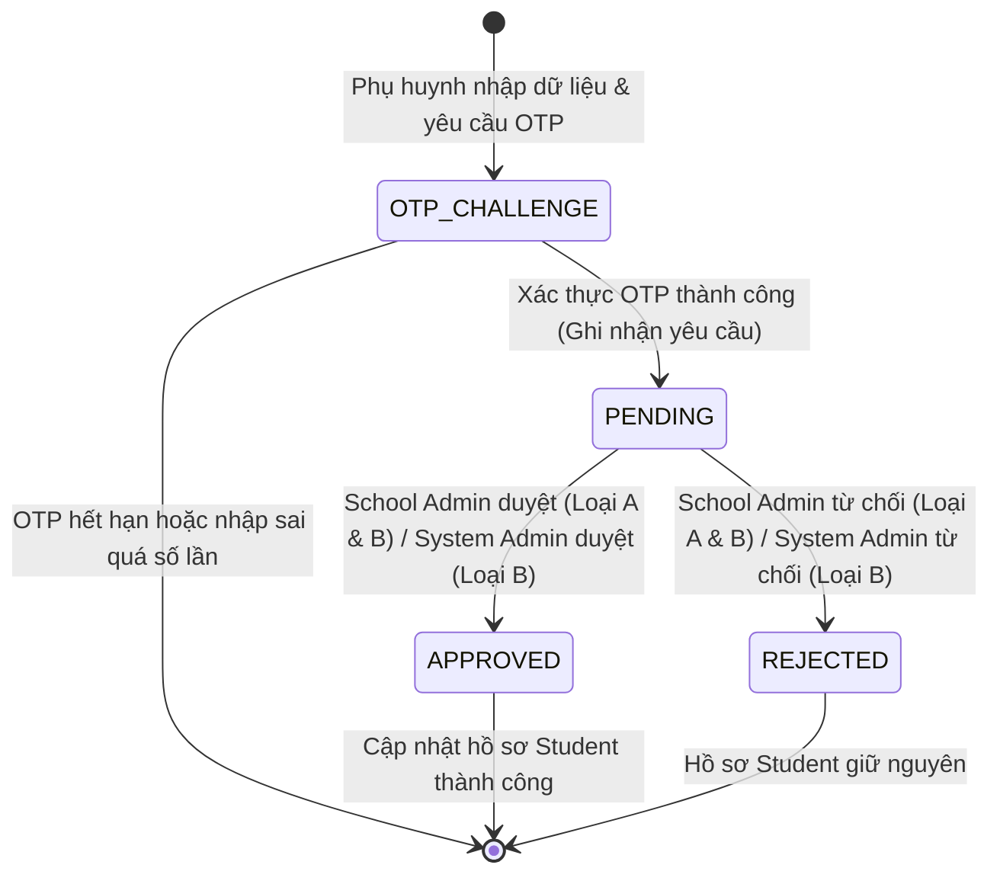
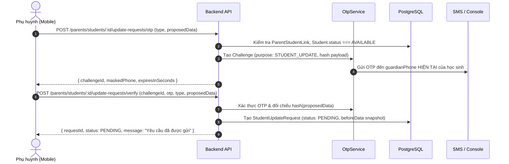

# RoadToSchool — Technical Architecture & Master Implementation Plan
# Scope: Account Settings, Vehicle Management & Student Update Requests
# Round: 1/3 — Business Analysis & Master Implementation Plan

> **Tài liệu**: Master Architecture & Implementation Plan  
> **Phiên bản**: 1.0 (Round 1/3 — Proposal for Product Owner Approval)  
> **Tác giả**: Senior Software Architect, Business Analyst, Database Architect & Technical Lead  
> **Trạng thái**: PLANNING ONLY — CHỜ PRODUCT OWNER PHÊ DUYỆT TRƯỚC KHI THỰC HIỆN ROUND 2  
> **Nguyên tắc**: Tuyệt đối không viết code ứng dụng, không sửa Schema/Migration trong Round 1.

---

## A. Executive Summary

1. **Bối cảnh nghiệp vụ**:
   - Sau khi hoàn thành xuất sắc các phân hệ cốt lõi (Authentication, School Management, Student & Driver Management, Parent–Student Linking), RoadToSchool bước vào phân hệ tiếp theo nhằm hoàn thiện quản trị tài khoản, quản lý đội xe và thiết lập quy trình nghiệp vụ số hóa các yêu cầu cập nhật thông tin học sinh từ phụ huynh.
2. **Mục tiêu cốt lõi của phạm vi mới**:
   - **Cài đặt tài khoản (Account Settings)**: Đổi mật khẩu an toàn và cập nhật Avatar (áp dụng cho tất cả 5 vai trò); cập nhật tên hiển thị của tài khoản Phụ huynh (chỉ riêng PARENT).
   - **Vị trí bãi xe (Parking Lot Location)**: Cấu hình địa điểm bãi đỗ xe trung tâm duy nhất của nhà xe do System Admin quản lý bằng VietMap Map Picker.
   - **Quản lý phương tiện (Vehicle Management)**: System Admin quản lý danh mục phương tiện (Hãng, Số chỗ ngồi, Biển số xe duy nhất toàn hệ thống, Màu sắc).
   - **Yêu cầu cập nhật học sinh (Student Update Requests)**: Quy trình gửi, xác thực OTP và phê duyệt hai loại yêu cầu từ phụ huynh:
     - `INFORMATION_UPDATE`: Đổi họ tên học sinh và/hoặc số điện thoại người giám hộ.
     - `ADDRESS_UPDATE`: Đổi địa chỉ đưa đón kèm tọa độ VietMap.
   - **Bảo mật OTP trước khi tạo yêu cầu**: Bắt buộc gửi mã OTP về số điện thoại người giám hộ hiện tại của học sinh và xác thực thành công trước khi yêu cầu được ghi nhận ở trạng thái `PENDING`.
   - **Phân quyền duyệt yêu cầu minh bạch**:
     - `School Admin`: Quản lý và duyệt cả hai loại yêu cầu (`INFORMATION_UPDATE` và `ADDRESS_UPDATE`) cho học sinh trường mình; có quyền chỉnh sửa trực tiếp địa chỉ học sinh.
     - `System Admin`: Chỉ có quyền xem và duyệt yêu cầu `ADDRESS_UPDATE`.
   - **Lịch sử yêu cầu học sinh**: Hiển thị danh sách yêu cầu cụ thể ngay trong trang Chi tiết học sinh của School Admin.
3. **Chính sách triển khai Three Rounds Only**:
   - **Round 1 (Hiện tại)**: Phân tích nghiệp vụ, kiến trúc dữ liệu, ma trận API, thiết kế workflow, lập danh mục màn hình và làm rõ 14 quyết định mở. **Không viết code.**
   - **Round 2**: Triển khai trọn gói Database & Backend (Schema, Migration, APIs, Logic duyệt, OTP, Tests, Swagger).
   - **Round 3**: Triển khai trọn gói Web & Mobile UI (Wireframe-first, Web Admin, Mobile screens, Tích hợp API, E2E Verification).

---

## B. Existing Architecture Assessment

Qua rà soát thực tế toàn bộ codebase hiện tại, hệ thống sở hữu nền tảng kiến trúc vững chắc có thể tái sử dụng tối đa:

1. **User Model & Authentication System**:
   - Bảng `users` dùng chung cho 5 roles (`SYSTEM_ADMIN`, `SCHOOL_ADMIN`, `DRIVER`, `BUS_ATTENDANT`, `PARENT`).
   - Mật khẩu được băm bằng `bcryptjs` với salt rounds 10.
   - Bảng `sessions` quản lý phiên đăng nhập đa thiết bị với cơ chế token rotation và `revokedAt` thu hồi tức thì.
   - Hiện tại `User` đã có cột `avatarUrl` nhưng chưa có cột `avatarPublicId` để theo dõi ID ảnh trên Cloudinary.
2. **Cloudinary Integration**:
   - Service `CloudinaryService` (`api/src/schools/cloudinary.service.ts`) đã hoạt động ổn định với upload stream buffer, giới hạn dung lượng 5MB, kiểm tra magic bytes JPEG/PNG/WebP, timeout 15s. Sẵn sàng bổ sung method `uploadUserAvatar`.
3. **School & Student Models**:
   - `Student` liên kết 1-N với `School` (`schoolId`).
   - `StudentStatus` gồm 2 giá trị chính thức: `AVAILABLE` và `DISABLED`.
   - Học sinh đã có sẵn các trường: `fullName`, `guardianPhone`, `addressText`, `latitude`, `longitude`, `avatarUrl`, `avatarPublicId`.
   - Bảng `parent_student_links` thiết lập quan hệ N-N giữa `User (PARENT)` và `Student`.
4. **OTP System**:
   - Bảng `otp_challenges` lưu trữ mã xác thực dưới dạng hash SHA-256 kèm thời hạn `expiresAt`, `attempts` và `consumedAt`.
   - Enum `OtpPurpose` hiện có: `PARENT_REGISTRATION`, `PASSWORD_RESET`, `PARENT_STUDENT_LINKING`.
5. **VietMap Integration**:
   - Tích hợp chuẩn hoá tại `web/src/lib/vietmap/` gồm Autocomplete v4, Place Details v4, Reverse Geocoding v4, bảo toàn `ref_id` và unmasking vector tile worker.
6. **Web & Mobile UI Foundations**:
   - Web có Admin Sidebar với điều hướng phân quyền theo vai trò, modal xác nhận, bảng dữ liệu phân trang, debounced search.
   - Mobile có Expo Router với dynamic tabs theo role, SafeAreaContext, PanResponder swipe gestures, API Client dùng chung.

---

## C. Confirmed Product Owner Requirements

Các yêu cầu nghiệp vụ đã được Product Owner xác nhận cố định (Không thay đổi):
1. Tất cả vai trò được đổi mật khẩu và đổi avatar của chính mình.
2. Chỉ có vai trò `PARENT` được đổi tên tài khoản của chính mình. Các vai trò khác không được tự đổi tên.
3. System Admin quản lý vị trí bãi đỗ xe trung tâm trong mục Cài đặt.
4. System Admin quản lý phương tiện: Hãng, Số chỗ ngồi, Biển số duy nhất, Màu sắc.
5. Biển số xe (`licensePlate`) phải duy nhất toàn hệ thống.
6. Phụ huynh gửi yêu cầu cập nhật học sinh chỉ khi học sinh đang có liên kết hợp lệ và ở trạng thái `AVAILABLE`.
7. Mọi yêu cầu cập nhật học sinh do phụ huynh tạo BẮT BUỘC phải qua xác thực OTP gửi đến số điện thoại người giám hộ HIỆN TẠI của học sinh.
8. Hai loại yêu cầu: `INFORMATION_UPDATE` (Họ tên, SĐT giám hộ) và `ADDRESS_UPDATE` (Địa chỉ, Tọa độ).
9. Trạng thái yêu cầu gồm đúng 3 giá trị: `PENDING`, `APPROVED`, `REJECTED`.
10. School Admin duyệt được cả 2 loại yêu cầu cho học sinh trường mình; System Admin chỉ được duyệt `ADDRESS_UPDATE`.
11. School Admin được chỉnh sửa trực tiếp địa chỉ của học sinh trường mình khi học sinh `AVAILABLE`.
12. Trang Chi tiết học sinh của School Admin có thêm section "Danh sách yêu cầu" của riêng học sinh đó.

---

## D. Business Domain A — Account Settings

### 1. Đổi mật khẩu (Change Password)
- **Đối tượng áp dụng**: Toàn bộ 5 vai trò (`SYSTEM_ADMIN`, `SCHOOL_ADMIN`, `DRIVER`, `BUS_ATTENDANT`, `PARENT`).
- **Vị trí giao diện**:
  - Web: Nằm trong trang *Cài đặt* (`/admin/settings`).
  - Mobile: Nằm trong tab *Cá nhân* (`/settings`).
- **Quy tắc bảo mật**:
  - Nhập: Mật khẩu hiện tại, Mật khẩu mới, Xác nhận mật khẩu mới.
  - Xác thực mật khẩu hiện tại bằng `bcrypt.compare` trước khi xử lý.
  - Mật khẩu mới tối thiểu 8 ký tự, gồm ít nhất 1 chữ hoa, 1 chữ thường, 1 số và 1 ký tự đặc biệt.
  - Mật khẩu mới phải khác mật khẩu hiện tại.
  - Băm mật khẩu mới bằng `bcrypt.hash(newPassword, 10)`.
  - **Chính sách phiên đăng nhập (Quyết định mở 13)**: Thu hồi toàn bộ các phiên đăng nhập khác của người dùng này trên các thiết bị khác (`revokedAt = now()`), duy trì phiên làm việc hiện tại để người dùng không bị văng ra bất tiện.

### 2. Cập nhật Avatar (Update Avatar)
- **Đối tượng áp dụng**: Toàn bộ 5 vai trò.
- **Quy trình xử lý**:
  - Chọn file ảnh trên thiết bị (JPEG/PNG/WebP, dung lượng tối đa 5MB).
  - Preview ảnh ngay trên giao diện.
  - Gửi multipart request lên API `POST /api/v1/auth/me/avatar`.
  - Backend sử dụng `CloudinaryService` upload lên thư mục `roadtoschool/avatars`.
  - Lưu `avatarUrl` và `avatarPublicId` vào bảng `users`.
  - Dọn dẹp avatar cũ trên Cloudinary nếu tồn tại (xem Quyết định mở 14).
  - Tuyệt đối không làm ảnh hưởng đến `Student.avatarUrl`.

### 3. Cập nhật tên tài khoản Phụ huynh (Parent Name Update)
- **Đối tượng áp dụng**: DUY NHẤT vai trò `PARENT`.
- **Hạn chế**:
  - Phụ huynh chỉ được cập nhật trường `fullName` của chính mình.
  - Không cho phép cập nhật email, số điện thoại, vai trò hay trường học qua API này.
  - Các vai trò khác (`SYSTEM_ADMIN`, `SCHOOL_ADMIN`, `DRIVER`, `BUS_ATTENDANT`) bị từ chối 403 Forbidden nếu gọi API đổi tên.
  - Việc đổi tên tài khoản Phụ huynh độc lập hoàn toàn với yêu cầu đổi tên học sinh.

---

## E. Business Domain B — Parking Lot Management

1. **Khái niệm & Phạm vi**:
   - Đại diện cho vị trí bãi đỗ xe trung tâm duy nhất của nhà xe (theo `BUSINESS_CONTEXT.md` Section 2).
   - Được quản lý tập trung bởi `SYSTEM_ADMIN`.
2. **Dữ liệu cấu hình**:
   - `addressText`: Chuỗi địa chỉ chi tiết bãi xe.
   - `latitude`: Vĩ độ WGS-84.
   - `longitude`: Kinh độ WGS-84.
3. **Tái sử dụng VietMap**:
   - Giao diện gồm 1 ô nhập địa chỉ với Autocomplete v4 và bản đồ MapLibre Map Picker.
   - Tọa độ được lưu trữ nội bộ, không hiển thị các ô nhập tọa độ thô cho người dùng.
4. **Mô hình lưu trữ đề xuất**:
   - Tạo bảng cấu hình hệ thống tổng quát `system_settings` hoặc bảng `parking_lots` đơn lẻ (xem Section O).

---

## F. Business Domain C — Vehicle Management

1. **Phân quyền**:
   - Chỉ `SYSTEM_ADMIN` được xem danh sách, tìm kiếm, phân trang và tạo mới phương tiện.
   - Không triển khai các chức năng sửa, xóa, phân công tài xế, tuyến xe hay theo dõi realtime trong phạm vi này.
2. **Cấu trúc dữ liệu phương tiện (`Vehicle`)**:
   - **Hãng xe (`brand`)**: Bắt buộc, chuỗi văn bản (ví dụ: Hyundai, Ford, Thaco, Samco).
   - **Số lượng chỗ ngồi (`seatCount`)**: Bắt buộc, số nguyên dương. Đây là **số lượng ghế khả dụng để chở HỌC SINH** trên phương tiện (KHÔNG bao gồm ghế tài xế, ghế dành riêng cho BUS_ATTENDANT / Giáo viên / Giám sát viên, hoặc các vị trí ngồi của nhân sự). Ví dụ: Xe 16 chỗ vật lý chở 14 học sinh thì `seatCount = 14`.
   - **Biển số xe (`licensePlate`)**: Bắt buộc, duy nhất toàn hệ thống.
     - Chuẩn hóa: Cắt khoảng trắng, chuyển in hoa, loại bỏ dấu chấm/gạch ngang khi so sánh duy nhất (`normalizedLicensePlate`).
     - Hiển thị: Giữ nguyên định dạng người dùng nhập (ví dụ: `29B-123.45`).
   - **Màu sắc (`color`)**: Bắt buộc, chuỗi văn bản (ví dụ: Trắng, Vàng, Đỏ, Bạc).
   - **Trạng thái hoạt động (`isActive`)**: Mặc định `true`.
3. **Danh sách & Modal**:
   - Bảng hiển thị: Hãng, Biển số, Số chỗ ngồi, Màu sắc, Trạng thái.
   - Modal thêm phương tiện: 4 trường bắt buộc, validate chặt chẽ, chống trùng lặp biển số (trả về lỗi 409 Conflict bằng tiếng Việt rõ ràng).

---

## G. Business Domain D — Student Update Request Types

Hệ thống hỗ trợ 2 loại yêu cầu độc lập:

### 1. Type A — Cập nhật thông tin (`INFORMATION_UPDATE`)
- **Dữ liệu được phép đề xuất thay đổi**:
  - `fullName`: Họ và tên học sinh.
  - `guardianPhone`: Số điện thoại người giám hộ mới.
- **Ràng buộc**:
  - Phụ huynh có thể đổi một trong hai hoặc cả hai.
  - Bắt buộc phải có ít nhất một trường khác với dữ liệu hiện tại của học sinh (không cho submit yêu cầu rỗng).
  - Validate định dạng số điện thoại Việt Nam chuẩn (10 chữ số, đầu số hợp lệ).
  - **Quy tắc gửi OTP**: Mã OTP xác thực BẮT BUỘC gửi về số điện thoại người giám hộ ĐANG LƯU HIỆN TẠI trong hồ sơ học sinh, TUYỆT ĐỐI KHÔNG gửi về số mới được đề xuất.

### 2. Type B — Cập nhật địa chỉ (`ADDRESS_UPDATE`)
- **Dữ liệu được phép đề xuất thay đổi**:
  - `addressText`: Địa chỉ chi tiết nơi đưa đón.
  - `latitude`: Vĩ độ WGS-84.
  - `longitude`: Kinh độ WGS-84.
- **Ràng buộc**:
  - Phải có đầy đủ cả 3 thông tin (địa chỉ và cặp tọa độ hợp lệ). Không cho phép gửi địa chỉ thiếu tọa độ hoặc tọa độ không hợp lệ.
  - Không hiển thị tọa độ thô ra giao diện người dùng.
  - Tái sử dụng quy trình tìm kiếm VietMap Autocomplete & Reverse Geocoding.

---

## H. Request Status & Lifecycle

Mỗi yêu cầu tuân theo máy trạng thái nghiêm ngặt (Strict State Machine):



1. **PENDING (Chờ duyệt)**:
   - Yêu cầu đã vượt qua xác thực OTP thành công và được tạo trong hệ thống.
   - Dữ liệu học sinh chưa bị thay đổi.
2. **APPROVED (Đã duyệt)**:
   - Được phê duyệt bởi Admin có thẩm quyền.
   - Dữ liệu học sinh được cập nhật tự động và nguyên tử (Atomic Update) trong một transaction duy nhất.
3. **REJECTED (Đã từ chối)**:
   - Bị từ chối bởi Admin có thẩm quyền kèm lý do từ chối (tùy chọn).
   - Dữ liệu học sinh được giữ nguyên vẹn.
4. **Quy tắc chuyển đổi trạng thái**:
   - Chỉ cho phép: `PENDING -> APPROVED` hoặc `PENDING -> REJECTED`.
   - Tuyệt đối không cho phép chuyển đổi trạng thái lần 2 sau khi đã APPROVED hoặc REJECTED.

---

## I. Parent OTP Verification Flow

**Mọi yêu cầu cập nhật do Phụ huynh tạo BẮT BUỘC phải qua xác thực OTP.**



1. **Khóa chặt OTP với Payload (Payload Hash Binding)**:
   - Chuỗi băm SHA-256 của `{ type, proposedData }` được lưu trong bản ghi `OtpChallenge`.
   - Khi verify, phụ huynh phải gửi lại đúng dữ liệu đề xuất; nếu phát hiện sai lệch, từ chối ngay lập tức nhằm chống tấn công tráo đổi dữ liệu sau khi nhận mã OTP.
2. **Gửi mã OTP**:
   - Gửi đến số điện thoại người giám hộ hiện tại lưu trong hồ sơ học sinh.
   - Che mờ số điện thoại dạng `091****678` để phụ huynh nhận biết.
   - Thời hạn OTP chuẩn: 300 giây (5 phút). Giới hạn tối đa 5 lần nhập sai.

---

## J. Parent — Request List & Detail (Mobile)

1. **Vị trí truy cập**:
   - Nằm trong trang *Chi tiết học sinh* (`/parent/student-detail/[id]`), Section 2: *Thao tác với học sinh*.
   - Gồm 2 nút hành động: "Cập nhật thông tin" và "Cập nhật địa chỉ".
   - Nếu học sinh ở trạng thái `DISABLED`: Nút cập nhật bị làm mờ (disabled) kèm tooltip thông báo "Học sinh đang bị vô hiệu hóa, không thể tạo yêu cầu cập nhật".
2. **Màn hình Danh sách yêu cầu (`/parent/requests`)**:
   - Danh sách thẻ dọc hiển thị các yêu cầu của học sinh đó.
   - Thẻ yêu cầu gồm: Loại yêu cầu (Badge), Ngày tạo, Trạng thái (Chờ duyệt / Đã duyệt / Đã từ chối), Thông tin tóm tắt.
   - Bộ lọc: Loại yêu cầu (Tất cả / Thông tin / Địa chỉ), Trạng thái (Tất cả / Chờ duyệt / Đã duyệt / Đã từ chối).
   - Nút tròn nổi hoặc nút bấm "Thêm yêu cầu mới".
3. **Màn hình Chi tiết yêu cầu**:
   - Hiển thị so sánh: Thông tin trước cập nhật và Thông tin đề xuất.
   - Trạng thái yêu cầu, ngày tạo, ngày duyệt/từ chối, lý do từ chối (nếu có).

---

## K. School Admin — Request Management (Web)

1. **Menu Sidebar**: Bổ sung mục **Yêu cầu** (`/admin/requests`).
2. **Phạm vi hiển thị**: Chỉ xem các yêu cầu thuộc học sinh của trường mình (`schoolId`).
3. **Loại yêu cầu xử lý**: Cả hai loại (`INFORMATION_UPDATE` và `ADDRESS_UPDATE`).
4. **Bảng dữ liệu**:
   - Tìm kiếm theo tên học sinh, mã học sinh.
   - Bộ lọc Loại yêu cầu và Bộ lọc Trạng thái yêu cầu.
   - Phân trang máy chủ (Server-side Pagination).
5. **Modal Chi tiết & So sánh Trước / Sau (Compare Layout)**:
   - Cột 1: Thông tin học sinh & Thông tin hiện tại/trước cập nhật.
   - Cột 2: Thông tin đề xuất sau cập nhật.
   - Cảnh báo nếu dữ liệu gốc của học sinh đã bị thay đổi trực tiếp (Stale Data Warning).
6. **Thao tác phê duyệt**:
   - Nút **Đồng ý (Approve)**: Mở dialog xác nhận, kiểm tra học sinh `AVAILABLE`, cập nhật dữ liệu học sinh và chuyển trạng thái yêu cầu sang `APPROVED` trong transaction.
   - Nút **Từ chối (Reject)**: Mở dialog xác nhận có ô nhập lý do từ chối (tùy chọn), chuyển trạng thái yêu cầu sang `REJECTED`.

---

## L. System Admin — Address Request Management (Web)

1. **Menu Sidebar**: Bổ sung mục **Yêu cầu** (`/admin/requests`).
2. **Quyền hạn vai trò**:
   - **CHỈ ĐƯỢC XEM VÀ DUYỆT YÊU CẦU LOẠI `ADDRESS_UPDATE`**.
   - Tuyệt đối không hiển thị và không cho phép can thiệp vào các yêu cầu `INFORMATION_UPDATE`.
3. **Quy tắc phê duyệt chung (Quyết định mở 3 & 4)**:
   - Áp dụng nguyên tắc **One Valid Approval Is Sufficient**: Chỉ cần School Admin HOẶC System Admin phê duyệt trước, yêu cầu chuyển thành `APPROVED` và địa chỉ học sinh được cập nhật ngay lập tức. Bên còn lại thấy kết quả đã duyệt.
   - Nếu một trong hai bên từ chối trước, yêu cầu chuyển `REJECTED` và kết thúc.
   - Kiểm soát đồng thời bằng Optimistic Locking / Prisma Condition để chống xung đột race condition.

---

## M. School Admin — Direct Student Address Update

1. **Mục đích**: Hỗ trợ nhà trường chủ động cập nhật địa chỉ đưa đón cho học sinh khi phụ huynh liên hệ trực tiếp qua văn phòng nhà trường.
2. **Quyền hạn**: Chỉ School Admin thuộc trường của học sinh.
3. **Điều kiện**: Học sinh phải ở trạng thái `AVAILABLE`.
4. **Giao diện**:
   - Nút "Sửa địa chỉ" trên trang Chi tiết học sinh (`/admin/students/[id]`).
   - Mở modal tích hợp VietMap Address Autocomplete và Map Picker.
   - Chỉ cập nhật `addressText`, `latitude`, `longitude`. Không cho phép đổi tên hay SĐT phụ huynh tại modal này.
5. **Xử lý xung đột (Quyết định mở 7)**:
   - Việc sửa trực tiếp địa chỉ không tự động hủy các yêu cầu `ADDRESS_UPDATE` đang `PENDING`.
   - Khi mở modal duyệt yêu cầu sau đó, hệ thống sẽ tự động so sánh và hiển thị cảnh báo: *"Địa chỉ học sinh đã được thay đổi trực tiếp sau khi yêu cầu này được tạo"*.

---

## N. School Admin — Student Request History

- Trong trang Chi tiết học sinh của School Admin (`/admin/students/[id]`):
  - Bổ sung section chuyên biệt: **Danh sách yêu cầu cập nhật**.
  - Tái sử dụng component bảng yêu cầu nhưng tự động gắn filter cố định `studentId = currentStudentId`.
  - Hiển thị đầy đủ lịch sử các yêu cầu đã gửi (Pending, Approved, Rejected) giúp nhà trường nắm bắt toàn bộ tiến trình thay đổi thông tin của học sinh đó.

---

## O. Minimal Database Proposal

Đề xuất bổ sung đúng **2 bảng mới** và điều chỉnh nhỏ trên 2 bảng hiện có:

```prisma
// ==========================================
// BỔ SUNG ENUM MỚI
// ==========================================

enum RequestType {
  INFORMATION_UPDATE
  ADDRESS_UPDATE
}

enum RequestStatus {
  PENDING
  APPROVED
  REJECTED
}

// Bổ sung giá trị cho OtpPurpose hiện có
// enum OtpPurpose {
//   ...
//   STUDENT_UPDATE_REQUEST
// }

// ==========================================
// CẬP NHẬT MODEL HIỆN CÓ
// ==========================================

// Trong model User:
// model User {
//   ...
//   avatarPublicId  String?  @map("avatar_public_id") // Bổ sung để dọn dẹp Cloudinary
//   reviewedRequests StudentUpdateRequest[] @relation("ReviewedRequests")
//   createdRequests  StudentUpdateRequest[] @relation("CreatedRequests")
// }

// Trong model OtpChallenge:
// model OtpChallenge {
//   ...
//   payloadHash     String?  @map("payload_hash") // Bổ sung khóa chặt OTP với dữ liệu đề xuất
// }

// ==========================================
// 1. MODEL QUẢN LÝ PHƯƠNG TIỆN (VEHICLE)
// ==========================================

model Vehicle {
  id                   String   @id @default(uuid())
  brand                String   @db.VarChar(100)
  seatCount            Int      @map("seat_count")
  licensePlate         String   @unique @map("license_plate") @db.VarChar(20)
  normalizedPlate      String   @unique @map("normalized_plate") @db.VarChar(20)
  color                String   @db.VarChar(50)
  isActive             Boolean  @default(true) @map("is_active")
  createdAt            DateTime @default(now()) @map("created_at")
  updatedAt            DateTime @updatedAt @map("updated_at")

  @@index([isActive])
  @@index([brand])
  @@map("vehicles")
}

// ==========================================
// 2. MODEL BÃI ĐỖ XE TRUNG TÂM (SYSTEM SETTING)
// ==========================================

model SystemSetting {
  id          String   @id @default("default")
  key         String   @unique @db.VarChar(50)
  value       Json     @map("value") // { addressText: string, latitude: number, longitude: number }
  updatedById String?  @map("updated_by_id")
  updatedAt   DateTime @updatedAt @map("updated_at")

  @@map("system_settings")
}

// ==========================================
// 3. MODEL YÊU CẦU CẬP NHẬT HỌC SINH
// ==========================================

model StudentUpdateRequest {
  id              String        @id @default(uuid())
  studentId       String        @map("student_id")
  parentId        String        @map("parent_id")
  schoolId        String        @map("school_id")
  type            RequestType
  status          RequestStatus @default(PENDING)
  beforeData      Json          @map("before_data")
  proposedData    Json          @map("proposed_data")
  rejectionReason String?       @map("rejection_reason") @db.VarChar(500)
  reviewedById    String?       @map("reviewed_by_id")
  reviewedAt      DateTime?     @map("reviewed_at")
  createdAt       DateTime      @default(now()) @map("created_at")
  updatedAt       DateTime      @updatedAt @map("updated_at")

  // Quan hệ
  student         Student       @relation(fields: [studentId], references: [id], onDelete: Cascade)
  parent          User          @relation("CreatedRequests", fields: [parentId], references: [id], onDelete: Restrict)
  school          School        @relation(fields: [schoolId], references: [id], onDelete: Restrict)
  reviewedBy      User?         @relation("ReviewedRequests", fields: [reviewedById], references: [id], onDelete: SetNull)

  @@index([schoolId, status])
  @@index([studentId, status])
  @@index([parentId, status])
  @@index([type, status])
  @@index([createdAt])
  @@map("student_update_requests")
}
```

---

## P. API Contract Matrix

| Nhóm API | Phương thức | Endpoint | Vai trò | Mục đích & Mô tả | Request Body | Response Body |
|---|---|---|---|---|---|---|
| **Account** | `POST` | `/api/v1/auth/me/change-password` | ALL (5 Roles) | Đổi mật khẩu tài khoản hiện tại | `{ currentPassword, newPassword, confirmPassword }` | `{ message: "Đổi mật khẩu thành công" }` |
| **Account** | `POST` | `/api/v1/auth/me/avatar` | ALL (5 Roles) | Upload avatar tài khoản qua Cloudinary | Multipart: `avatar` (file ảnh) | `{ avatarUrl: string, message: string }` |
| **Account** | `PATCH` | `/api/v1/auth/me/name` | PARENT only | Cập nhật họ tên tài khoản phụ huynh | `{ fullName: string }` | `{ id, fullName, email, phone, ... }` |
| **Parking** | `GET` | `/api/v1/system-settings/parking-lot` | ALL authenticated | Lấy vị trí bãi xe trung tâm hiện tại | — | `{ addressText, latitude, longitude, updatedAt }` |
| **Parking** | `PUT` | `/api/v1/system-settings/parking-lot` | SYSTEM_ADMIN | Cập nhật vị trí bãi xe trung tâm | `{ addressText, latitude, longitude }` | `{ addressText, latitude, longitude, updatedAt }` |
| **Vehicle** | `GET` | `/api/v1/vehicles` | SYSTEM_ADMIN | Danh sách phương tiện (phân trang, search) | Query: `page, limit, search` | `{ items: Vehicle[], total, page, totalPages }` |
| **Vehicle** | `POST` | `/api/v1/vehicles` | SYSTEM_ADMIN | Thêm phương tiện mới | `{ brand, seatCount, licensePlate, color }` | `VehicleResponseDto` |
| **Parent Request** | `POST` | `/api/v1/parents/students/:id/update-requests/otp` | PARENT | Khởi tạo yêu cầu & gửi OTP về SĐT giám hộ | `{ type, proposedData }` | `{ challengeId, maskedPhone, expiresInSeconds }` |
| **Parent Request** | `POST` | `/api/v1/parents/students/:id/update-requests/verify` | PARENT | Xác thực OTP & tạo yêu cầu PENDING | `{ challengeId, otp, type, proposedData }` | `StudentUpdateRequestDto` |
| **Parent Request** | `GET` | `/api/v1/parents/students/:id/update-requests` | PARENT | Danh sách yêu cầu của 1 học sinh | Query: `type, status, page, limit` | `{ items: RequestItem[], total, ... }` |
| **Parent Request** | `GET` | `/api/v1/parents/update-requests/:requestId` | PARENT | Xem chi tiết 1 yêu cầu của mình | — | `StudentUpdateRequestDetailDto` |
| **School Admin** | `GET` | `/api/v1/schools/:schoolId/update-requests` | SCHOOL_ADMIN | Danh sách yêu cầu thuộc trường | Query: `type, status, search, page, limit` | `{ items: RequestItem[], total, ... }` |
| **School Admin** | `GET` | `/api/v1/schools/:schoolId/students/:id/update-requests` | SCHOOL_ADMIN | Lịch sử yêu cầu của 1 học sinh cụ thể | Query: `type, status, page, limit` | `{ items: RequestItem[], total, ... }` |
| **School Admin** | `PATCH` | `/api/v1/schools/:schoolId/update-requests/:id/approve` | SCHOOL_ADMIN | Phê duyệt yêu cầu (Loại A & B) | — | `StudentUpdateRequestDto` |
| **School Admin** | `PATCH` | `/api/v1/schools/:schoolId/update-requests/:id/reject` | SCHOOL_ADMIN | Từ chối yêu cầu (Loại A & B) | `{ rejectionReason?: string }` | `StudentUpdateRequestDto` |
| **School Admin** | `PATCH` | `/api/v1/schools/:schoolId/students/:id/address` | SCHOOL_ADMIN | Cập nhật trực tiếp địa chỉ học sinh | `{ addressText, latitude, longitude }` | `StudentDetailDto` |
| **System Admin** | `GET` | `/api/v1/system-admin/update-requests` | SYSTEM_ADMIN | Danh sách yêu cầu ADDRESS_UPDATE toàn hệ thống | Query: `status, search, page, limit` | `{ items: RequestItem[], total, ... }` |
| **System Admin** | `PATCH` | `/api/v1/system-admin/update-requests/:id/approve` | SYSTEM_ADMIN | Phê duyệt yêu cầu ADDRESS_UPDATE | — | `StudentUpdateRequestDto` |
| **System Admin** | `PATCH` | `/api/v1/system-admin/update-requests/:id/reject` | SYSTEM_ADMIN | Từ chối yêu cầu ADDRESS_UPDATE | `{ rejectionReason?: string }` | `StudentUpdateRequestDto` |

---

## Q. Role & Permission Matrix

| Chức năng nghiệp vụ | SYSTEM_ADMIN | SCHOOL_ADMIN | DRIVER | BUS_ATTENDANT | PARENT |
|---|:---:|:---:|:---:|:---:|:---:|
| Đổi mật khẩu tài khoản mình | YES | YES | YES | YES | YES |
| Cập nhật Avatar tài khoản mình | YES | YES | YES | YES | YES |
| Cập nhật Họ tên tài khoản mình | NO | NO | NO | NO | **YES** |
| Xem vị trí bãi xe trung tâm | YES | YES | YES | YES | YES |
| Cập nhật vị trí bãi xe trung tâm | **YES** | NO | NO | NO | NO |
| Xem danh sách phương tiện | **YES** | NO | NO | NO | NO |
| Thêm phương tiện mới | **YES** | NO | NO | NO | NO |
| Tạo yêu cầu đổi thông tin (OTP) | NO | NO | NO | NO | **YES** |
| Tạo yêu cầu đổi địa chỉ (OTP) | NO | NO | NO | NO | **YES** |
| Xem yêu cầu của học sinh mình | NO | NO | NO | NO | **YES** |
| Duyệt yêu cầu INFORMATION_UPDATE | NO | **YES (Trường mình)** | NO | NO | NO |
| Duyệt yêu cầu ADDRESS_UPDATE | **YES (Toàn hệ thống)** | **YES (Trường mình)** | NO | NO | NO |
| Từ chối yêu cầu cập nhật | **YES (Địa chỉ)** | **YES (Cả hai)** | NO | NO | NO |
| Sửa trực tiếp địa chỉ học sinh | NO | **YES (Trường mình)** | NO | NO | NO |
| Xem lịch sử yêu cầu của học sinh | NO | **YES (Trường mình)** | NO | NO | NO |

---

## R. Request Concurrency & Data Integrity

1. **Atomic Approval via Prisma Transaction**:
   ```typescript
   return this.prisma.$transaction(async (tx) => {
     // 1. Khóa và lấy bản ghi yêu cầu
     const request = await tx.studentUpdateRequest.findUnique({
       where: { id: requestId },
       include: { student: true },
     });
     
     // 2. Kiểm tra điều kiện tiên quyết
     if (!request || request.status !== RequestStatus.PENDING) {
       throw new ConflictException('Yêu cầu không còn ở trạng thái chờ duyệt');
     }
     if (request.student.status !== StudentStatus.AVAILABLE) {
       throw new BadRequestException('Học sinh hiện đang bị vô hiệu hóa');
     }
     
     // 3. Cập nhật dữ liệu học sinh
     if (request.type === RequestType.INFORMATION_UPDATE) {
       await tx.student.update({
         where: { id: request.studentId },
         data: {
           fullName: request.proposedData.fullName ?? request.student.fullName,
           guardianPhone: request.proposedData.guardianPhone ?? request.student.guardianPhone,
         },
       });
     } else if (request.type === RequestType.ADDRESS_UPDATE) {
       await tx.student.update({
         where: { id: request.studentId },
         data: {
           addressText: request.proposedData.addressText,
           latitude: request.proposedData.latitude,
           longitude: request.proposedData.longitude,
         },
       });
     }
     
     // 4. Chuyển trạng thái yêu cầu sang APPROVED
     return tx.studentUpdateRequest.update({
       where: { id: requestId },
       data: {
         status: RequestStatus.APPROVED,
         reviewedById: reviewerId,
         reviewedAt: new Date(),
       },
     });
   });
   ```
2. **Chống duyệt đồng thời (First-Decision Wins)**:
   - Nếu School Admin và System Admin cùng bấm duyệt một yêu cầu ADDRESS_UPDATE trong cùng 1 giây, người đầu tiên commit transaction thành công sẽ hoàn tất; transaction của người thứ hai kiểm tra `request.status !== RequestStatus.PENDING` và bị từ chối 409 Conflict.
3. **Phát hiện dữ liệu lỗi thời (Stale Data Detection)**:
   - Khi hiển thị giao diện so sánh cho Admin, hệ thống đối chiếu `request.beforeData` với dữ liệu hiện tại trong `Student`. Nếu có khác biệt, cảnh báo vàng/đỏ được hiển thị rõ ràng.

---

## S. Security & Privacy

1. **Bảo vệ số điện thoại người giám hộ**:
   - Khi phụ huynh đề xuất đổi SĐT giám hộ, OTP xác thực **BẮT BUỘC** phải gửi về số điện thoại hiện tại của học sinh, ngăn chặn kẻ lạ liên kết tài khoản rồi tự ý đổi SĐT để chiếm đoạt quyền quản lý.
   - SĐT người giám hộ trên API response được che mờ `091****678`.
2. **Cô lập trường học (School Isolation)**:
   - School Admin tuyệt đối không thể xem hay duyệt yêu cầu của học sinh thuộc trường khác. Backend tự động ép điều kiện `schoolId = authUser.schoolId`.
3. **Phân quyền vai trò nghiêm ngặt (RBAC)**:
   - System Admin bị chặn cứng ở tầng Guard không được phép gọi API danh sách hoặc duyệt yêu cầu `INFORMATION_UPDATE`.
4. **Bảo mật OTP**:
   - Khóa chặt OTP với chuỗi băm của payload đề xuất (`payloadHash`). Không thể tái sử dụng OTP của học sinh này cho học sinh khác.
5. **Mật khẩu & Token**:
   - Mật khẩu mới được băm bằng bcrypt salt rounds 10.
   - Khi đổi mật khẩu, thu hồi toàn bộ session trên các thiết bị khác, bảo vệ tài khoản khỏi xâm nhập trái phép.

---

## T. Web Screen Inventory (Round 3 Target)

1. **System Admin Screens**:
   - `/admin/settings`:
     - Section Đổi mật khẩu.
     - Section Cập nhật Avatar.
     - Section Vị trí bãi đỗ xe trung tâm (VietMap address form + map picker).
   - `/admin/vehicles`:
     - Bảng danh sách phương tiện (Search, Pagination, Badges).
     - Modal Thêm phương tiện (Hãng, Số chỗ ngồi, Biển số, Màu sắc).
   - `/admin/requests`:
     - Bảng danh sách yêu cầu `ADDRESS_UPDATE` toàn hệ thống.
     - Modal Chi tiết yêu cầu & So sánh Before/After.
     - Dialog Xác nhận Phê duyệt & Dialog Từ chối (nhập lý do).
2. **School Admin Screens**:
   - `/admin/settings`:
     - Section Đổi mật khẩu.
     - Section Cập nhật Avatar.
   - `/admin/requests`:
     - Bảng danh sách yêu cầu (`INFORMATION_UPDATE` và `ADDRESS_UPDATE`).
     - Modal Chi tiết & So sánh Before/After.
     - Thao tác Duyệt / Từ chối kèm cảnh báo Stale Data.
   - `/admin/students/[id]`:
     - Modal Sửa trực tiếp địa chỉ học sinh (VietMap Address Picker).
     - Section Lịch sử yêu cầu của học sinh (Filtered Table).

---

## U. Mobile Screen Inventory (Round 3 Target)

1. **Màn hình Cài đặt cá nhân (`/settings`)**:
   - **Tất cả Roles**:
     - Form Đổi mật khẩu (Mật khẩu cũ, Mật khẩu mới, Xác nhận).
     - Cập nhật Avatar (Chọn ảnh từ thư viện, xem trước, tải lên).
   - **Riêng PARENT**:
     - Nút/Modal chỉnh sửa Họ tên hiển thị của tài khoản phụ huynh.
2. **Màn hình Chi tiết học sinh (`/parent/student-detail/[id]`)**:
   - Section 2 cập nhật thành 3 hành động:
     - Nút "Cập nhật thông tin" (Họ tên / SĐT giám hộ).
     - Nút "Cập nhật địa chỉ" (Địa chỉ / Tọa độ).
     - Nút "Hủy liên kết học sinh".
3. **Màn hình Danh sách yêu cầu học sinh (`/parent/requests`)**:
   - Thẻ yêu cầu dọc, Badge loại yêu cầu, Badge trạng thái.
   - Bộ lọc loại và trạng thái.
   - Nút Thêm yêu cầu mới.
4. **Màn hình Tạo yêu cầu cập nhật**:
   - Form Đổi thông tin: Họ tên mới, SĐT giám hộ mới.
   - Form Đổi địa chỉ: Ô tìm kiếm VietMap Autocomplete, chọn địa điểm, xem preview.
5. **Màn hình Xác thực OTP yêu cầu (`/parent/verify-request-otp`)**:
   - 6 ô nhập OTP, hiển thị SĐT giám hộ che mờ, đếm ngược TTL 300s, nút gửi lại mã.
6. **Màn hình Chi tiết yêu cầu (`/parent/request-detail/[id]`)**:
   - Xem dữ liệu cũ và dữ liệu đề xuất, trạng thái, lý do từ chối.

---

## V. Reusable Code & Services

1. **Backend**:
   - `CloudinaryService`: Thêm `uploadUserAvatar`.
   - `OtpService`: Thêm `createStudentUpdateRequestChallenge` và `verifyStudentUpdateRequestChallenge`.
   - `AuthService`: Tái sử dụng `bcrypt`, `Session` rotation.
   - `RolesGuard` & `AuthGuard`: Tái sử dụng phân quyền theo Decorator `@Roles(...)`.
2. **Frontend Web**:
   - `AdminLayout`, `AdminSidebar`: Thêm route `/admin/vehicles` (System Admin) và `/admin/requests` (cả 2 admin).
   - `VietMap` Autocomplete & MapPicker: Tái sử dụng cho bãi xe và sửa địa chỉ học sinh.
   - Pagination, SearchInput, StatusBadge, ConfirmationModal.
3. **Mobile**:
   - `AuthContext`, `mobileApiClient`.
   - Theme tokens (`colors.primary = #FFCB56`).
   - OTP input box component.

---

## W. Round 2 Implementation Plan (Database & Backend)

1. **Database Schema & Migrations**:
   - Thêm Enum `RequestType`, `RequestStatus`.
   - Bổ sung `STUDENT_UPDATE_REQUEST` vào `OtpPurpose`.
   - Bổ sung `avatarPublicId` vào `User`.
   - Bổ sung `payloadHash` vào `OtpChallenge`.
   - Tạo model `Vehicle` và `SystemSetting`.
   - Tạo model `StudentUpdateRequest`.
   - Chạy `npx prisma migrate dev --name add_vehicles_and_student_update_requests`.
2. **Module Vehicles (`api/src/vehicles/`)**:
   - DTOs: `CreateVehicleDto`, `ListVehiclesDto`, `VehicleResponseDto`.
   - Service: Chuẩn hóa biển số xe, kiểm tra trùng lặp, phân trang.
   - Controller: `GET /vehicles`, `POST /vehicles` (Role: SYSTEM_ADMIN).
3. **Module System Settings (`api/src/system-settings/`)**:
   - Service: Lấy và cập nhật cấu hình bãi đỗ xe trung tâm.
   - Controller: `GET /system-settings/parking-lot`, `PUT /system-settings/parking-lot` (Role: SYSTEM_ADMIN).
4. **Mở rộng Auth Module**:
   - Đổi mật khẩu: `POST /auth/me/change-password`.
   - Đổi avatar: `POST /auth/me/avatar`.
   - Đổi tên phụ huynh: `PATCH /auth/me/name`.
5. **Module Student Update Requests (`api/src/student-requests/`)**:
   - OTP Challenge với Payload Hash Binding.
   - Parent APIs: Yêu cầu OTP, Verify OTP, Danh sách, Chi tiết.
   - School Admin APIs: Danh sách theo trường, Duyệt, Từ chối, Sửa địa chỉ trực tiếp, Lịch sử theo học sinh.
   - System Admin APIs: Danh sách ADDRESS_UPDATE, Duyệt, Từ chối.
   - Transaction Atomic cho Approve & Reject.
6. **Automated Unit & Integration Tests**:
   - Test đổi mật khẩu, đổi avatar, đổi tên phụ huynh.
   - Test tạo phương tiện và ràng buộc biển số duy nhất.
   - Test bãi xe trung tâm.
   - Test luồng OTP yêu cầu cập nhật và kiểm tra payload hash.
   - Test phê duyệt nguyên tử, kiểm tra stale request và race condition.
   - Đảm bảo 100% tests pass và biên dịch không lỗi.
7. **Swagger Synchronization**: Cập nhật toàn bộ decorators và schema tại `http://localhost:3000/api/docs`.

---

## X. Round 3 Implementation Plan (Web & Mobile UI)

1. **Wireframe-First Phase**:
   - Thiết kế wireframe đầy đủ cho các màn hình Web và Mobile theo brand RoadToSchool.
   - Trình bày bố cục tối giản câu chữ (Minimal UI Copy) kèm tooltip ngữ cảnh.
2. **Web Admin Implementation**:
   - Cập nhật trang Cài đặt (Đổi mật khẩu, Avatar, Bãi xe).
   - Thêm trang Quản lý Phương tiện (`/admin/vehicles`).
   - Thêm trang Quản lý Yêu cầu (`/admin/requests`) cho cả 2 vai trò Admin với phân quyền hiển thị chuẩn.
   - Thêm modal sửa địa chỉ trực tiếp và section lịch sử yêu cầu trong Chi tiết học sinh.
3. **Mobile App Implementation**:
   - Cập nhật màn hình Cá nhân (Đổi mật khẩu, Avatar, Đổi tên phụ huynh).
   - Thêm 2 action cập nhật vào trang Chi tiết học sinh.
   - Xây dựng màn hình danh sách yêu cầu, form tạo yêu cầu, màn hình nhập OTP và chi tiết yêu cầu.
4. **Tích hợp API thực tế & E2E Verification**:
   - Kết nối toàn bộ API backend thực tế.
   - Chạy test tự động Web (`npm test`) và Mobile (`node --test`).
   - Chạy kịch bản E2E toàn diện và xuất báo cáo nghiệm thu.

---

## Y. Risks & Open Decisions (14 Quyết định cần PO phê duyệt)

### Quyết định 1: Có đúng một bãi xe trung tâm hay nhiều bãi xe?
- **Bằng chứng hiện tại**: `BUSINESS_CONTEXT.md` Section 2 quy định: *"Duy nhất 1 đơn vị vận tải (nhà xe). Duy nhất 1 bãi đỗ xe tập trung... Không thiết kế hệ thống hỗ trợ đa nhà xe hoặc nhiều bãi xe nếu chưa có yêu cầu chính thức."*
- **Khuyến nghị**: Triển khai **duy nhất 1 vị trí bãi xe trung tâm** trong bảng `system_settings` (`key = 'PARKING_LOT'`).
- **Lý do**: Đúng tuyệt đối theo Business Context, tiết kiệm chi phí và tránh overengineering.
- **Tác động**: DB (1 bảng setting), API (GET/PUT), UI (Form cài đặt đơn giản).
- **Yêu cầu phê duyệt**: Cần PO xác nhận cấu trúc bảng Singleton này.

### Quyết định 2: Ý nghĩa của "Số lượng chỗ ngồi" (Seat Count)? Có bao gồm ghế tài xế không?
- **Quyết định chính thức của Product Owner**: **`seatCount` là số lượng ghế khả dụng để chở HỌC SINH trên phương tiện**. KHÔNG bao gồm ghế tài xế, ghế dành riêng cho BUS_ATTENDANT / Giám sát viên hay nhân sự khác.
- **Định nghĩa**: `seatCount` được tính bằng số ghế có thể sử dụng thực tế cho học sinh trong hoạt động đưa đón. Ví dụ: Xe 16 chỗ vật lý bố trí 1 tài xế, 1 phụ xe và 14 học sinh thì khai báo và lưu trữ đúng `seatCount = 14`.
- **Ràng buộc**: Không tự động trừ thêm ghế tài xế/nhân sự ở backend (vì người dùng đã nhập số ghế học sinh), không tự tính toán theo số học sinh được phân công.
- **Tác động**: DB (cột `seat_count: Int`), API (validate số nguyên dương > 0), Swagger mô tả rõ ràng.

### Quyết định 3: Cơ chế duyệt `ADDRESS_UPDATE`: Cần cả School Admin VÀ System Admin hay chỉ MỘT BÊN?
- **Bằng chứng**: Yêu cầu mục 13.4 khuyến nghị cơ chế One Valid Approval Is Sufficient.
- **Khuyến nghị**: **Chỉ cần một bên phê duyệt hợp lệ là hoàn tất (One Valid Approval Is Sufficient)**.
- **Lý do**: Tránh việc yêu cầu của phụ huynh bị "ngâm" quá lâu chờ cả 2 bên cùng online; cả Nhà trường và Nhà xe đều có thẩm quyền nắm bắt điểm đón trả của học sinh.
- **Tác động**: DB (lưu `reviewedById` của người duyệt đầu tiên), API (Optimistic lock từ chối người thứ hai với lỗi 409), UI (hiển thị rõ ai đã duyệt).
- **Yêu cầu phê duyệt**: Cần PO xác nhận chính thức.

### Quyết định 4: Nếu một Admin từ chối trước, Request có kết thúc ngay không?
- **Bằng chứng**: Mục 13.4.
- **Khuyến nghị**: **Kết thúc ngay lập tức ở trạng thái `REJECTED`**. Không cho phép bên còn lại đảo ngược quyết định. Phụ huynh muốn thay đổi phải nộp yêu cầu mới kèm OTP.
- **Lý do**: Bảo đảm tính dứt khoát và nguyên tắc an toàn vận hành.
- **Tác động**: DB (`status = REJECTED`), API (khóa chuyển trạng thái), UI (hiển thị badge Đã từ chối).
- **Yêu cầu phê duyệt**: Cần PO phê duyệt.

### Quyết định 5: Có cho phép nhiều PENDING Requests cùng loại cho một Student không?
- **Khuyến nghị**: **Chặn tạo yêu cầu mới nếu học sinh đó ĐANG CÓ một yêu cầu CÙNG LOẠI ở trạng thái `PENDING`**. Cho phép 1 yêu cầu `INFORMATION_UPDATE` và 1 yêu cầu `ADDRESS_UPDATE` cùng tồn tại PENDING vì hai nghiệp vụ này độc lập.
- **Lý do**: Ngăn phụ huynh spam gửi nhiều yêu cầu sửa địa chỉ dồn dập khiến admin không biết địa chỉ nào là chính xác.
- **Tác động**: DB (Unique index hoặc check logic), API (trả về 409 Conflict), UI (disable nút tạo loại tương ứng).
- **Yêu cầu phê duyệt**: Cần PO phê duyệt.

### Quyết định 6: Khi Student bị DISABLED trong lúc Request đang PENDING, xử lý thế nào?
- **Khuyến nghị**: **Giữ nguyên trạng thái `PENDING` nhưng khóa nút "Đồng ý" (Approve) trên giao diện Admin; nếu cố tình Approve qua API sẽ bị từ chối 400 Bad Request**. Admin vẫn được phép bấm "Từ chối" (Reject) kèm lý do "Học sinh đang bị vô hiệu hóa".
- **Lý do**: Không tự ý xóa dữ liệu của phụ huynh; nếu học sinh được kích hoạt lại (`AVAILABLE`), yêu cầu vẫn còn đó để xử lý tiếp.
- **Tác động**: Không ảnh hưởng DB; API kiểm tra `student.status === AVAILABLE` khi duyệt.
- **Yêu cầu phê duyệt**: Cần PO phê duyệt.

### Quyết định 7: Khi School Admin sửa địa chỉ trực tiếp, xử lý PENDING `ADDRESS_UPDATE` như thế nào?
- **Khuyến nghị**: **Cơ chế Phát hiện Dữ liệu Cũ (Stale Data Detection)**: Giữ nguyên yêu cầu PENDING, nhưng khi Admin mở Modal chi tiết, hệ thống phát hiện `currentAddress !== beforeData` và hiển thị cảnh báo màu vàng nổi bật: *"Địa chỉ học sinh đã được thay đổi trực tiếp sau khi yêu cầu này được tạo"*. Admin tự quyết định áp dụng tiếp hay từ chối.
- **Lý do**: Đơn giản, minh bạch, không phát sinh thêm trạng thái mới ngoài 3 trạng thái đã duyệt.
- **Tác động**: UI hiển thị cảnh báo; API audit log rõ ràng.
- **Yêu cầu phê duyệt**: Cần PO phê duyệt.

### Quyết định 8: Khi Student Data thay đổi trong lúc chờ duyệt (đổi tên/SĐT), xử lý Stale Request thế nào?
- **Khuyến nghị**: Tương tự Quyết định 7: So sánh `beforeData` với dữ liệu hiện tại của `Student`. Nếu lệch, hiển thị bảng so sánh 3 cột: *"Dữ liệu lúc gửi | Dữ liệu hiện tại | Dữ liệu đề xuất"* và cảnh báo Stale Conflict.
- **Yêu cầu phê duyệt**: Cần PO phê duyệt.

### Quyết định 9: Parent đã hủy liên kết (Unlinked) có được xem Request History cũ của học sinh đó không?
- **Khuyến nghị**: **Phụ huynh đã hủy liên kết KHÔNG ĐƯỢC XEM lại lịch sử yêu cầu của học sinh đó nữa**. Toàn bộ lịch sử vẫn được lưu trữ đầy đủ trong DB và hiển thị cho School Admin.
- **Lý do**: Tuân thủ quyền riêng tư của trẻ em theo quy định pháp luật khi quan hệ giám hộ/liên kết trên ứng dụng đã chấm dứt.
- **Tác động**: API kiểm tra tồn tại của `ParentStudentLink`, nếu không có trả về 404/403.
- **Yêu cầu phê duyệt**: Cần PO phê duyệt.

### Quyết định 10: OTP Challenge ràng buộc Proposed Payload bằng cấu trúc nào để chống sửa trộm dữ liệu?
- **Khuyến nghị**: **Cơ chế Hash Payload Khóa Chặt (Payload Hash Binding)**: Backend sinh mã băm SHA-256 từ chuỗi canonical JSON `{ type, proposedData }` và lưu vào cột `payloadHash` của `OtpChallenge`. Khi verify, so sánh hash gửi lên; nếu lệch dù 1 ký tự sẽ bị từ chối ngay lập tức.
- **Lý do**: Chống giả mạo dữ liệu (Parameter Tampering) tuyệt đối.
- **Tác động**: DB thêm cột `payload_hash` vào `otp_challenges`.
- **Yêu cầu phê duyệt**: Cần PO phê duyệt.

### Quyết định 11: Chính sách kiểm thử và bàn giao khi chưa có SMS Provider ở môi trường Production?
- **Khuyến nghị**: Ở môi trường Development / E2E: Sử dụng Console OTP Delivery và truy vấn test hash an toàn. Trạng thái Production Readiness được đánh dấu là **CONDITIONAL** cho đến khi được cấp tài khoản SMS Gateway thật (Twilio/eSMS/SpeedSMS).
- **Yêu cầu phê duyệt**: Cần PO phê duyệt.

### Quyết định 12: Parent Mobile cần giải pháp Map/Địa chỉ nào phù hợp nhất với môi trường Expo hiện tại?
- **Khuyến nghị**: Sử dụng **VietMap REST API Service (Autocomplete v4 + Place Details v4)** để tìm kiếm và xác nhận địa chỉ chuẩn hóa tiếng Việt, kết hợp với Static Map Preview hoặc WebView nhẹ để hiển thị vị trí marker đã chọn mà không cần cài đặt thư viện bản đồ native phức tạp có nguy cơ gây lỗi build trên Expo.
- **Yêu cầu phê duyệt**: Cần PO định hướng giải pháp Map trên Mobile.

### Quyết định 13: Đổi mật khẩu có cần thu hồi toàn bộ các phiên đăng nhập khác không?
- **Khuyến nghị**: **Thu hồi toàn bộ các phiên đăng nhập khác (`revokedAt = now()`), duy trì phiên làm việc hiện tại**.
- **Lý do**: Chuẩn bảo mật quốc tế OWASP, bảo vệ tài khoản khi bị lộ mật khẩu mà không làm gián đoạn người dùng vừa đổi mật khẩu.
- **Tác động**: `prisma.session.updateMany({ where: { userId, id: { not: currentSessionId } }, data: { revokedAt: now() } })`.
- **Yêu cầu phê duyệt**: Cần PO phê duyệt.

### Quyết định 14: Avatar cũ xử lý thế nào theo Cloudinary Policy hiện tại khi người dùng đổi Avatar mới?
- **Khuyến nghị**: Bổ sung `avatarPublicId String?` vào bảng `User`. Khi upload avatar mới thành công, gọi `cloudinary.uploader.destroy(oldPublicId)` trong background để xóa ảnh cũ, tránh rác tài nguyên đám mây.
- **Lý do**: Tiết kiệm chi phí lưu trữ Cloudinary và tối ưu hóa hệ thống.
- **Tác động**: Thêm cột `avatar_public_id` vào bảng `users`.
- **Yêu cầu phê duyệt**: Cần PO phê duyệt.

---

## Z. Product Owner Approval Gate

Kính trình Product Owner xem xét và phê duyệt:

1. **Toàn bộ Phân tích nghiệp vụ & Kiến trúc tổng thể** trong tài liệu này.
2. **Đề xuất Database tối giản (Section O)**: Bổ sung 2 bảng mới (`vehicles`, `system_settings`), 1 bảng yêu cầu (`student_update_requests`), cập nhật `User` và `OtpChallenge`.
3. **Ma trận API & RBAC (Section P & Q)**: 19 REST endpoints bao quát toàn bộ 5 nhóm nghiệp vụ.
4. **14 Quyết định mở (Section Y)**.

Sau khi Product Owner phê duyệt chính thức Round 1, nhóm kỹ thuật sẽ tiến hành triển khai trọn gói **Round 2/3 (Database & Backend Implementation)** theo đúng quy trình Three Rounds Only.
