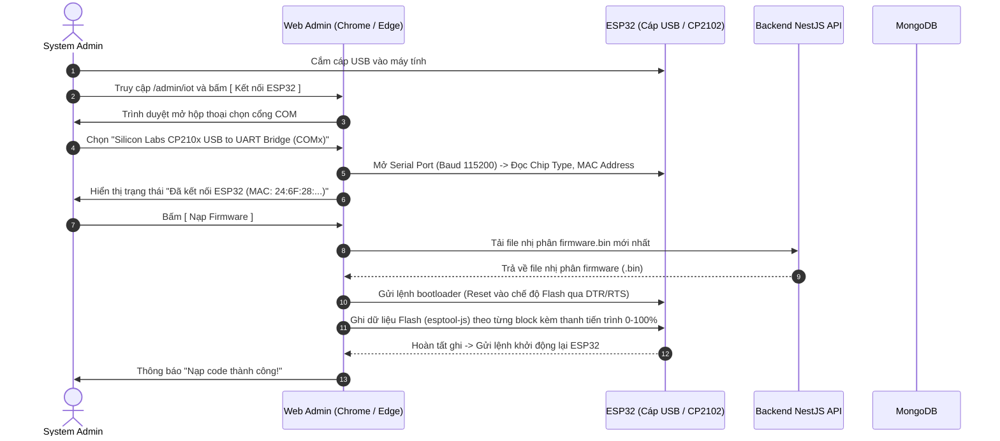
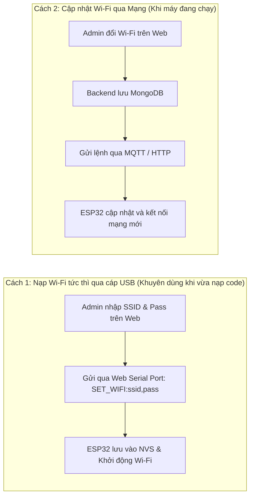
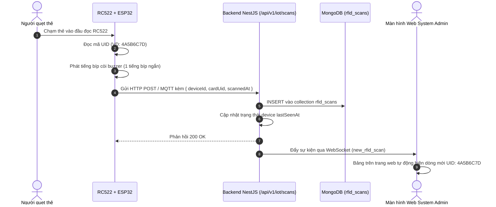
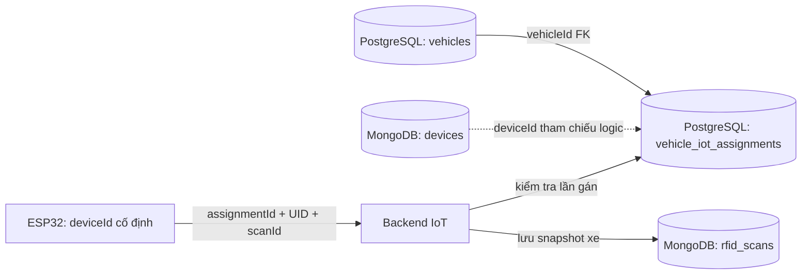
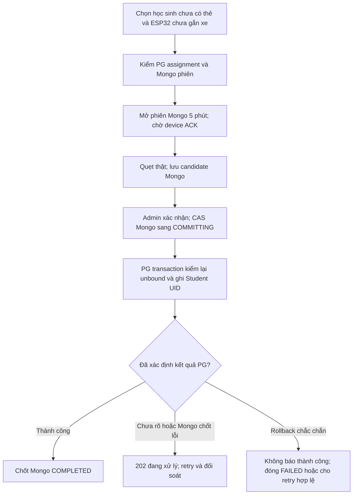
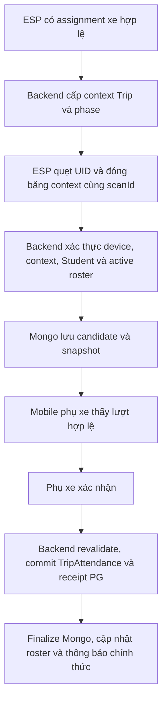

# KẾ HOẠCH KIẾN TRÚC & TRIỂN KHAI PHÂN HỆ IoT RFID TINH GỌN (LEAN POC)
## DỰ ÁN: ROAD TO SCHOOL V2.0 (WEB SERIAL FLASHER · RC522 · MONGODB)

> **Mục tiêu**: Xây dựng phiên bản thử nghiệm tinh gọn (Proof of Concept - POC) dành riêng cho `SYSTEM_ADMIN` trên Web Admin:
> 1. Tự động nhận diện ESP32 cắm qua cổng USB (CP2102) và **nạp code trực tiếp từ trình duyệt Web** (Web Serial API).
> 2. Cấu hình mạng Wi-Fi cho ESP32 ngay trên giao diện Web Admin.
> 3. Đọc thẻ RFID từ module RC522, truyền dữ liệu và lưu UID thẻ vào MongoDB.
> 4. Chỉ dùng 2 – 3 bảng (collections) tối giản để test, chưa gán học sinh (chuẩn bị kiến trúc tương lai gán `cardUid` vào model `Student`).
> **Lịch sử**: Tài liệu được lập ở **PLANNING MODE**. PO đã yêu cầu triển khai lần lượt 4 bước; trạng thái hiện tại được cập nhật bên dưới.


> **Cập nhật ngày 05/11/2026 — ĐÃ TRIỂN KHAI SOURCE, CHỜ UAT XE THẬT**: Yêu cầu mới là mỗi ESP32
> gắn với tối đa một xe buýt tại một thời điểm và có thể chuyển sang xe khác.
> Thiết kế PostgreSQL/MongoDB và luồng chuyển thiết bị nằm ở **mục J** cuối file.
> Các mục A–I và snapshot 04/11 là POC giai đoạn1; giới hạn “không chạm PostgreSQL”
> của giai đoạn1 không áp dụng cho giai đoạn2 đã được PO yêu cầu triển khai.
> Schema/API/Web/firmware đã có; PG đã migrate, đã nạp board1.2.0, chưa tạo dữ liệu gán xe cho giai đoạn2.

> **Bổ sung 06/11/2026 — CHỈ LẬP PLAN, CHƯA TRIỂN KHAI:** Mục **K** đề xuất trường
> RFID trên Student ở PostgreSQL và phiên đăng ký riêng ở MongoDB (điều chỉnh theo PO).
> Chỉ mở/nhận thẻ/xác nhận khi ESP32 **không
> có assignment xe đang mở**; đăng ký thẻ không tạo điểm danh. Schema/API/UI/firmware ở K
> đã được PO yêu cầu triển khai ngày06/11/2026; trạng thái source/nghiệm thu ởK.14. Các giới hạn
> giai đoạn1 và bản thiết kế MQTT lớn không thay thế mục này.

## Trạng thái triển khai giai đoạn1 — snapshot 04/11/2026

> **Cập nhật 06/11/2026 — ĐIỂM DANH RFID L-A:** Mục **L** đã được PO yêu cầu triển khai
> Backend/firmware và bàn giao Mobile bằng tài liệu, không sửa Mobile. Trạng thái ở **L.13**;
> chưa nghiệm thu thẻ/Trip thật, chưa tự động L-B. K.14–K.15 là đăng ký/quản lý thẻ.

| Bước | Mã nguồn / hạ tầng | Kiểm chứng hiện có | Còn lại |
| --- | --- | --- | --- |
| 1. MongoDB | Module riêng `api/src/iot`, 3 collections, indexes | MongoDB7.0.45 local ping thành công, indexes đã tạo, snapshot 1 thiết bị/21 scan sẵn có | Không cần thêm schema |
| 2. Backend | 7 REST operations, Socket.IO, device key, Wi-Fi encryption | Typecheck/build/tests, Swagger live và GET thiếu auth401 | Authenticated UAT/scan thật |
| 3. Web | `/admin/iot`, USB flasher, tự cấp API, dò Wi-Fi, lịch sử realtime | Build route200, typecheck, lint phần mới, pure tests | Browser/USB thực tế |
| 4. Firmware | ESP32+RC522, firmware1.1.1, Serial v1, NVS, HTTP ACK/retry | Nạp/verify hash, RC522 đọc thẻ thật, ACK cấu hình, quét lặp khi Wi-Fi cũ chưa kết nối | Kết nối Wi-Fi/lưu scan/realtime thật |

**Đã có code của cả4bước; chưa hoàn tất nghiệm thu toàn plan.** Môi trường local đã
chạy Web5173, IoT-only API3000 (không cron nghiệp vụ), MongoDB riêng127.0.0.1:27018.
Firmware tại `E:/ChatGPT/road-to-school-iot/artifacts/firmware.bin`, đã nối path vào
cấu hình IoT local. Không sửa PostgreSQL hoặc seed dữ liệu.

PO đã cho phép đăng ký1ESP32 thật và lưu tối đa5lượt quẹt thật vào `road_to_school_iot`.
PO đã cho phép cài driver signed Silicon Labs11.5.0.417 và xác nhận UAC. Windows nhận
ESP32 ởCOM6 trạng tháiOK. Đã nạp binary thật và verify hash trên ESP32-D0WD-V3/4MiB,
SerialINFO trả protocolVersion1 và firmware1.0.0-poc. Sau khi PO nối RC522, firmware
đã đọc UID thật E026885F/MIFARE1KB, không còn lỗi đầu đọc. Đã cập nhật chương trình lên1.1.1 (chỉ ghi app0x10000, giữ NVS), CONFIG_DEVICE ACK
và INFO configuredtrue. Lỗi quét1.1.0 tái hiện2/2lần; bản sửa quét lặp và chặn quét
đồng thời thành công khi đã lưu Wi-Fi cũ nhưng chưa kết nối. Snapshot MongoDB hiện
có1thiết bị/21scan/0Wi-Fi configs; agent không tạo scan ở phiên sửa này. Chưa nghiệm
thu lại SET_WIFI bản sửa và toàn luồng browser/realtime.
Không dùng dữ liệu giả để thay nghiệm thu.
Luồng mới đã được PO duyệt: Kết nối thiết bị → tự cấp URL/key từ backend → chọn
Wi-Fi/nhập mật khẩu. API URL nằm trong nâng cao; cấp lại không tạo đăng ký trùng.
Nguồn URL là IOT_ADVERTISED_API_URL do vận hành đặt một lần, không tự đoán IP từ browser.
Chi tiết kỹ thuật thực thi theo [Web/Serial contract](../../web/docs/iot-device-console.md),
[firmware README](../../firmware/esp32-rfid-node/README.md),
[IoT runtime](../../api/src/iot/README.md) và [báo cáo mới nhất](../ai-review/LATEST.md).

Phần thiết kế gốc bên dưới giữ để đối chiếu; các lựa chọn HTTP, Serial JSON v1 và
merged binary được cụ thể hóa trong source/contracts nêu trên.

---

## MỤC LỤC
1. [A. Phạm vi Tinh gọn (Lean Scope) & Định hướng Tương lai](#a-phạm-vi-tinh-gọn-lean-scope--định-hướng-tương-lai)
2. [B. Kiến trúc Kỹ thuật Nạp Code Trực tiếp qua Trình duyệt (Web Serial Flasher)](#b-kiến-trúc-kỹ-thuật-nạp-code-trực-tiếp-qua-trình-duyệt-web-serial-flasher)
3. [C. Thiết kế 3 MongoDB Collections Tối giản](#c-thiết-kế-3-mongodb-collections-tối-giản)
4. [D. Luồng Cấu hình Wi-Fi cho ESP32 từ Web Admin](#d-luồng-cấu-hình-wi-fi-cho-esp32-từ-web-admin)
5. [E. Luồng Quẹt Thẻ & Ghi nhận UID vào Database](#e-luồng-quẹt-thẻ--ghi-nhận-uid-vào-database)
6. [F. Thiết kế Module Backend NestJS (`/api/src/iot`)](#f-thiết-kế-module-backend-nestjs-apisrciot)
7. [G. Thiết kế Giao diện Web Admin (`SYSTEM_ADMIN`)](#g-thiết-kế-giao-diện-web-admin-system_admin)
8. [H. Kiến trúc Firmware ESP32 Tinh gọn (Arduino / C++)](#h-kiến-trúc-firmware-esp32-tinh-gọn-arduino--c)
9. [I. Kế hoạch Triển khai 4 Bước Tinh gọn](#i-kế-hoạch-triển-khai-4-bước-tinh-gọn)
10. [J. Gán ESP32 cho xe buýt và chuyển thiết bị — đề xuất giai đoạn2](#vehicle-iot-assignment-plan)
11. [K. Đăng ký thẻ RFID cho học sinh bằng phiên riêng — đề xuất giai đoạn3](#student-rfid-enrollment-plan)

---

## A. PHẠM VI TINH GỌN (LEAN SCOPE) & ĐỊNH HƯỚNG TƯƠNG LAI

### 1. Mục tiêu Cốt lõi của Sub-plan
Thay vì triển khai toàn bộ hệ thống lớn ngay từ đầu, kế hoạch tinh gọn này tập trung giải quyết trọn vẹn vòng lặp phần cứng - phần mềm cốt lõi:
- **Giai đoạn1 không chạm PostgreSQL**: Giữ các bảng nghiệp vụ hiện tại. Giai đoạn2 ở mục J đề xuất thêm một bảng liên kết có lịch sử, chỉ thực hiện sau khi PO duyệt.
- **Chưa cần gán Học sinh**: Mục tiêu giai đoạn này là xác minh phần cứng đọc thẻ chuẩn xác và lưu được dữ liệu UID vào MongoDB.
- **Tiện lợi tối đa cho Admin**: Cắm cáp USB vào máy tính $\rightarrow$ Mở Web Admin $\rightarrow$ Nạp code ESP32 một chạm qua Web Browser $\rightarrow$ Cài Wi-Fi $\rightarrow$ Quẹt thẻ thấy dữ liệu nhảy lên màn hình.

### 2. Định hướng Kiến trúc Tương lai (Lưu ý quan trọng từ PO)
- **Cơ chế liên kết Thẻ - Học sinh**:
  - *Thiết kế cũ*: Bảng thẻ RFID lưu tham chiếu `studentId`.
  - *Thiết kế mới theo chỉ đạo PO*: **Gắn `cardUid` trực tiếp vào thực thể `Student`** (ví dụ trường `Student.rfidCardUid String? @unique`). Khi đó, mỗi học sinh sở hữu một mã thẻ định danh duy nhất, dễ dàng tra cứu trực tiếp mà không cần bảng phụ N-N phức tạp.

---

## B. KIẾN TRÚC KỸ THUẬT NẠP CODE TRỰC TIẾP QUA TRÌNH DUYỆT (WEB SERIAL FLASHER)

### 1. Cơ chế Hoạt động của Web Serial API & ESP Flasher
Trình duyệt hiện đại (Google Chrome, Microsoft Edge, Brave, Opera) hỗ trợ chuẩn **Web Serial API** (`navigator.serial`), cho phép trang web giao tiếp hai chiều với cổng COM nối tiếp khi người dùng cắm ESP32 DevKit V1 (chip nạp CP2102) vào máy tính qua cổng USB.



### 2. Thư viện Thực thi trên Trình duyệt
- Sử dụng thư viện mã nguồn mở chính thức của Espressif: **`esptool-js`** (hoặc tích hợp Web Component **`esp-web-flasher`**).
- Chạy 100% client-side trong trình duyệt, không cần cài đặt Python, PlatformIO hay driver phức tạp lên máy của Admin.

---

## C. THIẾT KẾ 3 MONGODB COLLECTIONS TỐI GIẢN

Chỉ tạo 3 collections nhỏ phục vụ đúng mục tiêu thử nghiệm:

### 1. `devices` — Quản lý Thiết bị ESP32
Lưu danh tính các bo mạch ESP32 được kết nối:
```typescript
{
  deviceId: String,       // Unique (ví dụ: "ESP32_DEV_01" hoặc MAC address "246F28A1B2C3")
  name: String,           // Tên gợi nhớ (ví dụ: "Bộ đọc thử nghiệm 01")
  macAddress: String,     // Địa chỉ MAC Wi-Fi của chip
  chipModel: String,      // Ví dụ: "ESP32-D0WDQ6"
  firmwareVersion: String,// Ví dụ: "1.0.0-poc"
  status: String,         // "ONLINE" | "OFFLINE"
  lastSeenAt: Date,       // Thời gian gửi tín hiệu gần nhất
  createdAt: Date,
  updatedAt: Date
}
```
*Index*: `{ deviceId: 1 }` (Unique), `{ macAddress: 1 }`.

### 2. `rfid_scans` — Nhật ký Quẹt Thẻ RFID
Lưu lại toàn bộ lịch sử quẹt thẻ từ đầu đọc RC522:
```typescript
{
  scanId: String,         // UUIDv4
  cardUid: String,        // Mã UID hexa viết hoa (ví dụ: "4A5B6C7D")
  cardType: String,       // Ví dụ: "MIFARE_1K"
  deviceId: String,       // Thiết bị thực hiện quét
  scannedAt: Date,        // Thời gian quẹt thẻ trên thiết bị
  createdAt: Date         // Thời gian ghi nhận vào CSDL
}
```
*Index*: `{ cardUid: 1 }`, `{ deviceId: 1 }`, `{ scannedAt: -1 }`.

### 3. `device_wifi_configs` — Cấu hình Wi-Fi Thiết bị
Lưu thông tin mạng Wi-Fi đã cấu hình cho từng bo mạch:
```typescript
{
  deviceId: String,       // Unique
  ssid: String,           // Tên mạng Wi-Fi (ví dụ: "FPT_Telecom_2.4G")
  passwordMasked: String, // Mật khẩu hiển thị dạng ẩn (ví dụ: "******")
  passwordEncrypted: String, // Mật khẩu mã hóa AES lưu trữ an toàn
  isConfigured: Boolean,  // Đã nạp thành công vào thiết bị hay chưa
  updatedAt: Date
}
```
*Index*: `{ deviceId: 1 }` (Unique).

---

## D. LUỒNG CẤU HÌNH WI-FI CHO ESP32 TỪ WEB ADMIN

Hỗ trợ 2 hình thức cực kỳ trực quan:



1. **Cách 1 (Nạp trực tiếp qua cáp USB)**:
   - Ngay sau khi nạp firmware thành công trên trang Web Admin, giao diện hiển thị 2 ô nhập: `Tên Wi-Fi (SSID)` và `Mật khẩu Wi-Fi`.
   - Admin bấm `[ Cấu hình Wi-Fi ]` $\rightarrow$ Trình duyệt gửi chuỗi lệnh nối tiếp (Serial command) xuống ESP32.
   - ESP32 nhận lệnh, lưu vào bộ nhớ Flash (NVS) và tự động thử kết nối Wi-Fi ngay lập tức. Màn hình Serial Monitor trên trang web sẽ in ra: `[WIFI] Connected! IP: 192.168.1.15`.
2. **Cách 2 (Lưu trên CSDL & Đồng bộ)**:
   - Backend lưu cấu hình Wi-Fi vào collection `device_wifi_configs`.
   - Khi ESP32 đã có mạng, thiết bị có thể nhận cập nhật cấu hình mới qua MQTT hoặc HTTP endpoint.

---

## E. LUỒNG QUẸT THẺ & GHI NHẬN UID VÀO DATABASE



---

## F. THIẾT KẾ MODULE BACKEND NESTJS (`/api/src/iot`)

Cấu trúc file tinh gọn trong Backend:

```text
api/src/iot/
├── iot.module.ts                   # Module gộp đăng ký vào AppModule
├── database/
│   ├── iot-database.module.ts      # Kết nối Mongoose tới road_to_school_iot
│   └── schemas/
│       ├── device.schema.ts        # Schema collection devices
│       ├── rfid-scan.schema.ts     # Schema collection rfid_scans
│       └── device-wifi.schema.ts   # Schema collection device_wifi_configs
├── devices/
│   ├── iot-devices.controller.ts   # API danh sách thiết bị & cấp file firmware.bin
│   └── iot-devices.service.ts
├── scans/
│   ├── iot-scans.controller.ts     # API nhận lượt quẹt & truy vấn lịch sử quét
│   └── iot-scans.service.ts
└── realtime/
    └── iot-scans.gateway.ts        # WebSocket Gateway bắn UID realtime lên Web
```

### Danh mục API Tinh gọn:
1. `GET /api/v1/iot/firmware/latest.bin`: Trả về file nhị phân firmware biên dịch sẵn để trình duyệt tải về và nạp vào ESP32.
2. `POST /api/v1/iot/devices/register`: Đăng ký thiết bị vào hệ thống khi cắm nạp lần đầu.
3. `GET /api/v1/iot/devices`: Lấy danh sách các bo mạch ESP32 đã từng kết nối.
4. `POST /api/v1/iot/scans`: Endpoint để ESP32 gửi mã UID thẻ quẹt lên lưu vào MongoDB.
5. `GET /api/v1/iot/scans`: Lấy danh sách lịch sử quẹt thẻ (sắp xếp mới nhất lên đầu).
6. `POST /api/v1/iot/wifi/save`: Lưu cấu hình Wi-Fi của thiết bị vào MongoDB.

---

## G. THIẾT KẾ GIAO DIỆN WEB ADMIN (`SYSTEM_ADMIN`)

Menu mới trên Sidebar: **"IoT Device & Flasher"** (Chỉ hiển thị cho `SYSTEM_ADMIN`).
Đường dẫn: `/admin/iot`.

### Wireframe Bố cục Một Trang Tích hợp (All-in-One Dashboard):

```text
+----------------------------------------------------------------------------------------------------+
|  QUẢN LÝ THIẾT BỊ IoT & NẠP CODE ESP32 (SYSTEM ADMIN)                                             |
|----------------------------------------------------------------------------------------------------|
|  [ KHỐI 1: NẠP FIRMWARE & KẾT NỐI USB ]                                                            |
|  +---------------------------------------------------+------------------------------------------+  |
|  |  CỔNG KẾT NỐI: [ COM3 - CP2102 Bridge       ]     |  THÔNG TIN CHIP:                         |  |
|  |  [ NÚT: KẾT NỐI ESP32 ]   [ NÚT: NGẮT KẾT NỐI ]    |  - Chip: ESP32-D0WDQ6 (Rev 1)            |  |
|  |                                                   |  - MAC: 24:6F:28:A1:B2:C3                |  |
|  |  Firmware: [ RoadToSchool_RFID_v1.0.bin (Mới nhất)]|  - Flash: 4MB (Baudrate: 460800)         |  |
|  |  [ >>> BẤM VÀO ĐÂY ĐỂ NẠP CODE VÀO ESP32 <<< ]    |  Trạng thái: [ Đã kết nối cổng COM3 ]    |  |
|  |  Tiến trình nạp: [======================== 100% ] |                                          |  |
|  +---------------------------------------------------+------------------------------------------+  |
|                                                                                                    |
|  [ KHỐI 2: CẤU HÌNH NHANH WI-FI CHO THIẾT BỊ ]                                                     |
|  +----------------------------------------------------------------------------------------------+  |
|  |  Tên mạng Wi-Fi (SSID): [ Trường Chu Văn An 2.4G   ]  Mật khẩu: [ **************** ]         |  |
|  |  [ GỬI CẤU HÌNH WI-FI XUỐNG ESP32 ]  --> Trạng thái Wi-Fi: [ Đã kết nối - IP: 192.168.1.45 ]|  |
|  +----------------------------------------------------------------------------------------------+  |
|                                                                                                    |
|  [ KHỐI 3: MÀN HÌNH THEO DÕI QUẸT THẺ REALTIME ]                [ Tự động cuộn: BẬT ] [ Xóa log ] |
|  +----------------------+-----------------------+---------------------+-------------------------+  |
|  | Thời gian quét       | Mã thẻ UID (Hex)      | Loại thẻ            | Thiết bị đọc            |  |
|  +----------------------+-----------------------+---------------------+-------------------------+  |
|  | 06:45:12 04/11/2026  | 4A:5B:6C:7D           | MIFARE_CLASSIC_1K   | ESP32_246F28A1B2C3      |  |
|  | 06:45:18 04/11/2026  | 1F:8E:32:0A           | MIFARE_CLASSIC_1K   | ESP32_246F28A1B2C3      |  |
|  | 06:46:02 04/11/2026  | 99:AA:BB:CC           | MIFARE_CLASSIC_1K   | ESP32_246F28A1B2C3      |  |
|  +----------------------+-----------------------+---------------------+-------------------------+  |
+----------------------------------------------------------------------------------------------------+
```

---

## H. KIẾN TRÚC FIRMWARE ESP32 TINH GỌN (ARDUINO / C++)

### 1. Sơ đồ Đấu nối Phần cứng (Pinout chuẩn)
* **ESP32 DevKit V1 (CP2102)** kết nối **MFRC522 RC522** qua giao tiếp chuẩn SPI:
  * **SDA (SS)** $\rightarrow$ **GPIO 5**
  * **SCK** $\rightarrow$ **GPIO 18**
  * **MOSI** $\rightarrow$ **GPIO 23**
  * **MISO** $\rightarrow$ **GPIO 19**
  * **RST** $\rightarrow$ **GPIO 22**
  * **GND** $\rightarrow$ **GND**
  * **3.3V** $\rightarrow$ **3V3** *(Lưu ý: Không cắm 5V)*
  * *Buzzer (+)* $\rightarrow$ **GPIO 4** *(Phát tiếng bíp khi nhận thẻ)*

### 2. Logic Hoạt động của Firmware
1. **Khởi động**: Đọc thông tin Wi-Fi lưu trong bộ nhớ NVS.
   - Nếu có Wi-Fi: Tự động kết nối.
   - Nếu chưa có Wi-Fi: Chờ lệnh cấu hình từ cổng Serial (chuỗi format `WIFI:ssid,password\n`).
2. **Lắng nghe Thẻ RFID (Vòng lặp Loop)**:
   - Khi có thẻ đưa vào vùng cảm ứng RC522: Đọc mã UID 4-byte hoặc 7-byte.
   - Bíp còi 1 tiếng ngắn xác nhận đã đọc.
   - Khóa quét lặp trong 2 giây đối với cùng một thẻ.
3. **Gửi Dữ liệu lên Server**:
   - Gửi HTTP POST (hoặc MQTT) đến Backend: `{"deviceId": "MAC_ADDRESS", "cardUid": "4A5B6C7D", "scannedAt": "..."}`.
   - In ra cổng Serial Monitor để Admin xem trực tiếp trên trình duyệt.

---

## I. KẾ HOẠCH TRIỂN KHAI 4 BƯỚC TINH GỌN

Tuân thủ nghiêm ngặt nguyên tắc **Làm từng bước — Kiểm tra an toàn — Dừng chờ duyệt**:

* **BƯỚC 1: HẠ TẦNG & CSDL MONGODB TINH GỌN**
  * Chuẩn bị file `docker-compose.iot.yml` chỉ chạy MongoDB 7.0 local.
  * Thiết lập module Mongoose trong NestJS (`/api/src/iot/database/`) kết nối `road_to_school_iot`.
  * Khởi tạo 3 schemas: `devices`, `rfid_scans`, `device_wifi_configs`.
  * *Kiểm chứng*: Chạy `npx tsc --noEmit` kiểm tra type an toàn 100%.

* **BƯỚC 2: BACKEND REST APIs & WEBSOCKET NHẬN UID**
  * Viết API nhận quẹt thẻ `POST /api/v1/iot/scans` lưu vào MongoDB.
  * Viết WebSocket Gateway để phát sóng sự kiện quẹt thẻ realtime.
  * Viết API cung cấp file firmware `.bin` cho trình duyệt nạp code.
  * *Kiểm chứng*: Swagger đồng bộ đầy đủ, chạy test độc lập in-memory.

* **BƯỚC 3: GIAO DIỆN WEB ADMIN (NẠP CODE & BẢNG QUẸT THẺ)**
  * Xây dựng trang `/admin/iot` dành riêng cho `SYSTEM_ADMIN`.
  * Tích hợp Web Serial API (`esptool-js`) kết nối cổng COM và nạp firmware trực tiếp từ browser.
  * Tích hợp ô cấu hình Wi-Fi gửi trực tiếp xuống ESP32.
  * Tích hợp bảng hiển thị quẹt thẻ realtime qua WebSocket.

* **BƯỚC 4: FIRMWARE ESP32 & THỰC NGHIỆM PHẦN CỨNG**
  * Viết mã nguồn C++ PlatformIO tinh gọn cho ESP32 + RC522.
  * Biên dịch ra file `firmware.bin` và đưa vào thư mục public của Backend.
  * Admin cắm ESP32 vào máy tính $\rightarrow$ Bấm nạp code từ Web Admin $\rightarrow$ Cài Wi-Fi $\rightarrow$ Quẹt thử thẻ RFID và quan sát UID hiển thị ngay trên màn hình.

---

> **TRẠNG THÁI GIAI ĐOẠN1**: `SOURCE_READY — WAITING_HARDWARE_UAT`
> Bốn bước source đã triển khai và môi trường local đã chuẩn bị. Chỉ đánh dấu hoàn tất plan sau khi nạp và nghiệm thu với ESP32/RC522/thẻ thật trong phạm vi PO cho phép.

---

<a id="vehicle-iot-assignment-plan"></a>

## J. GÁN ESP32 CHO XE BUÝT VÀ CHUYỂN THIẾT BỊ — GIAI ĐOẠN2

**Ngày lập:** 05/11/2026. **Trạng thái:** `SOURCE_IMPLEMENTED — WAITING_REAL_VEHICLE_UAT`.
PO đã yêu cầu triển khai: “rồi giờ làm cho tôi đi”. Schema/API/Web/firmware dưới đây
đã có source; migration local đã áp dụng. Chưa nghiệm thu chuyển thiết bị trên xe thật.

### J.1. Mục tiêu và quy tắc đề xuất

- Một ESP32 có **0 hoặc1xe hiện tại**; một xe có **0 hoặc1ESP32 hiện tại**. Xe chưa gắn
  thiết bị vẫn được tạo/quản lý như hiện nay. Nhiều thiết bị trên cùng xe chưa thuộc scope.
- `deviceId` là danh tính phần cứng cố định từ MAC STA; chuyển xe không đổi `deviceId`,
  không tạo thiết bị giả mới, không đổi khóa xác thực và không sửa firmware theo biển số.
- Chỉ `SYSTEM_ADMIN` gán, tháo hoặc chuyển thiết bị; SCHOOL_ADMIN không có quyền này.
- Chuyển ESP32 từ xe A sang B phải giữ đúng lịch sử: lượt đã ghi cho A vẫn thuộc A;
  lượt của B chỉ xuất hiện khi thiết bị đã nhận lần gán mới. Không sửa lại scan cũ.
- Xe đích phải tồn tại và `isActive=true`; nếu đã có ESP32 thì báo xung đột, không tự
  tháo/chiếm thiết bị của xe đó. Thiết bị phải được đăng ký thật trong MongoDB.
- Đề xuất chặn thay đổi khi xe nguồn hoặc xe đích có chuyến đang vận hành/đã đóng băng:
  lọc Trip `SCHEDULED`/`IN_PROGRESS` và tái sử dụng `frozenTripWhere` hiện có. Không để
  các chuyến COMPLETED trong lịch sử khóa xe vĩnh viễn. Không tự hủy hoặc đổi phân công chuyến.
- Gán xe và đổi Wi-Fi là hai cấu hình riêng: đổi xe không xóa Wi-Fi; nếu xe mới dùng
  mạng khác thì cấu hình Wi-Fi qua Web. Sau một lần nâng cấp firmware để hỗ trợ tính năng
  này, các lần gán/chuyển xe tiếp theo không cần biên dịch/nạp lại code.
- Chưa gán UID cho Student, chưa tự điểm danh, chưa suy ra Trip từ xe, chưa GPS/MQTT/OTA.

### J.2. Hiện trạng source và nguồn dữ liệu chính

| Thành phần hiện có | Có gì | Thiếu cho việc gắn/chuyển xe |
| --- | --- | --- |
| PostgreSQL `vehicles` / Prisma `Vehicle` | id, biển số chuẩn hóa, số ghế, hãng, màu, isActive | Quan hệ tới các lần gán ESP32 |
| MongoDB `devices` | deviceId, MAC, chip, firmware, lastSeenAt | Xác nhận thiết bị đã nhận lần gán xe hiện tại |
| MongoDB `rfid_scans` | scanId, deviceId, UID, thời gian | Lần gán và snapshot xe của từng lượt quẹt |
| MongoDB `device_wifi_configs` | Wi-Fi mã hóa theo deviceId | Không thiếu field bắt buộc chỉ vì chuyển xe |
| Firmware1.1.1 | Nhận cấu hình, quét Wi-Fi, gửi UID, retry cùng scanId | Nhận assignmentId và giữ nó trong payload khi retry |

**Phân chia trách nhiệm:** PostgreSQL là nguồn chính của xe và lịch sử gán xe;
MongoDB là nguồn chính của thiết bị, Wi-Fi và dữ liệu quẹt thẻ. `deviceId` là khóa
tham chiếu logic giữa hai DB, không có foreign key xuyên PostgreSQL–MongoDB.
Không lưu khóa thiết bị hoặc mật khẩu Wi-Fi trong bảng xe.



### J.3. PostgreSQL — đề xuất một bảng gán có lịch sử

#### Vì sao không chỉ thêm `esp32Mac` vào `vehicles`?

Một cột nullable/unique như `Vehicle.iotDeviceId` đủ để tìm thiết bị **hiện tại**,
nhưng không đủ phân biệt các lần A→B→A hoặc xác định xe cho lượt gửi lại sau khi chuyển.
Thêm lịch sử vào Mongo rồi vừa sửa PostgreSQL vừa sửa Mongo cho mỗi lần chuyển sẽ tạo
hai nguồn mapping và rủi ro lệch khi một DB lỗi. Vì vậy, đề xuất **một bảng PostgreSQL
duy nhất giữ cả hiện tại và lịch sử**, không thêm cột mapping trùng vào `vehicles`.

#### Thay đổi `Vehicle`

Chỉ thêm quan hệ Prisma `iotAssignments: VehicleIotAssignment[]` — tên dự kiến.
Đây là field relation trong ORM, **không phải cột mới trong bảng `vehicles`**.
Xe hiện tại tra bằng bản ghi có `releasedAt=null`. Các field xe đang có giữ nguyên;
CRUD tạo xe không nhận thêm field IoT bắt buộc.

#### Bảng mới dự kiến `vehicle_iot_assignments`

| Field | Kiểu/nullable dự kiến | Ý nghĩa |
| --- | --- | --- |
| `id` | String UUID, PK | `assignmentId` riêng cho từng lần gán, không tái sử dụng |
| `vehicle_id` | String, NOT NULL, FK → vehicles.id | Xe nhận thiết bị |
| `device_id` | varchar(128), NOT NULL | `devices.deviceId` đã đăng ký; tham chiếu logic sang Mongo |
| `assigned_at` | timestamptz(3), NOT NULL | Thời điểm hiệu lực do server DB xác định |
| `released_at` | timestamptz(3), NULL | NULL nghĩa là hiện đang gán; có giá trị nghĩa là đã kết thúc |
| `assigned_by_id` | String, NOT NULL, FK → users.id | SYSTEM_ADMIN thực hiện gán |
| `released_by_id` | String, NULL, FK → users.id | Người tháo/chuyển thiết bị |
| `reason` | varchar(500), NULL | Lý do lúc mở lần gán, không ghi đè khi kết thúc |
| `release_reason` | varchar(500), NULL | Lý do tháo/chuyển, tách khỏi ghi chú lúc gán |

Không cần enum ACTIVE/INACTIVE riêng vì có thể suy ra từ `released_at`.
Vehicle FK dùng `ON DELETE RESTRICT`; không cascade xóa lịch sử. Audit user references
cũng không được xóa theo thao tác tháo thiết bị. Vì deviceId là liên kết ngoài DB, API
không được hard-delete Mongo device còn lịch sử gán; nếu record mất do thao tác trực
tiếp thì báo thiếu registry để admin xử lý, không tự xóa lịch sử hoặc đoán thiết bị khác. `vehicle_id`/user ID cùng kiểu cột
với schema hiện tại, không tự đổi toàn bộ ID hiện hữu sang kiểu SQL UUID.

**Ràng buộc bắt buộc:**

- Unique partial index `device_id WHERE released_at IS NULL`: một ESP32 chỉ có một xe hiện tại.
- Unique partial index `vehicle_id WHERE released_at IS NULL`: một xe chỉ có một ESP32 hiện tại.
- Index lịch sử `(device_id, assigned_at DESC)` và `(vehicle_id, assigned_at DESC)`.
- Check `released_at IS NULL OR released_at >= assigned_at`; khoảng hiệu lực dùng quy ước
  `[assigned_at, released_at)` để không mơ hồ ở thời điểm chuyển.
- Partial unique indexes/check constraint cần ghi rõ trong migration SQL; không thay
  bằng `@unique` toàn bộ deviceId/vehicleId vì sẽ vô tình cấm lưu lịch sử nhiều lần gán.

**Chưa duyệt tạo bảng:** phần này chỉ là đề xuất. Khi triển khai, migration additive,
không backfill xe từ biển số/MAC phỏng đoán; mọi xe ban đầu chưa gắn thiết bị.

### J.4. MongoDB — giữ ba collections, bổ sung vừa đủ

#### `devices`

Thêm hai field nullable:

| Field | Ý nghĩa |
| --- | --- |
| `reportedAssignmentId` | Lần gán mà firmware đã xác nhận nhận được; null khi xác nhận chưa gắn xe |
| `lastConfigAckAt` | Thời gian server nhận xác nhận cấu hình hợp lệ gần nhất |

Đây là **telemetry xác nhận**, không phải nguồn chính của mapping xe. Không thêm
`currentVehicleId` để cập nhật song song với PostgreSQL. Response danh sách thiết bị
join/batch-read mapping PostgreSQL rồi ghép telemetry Mongo, tránh query N+1.
Không copy key hoặc thông tin Wi-Fi vào response gán xe.

`lastSeenAt` hiện có được cập nhật bởi scan hoặc heartbeat đã xác thực. ONLINE chỉ
nghĩa là có liên lạc gần đây, không chứng minh thiết bị thực sự đang lắp trên xe.
Nếu PostgreSQL có assignment nhưng chưa có ACK tương ứng còn mới từ thiết bị, Web
hiển thị **Chờ thiết bị nhận cấu hình**, không báo “đã hoạt động trên xe”.

#### `rfid_scans`

Thêm ba field nullable để đọc được scan POC cũ:

| Field | Kiểu dự kiến | Quy tắc |
| --- | --- | --- |
| `assignmentId` | UUID string / null | Từ payload thiết bị; server kiểm chứng bằng PG |
| `vehicleId` | String / null | Server lấy từ assignment, không tin vehicleId do ESP gửi |
| `vehicleLicensePlateSnapshot` | String / null | Biển số server đọc khi lần đầu chấp nhận/lưu scan |

`createdAt` đang có tiếp tục là thời gian server ghi nhận, không tạo thêm receivedAt
trùng ý nghĩa. Snapshot là biển số **lúc tiếp nhận**, không khẳng định tái dựng được
biển số tại thời điểm quẹt nếu biển số đã bị sửa trước khi server nhận dữ liệu.

- Giữ unique `scanId`; bổ sung indexes `(vehicleId, scannedAt DESC)` và
  `(assignmentId, scannedAt DESC)`. Một UID quẹt nhiều lần vẫn được phép.
- Không backfill 21scan hoặc bất kỳ scan cũ nào sang xe theo mapping hiện tại. Thiếu
  snapshot thì hiển thị **POC / Chưa xác định xe**, không đoán là xe đang gắn hôm nay.
- Không sửa snapshot của scan đã lưu khi chuyển xe, đổi biển số hoặc retry.
- `device_wifi_configs` tiếp tục bám deviceId, không thêm vehicleId hoặc nhân bản mật khẩu.
- Không cần collection Mongo mới cho assignment/history vì PostgreSQL đã quản lý phần đó.

### J.5. Luồng gán, tháo và chuyển xe

1. Admin nhận diện thiết bị đã đăng ký bằng USB hoặc chọn đúng deviceId trong danh sách;
   hiển thị deviceId/MAC và biển số, không chỉ dựa vào tên thiết bị do người dùng đặt.
2. Chọn xe đích và xem xe hiện tại. Với chuyển A→B, màn hình xác nhận nêu rõ cả A và B.
3. Backend xác thực SYSTEM_ADMIN, kiểm tra Mongo có thiết bị, xe đích active và điều kiện chuyến.
4. Trong **một transaction PostgreSQL**, khóa device và các xe liên quan theo thứ tự
   cố định; kiểm tra lại trạng thái vừa đọc/expectedAssignmentId, occupancy và frozen trips.
   Dùng khóa dùng chung với luồng sửa status/assignment/start của Trip/Vehicle liên quan
   để guard không chỉ là một query trước transaction rồi bị race. Source hiện có
   lock Trip/School, chưa mặc định có chung khóa Vehicle/IoT: bước triển khai phải rà
   soát và xin duyệt việc nối khóa tối thiểu ở các writer liên quan nếu cần.
5. Kết thúc assignment cũ (ghi releasedBy/releaseReason), mở assignment mới với UUID mới và cùng một mốc cắt do DB
   lấy sau khi có lock. Nếu bước nào lỗi thì rollback cả transaction; không có nửa lần chuyển.
6. Chỉ trả thành công sau commit. Không ghi Mongo như một bước bắt buộc của transaction gán.
   Thiết bị offline vẫn có thể được gán, nhưng trạng thái vận hành là chờ ACK.
7. Firmware online nhận cấu hình mới từ API, xác nhận assignmentId; chỉ sau đó mới dùng
   assignment đó cho các lượt mới. Màn hình ghép PG + ACK để báo cấu hình đã được nhận.
8. Tháo thiết bị chỉ đóng assignment hiện tại; không xóa device, scan, Wi-Fi hoặc lịch sử.

Cùng device/xe hiện tại và expectedAssignmentId đúng: trả lại trạng thái hiện tại,
không tạo thêm lịch sử. Xe đích đã có thiết bị khác:409, không tự thay thế. UI cũ
hoặc hai admin thao tác đồng thời:409, yêu cầu tải lại; partial unique indexes là lớp
bảo vệ cuối cùng. Không dùng transaction giả xuyên PostgreSQL–MongoDB.

**Thao tác vật lý:** Admin phải ngừng quẹt và xác nhận tháo/lắp đúng xe. Khuyến nghị
chờ lượt đang chờ ACK xong trước khi ngắt nguồn vì firmware hiện chỉ giữ pending scan
trong RAM. Database/heartbeat không thể tự chứng minh một bo mạch đã được chuyển vật lý.
Nguồn điện và mạng có Internet/router trên xe phải được chuẩn bị riêng; ESP32 không tự
có kết nối di động chỉ nhờ việc gán vehicleId. Cần địa chỉ backend ổn định, truy cập được
ngoài mạng LAN máy tính thử nghiệm; không đưa IP riêng của một xe/máy tính vào firmware.

### J.6. Không gán nhầm xe khi retry hoặc gửi chậm

Đây là lý do phải có `assignmentId`, không chỉ lấy xe đang gắn lúc server nhận scan.

- Firmware thêm `assignmentId` vào payload quẹt bên cạnh các field đang có. Không gửi
  vehicleId/biển số như nguồn đáng tin; server tự xác định bằng PostgreSQL.
- Khi tạo một pending scan, **đóng băng toàn bộ payload** gồm scanId, scannedAt và
  assignmentId; giữ expectedVehicleId ở context pending để kiểm tra ACK. Poll nhận
  assignment mới không được thay token/expectedVehicleId của pending scan cũ.
- Server kiểm tra assignment thuộc đúng deviceId đã xác thực; so sánh scannedAt với
  khoảng hiệu lực. Assignment đã kết thúc chỉ nhận lượt quẹt từ trước releasedAt.
  Đề xuất giới hạn gửi chậm120giây, cần PO duyệt; không thêm offline queue trong scope này.
- Trường hợp A→B: lượt cũ có assignmentA hợp lệ trả về xe A dù tới muộn; lượt mới
  mang assignmentB trả về B. Token A với thời điểm sau khi tháo/chuyển bị409 STALE_ASSIGNMENT,
  không âm thầm đổi token sang B. Sai số đồng hồ ở mốc chuyển có thể bị từ chối để quẹt lại;
  không suy đoán xe hoặc chỉnh timestamp. Firmware vẫn phải đồng bộ UTC/SNTP.
- Duplicate scanId/payload đã lưu: ưu tiên đọc và trả đúng document/ACK cũ, kể cả đã
  chuyển xe; không lookup mapping hiện tại để viết lại xe. So sánh cả assignmentId.
  Cùng scanId nhưng đổi device/UID/time/cardType/assignmentId:409.
- Để serialize với thao tác chuyển xe, luồng nhận scan mới dùng lock theo deviceId
  cùng quy ước với transaction chuyển xe; đọc assignment và ghi snapshot Mongo khi còn
  giữ lock, với timeout hữu hạn. Transaction PG này chỉ bảo vệ việc đọc/cắt assignment,
  không giả định Mongo insert và PG commit là một giao dịch phân tán.
- Nếu Mongo đã insert nhưng response/PG connection lỗi, retry đọc document đã lưu và
  trả ACK cũ; không ghi thêm scan. PG mapping không thay đổi trong luồng ingest.
- PG unavailable khi cần resolve một scan mới:503, chưa ghi scan gắn xe. Mongo unavailable:
  503, không ACK thành công. Không fallback sang mapping cache/Mongo có thể đã cũ.

**Tương thích POC:** scan cũ trong Mongo không đổi. Thiết bị chưa gắn xe có thể tiếp
tục chế độ raw-UID POC, snapshot xe null. Với thiết bị đã gắn xe, request mới không có
assignmentId phải bị từ chối409 IOT_ASSIGNMENT_REQUIRED; không mặc định gán xe hiện tại.
Một lần nâng cấp firmware hỗ trợ contract mới phải xong trước khi bật gán xe thực tế.

### J.7. Cấu hình runtime của ESP32 và xác nhận

- Đề xuất API config dùng device key, đọc assignment hiện tại từ PG và trả
  `{deviceId, assignmentId|null, vehicleId|null, licensePlate|null, expiresAt}`.
- Firmware lấy config sau boot, sau reconnect, định kỳ khoảng30giây và khi server
  báo assignment cũ. Đề xuất hiệu lực config60giây; khi hết hạn chưa refresh được,
  không tạo lượt mới mang token cũ. Các mốc30/60/120giây là tham số đề xuất, chưa chốt.
- Assignment runtime có thể giữ RAM; boot phải tải lại trước khi quẹt ở chế độ xe.
  Không coi assignment lưu cũ trong NVS là cấu hình còn hiệu lực. Wi-Fi/key/backend URL
  vẫn giữ NVS như hiện tại. Chuyển xe không xoay key và không cần USB nếu thiết bị online.
- Heartbeat/ACK gửi assignmentId thiết bị thực sự đang dùng; server chỉ đánh dấu ACK
  khi khớp assignment hiện tại. ACK cũ409. Khi tháo, ACK null xác nhận chế độ chưa gắn.
- Thiết bị offline khi chuyển: giao dịch PG hoàn tất, Web chờ nhận cấu hình; sau online
  lấy token mới. Không báo chuyển vật lý hoàn tất chỉ từ thành công của HTTP gán xe.
- Poll/heartbeat phải có timeout và điều phối không làm treo đọc RFID hoặc đổi payload
  đang retry; kiểm thử độ trễ trên board thật. Beep đọc thẻ vẫn không thay thế ACK đã lưu.

### J.8. API contract đề xuất — chưa implement

Prefix `/api/v1`. Các API quản trị dùng JWT/session thật + SYSTEM_ADMIN. API thiết bị
chỉ dùng `X-IoT-Device-Key` cho đúng deviceId, không đưa JWT admin xuống firmware.

| Method/path | Actor | Input và response chính |
| --- | --- | --- |
| `GET /iot/devices/:deviceId/vehicle-assignment` | SYSTEM_ADMIN | Trả assignment hiện tại hoặc null, xe và trạng thái ACK/lastSeen; không trả key |
| `PUT /iot/devices/:deviceId/vehicle-assignment` | SYSTEM_ADMIN | Body `{vehicleId, expectedAssignmentId: UUID|null, reason?}`;200 assignment hiện tại sau gán/chuyển, trạng thái chờ ACK nếu chưa nhận |
| `DELETE /iot/devices/:deviceId/vehicle-assignment` | SYSTEM_ADMIN | Body `{expectedAssignmentId: UUID, reason?}`;200 kết quả tháo, đóng lịch sử; không xóa device |
| `GET /iot/devices/:deviceId/vehicle-assignments` | SYSTEM_ADMIN | page/limit; trả lịch sử gán/tháo/chuyển theo device |
| `GET /iot/devices/:deviceId/runtime-config` | ESP32 | Device-key header; trả config gán xe và expiresAt, Cache-Control:no-store |
| `POST /iot/devices/:deviceId/heartbeat` | ESP32 | Body `{assignmentId: UUID|null}`;200 ACK và thời gian server, cập nhật telemetry Mongo |
| `POST /iot/scans` hiện có | ESP32 | Thêm assignmentId trong body;200 scan có snapshot xe + duplicate, giữ idempotency |
| `GET /iot/scans` hiện có | SYSTEM_ADMIN | Thêm filter vehicleId/assignmentId, giữ phân trang; response có snapshot nullable |
| `GET /vehicles`, `GET /vehicles/:id` hiện có | SYSTEM_ADMIN | Thêm object nullable iotDevice/currentAssignment; không đổi payload tạo/sửa xe cơ bản |

`GET /iot/devices` và register/provision responses cũng cần thông tin assignment nullable
nếu Web đang dùng chúng. Chỉ endpoint cấp cấu hình đã có mới trả key, giữ no-store;
API gán/tháo/history không trả key. Device config/heartbeat cần controller/auth phù hợp:
**guard hiện tại chỉ đọc deviceId trong body**, phải bổ sung kiểm chứng path parameter
cho endpoints mới; nếu có cả path và body deviceId thì phải trùng nhau. Không gắn
nguyên guard hiện tại rồi cho rằng GET đã hoạt động.

Validation: UUID thật của xe/assignment; deviceId chuẩn đã đăng ký; expectedAssignmentId
phải có cả khi giá trịnull; reason tối đa500ký tự; pagination theo chuẩn IoT hiện có.

| HTTP | Trường hợp |
| --- | --- |
| 400 | DTO/time/UUID sai, field không được phép |
| 401 | Thiếu/sai/thu hồi thông tin xác thực hoặc device key |
| 403 | Role quản trị không đúng |
| 404 | Xe/thiết bị/assignment không tồn tại |
| 409 | Xe bị chiếm, expectedAssignmentId cũ, frozen trip, xe inactive, token thiếu/cũ/sai thiết bị |
| 503 | PostgreSQL/Mongo/config chưa sẵn sàng, không giả thành công |

Triển khai phải cập nhật Swagger request/response/nullability/errors và kiểm chứng live.
Vehicle joins cần tránh circular dependency VehiclesModule↔IotModule: endpoint assignment
nằm trong IotModule, query PG qua Prisma; phần đọc vehicle enrichment dùng service nhỏ
không kéo ngược controller hoặc mở kết nối Mongo khi IOT_ENABLED=false.

### J.9. Wireframe đề xuất — chờ duyệt trước khi code UI

Tái sử dụng trang `/admin/iot` và chi tiết xe, không thêm dashboard mới.

```text
Thiết bị: ESP32_…                  Trạng thái: Đã nhận cấu hình / Chờ thiết bị
Xe hiện tại: [Biển số hoặc Chưa gắn xe]
Xe đích:     [Chọn xe đang hoạt động ▼]
[Gán xe / Chuyển xe] [Tháo khỏi xe] [Lịch sử]

Xác nhận chuyển: thiết bị ESP32_…
Từ xe: [A]     →     Sang xe: [B]
Lý do: […]                         [Hủy] [Xác nhận chuyển]

Bảng quẹt: Thời gian | Xe (snapshot) | Thiết bị | UID | Kết quả lưu
Bộ lọc: [Xe ▼] [Thiết bị ▼]
```

Chi tiết xe chỉ thêm dòng Thiết bị IoT và link tới khu quản lý IoT nếu được quyền.
Danh sách có phân biệt “PG đã gán”, “thiết bị nhận config”, “có liên lạc” thay vì một
badge thành công gộp mọi ý nghĩa. Không hiển thị key/password. Scan POC cũ chưa rõ xe
hiển thị rõ, không lấy biển số hiện tại của thiết bị để lấp ô trống lịch sử.

### J.10. Triển khai, kiểm chứng và ảnh hưởng

1. **Duyệt thiết kế:** quy tắc0..1, bảng PG mới/constraints,3field scan/2field telemetry,
   giới hạn chuyển khi trip frozen, API/Wireframe và mốc poll/lease/late-arrival.
2. **Schema:** migration additive PG cho bảng link/history; cập nhật Mongoose fields
   nullable và indexes. Không tạo collection mới, không sửa Student/Trip schema. Backup
   trước deploy; không tự backfill hoặc tạo assignment giả để test.
3. **Backend:** service assignment + lock/CAS, config/heartbeat, enrich vehicle/device,
   ingest/idempotency/snapshot và Swagger. Giữ module IoT riêng, reuse auth/Prisma.
4. **Firmware:** nâng cấp một lần để nhận assignment runtime, lease/heartbeat và
   đóng băng token trong pending scan. Giữ quét Wi-Fi/NVS/UID/deadline đang có; nhận ACK
   phải so sánh thêm assignmentId/vehicleId phù hợp thay vì chỉ UID/thời gian như hiện nay.
5. **Web:** gán/tháo/chuyển/history/ACK state, cột/filter xe và thông tin ở chi tiết xe.
6. **Nghiệm thu:** static/unit không ghi DB; ghi thật chỉ trong phạm vi PO duyệt riêng.

Các file dự kiến: `api/prisma/schema.prisma` và migration mới; `api/src/iot/` schemas,
DTOs/devices/scans/security/realtime, service/controller assignment/runtime mới;
`api/src/vehicles/` response/read-enrichment tối thiểu và shared locking guard;
Trip writers chỉ điều chỉnh locking nếu cần và được PO duyệt, không thêm điểm danh; `web/src/lib/iot-api.ts`, types,
`web/src/app/admin/iot/_components/` và chi tiết xe; firmware pending sender/runtime config.
**Triển khai đã được PO duyệt trong hội thoại ngày 05/11/2026; không mở rộng sang điểm danh nghiệp vụ.**

Checklist nghiệm thu bắt buộc:

- [ ] Gán thiết bị thật cho xe thật; vehicle create cũ vẫn không bắt buộc có ESP32.
- [ ] Gán trùng device/xe và hai admin cùng thao tác bị chặn bởi DB/CAS, không “cướp” xe.
- [ ] A→B→A tạo ba assignmentId khác nhau; lịch sử và snapshot cũ không đổi.
- [ ] Lượt A gửi lại sau khi chuyển vẫn trả A/duplicate cũ nếu hợp lệ; tokenA quẹt sau
  mốc chuyển không bị biến thành lượt xe B. ScanId đổi payload bị409.
- [ ] Thiết bị unbound, legacy firmware, thiếu token và Mongo scan cũ có hành vi rõ ràng.
- [ ] Offline lúc chuyển hiển thị chờ; reconnect/config ACK chuyển sang sẵn sàng; config
  hết hạn thì ngừng dùng token cũ. Không yêu cầu nạp lại firmware cho mỗi lần chuyển xe.
- [ ] Xe nguồn/đích có trip frozen bị chặn; terminal trips không khóa thiết bị vĩnh viễn.
- [ ] PG lỗi, Mongo lỗi, ACK mất và retry không tạo mapping nửa chừng hoặc scan sai xe.
- [ ] Chuyển xe không xóa Wi-Fi/key; đổi mạng vẫn cấu hình qua Web như POC hiện có.
- [ ] Swagger, batch queries/indexes, kiểm tra role và hardware/network UAT có bằng chứng thật.

Không tự dùng hai xe giả hoặc ghi dữ liệu tạm rồi rollback để kiểm chứng. Cần PO chỉ
định device/xe thật và số lượt thử; nếu thiếu dữ liệu thì đánh dấu NOT_VERIFIED /
BLOCKED_BY_TEST_DATA_POLICY cho phần nghiệm thu cần ghi, không giả kết quả.

Rollback triển khai: tắt tính năng gán xe trong app trước, giữ lịch sử/scan đã ghi;
không drop bảng/cột hoặc xóa Mongo data tự động. Bản app/firmware cũ không hiểu assignment
không được âm thầm chạy chế độ gắn xe. Khi IOT_ENABLED=false, API nghiệp vụ xe hiện có
phải tiếp tục hoạt động và field enrichment trảnull/không tải Mongo theo contract đã chốt.

### J.11. Các điểm PO cần chốt

- Có duyệt một bảng PG có lịch sử thay vì chỉ thêm một cột deviceId vào xe không?
- Có chốt tối đa1thiết bị/xe,1xe/thiết bị, cho phép để trống và không tự thay thế thiết bị khác không?
- Có chặn chuyển khi nguồn/đích có chuyến frozen đang SCHEDULED/IN_PROGRESS không?
- Có duyệt gán offline với trạng thái chờ ACK, poll30s/lease60s/gửi chậm120s không?
- Có duyệt raw-UID POC khi unbound, nhưng bắt buộc token và firmware hỗ trợ khi đã gán xe không?
- Wireframe/API/schema trên đã phù hợp chưa? Chỉ triển khai sau khi PO xác nhận.

> **TRẠNG THÁI GIAI ĐOẠN2:** `SOURCE_IMPLEMENTED — WAITING_REAL_VEHICLE_UAT`.
> PostgreSQL migration, Mongo schemas, API/Swagger, Web và firmware 1.2.0-poc đã triển khai.
> Firmware1.2.0 đã nạp board thật, giữ NVS/Wi-Fi; runtime lease/heartbeat sau reset đã xác minh.
> Chưa tạo assignment hoặc scan thử cho giai đoạn này; đang chờ thao tác trên web và thẻ thật.

### J.12. Bằng chứng triển khai 05/11/2026

- PG đã áp dụng `20261105010000_vehicle_iot_assignments`; backup trước migration ở
  `E:/ChatGPT/road-to-school-iot-vehicle-implementation-2026-11-05/database-before-iot-assignment.dump`.
  Kiểm tra read-only xác nhận hai partial unique indexes, FKs, timestamp check; bảng có0assignment.
- Mapping chỉ ở PG. Mongo vẫn3collections, thêm nullable telemetry/snapshot; không backfill scan cũ.
- Assignment transaction dùng advisory device lock, vehicle row locks theo thứ tự và
  `SHARE ROW EXCLUSIVE` ngắn trên `trips`/`trip_attendances` trước frozen check.
  Cách này đồng bộ cả writers hiện có mà không sửa Trip/Attendance services; timeout lock3giây,
  transaction10giây. Trade-off: thao tác gán admin có thể chờ/chặn ngắn writes toàn hai bảng;
  khi timeout trả503, không báo gán thành công. Không giữ table lock khi gọi Mongo/network.
- Web hiện chưa có route chi tiết xe, nên tích hợp cột ESP32/link quản lý ở danh sách xe;
  `GET /vehicles/:id` đã có read enrichment. Không tự tạo thêm màn hình chi tiết xe mới.
- API/Web production build,33unit tests IoT,126tests Web,5tests bundle và firmware build: PASS.
  Lint IoT Web sạch; API lint không có errors, còn warnings cũ ngoài phạm vi.
  Swagger thật tại `http://localhost:3000/api/docs` và kiểm tra cô lập không DB: PASS.
- Lease có thêm `expiresAtEpoch` cùng mốc với `expiresAt` để firmware kiểm tra thời hạn UTC.
  Heartbeat có `firmwareVersion` optional; INFO trả `vehicleAssignment:true` để Web nhận biết
  board cần nâng cấp. Firmware build1.2.0 chỉ cần nạp một lần trước khi dùng gán/chuyển xe.
- Toàn bộ checklist UAT phía trên vẫn **NOT_VERIFIED / BLOCKED_BY_TEST_DATA_POLICY**:
  PO đã cho phép chọn hai xe hiện có,3lần gán A→B→A rồi tháo, heartbeat và tối đa5lượt thẻ thật.
  Đã chọn29B-900.02/29B-900.03; cần hoàn tất thao tác gán trên web và quẹt thẻ thật.
  Static/unit/build không thay kiểm chứng concurrency, mất ACK, reconnect hoặc chuyển A→B→A thật.


### J.13. Hardware UAT — đang thực hiện

PO cho phép agent chọn hai xe hiện có: A=29B-900.02, B=29B-900.03; read-only check
xác nhận xe active, chưa gán IoT và không có frozen SCHEDULED/IN_PROGRESS ở lúc chọn.
ESP32_C82E188BAB44 tại COM6 đã nạp1.2.0-poc bằng application-only offset0x10000,
MD5/hash readback verified; không erase NVS. Backup chương trình cũ và bằng chứng tại
`E:/ChatGPT/road-to-school-iot-vehicle-uat-2026-11-05/`.
Sau reset INFO xác nhận configured/hasSavedWifi, tự kết nối Wi-Fi và runtimeConfigReady=true;
Mongo có firmwareVersion1.2.0-poc cùng lastConfigAckAt thật từ firmware, reportedAssignmentId=null.
Runtime-config HTTP200. Assignment/history vẫn0, scans40 hiện hữu, chưa tạo scan mới.

Đang chờ SYSTEM_ADMIN thao tác trên Web và quẹt thẻ thật theo từng bước. Không reset tài khoản
hoặc giả token: bootstrap account trong env không tồn tại ở DB nên login thử trả401; công cụ
browser lỗi khởi tạo. Không dùng heartbeat giả hoặc scan giả để điền checklist. Chuyển A→B→A,
historical retry và kiểm tra đúng xe vẫn NOT_VERIFIED, không còn bị chặn bởi phê duyệt dữ liệu.

### J.14. Điều chỉnh luồng chọn xe trước — đã triển khai Web

PO yêu cầu vào xe để chọn thiết bị, thay cho chọn thiết bị rồi chọn xe. Đây là quyết định
mới về hướng thao tác, thay thế hướng vào device ở J.9. PO đã duyệt và yêu cầu sửa để tự test;
Web đã chuyển thao tác gán sang Phương tiện, không còn card gán ở trang IoT.

Luồng hiện tại: Phương tiện → bấm biển số xe hoặc cột IoT → hộp thoại Thiết bị IoT của xe.

```text
Thiết bị IoT · [biển số xe đang chọn]                 [Đóng]
Thiết bị hiện tại: ESP32_… / Chưa gắn
Trạng thái: Chờ thiết bị nhận cấu hình / Đã nhận cấu hình
Chọn ESP32: [danh sách thiết bị đã đăng ký             v]
Lý do:     [tùy chọn                                   ]
                         [Tháo thiết bị] [Gán thiết bị]
```

Xe được giữ cố định trong hộp thoại; không bắt người dùng chọn lại xe ở trang IoT.
Trang IoT tiếp tục USB/nạp firmware/Wi-Fi/lịch sử quẹt; đã bỏ card gán theo device.
Xe đang có ESP32: hiển thị thiết bị hiện tại và tháo rõ ràng trước khi gán thiết bị khác,
không tự gọi DELETE rồi PUT tạo cảm giác thay thế nguyên tử. ESP32 ở xe khác có thể chuyển
sang xe đang chọn bằng một PUT, xác nhận rõ xe nguồn→đích; vẫn kiểm tra occupancy/frozen/CAS.
Không tạo trang chi tiết phương tiện đầy đủ chỉ cho thao tác gán này.

**Tác động:** PostgreSQL/MongoDB/schema/migration/firmware không cần đổi. Bảng assignment
hiện có lưu cả vehicleId/deviceId; cardinality/lịch sử/scan snapshot không phụ thuộc hướng chọn.
API GET vehicles/:id và devices/state cùng PUT/DELETE assignment hiện có đủ cho luồng này;
UI vẫn gọi API theo deviceId ở phía trong, người dùng không cần biết cách tổ chức endpoint.
Chủ yếu thay Web: nút/biển số trên danh sách xe, modal/hook gán, bỏ card gán ở console IoT,
đồng bộ tài liệu chuẩn; không thêm bảng, collection hay cột mapping trùng.

Wireframe đã được PO chấp thuận trong hội thoại: “oke rồi sửa đi xong để tôi test”.
Triển khai chỉ sửa Web/tài liệu; không gọi mutations gán/quẹt thay PO trong phiên đổi UI này.
Modal có tải lại/poll10s, lịch sử thiết bị phân trang; source/target confirm và CAS giữ nguyên.
UAT vehicle-first và chuyển A→B→A/thẻ thật vẫn chờ người dùng thực hiện.

---

<a id="student-rfid-enrollment-plan"></a>

## K. ĐĂNG KÝ THẺ RFID CHO HỌC SINH — PHIÊN RIÊNG, ESP32 CHƯA GẮN XE

**Ngày lập/cập nhật:** 06/11/2026. **Trạng thái:** `SOURCE_IMPLEMENTED — WAITING_STUDENT_CARD_UAT`.
**Điều chỉnh mới nhất của PO:** phiên đăng ký ở MongoDB; PostgreSQL chỉ sửa bảng Student,
không tạo bảng phiên hoặc thêm field trên bảng PG khác cho chức năngK.
**PO đã yêu cầu triển khai sau khi review plan.** Các mụcK.1–K.13 giữ diễn giải thiết kế; source/migration
đã có theoK.14. Chưa mở phiên/gán UID thật để nghiệm thu, không coi build/static là UAT.

### K.1. Yêu cầu và đối chiếu source

PO muốn thêm một trường trên Student để lưu thẻ RFID, có phiên đăng ký tách khỏi điểm danh,
và chỉ đăng ký khi ESP32 chưa gắn bất kỳ xe buýt nào.

| Source hiện tại | Kết luận cho thiết kế |
| --- | --- |
| `api/prisma/schema.prisma`, Student | Có id/code/schoolId/status, chưa có RFID; status AVAILABLE/DISABLED |
| `api/src/students/` | SYSADMIN/SCHOOL_ADMIN đọc hồ sơ; tạo/đổi trạng thái hiện dành SCHOOL_ADMIN đúng trường |
| `StudentsService.getStudent()` | QR hiện dùng Student.code; không thay QR bằng RFID hoặc thay mã học sinh |
| `api/src/iot/assignments/` | PG giữ mapping xe; runtime config/heartbeat chỉ hiểu assignmentId, chưa có mode/phiên đăng ký |
| `IotScansService.receive()` | Nhận raw UID, lưu Mongo và snapshot xe; chưa ghi TripAttendance hoặc tự điểm danh học sinh |
| Firmware1.2.0-poc | Đọc UID4/7byte, pending payload bất biến; chưa biết phiên đăng ký hoặc endpoint dành riêng |

“Đăng ký học sinh vào thẻ” ở đây là **liên kết UID đọc được với Student trong PG**;
không ghi họ tên/mã học sinh vào bộ nhớ thẻ, không dùng UID làm Student.code.
Không coi “thiết bị đã gắn xe” là “đã có phiên điểm danh Trip”: đó là hai nghiệp vụ khác nhau.

### K.2. Quy tắc đề xuất và phạm vi

1. Một học sinh có tối đa một UID hiện tại; một UID thuộc tối đa một học sinh toàn hệ thống,
   kể cả record DISABLED nếu còn UID do dữ liệu bất nhất. **Đề xuất theo trao đổi mới: disable
   phải đồng thời set rfidCardUid=null** để giải phóng liên kết, xemK.13. UID chưa gán là null,
   không dùng chuỗi rỗng hoặc UID mẫu.
2. Bản đầu chỉ cấp thẻ khi **Student.rfidCardUid=null**, Student AVAILABLE và trường active
   (lần đầu hoặc sau khi liên kết cũ đã giải phóng theoK.13).
   Đã có thẻ: hiển thị, không tự ghi đè. Đổi/mất/tháo/chuyển thẻ giữa học sinh cần policy riêng,
   chưa thêm API “đổi thẻ” tùy ý; giải phóng UID khi disable là ngoại lệ vòng đời được đề xuất ởK.13.
3. Một phiên cố định **một học sinh + một ESP32 + người mở phiên**, hiệu lực5phút theo giờ backend thống nhất với kiểm tra PG.
   Một device và một student chỉ có tối đa một phiên giữ chỗ; phiên xác nhận chưa rõ kết quả
   vẫn giữ chỗ để đối soát. Không chuyển target giữa phiên.
4. Chỉ cho mở, nhận UID và xác nhận khi không có `vehicle_iot_assignments.releasedAt IS NULL`
   cho device. Xe inactive/offline không phải ngoại lệ; lịch sử assignment đã đóng không cản đăng ký.
   Không tự tháo xe để mở phiên. Việc học sinh có tuyến/chuyến riêng không đồng nghĩa ESP32 đã gắn xe.
5. Trong phiên còn hiệu lực, **chặn gán/chuyển ESP32 đó vào xe**. Phải hoàn tất/hủy/chờ hết hạn trước.
   Kiểm tra cả backend, không chỉ lọc dropdown. Luồng bình thường serialize mở phiên/gán xe;
   lỗi giữa hai DB phải fail closed và đối soát, không hứa transaction nguyên tử xuyên DB.
6. Quẹt chỉ thu UID ứng viên; chỉ nút **Xác nhận đăng ký** mới cập nhật Student. Một ứng viên hợp lệ
   đã thu thì cố định; quẹt UID khác không được thay âm thầm. Nhầm thẻ: hủy và mở phiên mới.
7. Không sửa Trip/TripAttendance, không gửi thông báo học sinh đã lên/xuống xe, không tạo PRESENT/ABSENT.
   “Đã đọc thẻ” hoặc ACK thu UID không đồng nghĩa “đã đăng ký học sinh” hoặc “đã điểm danh”.

**Phân quyền đề xuất cần PO chốt:** bản lean đầu dùng **SYSTEM_ADMIN** mở/xem/xác nhận/hủy phiên
mình tạo, vì device console/API IoT hiện chỉ cấp cho role này. Đây là quyền mới, giới hạn đúng trường
RFID qua API riêng; không mở quyền tạo học sinh/sửa hồ sơ/đổi status cho SYSTEM_ADMIN. SCHOOL_ADMIN
đọc trạng thái thẻ của học sinh trường mình, chưa tự quản lý ESP32 hoặc mở phiên. Nếu PO muốn
SCHOOL_ADMIN trực tiếp đăng ký, phải duyệt thêm school scope và quyền dùng thiết bị unbound; không
âm thầm mở toàn bộ provisioning/keys cho School Admin. Parent/Driver/Attendant không quản lý thẻ.

### K.3. PostgreSQL — chỉ sửa bảng Student

Đề xuất tối thiểu trên Student (chỉ minh họa thiết kế, chưa sửa schema):

```prisma
rfidCardUid String? @unique @map("rfid_card_uid") @db.VarChar(14)
```

- Chuẩn hóa cùng UID hiện có: hex uppercase, giữ số0đầu, không dấu phân cách; chỉ độ dài8hoặc14
  ký tự (UID4/7byte firmware hiện hỗ trợ). Không dùng số nguyên để lưu UID.
- Unique toàn hệ thống, không unique theo trường; nhiều Student null hợp lệ. Thêm DB CHECK null
  hoặc đúng `^([0-9A-F]{8}|[0-9A-F]{14})$` để mọi writer đều tuân thủ canonical format.
- Chỉ confirm phiên được phép ghi field này. Không thêm vào CreateStudent/UpdateStudent thường,
  không chấp nhận UID do admin gõ/paste trực tiếp hoặc lấy “scan mới nhất” trong lịch sử Mongo.
- Không thêm rfidCardId, deviceId, vehicleId, enrollmentMode hoặc hasRfidCard lưu trùng vào Student.
  `hasRfidCard` nếu cần cho badge được dẫn xuất; QR/parent links/routes giữ nguyên.
- Detail DTO dành admin được phép trả rfidCardUid nullable; list ưu tiên hasRfidCard. Không tự đưa UID
  vào DTO phụ huynh, roster công khai, QR hoặc payload gửi tới ESP32; rà soát serializers khi triển khai.

**Chỉ migration bảng students:** nullable column + unique index + CHECK UID. Không tạo
model/table `RfidEnrollmentSession` trong Prisma, không thêm relation phiên vào Student/User,
không thêm cột session/receipt/outbox ở PG. Các Student hiện hữu vẫn null, không backfill/seed.
Các bảng vehicle_iot_assignments/trips/users/schools giữ nguyên schema. Việc đọc/khóa các bảng
hiện có để kiểm tra nghiệp vụ không phải thêm cấu trúc PG mới.

### K.4. MongoDB — thêm một collection phiên đăng ký

Thêm **`rfid_enrollment_sessions`** trong DB IoT hiện có. Tổng4collections: devices,
rfid_scans, device_wifi_configs và phiên đăng ký mới. Source of truth Student↔UID vẫn ở PG;
Mongo chỉ giữ workflow/candidate/audit, không có registry thẻ hoặc bản sao danh sách học sinh.

| Nhóm field | Nội dung document đề xuất |
| --- | --- |
| `_id` | UUID string phiên, server sinh; không dùng lại ID cũ |
| `deviceId`, `studentId`, `createdById` | ID tham chiếu registry/Student/User; **không có FK xuyên DB**; kiểm tra ở service |
| `startedAt`, `expiresAt` | BSON Date UTC; TTL nghiệp vụ5phút theo giờ backend thống nhất với kiểm tra PG |
| `state`, `isOpen`, `version` | State machine + giữ chỗ + CAS version; update cùng một document, không cập nhật rời rạc |
| `lastDeviceAckAt` nullable | Device đã report đúng mode/session; telemetry mới trong60s |
| `lastScanFeedback` nullable | Một feedback gần nhất {scanId,code,observedAt} để Web poll cảnh báo quẹt lại; không append log vô hạn hoặc thay candidate |
| `capturedScanId` nullable | UUIDv4 lượt quẹt thật, không mặc định một giá trị null cho mọi document nếu dùng sparse index |
| `capturedCardUid`, `capturedScannedAt`, `capturedAt`, `capturedCardType` nullable | Candidate/immutable payload và thời gian nhận; không cập nhật Student khi capture |
| `confirmRequestedAt` nullable | Ý định xác nhận đã được lưu bền vững trước khi thử ghi PG; dùng cho retry/đối soát |
| `closedAt`, `closeReason` nullable | Audit kết thúc; không xóa phiên đã hoàn tất để giả làm chưa đăng ký |
| `reconciledById`, `reconciledAt` nullable | Audit người thực hiện đối soát thủ công; giữ nguyên creator ban đầu |

States/isOpen: WAITING_CARD, CARD_CAPTURED, COMMITTING, RECONCILING giữ isOpen=true;
COMPLETED, CANCELLED, EXPIRED, INVALIDATED, FAILED có isOpen=false. Mongoose/DB validation và
service đảm bảo state/isOpen/capture/time nhất quán; transitions dùng findOneAndUpdate với
_id+state/version kỳ vọng, không read-then-save thiếu điều kiện. Một document update là atomic,
**không đồng nghĩa Mongo+PG atomic**. Chỉ đóng COMPLETE sau khi đã biết Student UID lưu thành công.

Indexes: partial unique(deviceId) và partial unique(studentId) với isOpen=true; partial unique
capturedScanId cho documents có UUID string thật; history(deviceId,startedAt DESC) và
(studentId,startedAt DESC). Không dựa vào sparse index cho field mặc định null; phải kiểm chứng
định nghĩa index tương thích Mongo hiện có khi triển khai. Không thêm collection locks/outbox/cards.

**Không dùng TTL index để xóa expiresAt.**5phút là hạn thao tác, backend kiểm từng request.
GET chỉ dẫn xuất hết hạn cho WAITING_CARD/CARD_CAPTURED; mutation/cleanup có CAS mới đóng
EXPIRED và giải phóng partial unique. Không auto-expire/delete COMMITTING/RECONCILING: có thể
Student đã ghi nhưng Mongo chưa chốt. Những phiên này giữ chỗ đến khi retry/đối soát xác định
kết quả, không mở phiên thay thế chỉ vì quá5phút. Không cần cron mới hoặc Redis cho bản lean.

Lượt đăng ký không insert rfid_scans, không phát new_rfid_scan, không đi vào điểm danh.
Heartbeat chỉ dùng các telemetry fields hiện có ở devices, lastDeviceAckAt phiên ở collection mới;
không mirror Student UID hoặc current enrollment mode vào devices. PG/Mongo unavailable thì503;
không giả session/candidate trong RAM hoặc suy UID từ lịch sử scan gần nhất.

### K.5. Mode runtime và tách tuyệt đối hai loại quẹt

Mode do backend **kết hợp assignment PG và session Mongo**, không do dropdown/timer frontend quyết định:

| Mode | Điều kiện | Gửi tới đâu / tác động |
| --- | --- | --- |
| ENROLLMENT | Phiên đang hiệu lực, device unbound | Endpoint đăng ký riêng; lưu candidate Mongo; confirm riêng ghi Student PG |
| VEHICLE_SCAN | Có assignment xe đang mở, không có phiên đăng ký | POST /iot/scans hiện có; snapshot xe/Mongo; **chưa tự ghi TripAttendance** |
| POC | Không assignment và không phiên | Raw UID thử như hiện tại; không gán Student, không phải điểm danh |

Khi triển khai điểm danh thực sự sau này phải có contract Trip/direction/boarding/alighting riêng;
không đổi tên toàn bộ raw scan hiện có thành “điểm danh” rồi đánh dấu PRESENT.
Nếu đọc thấy binding PG cùng phiên Mongo, runtime không cấp ENROLLMENT, fail503/MODE_CONFLICT
và yêu cầu đối soát; không chọn đại mode hoặc tự tháo xe. COMMITTING/RECONCILING chặn capture mới
và giữ device ở trạng thái chờ xử lý, không phát lease POC cho quẹt mới.

Runtime-config mở rộng `mode`, `enrollmentSessionId` nullable; giữ assignmentId/vehicleId/expiry.
ENROLLMENT bắt buộc assignmentId/vehicleId=null, sessionId đúng; expiry=min(now+60s,session.expiresAt).
Không gửi studentId/họ tên/trường/mật khẩu admin xuống firmware. Heartbeat ENROLLMENT phải report
mode/sessionId hiện tại và assignmentId=null; server kiểm tra TTL/unbound rồi cập nhật lastDeviceAckAt.
Report chỉ assignmentId=null kiểu cũ không được coi là ACK phiên. ACK means server đã nhận report,
không chứng minh đường truyền tuyệt đối hoặc việc học sinh đã được lưu.

Đối với **scan mới chưa tồn tại**, POST /iot/scans phải chặn DEVICE_IN_ENROLLMENT khi device có
phiên đang hiệu lực, kể cả firmware cũ gửi assignmentId=null. Giữ lookup/dedup scan đã lưu trước
mode check để ACK lại dữ liệu POC/xe cũ, nhưng không dùng nó làm candidate hoặc ghi Student.
Không suy diễn một normal-scan trễ thành registration dựa trên mode lúc request đến.

### K.6. Vòng đời, khóa chung và xác nhận qua hai database



**Khóa dùng chung, không thêm bảng PG:** mọi start/capture/confirm/cancel và gán xe dùng
cùng `lockIotDevice` hiện hữu. Lock order bình thường: PG device advisory → Student row nếu
cần → Mongo read/CAS. Khi cần kiểm eligibility, khóa/đọc account/school liên quan theo thứ tự
thống nhất, không dùng snapshot cũ. Registry Mongo có thể đọc trước, nhưng điều kiện session
phải được kiểm tra lại khi đang giữ device lock. Student partial-unique Mongo bảo vệ trường hợp
hai device cùng mở phiên cho một học sinh; Student row/unique PG bảo vệ confirm cuối.

Khác thiết kế phiên ở PG trước đó, **phải có một số Mongo reads/CAS khi giữ PG advisory lock**
để serialize với assignment. Đặt timeout/budget hữu hạn cho cả query lẫn network; timeout không
chứng minh Mongo write đã bị hủy. IotAssignmentsService kiểm Mongo guard **trước** khi lấy table
locks trips/trip_attendances hiện có; không giữ những table locks đó khi chờ Mongo. Không gọi
Serial/device/HTTP/WebSocket trong critical section. Không tuyên bố hai DB cùng rollback.

**Mở phiên:** xác thực creator/Student.schoolId/AVAILABLE/trường active, rfidCardUid=null và registry.
Trong critical section kiểm PG không có binding mở, Mongo không có phiên giữ chỗ khác; đóng
WAITING/CAPTURED đã hết hạn có điều kiện trước insert mới. Tạo Mongo document có durable ACK.
Retry cùng creator+student+device còn hiệu lực trả cùng phiên, không gia hạn. Phiên của người khác
hoặc COMMITTING/RECONCILING trả409, không “cướp” hoặc đóng hộ chỉ để giải phóng index.

**Capture:** endpoint riêng, device key/path/session phải khớp; kiểm mode ACK/owner/Student eligibility,
TTL và unbound PG trong lock chung. Giờ quẹt thuộc [startedAt,expiresAt), gửi chậm<=120s/future skew<=5s;
server nhận trước TTL/closed. Mongo CAS lưu first valid candidate, **không ghi Student**. UID đã thuộc
Student khác trả409 không lộ danh tính. Nếu hai phiên cùng capture UID tự do, confirm unique PG quyết
định người thắng; ACK capture không hứa giữ UID. Payload khác hoặc đổi candidate bị409.

**Confirm bình thường:**
1. Đúng creator, session/capturedScanId khớp, còn TTL, state CARD_CAPTURED, target vẫn null/eligible,
   device unbound. Lấy PG device lock và Student row lock; re-read Mongo state/candidate để chống stale.
2. Mongo CAS CARD_CAPTURED→COMMITTING, giữ isOpen=true và persist confirmRequestedAt/candidate.
   Chỉ tiếp tục khi biết intent được lưu bền vững; nếu write timeout/chưa rõ thì **không ghi Student**.
3. PG transaction kiểm lại assignment/eligibility và update Student từ null sang candidate UID.
   Unique UID/conditional update chống hai xác nhận; không sửa row PG khác hoặc thêm receipt field.
4. Sau khi PG commit đã xác định, CAS Mongo→COMPLETED/isOpen=false/closedAt; mới trả200 thành công.
   Nếu PG commit chưa rõ hoặc Student đã lưu mà Mongo finalize lỗi: trả202 CONFIRMATION_PENDING,
   UI “Đang đối soát”, không trả lỗi “chưa đăng ký” rồi mở phiên mới. Không xóa UID để rollback bù.

**Retry/đối soát (bắt buộc vì không có transaction xuyên DB):**
- Chỉ retry cùng session+capturedScanId+creator. COMMITTING/RECONCILING giữ candidate/intent bất biến,
  không cho hủy/expire/gán xe hoặc mở phiên khác cho device/student khi chưa biết kết quả.
- Lấy cùng PG device lock và Student row lock; việc chờ row giúp transaction PG cũ kết thúc trước khi
  đọc kết quả. PG còn không truy cập được→202/503 tùy đã có intent hay chưa, không đoán thất bại.
- Student UID đúng candidate: hậu điều kiện đăng ký đã đạt; finalize Mongo COMPLETED, **không ghi
  PG lần nữa**. Đây là đối soát hậu điều kiện, không chứng minh nguồn gốc/exactly-once của transaction:
  chỉ enrollment service được gán UID; Student lifecycle service được clear UID khi disable theoK.13.
  Không cho writes khác tự gán/khôi phục UID hoặc sửa receipt lịch sử.
- Student vẫn null sau khi chắc transaction cũ kết thúc: **không tự ghi lại UID từ intent cũ**,
  vì UID có thể đã được clear do disable. Chốt FAILED/INVALIDATED (hoặc EXPIRED), giải phóng sau
  khi đã xác định kết quả; muốn đăng ký phải mở phiên mới và đọc thẻ lại, kể cả TTL cũ chưa hết.
- Student UID khác candidate: conflict, không overwrite; chốt FAILED sau khi đã xác định kết quả.
  Mongo vẫn lỗi thì giữ pending, không giải phóng mù. GET chỉ trả trạng thái; POST confirm retry là
  entry retry có mutation, không âm thầm sửa DB trong GET. Không cần queue/cron tự gán Student.
- Nếu creator bị khóa/mất quyền, SYSADMIN đang hợp lệ có endpoint đối soát riêng: chỉ đọc PG dưới
  lock rồi finalize Mongo theo hậu điều kiện; **không ghi/gán lại Student** thay creator. UID khớp→
  COMPLETED, null/khác sau khi đã xác định transaction cũ kết thúc→FAILED. Có audit reconciledById/At.
  Metadata device trả pendingSessionId để quản trị xử lý slot kẹt, không cần lộ UID ứng viên của người khác.

**Hủy/hết hạn:** WAITING/CAPTURED có thể CANCELLED/EXPIRED/INVALIDATED bằng CAS và release slot;
Student không đổi. COMMITTING/RECONCILING phải đối soát trước, không áp TTL tự giải phóng.
Hủy COMPLETED không tháo UID. Account/student/school bị vô hiệu hóa chặn registration mới;
việc đối soát hậu điều kiện đã ghi cần quyền quản trị hợp lệ, không biến thành quyền ghi mới sau revoke.

**Gán xe đồng thời:** trong device lock, query Mongo những phiên giữ chỗ; open/chưa TTL hoặc
COMMITTING/RECONCILING→409 DEVICE_ENROLLMENT_ACTIVE. Mongo lỗi→503, không coi là không có phiên.
Hết hạn WAITING/CAPTURED xử lý CAS trước khi gán; không sửa schema/column của vehicle assignment.
Start/capture/confirm vẫn luôn kiểm unbound PG, không tin reportedAssignmentId=null.

**Giới hạn phải công khai:** không có invariant atomic xuyên PG/Mongo dưới lỗi mạng/crash. Một
Mongo write có thể đến muộn sau timeout, nên transient session document có thể xuất hiện cùng
binding PG. Không cấp enrollment lease/không ghi Student trong tình trạng này; đối soát theo
binding PG, invalidated session không có commit intent, không tự hủy binding. Chỉ normal-path concurrency
được serialize bởi lock; không hứa “hai DB luôn đồng thời nhất quán”. Muốn guarantee mạnh hơn cần
coordinator/receipt hoặc transaction topology bổ sung, ngoài phạm vi “PG chỉ thêm field Student”.

### K.7. API contract đề xuất — chưa có endpoints này

Base `/api/v1`. Phiên gắn học sinh ngay từ lúc tạo; admin không gửi cardUid để tự gán.

| Actor / Method / Path | Input / output chính |
| --- | --- |
| SYSADMIN POST /iot/enrollment-sessions | schoolId, studentId, deviceId;201 phiên mới/200 retry cùng phiên; không UID nhập tay |
| SYSADMIN GET /iot/enrollment-sessions?studentId=&activeOnly=true | Phiên của người đang đăng nhập để resume sau mất response/reload; validate scope |
| SYSADMIN GET /iot/enrollment-sessions/:sessionId | State/candidate/times/device readiness, chỉ creator; không đọc phiên người khác |
| SYSADMIN POST /iot/enrollment-sessions/:sessionId/confirm | capturedScanId;200 khi hoàn tất,202 nếu cần đối soát; không nhận UID/target từ body |
| SYSADMIN DELETE /iot/enrollment-sessions/:sessionId | Đóng CANCELLED và trả state; lặp hủy cùng phiên là idempotent; COMPLETED/COMMITTING/RECONCILING trả409, không undo/cancel mù |
| SYSADMIN POST /iot/enrollment-sessions/:sessionId/reconcile | Chỉ phiên COMMITTING/RECONCILING; admin hợp lệ có thể đối soát hộ, PG read-only và Mongo finalize/audit; không gán UID mới |
| Device-key POST /iot/devices/:deviceId/enrollment-scans | sessionId, scanId UUIDv4, cardUid normalized, scannedAt timezone, cardType optional;200 ACK capture/duplicate |
| Device-key GET runtime-config / POST heartbeat hiện có | Mở rộng mode/enrollmentSessionId/lease/report; không JWT admin ở thiết bị |
| SYSADMIN GET /iot/devices hiện có | Bổ sung enrollmentBusy/enrollmentExpiresAt/pendingSessionId từ Mongo session; không trả Student/UID của phiên |

Admin SessionResponse gồm id/deviceId/studentId, state, expiresAt, lastDeviceAckAt,
candidate {scanId,cardUid,cardType,scannedAt,capturedAt} nullable, lastScanFeedback và closedAt/closeReason;
serverTime giúp UI hiển thị thời gian còn lại; backend kiểm TTL theo clock đã thống nhất.
Response có state COMMITTING/RECONCILING để chờ xử lý, không giả COMPLETED từ candidate.
Device CaptureAck chỉ có sessionId/scanId/cardUid/scannedAt/state/duplicate cần so khớp, không PII học sinh.
Capture retry cùng payload/session trả cùng candidate, không reset TTL hoặc ghi Student;
scanId/payload khác409; phiên CANCELLED/EXPIRED không được sống lại bởi retry (410); COMPLETED chỉ
ACK lịch sử đã thu đúng payload, không nhận candidate mới hoặc biến thành attendance.

| Status / mã đề xuất | Trường hợp |
| --- | --- |
| 202 CONFIRMATION_PENDING | Intent đã ghi, kết quả PG hoặc Mongo finalize cần retry/đối soát; chưa được mở phiên mới |
| 400 | UUID/UID/time/body không hợp lệ hoặc cố gửi field không cho phép |
| 401 / 403 | JWT/device key sai; sai role/creator/school scope; không expose phiên hoặc UID người khác |
| 404 | Student/trường/device/session không tồn tại theo quyền truy cập |
| 409 DEVICE_ALREADY_ASSIGNED | Device đã gắn xe, kể cả xe inactive/offline |
| 409 ENROLLMENT_BUSY / DEVICE_ENROLLMENT_ACTIVE | Device/student có phiên khác; hoặc đang đăng ký mà gán xe |
| 409 CARD_ALREADY_ASSIGNED / STUDENT_ALREADY_HAS_CARD | UID đã dùng: “Thẻ đã được đăng ký”; Student đã có thẻ: không overwrite |
| 409 CARD_ALREADY_CAPTURED | Cùng UID, lượt quẹt vật lý mới trong phiên đã thu thẻ nhưng chưa confirm: “Thẻ đã được đọc. Vui lòng xác nhận đăng ký.”; không đổi candidate |
| 409 CAPTURE_CONFLICT / STALE_SESSION | Đổi candidate/payload/target hoặc token/ACK mode cũ |
| 410 SESSION_EXPIRED / SESSION_CANCELLED | Capture/confirm phiên hết hạn hoặc đã hủy |
| 503 | PG/Mongo registry/config/locks unavailable; không fallback hoặc success giả |

Khi implement phải có DTO/decorators đầy đủ, cập nhật Swagger và kiểm chứng thật `/api/docs`.
Không cho bypass điều kiện unbound bằng Student CRUD, raw-scan endpoint hoặc confirm nhập UID trực tiếp.

### K.8. Firmware và tương thích

Cần **một lần nâng firmware mới** (đề xuất1.3.0-poc) sau khi plan được duyệt;1.2 hiện chưa hỗ trợ.
Không nạp lại mỗi lần mở/hủy phiên. Tiếp tục HTTP/Serial/Web Serial/Wi-Fi hiện có, không thêm MQTT/OTA.

- INFO bổ sung capability enrollment; runtime worker đọc mode/session cùng lease và heartbeat ACK.
  Web phải phân biệt “firmware chưa hỗ trợ” với “đang chờ ACK”; không coi version string đơn lẻ là
  bằng chứng thiết bị đã vào phiên. Legacy payload không được ACK như enrollment khi phiên đang mở.
- Pending event đóng băng mode+sessionId hoặc assignmentId+endpoint từ lúc quẹt, giữ cả khi retry.
  Quẹt ENROLLMENT chỉ gửi endpoint enrollment-scans. Hủy/timeout/tháo/gán xe không đổi payload cũ
  sang endpoint mới; stale409/410 invalidate cache, báo cần quẹt lại. Không offline enrollment queue.
- Chỉ event `ENROLLMENT_CAPTURED` sau ACK capture khớp UID/session/scanId/time; không phát SCAN_SAVED
  cho đăng ký, không bíp/label “đã đăng ký học sinh” trước confirm PG. Không đưa JWT hoặc thông tin Student vào NVS.
- Lease hết hạn hoặc clock chưa sẵn sàng thì không nhận scan đăng ký mới. Backend vẫn kiểm TTL/unbound
  mỗi request, vì firmware cache tối đa60s không thay thế được guard khi mở/hủy/gán xe.
- Không phá normal retry/dedup/snapshot xe hiện có; firmware cũ chỉ dùng luồng cũ khi không có phiên.

### K.9. Wireframe đề xuất — chọn học sinh trước

Vì Student write và role chưa chốt, đây là wireframe **chờ duyệt**, chưa có UI mới.
Luồng lean SYSADMIN: **Trường học → Học sinh → mở hồ sơ → Thẻ RFID → Đăng ký thẻ**;
trang IoT chỉ chuẩn bị thiết bị/firmware/Wi-Fi. Không bắt bắt đầu từ bảng raw scans.

```text
Hồ sơ học sinh · [Mã / Họ tên] · [Trường]
Thẻ RFID: Chưa đăng ký                         [Đăng ký thẻ]

[Modal] Đăng ký thẻ · [Học sinh cố định]
ESP32: [Chọn thiết bị chưa gắn xe                      v]
                            [Hủy] [Mở phiên]

Phiên: Chờ thiết bị / Chờ quẹt thẻ          Còn 04:59
Thiết bị: ESP32_… · Chưa gắn xe
Thẻ vừa đọc: [UID] / Chưa đọc
                      [Hủy phiên] [Xác nhận đăng ký]
```

Selector chỉ chọn device unbound và không bận phiên khác; lý do disabled “Đang gắn xe …” hoặc
“Đang đăng ký” ngắn, không coi offline là unbound. Device offline có thể ở trạng thái chờ nhận phiên
đến hết TTL; không giả danh sách/ACK. Modal poll GET session mỗi2giây khi mở để nhận ACK/candidate (không dùng new_rfid_scan), dừng
khi đóng hoặc phiên bị hủy/hết hạn; với COMPLETED chỉ poll feedback khi modal còn mở, không mở lại phiên.
Lỗi không bật confirm bằng dữ liệu cũ. Confirm chỉ bật khi đã thu candidate hợp lệ; reload phải lấy
lại session chính xác của creator, không dùng latest UID trong Mongo/localStorage. Hết hạn khóa confirm
và hiện nút mở phiên mới; không tự gia hạn. Đã có thẻ chỉ hiển thị, chưa thêm flow thay/tháo thẻ.

Đóng có phiên→xác nhận Hủy phiên; mất request/đóng đột ngột→TTL/GET resume bảo vệ. Lỗi conflict giữ
ở modal, không tự chuyển sang học sinh/device khác. COMMITTING/RECONCILING hiện “Đang đối soát”, khóa mở phiên mới/gán xe/hủy; chỉ cho retry đúng
phiên, không báo “thất bại, đăng ký lại” khi UID có thể đã lưu. Success chỉ sau confirm hoàn tất→refresh Student detail;
không có nút hay nhãn điểm danh trong form này. Native/shared modal, keyboard focus, vùng cuộn và
màu thương hiệu theo Web rules; UID chỉ hiển thị cho admin hợp lệ, không lộ keys.

### K.10. Thứ tự triển khai và files dự kiến sau duyệt

1. Chốt role/field/cardinality, collection phiên Mongo, TTL5phút, confirm/reconciliation, phạm vi lần đầu và wireframe.
2. Backup PG; migration DDL **chỉ bảng Student** (field/unique/check), validate/generate. Tạo schema/indexes
   Mongo enrollment riêng theo policy; không backfill/seed, không tạo PG model/relations phiên.
3. `api/src/iot/enrollment/` mới: DTO/controller/service/policy/reconcile; thêm Mongoose enrollment schema
   và đăng ký model/indexes trong IoT database module; dùng Auth/Prisma/registry hiện có.
   Cập nhật assignments/runtime/heartbeat/scans để enforce mutual exclusion, mode và dedicated capture.
4. `api/src/students/` DTO/response mapping thêm RFID read theo quyền; lifecycle updateStatus clear UID
   cùng transaction khi disable theoK.13. Không mở field gán UID bằng tay trong CRUD.
   Rà serializers của Parent/Mobile để không lộ UID; không cần sửa Mobile nghiệp vụ.
5. Firmware runtime_config/scan_sender/serial_protocol và README; nâng version/build/manifest một lần.
6. Web Student detail SYSADMIN hiện tại ở `web/src/app/admin/schools/[id]/students/[studentId]/page.tsx`,
   modal/hook trong shared Student domain nếu có thêm caller; iot-api/types, device availability và Vehicles modal
   hiển thị enrollmentBusy/409 và pending đối soát. SCHOOL_ADMIN detail read trạng thái theoK.2.
7. Swagger, module/schema/API/Web/Firmware docs; static checks rồi UAT thật chỉ sau cấp phạm vi ghi riêng.

Files dự kiến khác: `api/prisma/schema.prisma` + migration mới; `api/src/iot/iot.module.ts`,
`database/schemas/rfid-enrollment-session.schema.ts` (đề xuất), database model/index registration,
`assignments/*`, `scans/*`, `devices/*`, response DTOs; `web/src/lib/iot-api.ts`, `types.ts`,
`components/admin/students/` và Vehicle IoT selector; không thêm dependency, broker hoặc queue.

### K.11. Checklist nghiệm thu, rollback và các điểm PO cần duyệt

- [ ] Student cũ vẫn null, create/detail/QR/link Parent/tuyến hiện có không bị thay đổi hành vi.
- [ ] UID canonical/leading0, length4/7byte, global unique mọi record giữ UID; disable clear/null theoK.13.
- [ ] Device có binding mở luôn bị chặn mở/capture/confirm, không ngoại lệ xe offline/inactive.
- [ ] Bình thường start/gán xe serialize; active/pending session chặn gán. Mongo timeout/late write/crash
  phải fail closed, không ghi UID khi bound; không claim crossDB atomicity.
- [ ] Một device/student một phiên; admin khác không cướp, đổi target, đọc UID phiên hoặc confirm hộ.
- [ ] Capture chỉ sửa Mongo session, không Student/rfid_scans/TripAttendance; confirm riêng mới gán UID PG.
- [ ] Crash trước PG commit, mất ACK commit, PG đã ghi/Mongo finalize lỗi, retry202 và đối soát không
  double write/overwrite/false failure; pending không bị TTL delete hoặc mở phiên khác.
- [ ] Card đã dùng, Student đã có card và hai confirm đồng thời một UID đều không overwrite/double assign.
- [ ] TTL/cancel/tab close/restart API/clock skew/Student-school-account inactive được xử lý, không khóa device vĩnh viễn.
- [ ] Retry same capture/confirm idempotent; UID/payload/session khác bị chặn; closed session không sống lại.
- [ ] Old normal-scan sau mở phiên không thành enrollment; stale enrollment sau gán xe không thành attendance.
- [ ] Legacy firmware không được xem là đã vào phiên; runtime mode/ACK/lease đúng; không lộ Student PII lên ESP32.
- [ ] Swagger/role/scoped DTOs và browser/ESP32/thẻ thật có bằng chứng, không dùng static result thay UAT.

**Phiên lập kế hoạch:** NOT_IMPLEMENTED/NOT_VERIFIED cho toàn bộ chức năngK. Không mở DB/Serial,
chạy migrations, gọi POST/PUT/DELETE hoặc kiểm thử ghi Student. Quyền UAT trước cho3lần gán xe/
5scan không tự mở rộng sang session/Student UID. Khi triển khai cần PO cấp riêng student/device/thẻ
thật, môi trường và phạm vi ghi; thiếu dữ liệu→NOT_VERIFIED/BLOCKED_BY_TEST_DATA_POLICY.

Rollback đề xuất: trước khi tắt enrollment, hủy/để hết hạn các phiên đang mở và chặn start mới;
không xóa UID/phiên/assignments/scans. COMMITTING/RECONCILING phải đối soát trước rollback, không
TTL delete/clear slot. Không chạy app cũ chỉ vì PG không có bảng phiên rồi kỳ vọng guard phiên
vẫn có; không downgrade firmware đang giữ enrollment cache thành raw-scan fallback. PG unavailable
thì fail closed, không cho đăng ký từ cache. Chưa bao gồm policy mất thẻ/chuyển UID hoặc chống clone UID.

**Đã cập nhật theo yêu cầu PO:** một field trên Student PG + collection phiên Mongo; không thêm bảng PG.
**PO còn cần chốt:** protocol confirm/202/đối soát và giới hạn crossDB; role SYSTEM_ADMIN ghi RFID riêng/School Admin
read-only hay mở thêm school-scoped enrollment; TTL5phút/capture rồi confirm; chỉ đăng ký lần đầu;
mode/endpoint riêng và một lần nâng firmware; wireframe Student-first. Chỉ triển khai sau yêu cầu mới
của PO, không coi việc lập plan này là phê duyệt source/schema/API/UI.

### K.12. Quẹt lại thẻ khi đăng ký — chống trùng và thông báo cụ thể

**Làm rõ theo PO ngày06/11/2026; chưa sửa code.** K.2/K.3/K.6 đã có unique UID, capture
bất biến và idempotency. Mục này chốt thêm hành vi/thông báo đề xuất, không để frontend chỉ
hiện lỗi chung hoặc xem mọi lần quẹt lại là đăng ký thành công mới.

Lưu ý: trong plan hiện tại, **quẹt lần đầu chỉ đọc thẻ**; sau nút Xác nhận đăng ký và PG đã
lưu UID thành công mới được gọi là “thẻ đã đăng ký”. Không tự đổi sang auto-enroll một chạm.

| Trường hợp trong luồng đăng ký | Kết quả backend/UI đề xuất | Có ghi Student/candidate mới không? |
| --- | --- | --- |
| Thẻ chưa thuộc học sinh nào, quẹt hợp lệ lần đầu | Lưu candidate Mongo, báo “Đã đọc thẻ”; chờ Xác nhận đăng ký | Chỉ candidate, chưa Student |
| Cùng thẻ, quẹt vật lý lần nữa trước confirm (scanId mới) |409 CARD_ALREADY_CAPTURED: “Thẻ đã được đọc. Vui lòng xác nhận đăng ký.” | Không; giữ candidate/scanId đầu, không reset TTL |
| UID đã lưu trong Student, dùng lại để đăng ký cho cùng hoặc học sinh khác |409 CARD_ALREADY_ASSIGNED: **“Thẻ đã được đăng ký”** | Không gán lại, không chuyển chủ thẻ, không ghi đè |
| Hai phiên cùng confirm một UID | Unique PG cho một bên thắng; bên thua409 CARD_ALREADY_ASSIGNED cùng thông báo | Không tạo hai Student cùng UID |
| Firmware gửi lại cùng scanId và toàn bộ payload vì mất ACK |200 duplicate=true ACK chính capture cũ; đây là retry mạng, không phải lượt đăng ký mới | Không; không reset TTL hoặc phát success mới |
| Cùng scanId nhưng payload khác |409 CAPTURE_CONFLICT, không xem là duplicate hợp lệ | Không |
| Confirm đã COMPLETED, user/request gửi lại cùng session+capturedScanId |200 kết quả lịch sử; chỉ báo thẻ còn gắn hiện tại khi PG UID vẫn khớp, xemK.13 | Không ghi PG lần nữa |
| Confirm còn COMMITTING/RECONCILING, quẹt/gửi tiếp | Hiện “Đang xác nhận đăng ký, vui lòng chờ”/CONFIRMATION_PENDING; retry đúng phiên để đối soát | Không đổi candidate/target hoặc tạo phiên mới |

Backend tra UID ở **Student PG**, không chỉ kiểm document session hoặc cooldown firmware.
Nếu record DISABLED vẫn còn UID do lỗi dữ liệu thì UID đó vẫn được xem là đang bị chiếm;
chỉ thật sự giải phóng khi field được clear thành null theoK.13. Không lộ tên/trường/chủ thẻ khác
trong thông báo. Kiểm tra tại capture và confirm; unique Student là lớp bảo vệ cuối cho race.
Nếu UID đã được dùng bị phát hiện lúc capture phiên WAITING_CARD, không lưu candidate và giữ
phiên chờ một thẻ khác hợp lệ đến hết TTL. Nếu UID bị phiên khác chiếm sau khi đã capture,
confirm trả409 và không đổi UID đã lưu; không tự lấy UID mới thay candidate cũ.

Không nhầm quẹt vật lý với retry: firmware cooldown hiện có không đủ chống đăng ký hai lần;
server phải xử lý cả scanId mới/cùng UID và scanId cũ/cùng payload. Candidate đầu là nguồn cho
confirm; không cập nhật capturedScanId sang lượt thứ hai khiến nút xác nhận dùng token mới âm thầm.

**Sau khi phiên đã COMPLETED:** phiên không được mở lại. Nếu một lượt quẹt vật lý mới cùng UID
vẫn đến enrollment endpoint với context phiên vừa hoàn tất còn hợp lệ và device vẫn unbound,
backend tra mapping PG hiện tại: UID còn được dùng→409 CARD_ALREADY_ASSIGNED; UID đã giải phóng
không bị coi là đang đăng ký chỉ vì candidate lịch sử, trả SESSION_COMPLETED/yêu cầu mở phiên mới.
Không ACK capture200 cho scanId mới hoặc ghi candidate/Student. Retry scanId cũ chỉ là ACK lịch sử.
Các lỗi typed này cần firmware đọc mã an toàn, phát ENROLLMENT_REJECTED với code tương ứng;
UI ở luồng đăng ký hiển thị đúng copy qua session.lastScanFeedback, không chỉ SERVER_REJECTED chung.
Để Web biết cảnh báo ngay cả khi không mở Serial, backend cập nhật **một feedback gần nhất**
{scanId,code,observedAt} trong cùng Mongo session khi xử lý quẹt lại. Không sửa candidate,
Student, isOpen hoặc state đã đóng. Modal đang mở poll feedback kể cả trạng thái COMPLETED
và dedup theo scanId/code để mỗi lần poll không lặp toast. Không dùng new_rfid_scan hoặc ghi
raw Mongo scan chỉ để truyền thông báo; Serial event chỉ là chẩn đoán, không phải kênh Web duy nhất.
Không dùng exception text tùy ý từ firmware làm nội dung UI.

**Ranh giới cần nói rõ:** modal hoàn tất giữ trạng thái “Thẻ đã được đăng ký”. Khi runtime đã về
POC/VEHICLE_SCAN và không còn context đăng ký, lượt quẹt mới là luồng khác; không được hứa nó sẽ
có popup đăng ký hoặc bị chặn bởi UID đã dùng. Muốn popup riêng cho từng lần chạm sau khi đã rời
phiên cần thêm feedback channel/mode, chưa nằm trong contract hiện tại. Không chặn UID đã đăng ký
trong luồng xe/điểm danh tương lai: chính những thẻ đó phải còn quẹt được để nhận diện học sinh.

Bổ sung nghiệm thu sau khi được duyệt triển khai và cấp dữ liệu thật:
- [ ] Quẹt cùng thẻ hai lần trước confirm không tạo candidate mới, không ghi Student; thông báo chưa đăng ký.
- [ ] Đã confirm, dùng lại thẻ trong luồng đăng ký nhận đúng “Thẻ đã được đăng ký”, không thay chủ thẻ.
- [ ] New scanId ở completed enrollment context không bị ACK như capture mới; old scanId retry vẫn idempotent.
- [ ] Hai confirm cùng UID một bên409, retry mạng không tạo đăng ký thứ hai hoặc success toast lặp.
- [ ] POC/xe không bị biến thành global blacklist thẻ; ngoài phiên không giả có popup enrollment.

Các mụcK vẫn là `PLAN_READY — WAITING_PO_APPROVAL`; không có chức năng chống trùng mới được
implement trong phiên làm rõ này. PostgreSQL vẫn chỉ đề xuất field Student, phiên vẫn ở MongoDB.

### K.13. Học sinh nghỉ/disable — giải phóng UID và cho phép tái sử dụng

**Đề xuất theo trao đổi PO ngày06/11/2026, chỉ cập nhật plan.** Thay chính sách giữ thẻ ở
học sinh DISABLED của bảnK đầu bằng chính sách giải phóng khi nghỉ. Chưa có code xử lý này.
`DISABLED` không tự khiến field thành null nếu service không thực hiện việc clear rõ ràng.

1. Khi SCHOOL_ADMIN đúng trường xác nhận học sinh nghỉ, trong **chính PG transaction đổi status**
   hiện có, cập nhật `status=DISABLED` và `rfidCardUid=null` cùng nhau. Nếu transaction rollback,
   giữ cả status/UID cũ. Không thêm bảng/field PG khác; không thay các cascade tuyến/chuyến hiện có.
   UI xác nhận disable phải nêu ngắn “Thẻ RFID sẽ được giải phóng”. Không mở quyền disable cho SYSADMIN.
2. `null` là liên kết trong Student, **không phải xóa UID vật lý của thẻ**. Không cần nạp/ghi lại thẻ.
   Unique index cho phép học sinh cũ null, thẻ cũ được đăng ký cho Student AVAILABLE khác qua phiên mới.
3. Capture/confirm luôn tìm UID đang được dùng trong **mọi Student**, không chỉ lọc AVAILABLE.
   Không có Student nào giữ UID→thẻ khả dụng. Còn bất kỳ record nào giữ UID, dù DISABLED→
   “Thẻ đã được đăng ký”; không tự cướp hoặc bỏ qua dữ liệu bất nhất theo status. Có thể bổ sung
   CHECK `DISABLED => rfid_card_uid IS NULL` trên students khi triển khai sau duyệt, không chạy backfill ngầm.
4. Học sinh cũ được bật lại AVAILABLE vẫn có UID=null; **không tự khôi phục thẻ cũ**, vì thẻ có thể
   đã chuyển cho người khác. Muốn có thẻ phải đăng ký bằng phiên mới; global unique vẫn là hàng rào cuối.
5. Disable và confirm phải phối hợp khóa Student row/expected eligibility để không còn UID trên Student
   DISABLED. Các phiên WAITING_CARD/CARD_CAPTURED cũ phải bị INVALIDATED; COMMITTING/RECONCILING
   phải đối soát hậu điều kiện, không phát lại PG write. Re-enable phải kiểm tra/đóng các phiên cũ liên quan
   trước khi cho đăng ký mới; Mongo lỗi/không xác định được phiên thì fail closed cho enrollment/re-enable,
   không tự dùng cache. Rà soát thứ tự khóa với device lock để tránh Student→device deadlock.
6. Không xóa Mongo session completed/candidate, raw scans hoặc TripAttendance cũ. Lịch sử vẫn giữ
   studentId/ngữ cảnh lúc thực hiện; không gán lại lịch sử theo UID nay thuộc học sinh mới. Không backfill
   studentId cho raw scan cũ bằng current UID lookup. Audit giải phóng Mongo nếu có là bổ sung, không
   được dùng lỗi ghi audit để khôi phục UID hoặc tuyên bố PG đã rollback sau khi commit.
7. Retry phiên COMPLETED cũ chỉ trả kết quả lịch sử, không gán lại. Nếu PG Student.rfidCardUid đã null
   hoặc khác candidate, response phải nói liên kết hiện tại không còn hiệu lực (ví dụ `bindingCurrent=false`),
   không báo “thẻ đang đăng ký cho học sinh này”. Quẹt mới vào completed context không được dùng
   candidate lịch sử làm nguồn xác định chủ thẻ: tra PG current mapping để báo đã dùng hay yêu cầu phiên mới.
8. Chỉ set null khi **thực sự thu hồi/tháo quyền dùng thẻ** của học sinh đã nghỉ. Không cấp lại cho học sinh
   mới trong khi người cũ vẫn còn dùng thẻ vật lý. Đây không phải cơ chế chống clone UID hoặc blacklist phần cứng.

Ví dụ nghiệp vụ, không phải dữ liệu test: Student A nghỉ→DISABLED/UID=null; đăng ký lại thẻ cho
Student B qua ESP32 unbound→B giữ UID, A vẫn null. Sau đó A đi học lại→AVAILABLE/null, không lấy thẻ củaB.

Bổ sung nghiệm thu sau duyệt triển khai và cấp data scope:
- [ ] Disable commit/rollback giữ status và UID nhất quán; không ảnh hưởng cascade nghiệp vụ cũ.
- [ ] UID đã clear được đăng ký cho học sinh mới bằng phiên unbound, không bị lịch sử Mongo chặn oan.
- [ ] Chỉ DISABLED nhưng chưa clear không cho tái sử dụng; không dùng filter AVAILABLE để lách unique.
- [ ] Re-enable không tự phục hồi UID; confirm/retry/đối soát phiên cũ không gán lại thẻ đã giải phóng.
- [ ] Disable vs confirm đồng thời, Mongo lỗi khi invalidate/re-enable và pending intent có kết quả rõ ràng.

Quyền gán UID vẫn qua enrollment; quyền clear do lifecycle disable là thay đổi nghiệp vụ bổ sung cần
review cùng plan trước implementation. Phiên này không sửa code, schema, Student hoặc dữ liệu thật.

### K.14. Triển khai source — 06/11/2026

PO chỉ thị “rồi bắt đầu làm đi” sau các điều chỉnh phiên Mongo, duplicate feedback và release-on-disable.
Đã có enrollment service/controller/DTO/Mongo schema/indexes, runtime mode/heartbeat/interlock,
Student UID read/lifecycle clear, Web Student-first modal/feedback/reconcile và firmware1.3.
SYSADMIN được quyền enrollment riêng; SCHOOL_ADMIN đọc thẻ và disable theo quyền hiện có.

- PG migration20261106010000_student_rfid_uid đã deploy sau backup, chỉ students: nullable UID/unique/
  format check và DISABLED=>UIDnull. Không thêm PG session table hoặc fields khác.
- Mongo4collections, partial unique device/student isOpen và capturedScanId string, không TTL index.
- CrossDB confirm durable intent trước PG,202 nếu chưa rõ; pending reconciliation PG read-only, không
  retry write khi UID null. Chặn direct binding/raw scans trong phiên; old physical scan không reclassify.
- Student status đổi/version invalidates old session, disable clears UID trong PG transaction; re-enable
  không restore. Nếu PG status cascade rollback sau Mongo invalidation, phiên có thể đã đóng và cần mở
  lại; không hứa rollback xuyên DB. Không sửa cascade tuyến/chuyến hoặc nguồn dữ liệu lịch sử.
- New session retry trả200cùng phiên, create201; controller/body/state/error được Swagger đồng bộ.
- Native dialog và recovery button theo wireframe đã duyệt; fieldrfid không nằm trong QR/Parent DTO.
- Chưa cấp phạm vi ghi Student để UAT; không tự tạo session/Student/thẻ/scan hoặc gọi mutation test.

Nguồn thực thi: api/src/iot/enrollment/, migrationStudent, StudentsService và các Web/Firmware files.
Bằng chứng build/tests/deployment/giới hạn còn lại được ghi ở docs/ai-review/LATEST.md khi chốt phiên.

### K.15. Đổi thẻ và hủy liên kết — đã duyệt, triển khai source

PO muốn học sinh đã đăng ký có thêm đổi thẻ và hủy thẻ, đã duyệt luồng bằng “ok”.
Source Backend/Web đã triển khai theo mục này; kiểm thử thẻ/học sinh thật vẫn chờ UAT.

**Wireframe:** giữ card Thẻ RFID trong hồ sơ học sinh.

```text
Chưa có thẻ:   Chưa đăng ký          [Đăng ký thẻ]
Đã có thẻ:     UID hiện tại          [Đổi thẻ] [Hủy liên kết]

Đổi thẻ — tên học sinh
Thẻ hiện tại: ...
Thiết bị: [ESP32 chưa gắn xe v]
[Mở phiên] -> Chờ quẹt -> Thẻ mới: ...
                              [Hủy phiên] [Xác nhận đổi thẻ]

Hủy liên kết thẻ — tên học sinh
Thẻ ... sẽ không còn liên kết với học sinh này.
                              [Quay lại] [Hủy liên kết]
```

1. Giữ quyền SYSTEM_ADMIN như enrollment hiện tại; SCHOOL_ADMIN đọc UID và disable theo quyền
   cũ. Không tự mở thêm quyền ghi thẻ cho SCHOOL_ADMIN dù họ xem được hồ sơ.
2. Đổi thẻ dùng phiên mode REPLACE; giữ UID cũ cho tới khi confirm thành công. TTL/hủy phiên/
   quẹt lỗi không clear UID cũ. Chỉ ESP chưa gắn xe; thẻ mới phải khác thẻ hiện tại và chưa thuộc
   bất kỳ Student nào. Sau commit, UID mới thay UID cũ atomically trong cùng Student transaction.
   Thẻ cũ được giải phóng để đăng ký lại, lịch sử cũ không đổi chủ.
3. Hủy liên kết là gỡ UID hiện tại thành null, không disable/xóa Student, không xóa phiên/raw scans.
   Không cần ESP hoặc thẻ vật lý. Không phải lệnh hủy phiên đang quét. Chỉ học sinh AVAILABLE và
   trường active; nếu có phiên open/pending thì xử lý phiên đó trước, không bỏ qua khóa pending.
4. Hủy liên kết cũng giải phóng UID để tái sử dụng. Việc này không blacklist UID hay chống clone;
   thu hồi quyền sử dụng thẻ vật lý theo nghiệp vụ trước khi cấp lại cho người khác.

**Dữ liệu và concurrency:** không thêm PG bảng/column/migration. Tái sử dụng Student.rfidCardUid,
updatedAt và row lock. Mongo sessions bổ sung operation REGISTER/REPLACE (legacy mặc định REGISTER)
và expectedPreviousCardUid/version bất biến. Metadata/query kiểm tra eligible phải cho REPLACE giữ
UID cũ, thay vì coi mọi Student có UID là stale. Runtime/capture firmware vẫn cùng enrollment mode:
không cần đưa UID cũ hoặc Student PII xuống ESP, dự kiến không cần flash lại.

Confirm REPLACE so khớp Student version và UID cũ dưới lock, kiểm tra candidate global unique,
persist intent rồi cập nhật PG; reconciliation read-only, không khôi phục UID cũ/mới từ history.
Hủy liên kết khóa Student, kiểm tra expected UID và updatedAt chống thao tác từ trang cũ; có active
session trả conflict (không lấy device lock sau Student lock để tránh đảo thứ tự). Start phải giữ
Student lock trước khi tạo session như hiện tại. Mongo lỗi thì từ chối hủy, không bỏ kiểm tra pending.
Sau hủy thành công, retry cùng trạng thái null được trả idempotent mà không sửa updatedAt liên tục;
nếu UID/version khác thì 409, không xóa liên kết mới. Không tạo collection/bảng audit mới trong phạm vi này;
giữ nguyên session history, không tuyên bố có đầy đủ lịch sử hủy liên kết khi chưa có audit chuyên biệt.

**API đã triển khai:**

| API SYSTEM_ADMIN | Contract và kết quả |
| --- | --- |
| POST /iot/enrollment-sessions | Thêm operation REGISTER/REPLACE, default REGISTER; REPLACE yêu cầu expectedPreviousCardUid và expectedStudentVersion; trả 201/200, phiên mới có operation |
| POST /iot/enrollment-sessions/:sessionId/confirm | Giữ capturedScanId, suy target/mode/UID cũ từ phiên; 200 hoặc 202 pending, không nhận UID mới nhập tay |
| DELETE /iot/students/:studentId/rfid-card | Body expectedCardUid, expectedStudentVersion; 200 current binding null, không thay status; 400 validation, 401/403 auth, 404 Student, 409 stale/active session, 503 Mongo/DB không sẵn sàng |

Các endpoints list/get/cancel/reconcile và response DTO/Swagger đồng bộ operation; capture endpoint
không đổi. Thẻ trùng hiện tại báo SAME_CARD, thuộc Student khác báo CARD_ALREADY_ASSIGNED.
PG conflict rollback giữ UID cũ; Mongo finalize lỗi giữ intent để đối soát, không báo thành công giả.
Trạng thái disable/re-enable/old-session không được phục hồi UID đã hủy hoặc đã thay.

**Files triển khai:** api/src/iot/enrollment/{schema,DTO,policy,store,service,controller,module,tests},
web/src/lib/rfid-enrollment-api.ts, Student RFID hook/card/CSS, API IoT README, Web console docs và
báo cáo. Student detail đã có updatedAt; không cần sửa Student DTO, PG schema hoặc firmware.

**Nghiệm thu:** build/typecheck/lint/technical tests không DB; Swagger các mode/errors. Sau cấp phạm vi
UAT: đổi thành công/hủy/TTL giữ UID cũ; duplicate/same card; unlink/retry/stale trang; pending không bị
bỏ qua; disable/confirm/unlink race và Mongo lỗi. Không tự tạo Student/card/session hoặc gọi mutations
để test. Build/typecheck/scoped lint và 44 kiểm thử IoT đạt; Swagger/runtime được đối chiếu ở báo cáo.
Browser UAT chưa xác minh vì native pipe/browser access host không khả dụng; không thay bằng fake data.

---

## L. Điểm danh học sinh bằng RFID theo chuyến — L-A Backend/firmware đã triển khai source

### L.1. Mục tiêu, hiện trạng và giới hạn

Mục L ban đầu được lập Markdown để PO đọc lại. PO sau đó yêu cầu triển khai, **không sửa Mobile**,
và tạo tài liệu bàn giao cho người khác. Source L-A và schema đã có; flash/UAT thật chưa được thực hiện.
Tài liệu bàn giao: [iot-rfid-mobile-integration-guide.md](iot-rfid-mobile-integration-guide.md).

Hiện tại: Student có UID và luồng quản lý thẻ ở K; ESP được gắn xe ở J. Lượt quẹt trên xe mới là
raw scan ở MongoDB. Điểm danh chính thức vẫn do BUS_ATTENDANT trên Mobile ghi TripAttendance PG.
Đã có boarding/alighting/QR, readiness/start/arrive/complete và kiểm tra roster/phân quyền/hợp đồng.
Mục L là phần nối còn thiếu, không tự coi raw scan đã lưu là học sinh đã được điểm danh.

**Đề xuất rollout:**

| Giai đoạn | Lượt quẹt làm gì? | Ai ghi nhận chính thức? | Điều kiện chuyển bước |
| --- | --- | --- | --- |
| L-A: Có xác nhận, làm trước | Nhận diện đúng Student/Trip/phase và đưa vào hàng chờ Mobile | Phụ xe đúng phân công bấm xác nhận; Backend commit PG | PO duyệt contract/wireframe/DB và cấp UAT scope |
| L-B: Tự động, làm sau | Backend tự áp dụng lượt hợp lệ theo giai đoạn chuyến | Device được xác thực và context hợp lệ, có audit nguồn RFID; không giả danh phụ xe | Nghiệm thu L-A, PO duyệt riêng quyền auto, audit và ngoại lệ |

Không tự làm L-B trong lần duyệt L-A. Không có scan1=lên/scan2=xuống. Giữ QR và thủ công làm fallback.
Không mở thêm quyền điểm danh cho SYSTEM_ADMIN/SCHOOL_ADMIN, không cho enrollment ghi attendance.

### L.2. Mobile có cần sửa không?

**Có, nếu triển khai L-A theo đề xuất.** Điện thoại không đọc RFID/NFC/Bluetooth/USB; ESP đọc thẻ và
liên lạc Backend qua Wi-Fi. Mobile chỉ lấy candidate/kết quả của chuyến đang xem.

| Thành phần | Thay đổi dự kiến |
| --- | --- |
| Mobile phụ xe, màn chi tiết chuyến | Thêm vùng RFID, hàng chờ học sinh vừa quẹt, phase lên/xuống, xác nhận/bỏ qua và lý do lỗi |
| Mobile API/types | GET candidates và POST confirm/dismiss; phân biệt pending/APPLIED/historical, refresh roster sau PG commit |
| Mobile polling | Poll hàng chờ khoảng 2 giây khi màn chuyến foreground, đúng account/Trip; dừng khi blur/logout/đổi Trip; không xác nhận từ callback cũ |
| Mobile tài xế | Giữ Ready của phụ xe và Start/Arrive/Complete như cũ; không thêm nút điểm danh cho tài xế |
| Mobile phụ huynh | Đọc kết quả điểm danh chính thức qua luồng hiện có; không nhận raw UID/candidate của học sinh khác |
| Web | Giữ gán thiết bị ở Phương tiện và quản lý thẻ ở hồ sơ; không thêm màn hình điểm danh Web trong L-A |
| Backend | Resolve đúng chuyến/phase/roster, candidate/receipt, transaction/idempotency, phân quyền và audit |
| Firmware | Thêm attendance context/endpoint/ACK; cần build và nạp bản mới sau duyệt, không chỉ sửa Web |

L-B vẫn cần Mobile hiển thị kết quả/lỗi và đồng bộ roster; bỏ bước xác nhận bắt buộc nếu PO duyệt.
Không hứa Mobile hiện tại tự hiểu trạng thái/notification mới mà không kiểm tra caller.

### L.3. Luồng tổng thể và context theo chuyến



1. Gán ESP vào xe là điều kiện cần; không đồng nghĩa ESP đã có chuyến điểm danh.
2. Backend tìm chuyến từ assignedVehicleId, ngày/khung vận hành, status, ready và điều kiện nghiệp vụ.
   Phải có **đúng một chuyến hợp lệ**; không có thì NO_ACTIVE_TRIP, nhiều chuyến thì AMBIGUOUS_TRIP.
   Không dùng findFirst hoặc chuyến gần giờ nhất để đoán. TEST không được bỏ qua roster/role/phase.
3. Runtime đề xuất mode ATTENDANCE khi đủ điều kiện; context có deviceId/assignmentId/tripId/phase,
   mốc phiên bản giai đoạn và token có hạn (đề xuất tối đa 60 giây), do Backend phát và xác thực.
   Token phải gắn các định danh này, không tin tripId/phase tự khai trong body. Không lưu Student PII trên ESP.
4. Mỗi scan đóng băng scanId/UID/thời gian/context. Retry cùng scan không đổi payload/mục đích.
   Backend kiểm tra context còn đúng tại lúc nhận và lúc confirm. Token cũ sau chuyển xe/đổi phase/
   đổi phân công/kết thúc chuyến bị từ chối; không tự diễn giải thành phase mới.
5. Khi chưa có context hợp lệ, không tạo điểm danh. Chế độ raw VEHICLE_SCAN/POC chỉ được ghi chẩn đoán
   như trước, có nhãn không phải attendance. Candidate attendance và raw scan cũ không được backfill.
6. Capture thành công chỉ trả WAITING_CONFIRMATION; chưa phát BOARDING/ALIGHTING cho phụ huynh.
   Đề xuất hạn xác nhận candidate 120 giây và phải còn đúng phase. Quá hạn phải quẹt lại hoặc dùng thủ công.
   TTL token 60 giây áp dụng lúc capture; confirm dùng hạn candidate và kiểm tra lại trạng thái PG/
   assignment/phase hiện tại, không kéo dài hạn hoặc dùng token cũ làm bằng chứng trạng thái hiện tại.

### L.4. Quy tắc giai đoạn — Backend quyết định

| Chiều và trạng thái | Phase RFID đề xuất | Điều kiện |
| --- | --- | --- |
| TO_SCHOOL SCHEDULED | Không nhận boarding | Phụ xe Ready chưa đủ; cần tài xế Start |
| TO_SCHOOL IN_PROGRESS, chưa arrivedAtSchoolAt | BOARDING | Đúng phụ xe/xe, hợp đồng và active roster |
| TO_SCHOOL IN_PROGRESS, đã arrivedAtSchoolAt | ALIGHTING | Chỉ học sinh PRESENT, chưa xuống |
| TO_PARKING SCHEDULED, đã attendantReadyAt | BOARDING | Điểm danh ở trường trước xuất phát |
| TO_PARKING IN_PROGRESS | ALIGHTING | Chỉ học sinh PRESENT, chưa xuống |
| COMPLETED/CANCELLED hoặc không có chuyến/context | Không điểm danh | Không đổi phase để cố nhận lượt quẹt |

Phase RFID chiều về này **chặt hơn manual writer hiện tại** vốn vẫn cho PRESENT khi IN_PROGRESS.
Đây là lựa chọn thiết kế cần PO duyệt; không sửa ngầm behavior thủ công/QR ngoài phạm vi RFID.

Giữ các chốt vận hành: chiều đi hết UNMARKED và ABSENT có lý do mới Arrive; chiều về hết UNMARKED,
ABSENT có lý do và ít nhất một PRESENT mới Start. Complete yêu cầu mọi PRESENT đã xuống, chiều đi
đã Arrive. Không thêm kiểm tra GPS/về bãi trong task này, không tuyên bố source hiện có đã kiểm tra GPS.

### L.5. Nhận diện học sinh và ngoại lệ

- UID chuẩn hóa như K, lookup current Student.rfidCardUid, Student AVAILABLE và trường active.
- Student phải có TripAttendance thuộc đúng Trip, excludedAt=null; không tự thêm học sinh vào roster.
- Candidate giữ studentId/UID/Trip/assignment/phase và Student version tại lúc nhận. Confirm kiểm tra
  UID vẫn thuộc đúng học sinh; đổi/hủy thẻ sau capture làm candidate cũ không còn hợp lệ.
- Không quẹt là ABSENT. Phụ xe/báo nghỉ hợp lệ vẫn quản lý vắng và lý do như cũ.
- Nếu đã ABSENT, kể cả phụ huynh xin nghỉ: hiển thị ngoại lệ, không tự chuyển PRESENT. Phụ xe xử lý
  bằng luồng hiện có rồi quẹt lại nếu cần, không bypass báo nghỉ/hợp đồng.
- BOARDING đã PRESENT hoặc ALIGHTING đã có alightedAt: trả ALREADY_RECORDED, không sửa thời gian,
  không tạo thông báo lặp, không chuyển thành trạng thái đối lập.
- ALIGHTING khi chưa PRESENT: từ chối, không tự ghi thêm boarding để hợp thức hóa.
- Snapshot lịch sử giữ Student lúc nhận; không relabel lượt cũ theo người được cấp lại UID hiện nay.

### L.6. Chống trùng, PG receipt và hai database

Cooldown ngắn ở firmware chỉ giúp UX; không thay scanId unique, phase guard hoặc idempotency PG.
Cùng scanId khác payload trả conflict. Quẹt mới cùng Student/Trip/phase đã ghi không thay dữ liệu.
So sánh idempotency phải gồm purpose/context/assignment/Trip/phase; không nhận scanId raw cũ qua
endpoint attendance hoặc reuse scanId enrollment thành candidate. Legacy retry vẫn giữ mục đích gốc.

**PG tối thiểu đã triển khai theo plan được yêu cầu thực hiện:** hai field nullable unique UUID vào TripAttendance:
`rfidBoardingScanId`, `rfidAlightingScanId`. Không thêm bảng điểm danh/session RFID PostgreSQL.
Một scan chỉ được dùng đúng phase đã capture, Backend không chấp nhận chuyển endpoint/phase để dùng lại.
Trong L-A, markedById/markedAt vẫn là phụ xe xác nhận thật. ALIGHTING actor và event context được
lưu cùng audit candidate; không thêm quyền giả hoặc gán device ID vào markedById FK User.

Hai reference này là receipt bất biến cho tối đa một lần RFID mỗi phase trên một roster entry:
- Ghi trạng thái/thời gian và reference của phase trong **cùng PG transaction**, dùng conditional
  update/locks chung với manual/complete để xử lý concurrent confirm, start/arrive/disable và dispatch.
- Một reference đã ghi không được xóa/đổi bởi thao tác hoàn tác thủ công. Retry scan cũ chỉ trả lịch sử;
  không tự khôi phục PRESENT/alightedAt sau khi phụ xe sửa. Candidate mới khi phase đã có receipt
  nhưng trạng thái bị manual override phải chuyển xử lý thủ công, không ghi đè receipt.
- Không dùng chỉ Mongo APPLIED làm bằng chứng PG commit. Persist Mongo intent trước PG; finalize sau.
  Nếu chưa rõ thì 202 RECONCILING; đối soát PG reference, không phát lại PG write khi reference không khớp.
- Nếu hai reference tối thiểu không đáp ứng case nghiệp vụ khi review implementation, phải trình
  phương án điều chỉnh; không tự tạo bảng receipt/outbox hoặc bỏ idempotency để giữ hình thức lean.

Mongo tái sử dụng rfid_scans, thêm fields nullable cho scan mới purpose=ATTENDANCE: tripId/studentId/
phase/context snapshot, processingState/resultCode, expiresAt/confirmedById/confirmedAt và audit cần thiết.
Legacy scan không có purpose là RAW, chỉ đọc như cũ. Không TTL-delete pending intent/lịch sử và không
lưu toàn bộ payload Student. Dự kiến indexes tripId+processingState+createdAt/studentId+scannedAt;
scanId unique hiện có giữ nguyên. Candidate và history API có phân quyền riêng, không mở cho Parent.

States dự kiến: WAITING_CONFIRMATION -> COMMITTING -> APPLIED; RECONCILING khi chưa rõ; hoặc
REJECTED/DISMISSED/EXPIRED. Intent pending không auto-expire hoặc dismiss để giải phóng mù.
READ candidates không tự sửa business data. Bỏ qua candidate không đánh dấu Student ABSENT.
Nếu manual đã ghi cùng trạng thái trước khi confirm thì trả ALREADY_RECORDED và đóng candidate
không tạo PG receipt/event giả cho lượt đó; không tuyên bố lượt RFID này là nguồn của thao tác manual.

**L-B chưa chốt:** tự ghi theo device identity cần source/audit rõ trong PG và notification actor phù hợp.
Không dùng JWT của phụ xe hay điền markedById bằng người đang được phân công để giả rằng họ đã xác nhận.
Chưa triển khai auto trước khi duyệt thiết kế attribution này.

### L.7. API và ACK L-A đã triển khai

| API | Quyền và contract dự kiến |
| --- | --- |
| GET runtime-config hiện có | Device-key; bổ sung mode/contextToken/tripId/phase/contextExpiresAt, không Student PII; thiếu/mơ hồ context thì không kích hoạt attendance |
| POST /iot/devices/:deviceId/attendance-scans | Device-key; scanId/cardUid/scannedAt/cardType?/contextToken; Backend xác thực context, snapshot và candidate; retry cùng scan trả kết quả nhất quán |
| GET /trips/:tripId/rfid-scans | BUS_ATTENDANT đúng phân công; phân trang/filter queue/history, trạng thái theo server; không expose UID người ngoài quyền |
| POST /trips/:tripId/rfid-scans/:scanId/confirm | BUS_ATTENDANT đúng phân công, không nhận UID/Student/phase tùy ý; revalidate trong transaction; 200 APPLIED/ALREADY_RECORDED/historical, 202 RECONCILING |
| POST /trips/:tripId/rfid-scans/:scanId/dismiss | BUS_ATTENDANT đúng phân công; đóng candidate chưa intent, idempotent; không undo điểm danh, không bỏ pending |

Errors:400 validation;401 device/JWT;403 sai phân công;404 resource;409 stale/mismatch/phase/roster/
absence/receipt conflict;410 candidate hết hạn;503 PG/Mongo/context chưa sẵn sàng. Body errors dùng
code ổn định và message ngắn. Unknown card/khác roster không lộ tên/trường/học sinh ngoài quyền.

Capture endpoint ACK phân biệt “đã nhận, chờ xác nhận” với “đã điểm danh”. Firmware không phát
SCAN_SAVED hoặc đèn thành công attendance chỉ vì Mongo đã lưu raw/candidate; event tên riêng cho
capture là ATTENDANCE_CAPTURED. Mobile chỉ báo APPLIED sau PG commit hoặc receipt đối soát khớp.
Nếu cần báo kết quả confirm ngược ESP thì chốt cơ chế poll riêng; chưa hứa đèn/âm thanh thành công cuối
trên ESP chỉ với capture HTTP response. Không mở rộng phần cứng buzzer/LED trong plan này.

### L.8. Wireframe Mobile dự kiến — cần duyệt trước code

Trong màn chi tiết chuyến của phụ xe, giữ danh sách Boarding/Alighting và nút QR hiện có:

```text
Điểm danh                       [Quét QR]
[Lên xe] [Xuống xe]

RFID · Xe ... · Lên xe
Thiết bị: Đã nhận đúng chuyến / Chưa sẵn sàng

Vừa quẹt
Tên học sinh · Mã học sinh
Chờ xác nhận lên xe
[Bỏ qua]                  [Xác nhận lên xe]

Lượt khác: danh sách cuộn, không tự thay thẻ đang xác nhận
Kết quả: Đã ghi nhận / Đang đối soát / Lỗi cần xử lý
```

Chiều xuống đổi thành Xác nhận xuống xe. Không tự động pop modal liên tiếp làm gián đoạn phụ xe;
hàng chờ có giới hạn, phân trang và gộp hiển thị lặp hợp lý; mỗi thao tác vẫn gắn scanId cụ thể.
Trong lúc submit khóa nút; đổi account/Trip/blur phải bỏ callback cũ. Pending cho kiểm tra kết quả,
không gửi lại bằng scanId mới. Sau APPLIED refresh roster/operational-state như manual writer.
Tách source RFID/manual ở audit, không thay bản đồ hoặc dữ liệu nhạy cảm Parent.

### L.9. Mất mạng, retry và chuyển thiết bị

Giai đoạn đầu yêu cầu online, không thêm offline queue bền vững. Pending transport giữ nguyên payload,
retry có giới hạn trong context/time window; timeout không chứng minh thất bại cũng không chứng minh PG commit.
Stale context thì refresh và yêu cầu quẹt lại, không tự chuyển payload sang phase/Trip/assignment mới.

Tháo/chuyển ESP phải tuân freeze/assignment guard hiện có. Candidate đã chụp assignment cũ không được
confirm nếu context không còn hợp lệ. Chuyến kết thúc/hủy hoặc phụ xe đổi thì candidate chờ mất quyền;
pending receipt vẫn phải đối soát. Không xóa/cấp lại UID hoặc tự tháo xe để làm test chạy được.
Enrollment K tiếp tục chỉ device unbound; không mở enrollment khi ATTENDANCE đang chạy trên xe.

### L.10. Phạm vi source dự kiến và thứ tự sau duyệt

1. Rà shared business policies và thứ tự locks giữa IoT assignment, Trip/School, Student lifecycle/
   dispatch; reuse transaction helpers trong cùng transaction, tránh gọi writer lồng transaction.
2. Chốt migration 2 nullable receipt fields, DTO/schema/index và semantics manual override trước API.
3. Backend thêm api/src/iot/attendance/; tích hợp runtime/Mongo, TripsModule policy/internal service,
   controller/Swagger/roles, notification đã commit. Không nhân bản logic điểm danh một bản riêng.
4. Firmware esp32-rfid-node thêm mode/context/endpoint/ACK, build/bundle/compatibility và flash sau cấp scope.
5. Mobile services/api-client.ts types/calls; app/trip/[id].tsx tích hợp, tách component/hook RFID phù hợp
   trong cấu trúc Mobile sau khi đọc AGENTS/skill liên quan. Không nhồi thêm một khối lớn vào trip page.
6. Kiểm chứng kỹ thuật, Swagger, UI các viewport và UAT có phạm vi. L-B là task duyệt riêng sau đó.

Không cài package/CLI hoặc dependencies Mobile nếu PO chưa cho phép. Quyết định trước đây chỉ làm
BE/Web không mặc nhiên thành quyền sửa Mobile: PO cần duyệt phần Mobile L-A trước implementation.
Nếu PO muốn người khác làm Mobile, có thể làm Backend/firmware và bàn giao contract; L-A chưa thể
nghiệm thu end-to-end bằng Mobile hiện tại khi chưa tích hợp phần xác nhận.

### L.11. Checklist nghiệm thu và dữ liệu cần cấp

- [ ] Enrollment/raw/candidate/attendance phân biệt rõ; không reprocess scans cũ.
- [ ] Context đúng device/assignment/Trip/phase; không có hoặc nhiều Trip không đoán.
- [ ] BOARDING/ALIGHTING hai chiều đúng bảng L.4; duplicate không đảo trạng thái.
- [ ] Thẻ chưa đăng ký/đổi/hủy, Student disabled/khác trường/ngoài roster/excluded bị xử lý đúng.
- [ ] ABSENT không bị tự ghi đè; không PRESENT thì không ALIGHTING.
- [ ] Creator/role/Trip permissions, privacy Parent và callbacks Mobile account/Trip isolation.
- [ ] PG status/time+receipt atomic, two concurrent confirms chỉ một write/event; manual override không
      bị retry scan cũ khôi phục; Mongo finalize fail/PG rollback/pending trả kết quả rõ ràng.
- [ ] Race với start/arrive/complete/disable/dispatch/reassignment; không deadlock hoặc ghi vào Trip cũ.
- [ ] Mất Wi-Fi/ACK retry/stale token/clock skew; chưa commit không báo điểm danh thành công.
- [ ] QR/manual và eligibility Start/Arrive/Complete không hồi quy; Mobile build/visual/UAT thật.

Trước UAT agent cần PO cấp: một xe/ESP đã gắn, Trip và Student thật thuộc roster, phụ xe được phân
công; giới hạn candidate/PG attendance writes, transition Start/Arrive/Complete và firmware flash được
phép. Phải chốt riêng rollback/khôi phục attendance thật nếu muốn; không tự tạo dữ liệu hoặc rollback
bản ghi thật. Khi thiếu scope: NOT_VERIFIED/BLOCKED_BY_TEST_DATA_POLICY, không thay bằng seed giả.

### L.12. Các quyết định cần PO duyệt

1. L-A phụ xe xác nhận trước, chưa tự ghi; L-B duyệt riêng sau nghiệm thu.
2. Phạm vi Mobile: cùng task hay bàn giao người khác; wireframe ở L.8.
3. Phase chiều về sau xuất phát chỉ ALIGHTING cho RFID, giữ manual writer ngoài scope.
4. Hai nullable receipt fields PG, nguyên tắc receipt bất biến/manual override phải xử lý thủ công;
   Mongo bổ sung metadata/indexes nhưng không thêm PG table/collection session attendance.
5. Context TTL đề xuất60giây/candidate120giây, online-only, protocol ACK và 202/reconcile.
6. Phạm vi test data/flash thực tế được cấp khi bắt đầu UAT, không suy từ quyền thử enrollment trước.

**Các lựa chọn thiết kế trên là cơ sở triển khai L-A theo chỉ thị tiếp theo của PO; Mobile và L-B vẫn ngoài scope.**

### L.13. Triển khai và bàn giao — 06/11/2026

PO chỉ thị “bắt đầu đọc leanpoc và làm đi, đừng sửa mobile ... ghi một file md hướng dẫn mobile”.
Đã triển khai API L-A và firmware1.4, migration20261106020000_rfid_attendance_receipts sau backup PG.
Chỉ hai nullable UUID receipt fields trên TripAttendance; Mongo reuse rfid_scans + device heartbeat fields,
không thêm collection/bảng PG. Raw scan legacy không đổi purpose/backfill; raw API tách attendance rows.

- Backend api/src/iot/attendance/: signed context60s/candidate120s, resolve đúng một chuyến trong ngày
  VN, active roster/vehicle/attendant và policy lịch/hợp đồng. Không mơ hồ thì mới cấp ATTENDANCE.
- Device không có firmware hỗ trợ tiếp tục raw/enrollment, config trả FIRMWARE_UPGRADE_REQUIRED khi
  cần; heartbeat firmware1.4 rồi lần refresh kế tiếp mới chuyển attendance. Không giả ACK phase.
- Capture chỉ Mongo WAITING_CONFIRMATION hoặc REJECTED/ALREADY_RECORDED; danh tính ngoài roster bị
  ẩn. Queue có rejection/already-recorded còn hạn và pending; không coi Mongo ACK là boarding commit.
- Phụ xe đúng phân công confirm/dismiss; common trips/attendance-operations.ts dùng lại manual
  transaction rules/notification. PG status/time+receipt cùng transaction, Mongo durable intent trước;
  retry pending chỉ đọc receipt, không phục hồi manual override. GET có reader READY từ heartbeat đúng
  assignment/Trip/phase/version <60s; không đưa token/key vào Mobile response.
- Khóa mutation device -> scanId -> Student (nếu có) -> Trip -> School; raw/enrollment cùng scanId lock
  và purpose checks. Không hứa atomic PG/Mongo hoặc hủy được Mongo write đã timeout.
- Giữ notification chính thức trong PG transaction; no automatic L-B, no Parent raw UID/Student khác.
- Firmware1.4 build/bundle đã có, chưa nạp ESP. Không có offline queue bền vững hoặc hardware LED/buzzer mới.
- **Không sửa mobile/**. Tài liệu bàn giao có API/types, wireframe, polling/callback isolation,
  confirm202/reconcile, receipt/manual override, runtime cần dùng và checklist UAT cho developer khác.

Source checks/migration/live Swagger/bundle và bằng chứng không đổi Mobile được ghi trong LATEST.md.
**Status: BACKEND_FIRMWARE_SOURCE_IMPLEMENTED / MOBILE_INTEGRATION_PENDING / REAL_TRIP_CARD_UAT_PENDING.**
Chưa thể nghiệm thu L-A end-to-end bằng Mobile hiện tại; cần developer tích hợp, nạp firmware và UAT
trong phạm vi PO cấp rõ. Quyền thử enrollment trước không được suy thành quyền ghi attendance thật.

### L.14. Mobile tích hợp local để PO test — 06/11/2026

PO thay đổi phạm vi: gắn Mobile tạm, khi commit/push loại phần Mobile ra; đã cho phép npm ci theo
lockfile, chọn Expo Go trên điện thoại và cho phép nạp firmware1.4. Không thực hiện commit/push.

Đã có service/API wrapper riêng, hook foreground queue/held-result/pagination, helper UI protocol,
panel RFID và điểm gắn nhỏ ở hai tab boarding/alighting của màn chuyến. Chỉ BUS_ATTENDANT đúng
screen/Trip; giữ manual/QR, không đổi Backend hay dependency versions. Snapshot/result không đổi
học sinh khi lượt mới đến, pending/timeout giữ scanId; current=false không báo thành công mới.

Expo Go LAN exp://192.168.2.8:8081; Android bundle đã kiểm tra có code RFID, Backend LAN health200.
Typecheck Mobile và10 tests protocol/refresh coordinator đạt. Chưa nghiệm thu giao diện trên điện thoại
hoặc quẹt/confirm Student thật. Physical firmware status được cập nhật trong LATEST.md; không suy
build/bundle thành đã nạp. Nếu USB chưa ổn định thì chỉ test Mobile trước, không flash khi chưa sẵn sàng.

Các file Mobile vẫn local/unstaged, không gitignore hoặc xóa work để tránh đưa vào push.
Handoff được đồng bộ mục11: [iot-rfid-mobile-integration-guide.md](iot-rfid-mobile-integration-guide.md).

### L.15. Gắn lại nút RFID vào Mobile sau pull main — 09/11/2026

PO yêu cầu theo thiết kế Mobile hiện có và xác nhận giữ phân quyền: phụ xe xác nhận, tài xế chỉ xem.
Giữ nguyên tabs/QR/roster/bottom sheet; thêm nút Điểm danh RFID gọn trong hai danh sách Lên xe/Xuống xe.
Entry mở panel đã có theoL.8; chưa mở không polling, đang submit/đối soát/unknown không đóng panel.
Có student/candidate đúng phase mới cho confirm; refresh dùng cùng mutation coordinator của màn chuyến.
Account/Trip/phase thay đổi reset identity; không gọi API RFID từ Driver hoặc Parent, không sửa Backend/DB.
Mobile tsc,3 pure protocol state tests và Android bundle đã đạt; chưa nghiệm thu authenticated native UI
hoặc lượt quẹt thật. Device vẫn OFFLINE ngày09/11, PO cần đưa ESP lên mạng để test các chuyến hiện có.
Chi tiết file/luồng tại iot-rfid-mobile-integration-guide.md mục12. Giữ các thay đổi Mobile local/unstaged.
