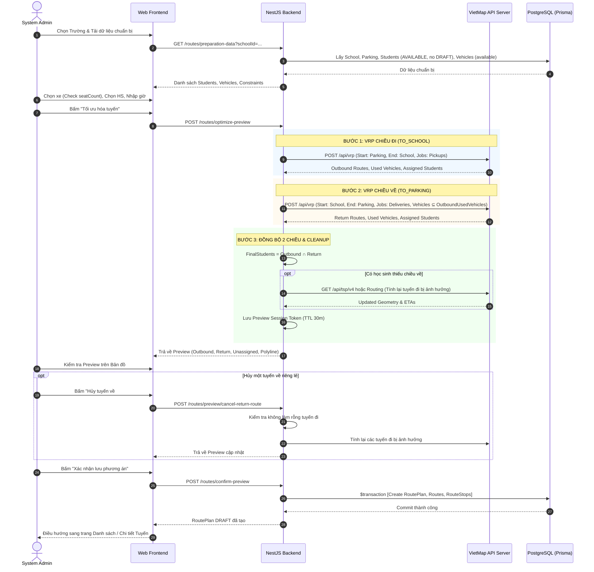

# RoadToSchool — Route Management & VietMap VRP Optimization Architecture
# Scope: RoutePlan, Route, RouteStop, VietMap VRP Multi-Vehicle Multi-Stop Optimization
# Target: Web Admin (System Admin, School Admin), Mobile App (Parent), Backend NestJS, PostgreSQL Prisma

> **Tài liệu Kiến trúc & Thiết kế Kỹ thuật Phân hệ Quản lý & Tối ưu Tuyến Đưa Đón Học Sinh**  
> **Áp dụng cho**: RoadToSchool v2.0  
> **Nguyên tắc cốt lõi**: Business Invariants First, Atomic RoutePlan Lifecycle, Proposed Vehicle Assignment, VietMap VRP Two-Direction Consistency, Strict School & Student Isolation, Minimal UI Copy.

---

## 1. TỔNG QUAN NGHIỆP VỤ & BẤT BIẾN CỐT LÕI (CORE BUSINESS CONCEPTS & INVARIANTS)

### 1.1. Các thực thể cốt lõi
1. **`RoutePlan` (Phương án Tuyến)**:
   - Đại diện cho toàn bộ phương án tuyến được lập và xác nhận trong một phiên tối ưu duy nhất của một trường học.
   - Có trạng thái vòng đời: `DRAFT`, `CANCELLED`.
   - Lưu trữ phạm vi lịch áp dụng (`scheduleScope`), các ràng buộc thời gian (`routingConstraints`), tổng số học sinh và số tuyến.
   - **RoutePlan là đơn vị quản lý, xác nhận và hủy bỏ duy nhất**. Không có khái niệm hủy một tuyến đơn lẻ sau khi RoutePlan đã được xác nhận.
2. **`Route` (Tuyến một chiều)**:
   - Đại diện cho duy nhất **một chiều di chuyển**:
     - `TO_SCHOOL`: Bãi xe trung tâm ➔ Đón lần lượt các học sinh ➔ Trường học.
     - `TO_PARKING`: Trường học ➔ Trả lần lượt các học sinh ➔ Bãi xe trung tâm.
   - Tuyệt đối không dùng khái niệm `RoutePair`. Không bắt buộc số tuyến đi bằng số tuyến về.
   - Lưu trữ xe được đề xuất (`proposedVehicleId`), tổng quãng đường, tổng thời gian di chuyển dự kiến, giờ khởi hành, giờ đến và encoded polyline geometry từ VietMap.
   - Mỗi Route bắt buộc thuộc về một `RoutePlan`.
3. **`RouteStop` (Điểm dừng)**:
   - Đại diện cho điểm dừng và thứ tự dừng (`stopOrder`) trên tuyến:
     - `PARKING_START`: Bãi xe xuất phát (chiều đi).
     - `PICKUP`: Đón học sinh tại địa chỉ nhà (chiều đi).
     - `SCHOOL_ARRIVAL`: Đến trường (chiều đi).
     - `SCHOOL_DEPARTURE`: Xuất phát từ trường (chiều về).
     - `DROPOFF`: Trả học sinh tại địa chỉ nhà (chiều về).
     - `PARKING_END`: Về lại bãi xe kết thúc ca (chiều về).
   - Lưu trữ snapshot địa chỉ, tọa độ `latitude`, `longitude`, thời gian dự kiến (ETA) theo giây từ 00:00 và định dạng chuỗi giờ `HH:mm`.
4. **Phân biệt Route vs Trip**:
   - `Route` = Tuyến đường dự kiến (kế hoạch tĩnh).
   - `Trip` = Chuyến xe chạy vào ngày cụ thể (vận hành động).
   - Trong giai đoạn này: **Tuyệt đối không triển khai Trip, không phân công tài xế, không phân công giáo viên phụ trách, không điểm danh**.
5. **Quy tắc phân bổ phương tiện (Proposed Vehicle Assignment)**:
   - `Route.proposedVehicleId` lưu xe được thuật toán VietMap VRP đề xuất.
   - Đây là **phương tiện dự kiến cho tuyến**, chưa phải là phân công xe thực tế cho Trip vận hành.
   - Khi RoutePlan ở trạng thái `DRAFT`, xe này được tính là đang được "giữ chỗ" (reserved) trong phạm vi khung giờ áp dụng, ngăn việc phương án khác sử dụng cùng xe vào khung giờ xung đột.
   - Khi RoutePlan bị hủy (`CANCELLED`), toàn bộ ràng buộc giữ chỗ của xe được giải phóng ngay lập tức.

### 1.2. Bất biến hai chiều (Two-Direction Consistency)
- Học sinh cuối cùng được duyệt vào phương án phải thỏa mãn:
  $$\text{FinalStudents} = \text{OutboundAssignedStudents} \cap \text{ReturnAssignedStudents}$$
- Mỗi học sinh hợp lệ phải có **đúng 1 tuyến đi (`TO_SCHOOL`)** và **đúng 1 tuyến về (`TO_PARKING`)**. Tuyệt đối không lưu học sinh chỉ có một chiều.
- Tập xe sử dụng ở chiều về bắt buộc là tập con của các xe đã thực sự sử dụng ở chiều đi:
  $$\text{ReturnUsedVehicles} \subseteq \text{OutboundUsedVehicles}$$
- VRP chiều về được phép gom nhóm học sinh khác với chiều đi, thay đổi thứ tự và sử dụng ít xe hơn chiều đi.

---

## 2. THIẾT KẾ DATABASE (PRISMA SCHEMA)

Bổ sung 3 models mới và quan hệ liên kết vào `api/prisma/schema.prisma` theo chính sách Additive Migration:

```prisma
// ==========================================
// ROUTE MANAGEMENT ENUMS
// ==========================================

enum RoutePlanStatus {
  DRAFT
  CANCELLED
}

enum RouteDirection {
  TO_SCHOOL
  TO_PARKING
}

enum RouteStopType {
  PARKING_START
  PICKUP
  SCHOOL_ARRIVAL
  SCHOOL_DEPARTURE
  DROPOFF
  PARKING_END
}

// ==========================================
// ROUTE MANAGEMENT MODELS
// ==========================================

/// Bảng quản lý phương án tuyến tổng thể của trường học
model RoutePlan {
  id                 String          @id @default(uuid())
  schoolId           String          @map("school_id")
  name               String          @db.VarChar(255)
  status             RoutePlanStatus @default(DRAFT)
  scheduleScope      Json            @map("schedule_scope")
  routingConstraints Json            @map("routing_constraints")
  totalStudents      Int             @default(0) @map("total_students")
  totalOutboundRoutes Int            @default(0) @map("total_outbound_routes")
  totalReturnRoutes  Int             @default(0) @map("total_return_routes")
  createdById        String          @map("created_by_id")
  createdAt          DateTime        @default(now()) @map("created_at")
  updatedAt          DateTime        @updatedAt @map("updated_at")
  cancelledAt        DateTime?       @map("cancelled_at")
  cancelledById      String?         @map("cancelled_by_id")
  cancellationReason String?         @map("cancellation_reason") @db.VarChar(500)

  // Relations
  school      School   @relation(fields: [schoolId], references: [id], onDelete: Restrict)
  createdBy   User     @relation("RoutePlanCreator", fields: [createdById], references: [id], onDelete: Restrict)
  cancelledBy User?    @relation("RoutePlanCanceller", fields: [cancelledById], references: [id], onDelete: SetNull)
  routes      Route[]

  @@index([schoolId, status])
  @@index([status, createdAt])
  @@map("route_plans")
}

/// Bảng quản lý tuyến đường một chiều (TO_SCHOOL hoặc TO_PARKING)
model Route {
  id                       String         @id @default(uuid())
  routePlanId              String         @map("route_plan_id")
  schoolId                 String         @map("school_id")
  name                     String         @db.VarChar(255)
  direction                RouteDirection
  proposedVehicleId        String?        @map("proposed_vehicle_id")
  totalDistanceMeters      Int            @default(0) @map("total_distance_meters")
  estimatedDurationSeconds Int            @default(0) @map("estimated_duration_seconds")
  departureTime            String?        @map("departure_time") @db.VarChar(10)
  arrivalTime              String?        @map("arrival_time") @db.VarChar(10)
  polylineGeometry         String         @map("polyline_geometry") @db.Text
  createdAt                DateTime       @default(now()) @map("created_at")
  updatedAt                DateTime       @updatedAt @map("updated_at")

  // Relations
  routePlan       RoutePlan   @relation(fields: [routePlanId], references: [id], onDelete: Cascade)
  school          School      @relation(fields: [schoolId], references: [id], onDelete: Restrict)
  proposedVehicle Vehicle?    @relation(fields: [proposedVehicleId], references: [id], onDelete: SetNull)
  stops           RouteStop[]

  @@index([routePlanId, direction])
  @@index([schoolId, direction])
  @@index([proposedVehicleId])
  @@map("routes")
}

/// Bảng quản lý điểm dừng và thứ tự đón/trả trên tuyến
model RouteStop {
  id                    String        @id @default(uuid())
  routeId               String        @map("route_id")
  stopOrder             Int           @map("stop_order")
  stopType              RouteStopType @map("stop_type")
  studentId             String?       @map("student_id")
  addressText           String        @map("address_text")
  latitude              Float
  longitude             Float
  plannedArrivalSeconds Int?          @map("planned_arrival_seconds")
  plannedArrivalTime   String?       @map("planned_arrival_time") @db.VarChar(10)
  createdAt             DateTime      @default(now()) @map("created_at")

  // Relations
  route   Route    @relation(fields: [routeId], references: [id], onDelete: Cascade)
  student Student? @relation(fields: [studentId], references: [id], onDelete: Restrict)

  @@index([routeId, stopOrder])
  @@index([studentId])
  @@map("route_stops")
}
```

---

## 3. THIẾT KẾ BACKEND API CONTRACTS (NESTJS MODULE)

Tạo module mới `api/src/routes/` gồm:
- `routes.controller.ts`
- `routes.service.ts`
- `vietmap-vrp.service.ts`
- DTOs & Response DTOs

### 3.1. Route Preparation Endpoints
1. `GET /api/v1/routes/preparation-data?schoolId={schoolId}`
   - **Quyền**: `SYSTEM_ADMIN`
   - **Mục tiêu**: Lấy dữ liệu sẵn sàng lập tuyến:
     - Thông tin trường học (`latitude`, `longitude`, `name`, `weeklySchedule`, `contractStartDate`, `contractEndDate`).
     - Tọa độ bãi xe trung tâm từ `SystemSetting` (`parking_lot`).
     - Danh sách học sinh đủ điều kiện (`status = AVAILABLE`, có tọa độ hợp lệ, chưa được gán vào `RoutePlan` trạng thái `DRAFT` của trường).
     - Danh sách xe khả dụng (sắp xếp `seatCount DESC`, lọc loại trừ các xe đang bị trùng lịch ở các `RoutePlan DRAFT` khác).

### 3.2. Route Optimization Endpoints (VietMap VRP)
2. `POST /api/v1/routes/optimize-preview`
   - **Quyền**: `SYSTEM_ADMIN`
   - **Body DTO**: `OptimizeRouteDto`
     ```ts
     {
       schoolId: string;
       studentIds: string[]; // Danh sách học sinh được chọn
       vehicleIds: string[]; // Danh sách xe System Admin chọn thủ công
       constraints: {
         maxRouteDurationMinutes?: number;
         latestSchoolArrival: string; // "07:15"
         returnDepartureTime: string; // "16:30"
       }
     }
     ```
   - **Quy trình xử lý Service**:
     1. Kiểm tra điều kiện tiên quyết: $\sum \text{seatCount(selectedVehicles)} \ge \text{studentIds.length}$.
     2. Chuẩn bị jobs chiều đi: `pickup: [1]`, `service: 60` (giây).
     3. Gọi VietMap VRP chiều đi (Start: Parking, End: School).
     4. Lấy danh sách xe đã dùng chiều đi và học sinh được phân bổ chiều đi.
     5. Chuẩn bị jobs chiều về: `delivery: [1]`, `service: 60` (giây).
     6. Gọi VietMap VRP chiều về (Start: School, End: Parking, Vehicles: chỉ các xe đã dùng chiều đi).
     7. Lấy giao học sinh 2 chiều. Nếu có học sinh thiếu chiều về, loại khỏi chiều đi và tính lại geometry/stops của tuyến đi tương ứng bằng VietMap TSP v4 / Routing.
     8. Tạo snapshot Preview trên server kèm `previewToken` có thời hạn 30 phút.
   - **Response DTO**: `RoutePreviewResponseDto`
     ```ts
     {
       previewToken: string;
       school: { id: string; name: string };
       outboundRoutes: PreviewRouteDto[];
       returnRoutes: PreviewRouteDto[];
       summary: {
         totalSelectedStudents: number;
         assignedBothWaysCount: number;
         unassignedCount: number;
         unassignedStudents: { id: string; fullName: string; reason?: string }[];
         excludedByAdminCount: number;
         outboundVehiclesUsed: number;
         returnVehiclesUsed: number;
       }
     }
     ```

3. `POST /api/v1/routes/preview/cancel-return-route`
   - **Quyền**: `SYSTEM_ADMIN`
   - **Body DTO**: `{ previewToken: string; returnRouteIndex: number }`
   - **Logic nghiệp vụ**:
     - Lấy danh sách học sinh thuộc tuyến về đó.
     - Kiểm tra nếu loại các học sinh này khiến bất kỳ tuyến đi nào bị rỗng học sinh (`empty route`) ➔ Ném lỗi `OUTBOUND_ROUTE_WOULD_BE_EMPTY` và giữ nguyên Preview.
     - Loại bỏ tuyến về đó khỏi Preview.
     - Loại các học sinh đó khỏi tuyến đi tương ứng.
     - Gọi VietMap TSP v4 tính lại các tuyến đi bị ảnh hưởng (cập nhật geometry, distance, duration, ETA).
     - Trả về Preview đã cập nhật.

### 3.3. RoutePlan Management Endpoints
4. `POST /api/v1/routes/confirm-preview`
   - **Quyền**: `SYSTEM_ADMIN`
   - **Body DTO**: `{ previewToken: string; planName?: string }`
   - **Logic nghiệp vụ**:
     - Kiểm tra `previewToken` hợp lệ và chưa hết hạn.
     - Re-validate tính khả dụng của xe và trạng thái học sinh trước khi commit.
     - Chạy Prisma `$transaction` nguyên khối (Atomic Transaction):
       - Tạo 1 `RoutePlan` trạng thái `DRAFT`.
       - Tạo các `Route` chiều `TO_SCHOOL` và `TO_PARKING` gắn `proposedVehicleId`.
       - Tạo toàn bộ `RouteStop` với snapshot tọa độ và ETA.
     - Trả về `RoutePlanResponseDto` thành công.

5. `GET /api/v1/routes/plans`
   - **Quyền**: `SYSTEM_ADMIN` (xem toàn bộ), `SCHOOL_ADMIN` (chỉ xem trường mình).
   - **Query**: `schoolId`, `status`, `page`, `limit`.
   - **Response**: Danh sách `RoutePlan` kèm số tuyến, số học sinh.

6. `GET /api/v1/routes/plans/:id`
   - **Quyền**: `SYSTEM_ADMIN`, `SCHOOL_ADMIN` (trường khớp).
   - **Response**: Chi tiết `RoutePlan` bao gồm toàn bộ các `Route` chiều đi và chiều về.

7. `POST /api/v1/routes/plans/:id/cancel`
   - **Quyền**: Duy nhất `SYSTEM_ADMIN`.
   - **Body**: `{ reason: string }`
   - **Logic nghiệp vụ**:
     - Kiểm tra `RoutePlan` tồn tại và đang ở trạng thái `DRAFT`.
     - Cập nhật `RoutePlan.status = CANCELLED`, `cancelledAt = now()`, `cancelledById = user.id`, `cancellationReason = reason`.
     - Toàn bộ các `Route` và `RouteStop` thuộc plan được giải phóng khỏi trạng thái giữ chỗ (xe và học sinh trở lại khả dụng cho các lần lập tuyến tiếp theo).

### 3.4. Route Query Endpoints
8. `GET /api/v1/routes`
   - **Quyền**: `SYSTEM_ADMIN` (toàn bộ), `SCHOOL_ADMIN` (trường mình).
   - **Query**: `schoolId`, `direction`, `status`, `search`, `page`, `limit`.
   - **Response**: Danh sách `Route` phân trang theo chuẩn Data Table.

9. `GET /api/v1/routes/:id`
   - **Quyền**: `SYSTEM_ADMIN`, `SCHOOL_ADMIN` (trường khớp).
   - **Response**: Chi tiết `Route` kèm toàn bộ `RouteStop`, thông tin `proposedVehicle`, thông tin `School` và geometry.

10. `GET /api/v1/routes/students/:studentId`
    - **Quyền**:
      - `SYSTEM_ADMIN`: Xem mọi học sinh.
      - `SCHOOL_ADMIN`: Chỉ xem học sinh thuộc trường mình.
      - `PARENT`: Bắt buộc phải có bản ghi liên kết hợp lệ trong `ParentStudentLink`.
    - **Response**: Chi tiết tuyến đi (`TO_SCHOOL`) và tuyến về (`TO_PARKING`) của học sinh kèm trạng thái `DRAFT` (Dự kiến - Chưa kích hoạt).
    - **Bảo mật quyền riêng tư (Privacy Guard)**: Khi trả về cho `PARENT` hoặc trang `Student Detail`, API chỉ trả geometry tuyến và 3 điểm dừng liên quan: Bãi xe, Điểm đón/trả của con mình, Trường học. Tuyệt đối không trả PII hoặc tọa độ của các học sinh khác trên cùng tuyến.

---

## 4. QUY TRÌNH TỐI ƯU HÓA VIETMAP VRP (STEP-BY-STEP ALGORITHM)



---

## 5. BẢO MẬT, ĐỘC LẬP DỮ LIỆU & QUYỀN TRUY CẬP (SECURITY & ACCESS CONTROL)

1. **Phân quyền vai trò (Role-Based Access Control)**:
   - `SYSTEM_ADMIN`: Toàn quyền Tạo, Xem, Hủy RoutePlan trên mọi trường học.
   - `SCHOOL_ADMIN`: Chỉ Xem danh sách và chi tiết các tuyến/RoutePlan thuộc `schoolId` của trường mình. Nghiêm cấm tạo, tối ưu, xác nhận hoặc hủy tuyến.
   - `PARENT`: Chỉ Xem tuyến của các học sinh đã liên kết hợp lệ trong `ParentStudentLink`.
   - `DRIVER` / `BUS_ATTENDANT`: Bị từ chối 403 đối với toàn bộ các endpoint quản trị tuyến.
2. **Bảo vệ quyền riêng tư học sinh (Privacy Preservation)**:
   - Không truyền tên, số điện thoại, PII của học sinh sang dịch vụ VietMap VRP. Chỉ truyền `id: student.id` làm định danh kỹ thuật.
   - Khi trả dữ liệu tuyến cho Phụ huynh hoặc màn hình chi tiết học sinh, che giấu toàn bộ các điểm dừng của học sinh khác.
3. **Phòng chống Race Condition & Giữ chỗ xe**:
   - Sử dụng kiểm tra khoảng thời gian lịch học (`weeklySchedule`) và phạm vi hợp đồng để phát hiện xung đột xe giữa các phương án.
   - Giao dịch xác nhận `confirm-preview` kiểm tra lại lần cuối tính hợp lệ của toàn bộ xe và học sinh trước khi ghi vào Database.

---

## 6. KẾ HOẠCH TRIỂN KHAI THEO PHASE (EXECUTION PLAN)

- **Phase A**: Thiết kế Kiến trúc (`docs/architecture/route-management-vrp-plan.md`) & Wireframes (`docs/architecture/route-management-vrp-wireframes.md`).
- **Phase B**: Migration Prisma Database (`route_plans`, `routes`, `route_stops`).
- **Phase C**: Backend Module `RoutesModule` (Service, Controller, VietMap VRP Adapter, DTOs, Unit Tests).
- **Phase D**: Web Admin UI (System Admin Routes Sidebar, Create Route Plan Wizard, Route Preview with Interactive Map, Route Detail, School Detail Tab, School Admin Read-only View, Student Detail Route Section, Student Status Filter).
- **Phase E**: Mobile Parent UI (Parent Student Detail Route Button, Route Detail Screen with VietMap Polylines, DRAFT Status Alert).
- **Phase F**: Kiểm thử tự động, build kiểm tra TypeScript và xác thực E2E.
- **Phase G**: Cập nhật báo cáo AI Review `docs/ai-review/LATEST.md` và `LATEST.diff`.
