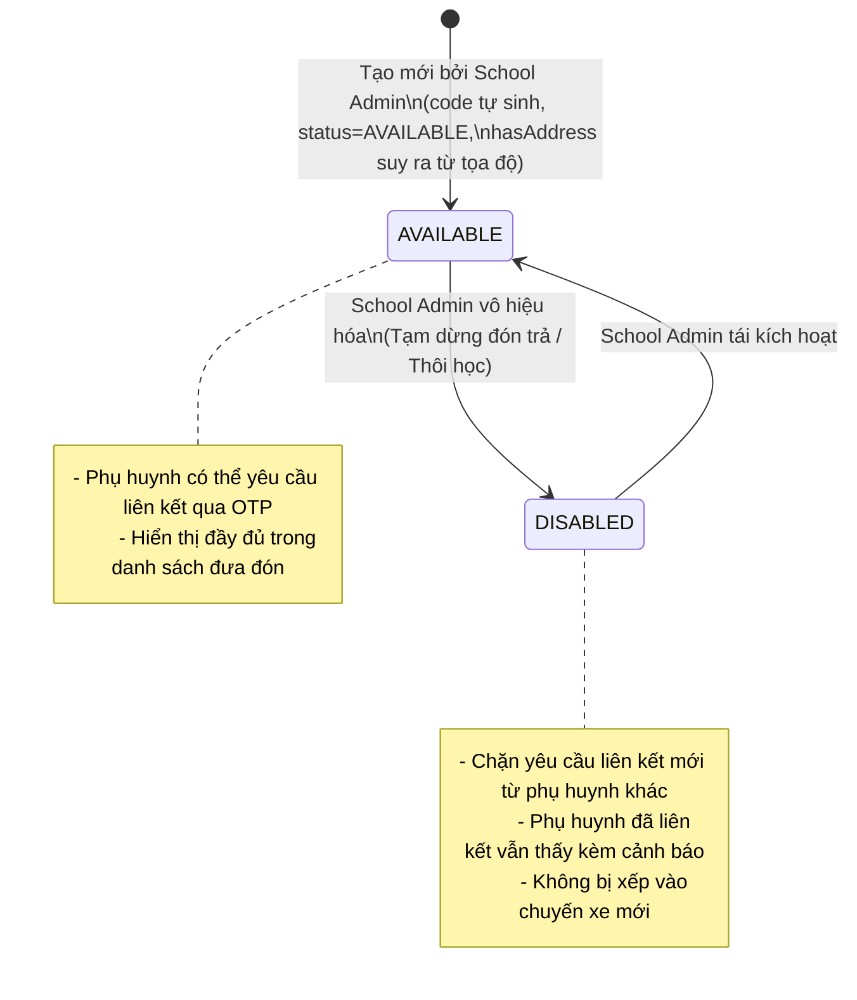

# RoadToSchool — Technical Architecture & Master Implementation Plan
# Phạm vi: Quản lý Học sinh, Giáo viên (Bus Attendant), Tài xế & Liên kết Phụ huynh
# Giai đoạn: Round 1/3 — Business Analysis & Master Implementation Plan

> **Phiên bản**: 2.0  
> **Thời gian cập nhật**: 23/10/2026 13:00  
> **Tác giả**: Senior Backend Engineer, Database Architect & Security Engineer  
> **Trạng thái**: Hoàn thành Triển khai Round 2 (Database & Backend Implementation Completed & Verified)  
> **Tài liệu tham chiếu**: [BUSINESS_CONTEXT.md](file:///c:/Users/chuon/Documents/work/road-to-school-v2/docs/BUSINESS_CONTEXT.md), [WORKING_RULES.md](file:///c:/Users/chuon/Documents/work/road-to-school-v2/docs/WORKING_RULES.md), [auth-technical-design.md](file:///c:/Users/chuon/Documents/work/road-to-school-v2/docs/architecture/auth-technical-design.md), [school-management-design.md](file:///c:/Users/chuon/Documents/work/road-to-school-v2/docs/architecture/school-management-design.md)

---

## A. Executive Summary

Tài liệu này xác lập bản thiết kế kỹ thuật kiến trúc tổng thể (Master Technical Architecture) và kế hoạch triển khai 3 đợt (Three-Round Execution Policy) cho 4 miền nghiệp vụ cốt lõi tiếp theo của hệ thống RoadToSchool:
1. **Quản lý Học sinh (Student Management)**: Khởi tạo, quản lý hồ sơ, mã định danh duy nhất (Student Code), mã QR, trạng thái hoạt động độc lập và tình trạng địa chỉ dẫn xuất.
2. **Quản lý Giáo viên / Giám sát xe (Bus Attendant Management)**: Thống nhất vai trò nội bộ `BUS_ATTENDANT`, hiển thị trên giao diện là "Giáo viên", quản lý danh sách và cấp tài khoản theo trường.
3. **Quản lý Tài xế (Driver Management)**: Quản trị tài xế tập trung do Quản trị viên hệ thống (SYSTEM_ADMIN / Đơn vị vận tải) phụ trách.
4. **Liên kết Phụ huynh - Học sinh (Parent–Student Linking)**: Quy trình liên kết an toàn qua Mã học sinh / Quét QR kết hợp xác thực OTP gửi đến số điện thoại người giám hộ, giao diện theo dõi và thao tác hủy liên kết (Swipe-to-Unlink & Detail Unlink).

Toàn bộ phạm vi được thực thi theo chính sách 3 đợt tinh gọn:
- **Round 1 (Hiện tại)**: Phân tích nghiệp vụ chuyên sâu, thiết kế kiến trúc Database & API, rà soát phân quyền và lập kế hoạch tổng thể. Không can thiệp code ứng dụng.
- **Round 2**: Triển khai toàn bộ Database Migration, Prisma Schema, Backend APIs, OTP Linking, Unit/Integration Tests và Swagger Documentation trong một đợt duy nhất.
- **Round 3**: Triển khai toàn bộ Giao diện Web (School Admin, System Admin) và Mobile App (Parent, Driver, Bus Attendant), tích hợp QR scanner, OTP dialogs và kiểm thử E2E hoàn chỉnh.

---

## B. Existing Architecture & Reusability Baseline

Hệ thống hiện tại đã sở hữu nền tảng kiến trúc vững chắc từ Stage A (Authentication) và Stage B (School Management):

1. **Cơ sở dữ liệu & ORM**:
   - PostgreSQL 16 quản lý qua Prisma ORM ([schema.prisma](file:///c:/Users/chuon/Documents/work/road-to-school-v2/api/prisma/schema.prisma)).
   - Bảng `users` đã hỗ trợ 5 vai trò thông qua `Role` Enum: `SYSTEM_ADMIN`, `SCHOOL_ADMIN`, `DRIVER`, `BUS_ATTENDANT`, `PARENT`.
   - Trường `schoolId` (onDelete: Restrict) trên bảng `users` đã được đánh index và kiểm thử cô lập trường học an toàn.
   - Bảng `otp_challenges` đã sẵn sàng các trường `identifier`, `channel`, `purpose`, `otpHash`, `expiresAt`, `consumedAt`.
2. **Backend NestJS**:
   - Kiến trúc module hóa sạch sẽ: `AuthModule`, `SchoolsModule`, `PrismaModule`.
   - Cơ chế phân quyền RBAC đa lớp: `AuthGuard` (JWT Bearer/Cookie) kết hợp `@Roles()` decorator và `RolesGuard`.
   - `OtpService` đã hoàn thiện logic: sinh mã ngẫu nhiên an toàn, mã hóa SHA-256, kiểm tra thời gian hết hạn, rate-limiting chống spam và chế độ console delivery cho môi trường development.
   - `CloudinaryService`: Hỗ trợ upload ảnh dạng Stream buffer qua Multer memory storage, giới hạn 5MB, kiểm tra magic bytes file header, trả về `imageUrl` (HTTPS CDN) và `imagePublicId`.
3. **Frontend Web (Next.js 16 App Router + TailwindCSS)**:
   - Shared Admin Layout ([admin/layout.tsx](file:///c:/Users/chuon/Documents/work/road-to-school-v2/web/src/app/admin/layout.tsx)): Header người dùng, Sidebar phân quyền theo vai trò (`SYSTEM_ADMIN` vs `SCHOOL_ADMIN`).
   - Tích hợp VietMap v4 (Autocomplete, Place Details, Reverse Geocoding) kèm Custom MapLibre Worker giải mã vector tile đã hoàn thiện và kiểm thử đạt chuẩn.
   - Thành phần nhập địa chỉ đơn nhất (`Single Address Input UX`): quản lý tọa độ ngầm, chỉ hiển thị ghim bản đồ trực quan, không hiển thị trường số vĩ độ/kinh độ.
4. **Mobile App (React Native Expo 58 + Expo Router)**:
   - Cấu trúc thư mục định tuyến theo tabs `app/(tabs)/` và xác thực `app/(auth)/`.
   - Đã tích hợp Token Storage an toàn (`expo-secure-store`) và Design tokens chung (`#FFCB56`, `#1E293B`, `#FFFDF6`).

---

## C. Confirmed Business Requirements (Quyết định PO Bắt buộc)

1. **Giáo viên trong hệ thống chính là BUS_ATTENDANT**:
   - UI hiển thị nhãn "Giáo viên".
   - Database và Backend dùng duy nhất `Role.BUS_ATTENDANT`.
   - Tuyệt đối không tạo `Role.TEACHER`, không tạo bảng `teachers`, không tạo luồng đăng nhập riêng.
2. **StudentStatus là Enum lưu trong Cơ sở dữ liệu**:
   - Đúng 2 giá trị chính thức: `AVAILABLE` và `DISABLED`.
   - Mặc định khi tạo mới là `AVAILABLE`.
   - Không chứa bất kỳ giá trị địa chỉ nào (`NO_ADDRESS`, `HAS_ADDRESS`, `PENDING_ADDRESS` là hoàn toàn bị cấm).
3. **Tình trạng địa chỉ là trạng thái dẫn xuất (Derived State)**:
   - Suy ra từ 3 trường: `addressText`, `latitude`, `longitude`.
   - `hasAddress = true` khi cả 3 trường đều có giá trị hợp lệ.
   - `hasAddress = false` khi chưa có thông tin địa chỉ (cả 3 trường đều `null`).
   - Không lưu cột `hasAddress` hay `addressStatus` trong Database.
4. **Danh sách học sinh có đúng hai bộ lọc trạng thái độc lập**:
   - Bộ lọc 1 (Trạng thái học sinh): Tất cả / Khả dụng (`AVAILABLE`) / Đã vô hiệu hóa (`DISABLED`).
   - Bộ lọc 2 (Tình trạng địa chỉ): Tất cả / Đã có địa chỉ (`hasAddress=true`) / Chưa có địa chỉ (`hasAddress=false`).
   - Hai bộ lọc kết hợp được với nhau và bắt buộc thực thi ở tầng Database trước khi phân trang (Server-side filtering).
5. **Mã học sinh duy nhất toàn hệ thống (Student Code)**:
   - Backend tự sinh ngẫu nhiên an toàn, không trùng lặp toàn hệ thống (`@unique`).
   - Mã QR sinh trực tiếp từ Student Code, không lưu ảnh tĩnh vào Cloudinary hay Database.
6. **Liên kết Phụ huynh - Học sinh qua Mã/QR + OTP**:
   - Quét QR hoặc nhập Student Code -> Gửi mã OTP xác thực tới `guardianPhone` của học sinh.
   - Xác thực OTP thành công mới tạo liên kết `ParentStudentLink`.
7. **Thao tác Hủy liên kết của Phụ huynh**:
   - Hỗ trợ 2 luồng: Vuốt thẻ sang trái (Swipe-to-Unlink) và nút Hủy trong màn hình Chi tiết học sinh (Detail Unlink).

---

## D. Student Model & Lifecycle



- **Vòng đời học sinh**:
  1. *Khởi tạo*: Do `SCHOOL_ADMIN` tạo tại trường của mình. Hệ thống tự động sinh `code`, gán `status = AVAILABLE`. Nếu có nhập địa chỉ qua bản đồ VietMap, lưu cả 3 trường `addressText`, `latitude`, `longitude`. Nếu không nhập địa chỉ, cả 3 trường là `null`.
  2. *Vô hiệu hóa (`DISABLED`)*: Khi học sinh chuyển trường, tạm dừng dịch vụ đưa đón hoặc nghỉ học dài hạn.
  3. *Tái kích hoạt (`AVAILABLE`)*: Khôi phục trạng thái hoạt động bình thường khi học sinh tiếp tục sử dụng dịch vụ.
  4. *Không áp dụng Hard Delete*: Bảo tồn toàn vẹn dữ liệu lịch sử các chuyến xe, điểm danh và liên kết phụ huynh.

---

## E. StudentStatus — Persisted Enum

Định nghĩa chính thức trong Prisma Schema (Round 2):

```prisma
enum StudentStatus {
  AVAILABLE
  DISABLED
}
```

- **AVAILABLE (Khả dụng)**: Học sinh đang trong diện quản lý dịch vụ đưa đón của trường. Được phép liên kết phụ huynh mới, được phân công chuyến xe.
- **DISABLED (Vô hiệu hóa)**: Học sinh tạm dừng hoặc chấm dứt dịch vụ. Chặn tạo liên kết phụ huynh mới. Phụ huynh cũ đã liên kết vẫn xem được hồ sơ lịch sử với huy hiệu thông báo "Vô hiệu hóa".
- **Tính mở rộng (Extensibility)**: Không tự ý thêm các trạng thái chưa có yêu cầu (`ASSIGNED`, `ON_TRIP`, `GRADUATED`). Khi nào bước sang phân hệ Route/Trip sẽ thảo luận mở rộng nếu cần.

---

## F. Derived Address Availability (Tình trạng Địa chỉ Dẫn xuất)

Bảng đối chiếu tính độc lập giữa Trạng thái hoạt động và Tình trạng địa chỉ:

| Student.status | hasAddress (Derived) | Điều kiện Database | Ý nghĩa nghiệp vụ |
| :--- | :---: | :--- | :--- |
| **AVAILABLE** | `true` | `status = AVAILABLE` AND `addressText IS NOT NULL` AND `latitude IS NOT NULL` AND `longitude IS NOT NULL` | Học sinh khả dụng, đã xác định điểm đón/trả tại nhà trên bản đồ. |
| **AVAILABLE** | `false` | `status = AVAILABLE` AND (`addressText IS NULL` OR `latitude IS NULL` OR `longitude IS NULL`) | Học sinh khả dụng, chưa cập nhật địa chỉ đưa đón (nhà trường cần liên hệ phụ huynh bổ sung). |
| **DISABLED** | `true` | `status = DISABLED` AND `addressText IS NOT NULL` AND `latitude IS NOT NULL` AND `longitude IS NOT NULL` | Học sinh tạm ngừng dịch vụ, hồ sơ cũ đã có sẵn địa chỉ. |
| **DISABLED** | `false` | `status = DISABLED` AND (`addressText IS NULL` OR `latitude IS NULL` OR `longitude IS NULL`) | Học sinh tạm ngừng dịch vụ và chưa từng có địa chỉ. |

### Ràng buộc tính nhất quán dữ liệu (Data Consistency Invariant):
- Tuyệt đối không cho phép lưu địa chỉ nửa vời (ví dụ: có `addressText` nhưng thiếu tọa độ).
- Khi tạo học sinh:
  - Nếu không chọn địa chỉ: Cả 3 trường (`addressText`, `latitude`, `longitude`) đều lưu `null`.
  - Nếu chọn địa chỉ: Cả 3 trường phải có giá trị hợp lệ (`addressText.trim().length > 0`, `latitude` trong [-90, 90], `longitude` trong [-180, 180]).

---

## G. Two Independent Student Filters (Bộ lọc Kép Độc lập)

Giao diện danh sách học sinh trên Web sở hữu 2 dropdown lọc dữ liệu hoàn toàn độc lập:

1. **Bộ lọc 1: Trạng thái (Student Status)**:
   - Nhãn UI: `Trạng thái`
   - Tùy chọn: `Tất cả trạng thái` (rỗng), `Khả dụng` (`AVAILABLE`), `Đã vô hiệu hóa` (`DISABLED`).
   - Tác động: So khớp trực tiếp cột `Student.status`.
2. **Bộ lọc 2: Tình trạng địa chỉ (Address Availability)**:
   - Nhãn UI: `Tình trạng địa chỉ`
   - Tùy chọn: `Tất cả địa chỉ` (rỗng), `Đã có địa chỉ` (`true`), `Chưa có địa chỉ` (`false`).
   - Tác động: Truy vấn điều kiện kiểm tra `null` của bộ 3 trường địa chỉ.

### Cơ chế truy vấn Backend Prisma (Server-side Filter Strategy):
```ts
// Xây dựng điều kiện Prisma where
const where: Prisma.StudentWhereInput = {
  schoolId,
};

// 1. Lọc theo StudentStatus
if (query.status) {
  where.status = query.status; // AVAILABLE | DISABLED
}

// 2. Lọc theo Address Availability (Derived)
if (query.hasAddress !== undefined) {
  if (query.hasAddress === true) {
    where.addressText = { not: null };
    where.latitude = { not: null };
    where.longitude = { not: null };
  } else if (query.hasAddress === false) {
    where.OR = [
      { addressText: null },
      { latitude: null },
      { longitude: null },
    ];
  }
}

// 3. Tìm kiếm theo tên hoặc mã học sinh
if (query.search) {
  const searchTerm = query.search.trim();
  where.AND = [
    {
      OR: [
        { fullName: { contains: searchTerm, mode: 'insensitive' } },
        { code: { contains: searchTerm, mode: 'insensitive' } },
      ],
    },
  ];
}
```

---

## H. Unique Student Code & QR Generation

### 1. Thuật toán sinh Mã học sinh (Student Code)
- **Định dạng**: Tiền tố cố định `STU` kết hợp 6 ký tự ngẫu nhiên từ bảng ký tự an toàn chống nhầm lẫn trực quan (bỏ `0`, `O`, `1`, `I`, `L`):
  `Alphabet = 23456789ABCDEFGHJKMNPQRSTUVWXYZ`
  Ví dụ: `STU7X9K2M`, `STU3BN8WP`.
- **Ràng buộc Database**: Đánh chỉ mục duy nhất `@unique` trên cột `code`.
- **Xử lý xung đột (Collision Prevention)**: Vòng lặp thử lại tối đa 5 lần với `crypto.randomInt` trước khi ném lỗi ngoại lệ.
- **Đặc tính**: Bất biến (immutable), không chứa thông tin cá nhân của học sinh, không cho phép chỉnh sửa thủ công.

### 2. Thiết kế Mã QR (QR Code Specification)
- **Payload**: Chuỗi thuần túy chứa đúng `Student.code` (Ví dụ: `STU7X9K2M`).
- **Lý do kỹ thuật**:
  - Tối giản số lượng ký tự giúp mã QR có mật độ điểm ảnh thấp (Low density), máy ảnh điện thoại đời cũ hoặc camera thiếu sáng quét được cực nhanh (< 200ms).
  - Không chứa số điện thoại phụ huynh, không chứa JWT Token, không chứa OTP -> Ngăn chặn hoàn toàn việc rò rỉ dữ liệu cá nhân qua ảnh QR.
  - Mã QR chỉ đóng vai trò là "chìa khóa định danh" để bắt đầu quy trình xác thực OTP, không cho phép xem thông tin học sinh nếu chưa hoàn tất liên kết.
- **Cơ chế hiển thị**: Sinh động phía Client bằng thư viện hiển thị SVG / Canvas chuẩn (ví dụ `qrcode.react` trên Web), không lưu ảnh PNG/JPEG vào Cloudinary nhằm tiết kiệm tài nguyên lưu trữ.

---

## I. BUS_ATTENDANT / Giáo viên Management

- **Khái niệm**: Giáo viên phụ trách xe và Bus Attendant là một. Toàn bộ cơ sở dữ liệu và API xử lý thống nhất bằng `Role.BUS_ATTENDANT`.
- **Phân cấp quản trị**: Thuộc quyền quản lý của `SCHOOL_ADMIN` của trường tương ứng.
- **Các chức năng**:
  1. *Danh sách Giáo viên*: Phân trang, tìm kiếm theo tên/email/sđt, lọc trạng thái hoạt động của User (`isActive: true/false`).
  2. *Thêm Giáo viên mới*: Nhập họ tên, email hoặc số điện thoại (tối thiểu 1 định danh). Mật khẩu ngẫu nhiên an toàn 12 ký tự, hash `bcryptjs` 10 vòng, log console chỉ trong `development`. Gán cố định `role = Role.BUS_ATTENDANT` và `schoolId = CurrentSchoolId`.
  3. *Chi tiết Giáo viên*: Xem thông tin cá nhân, định danh và trường công tác.
- **Ràng buộc trường học**: Nếu trường học đang ngừng hoạt động (`School.isActive === false`), chặn tạo mới giáo viên (`400 Bad Request`).

---

## J. Driver Management (Quản lý Tài xế)

- **Khái niệm**: Tài xế là nhân sự thuộc đơn vị vận tải (Nhà xe), phục vụ nhiều tuyến xe và có thể luân chuyển giữa các trường đối tác.
- **Phân cấp quản trị**: Thuộc quyền quản lý trực tiếp của `SYSTEM_ADMIN` (Quản trị viên phía Nhà xe).
- **Mô hình dữ liệu**: Tái sử dụng bảng `users` với `role = Role.DRIVER`. Trường `schoolId = null` (tài xế không thuộc biên chế riêng của một trường học nào).
- **Các chức năng**:
  1. *Danh sách Tài xế*: Phân trang, tìm kiếm theo họ tên/sđt/email, lọc trạng thái hoạt động của User (`isActive`).
  2. *Thêm Tài xế mới*: Nhập họ tên, số điện thoại (bắt buộc đối với tài xế để nhận cuộc gọi khẩn cấp) và email (tùy chọn). Mật khẩu ngẫu nhiên băm `bcryptjs`.
  3. *Chi tiết Tài xế*: Xem thông tin cơ bản và trạng thái tài khoản.
- Không triển khai các chức năng phân công tuyến, bằng lái xe hay quản lý xe trong phạm vi Round này.

---

## K. Parent Linking & Tracking (Luồng Liên kết & Theo dõi)

### Quy trình liên kết Phụ huynh - Học sinh:

```mermaid
sequenceDiagram
    autonumber
    actor P as Phụ huynh (Parent Mobile)
    participant API as Backend API
    participant DB as PostgreSQL
    participant OTP as OtpService
    actor G as Người giám hộ (Guardian Phone)

    P->>API: POST /api/v1/parents/link-requests (studentCode)
    API->>DB: Tìm Student theo code (Kiểm tra status = AVAILABLE)
    alt Không tìm thấy hoặc status = DISABLED
        API-->>P: 400 Bad Request / 404 Not Found
    else Hợp lệ
        API->>DB: Kiểm tra liên kết đã tồn tại giữa Parent và Student
        alt Đã liên kết trước đó
            API-->>P: 409 Conflict (Học sinh đã được liên kết)
        else Chưa liên kết
            API->>OTP: Tạo challenge OTP gửi đến student.guardianPhone
            OTP-->>G: Gửi mã OTP (6 chữ số, hạn 5 phút)
            API-->>P: 200 OK { challengeId, maskedPhone: "******7890" }
        end
    end

    P->>API: POST /api/v1/parents/verify-link (studentCode, otp)
    API->>OTP: Xác minh mã OTP với guardianPhone
    alt OTP sai hoặc hết hạn
        API-->>P: 400 Bad Request (Mã xác thực không hợp lệ)
    else OTP chính xác
        API->>DB: Tạo bản ghi ParentStudentLink (parentId, studentId)
        API-->>P: 201 Created { message: "Liên kết thành công", student }
    end
```



### An toàn & Bảo mật liên kết:
1. **Bảo vệ số điện thoại người giám hộ**: Khi phụ huynh nhập mã học sinh, Backend chỉ trả về số điện thoại đã che giấu (Masked Phone, ví dụ `090****123`) để phụ huynh đối chiếu, không trả số điện thoại đầy đủ.
2. **Ngăn chặn Brute Force & Spam**: Kế thừa cơ chế rate-limiting của `OtpService` (chỉ cho phép gửi lại khi mã cũ đã hết hạn, TTL 300 giây).
3. **Mối quan hệ N-N**:
   - 1 Phụ huynh có thể liên kết nhiều Học sinh (con cái học các lớp/trường khác nhau).
   - 1 Học sinh có thể được liên kết bởi nhiều Phụ huynh (cả Bố và Mẹ đều có thể theo dõi độc lập nếu cùng nhận được OTP từ số điện thoại giám hộ đã đăng ký với trường).

---

## L. Parent Student Detail & Unlink (Chi tiết Học sinh & Hủy liên kết)

Màn hình Chi tiết học sinh trên ứng dụng Phụ huynh gồm đúng 2 Sections chính:

### Section 1: Thông tin học sinh
- Ảnh đại diện học sinh (Avatar hoặc Placeholder mặc định thân thiện).
- Họ và tên học sinh.
- Tên trường học đối tác.
- Địa chỉ đưa đón:
  - Nếu `hasAddress === true`: Hiển thị địa chỉ văn bản chi tiết (`addressText`).
  - Nếu `hasAddress === false`: Hiển thị dòng trạng thái trực quan `"Chưa có địa chỉ đưa đón"`.
  - Tuyệt đối không hiển thị kinh độ/vĩ độ thô (`latitude`, `longitude`).

### Section 2: Thao tác với học sinh
- Duy nhất một hành động: **Hủy liên kết**.
- Khi phụ huynh nhấn nút:
  1. Mở Confirmation Modal cảnh báo: *"Bạn có chắc chắn muốn hủy theo dõi học sinh này không? Bạn sẽ cần nhập mã và xác thực lại nếu muốn theo dõi lại."*
  2. Phụ huynh xác nhận -> Gọi `DELETE /api/v1/parents/students/:studentId`.
  3. Xóa bản ghi trong `ParentStudentLink`.
  4. Cập nhật lại danh sách theo dõi tại Local State và chuyển hướng về tab Theo dõi.
  5. Tuyệt đối không xóa bản ghi `Student` trong cơ sở dữ liệu.

### Thao tác Swipe-to-Unlink tại danh sách:
- Phụ huynh vuốt thẻ học sinh từ phải sang trái -> Xuất hiện nút "Hủy liên kết" màu đỏ.
- Nhấn nút -> Mở cùng một Confirmation Dialog -> Gọi cùng một endpoint `DELETE` như màn hình Chi tiết.

---

## M. Minimal Database Proposal (Định hướng Schema Round 2)

Đề xuất bổ sung tinh gọn vào [schema.prisma](file:///c:/Users/chuon/Documents/work/road-to-school-v2/api/prisma/schema.prisma) cho Round 2:

```prisma
// ==========================================
// NEW ENUMS
// ==========================================

enum StudentStatus {
  AVAILABLE
  DISABLED
}

// Mở rộng OtpPurpose hiện có
enum OtpPurpose {
  PARENT_REGISTRATION
  PASSWORD_RESET
  PARENT_STUDENT_LINKING   // <-- Thêm mới cho Round 2
}

// ==========================================
// NEW MODELS
// ==========================================

/// Bảng quản lý hồ sơ học sinh
model Student {
  id              String         @id @default(uuid())
  code            String         @unique // Mã duy nhất toàn hệ thống (VD: STU7X9K2M)
  schoolId        String         @map("school_id")
  fullName        String         @map("full_name")
  guardianPhone   String         @map("guardian_phone")
  avatarUrl       String?        @map("avatar_url")
  avatarPublicId  String?        @map("avatar_public_id")
  
  // Thông tin địa chỉ (Nullable - tình trạng địa chỉ là Derived State)
  addressText     String?        @map("address_text")
  latitude        Float?
  longitude       Float?
  
  // Trạng thái hoạt động chính thức
  status          StudentStatus  @default(AVAILABLE)
  
  createdAt       DateTime       @default(now()) @map("created_at")
  updatedAt       DateTime       @updatedAt @map("updated_at")

  // Quan hệ
  school          School         @relation(fields: [schoolId], references: [id], onDelete: Restrict)
  parentLinks     ParentStudentLink[]

  @@index([schoolId])
  @@index([status])
  @@index([fullName])
  @@map("students")
}

/// Bảng liên kết Phụ huynh - Học sinh (N-N)
model ParentStudentLink {
  id         String    @id @default(uuid())
  parentId   String    @map("parent_id")
  studentId  String    @map("student_id")
  linkedAt   DateTime  @default(now()) @map("linked_at")

  // Quan hệ
  parent     User      @relation(fields: [parentId], references: [id], onDelete: Cascade)
  student    Student   @relation(fields: [studentId], references: [id], onDelete: Cascade)

  @@unique([parentId, studentId]) // Ngăn chặn liên kết trùng lặp giữa 1 phụ huynh và 1 học sinh
  @@index([parentId])
  @@index([studentId])
  @@map("parent_student_links")
}
```

### Điểm nổi bật về tính tối giản:
- Không tạo cột `hasAddress`, `addressStatus` hay enum thừa thãi.
- Không tạo bảng `teachers` (dùng `users` với `role: BUS_ATTENDANT`).
- Không tạo bảng `drivers` (dùng `users` với `role: DRIVER`).
- Không tạo bảng `qr_codes` (sinh động từ `student.code`).

---

## N. API Matrix (Ma trận API Round 2)

| STT | Phương thức | Endpoint | Thẩm quyền (Roles) | Mục đích & Mô tả nghiệp vụ |
| :---: | :---: | :--- | :--- | :--- |
| 1 | `GET` | `/api/v1/schools/:schoolId/students` | `SCHOOL_ADMIN`, `SYSTEM_ADMIN` | Lấy danh sách học sinh theo trường. Hỗ trợ tìm kiếm `search`, 2 bộ lọc độc lập `status` (AVAILABLE/DISABLED) và `hasAddress` (true/false), phân trang Server-side. |
| 2 | `POST` | `/api/v1/schools/:schoolId/students` | `SCHOOL_ADMIN` | Tạo học sinh mới (Multipart: `fullName`, `guardianPhone`, `addressText`, `latitude`, `longitude`, `avatar`). `SYSTEM_ADMIN` bị chặn 403. |
| 3 | `GET` | `/api/v1/schools/:schoolId/students/:id` | `SCHOOL_ADMIN`, `SYSTEM_ADMIN` | Xem chi tiết học sinh, bao gồm mã học sinh, tình trạng địa chỉ dẫn xuất và số lượng phụ huynh đã liên kết. |
| 4 | `PATCH` | `/api/v1/schools/:schoolId/students/:id/status` | `SCHOOL_ADMIN` | Chuyển đổi trạng thái học sinh giữa `AVAILABLE` và `DISABLED`. |
| 5 | `GET` | `/api/v1/schools/:schoolId/bus-attendants` | `SCHOOL_ADMIN` | Lấy danh sách Giáo viên (BUS_ATTENDANT) của trường. Phân trang, tìm kiếm, lọc theo `isActive`. |
| 6 | `POST` | `/api/v1/schools/:schoolId/bus-attendants` | `SCHOOL_ADMIN` | Tạo tài khoản Giáo viên mới (`role = BUS_ATTENDANT`, gán `schoolId`, sinh mật khẩu ngẫu nhiên). |
| 7 | `GET` | `/api/v1/schools/:schoolId/bus-attendants/:id` | `SCHOOL_ADMIN` | Xem thông tin chi tiết Giáo viên. |
| 8 | `GET` | `/api/v1/drivers` | `SYSTEM_ADMIN` | Lấy danh sách Tài xế toàn hệ thống do Nhà xe quản lý. Phân trang, tìm kiếm, lọc theo `isActive`. |
| 9 | `POST` | `/api/v1/drivers` | `SYSTEM_ADMIN` | Tạo tài khoản Tài xế mới (`role = DRIVER`, `schoolId = null`, sinh mật khẩu ngẫu nhiên). |
| 10 | `GET` | `/api/v1/drivers/:id` | `SYSTEM_ADMIN` | Xem chi tiết thông tin Tài xế. |
| 11 | `GET` | `/api/v1/parents/students` | `PARENT` | Lấy danh sách các học sinh mà Phụ huynh hiện tại đã liên kết thành công. |
| 12 | `GET` | `/api/v1/parents/students/:id` | `PARENT` | Xem chi tiết học sinh đã liên kết (chỉ cho phép truy cập nếu bản ghi `ParentStudentLink` hợp lệ). |
| 13 | `POST` | `/api/v1/parents/link-requests` | `PARENT` | Khởi tạo yêu cầu liên kết: nhận `studentCode`, kiểm tra học sinh khả dụng, gửi OTP tới `guardianPhone`, trả về số điện thoại ẩn. |
| 14 | `POST` | `/api/v1/parents/verify-link` | `PARENT` | Xác thực mã OTP và hoàn tất liên kết phụ huynh - học sinh. |
| 15 | `DELETE`| `/api/v1/parents/students/:id` | `PARENT` | Hủy liên kết phụ huynh với học sinh (chỉ xóa liên kết của chính phụ huynh đó). |

---

## O. Role & Permission Matrix

| Tính năng / Nghiệp vụ | SYSTEM_ADMIN | SCHOOL_ADMIN | PARENT | DRIVER | BUS_ATTENDANT |
| :--- | :---: | :---: | :---: | :---: | :---: |
| **Xem DS học sinh của trường** | Có (Read-only) | Có (Trường mình) | Không | Không | Không |
| **Lọc kép (Status & Address)** | Có | Có | Không | Không | Không |
| **Tạo học sinh mới** | **Không (403)** | Có (Trường mình) | Không | Không | Không |
| **Đổi trạng thái học sinh** | Không | Có | Không | Không | Không |
| **Xem mã QR học sinh** | Có | Có | Không | Không | Không |
| **Xem DS Giáo viên (Bus Attendant)**| Không | Có (Trường mình) | Không | Không | Không |
| **Tạo Giáo viên mới** | Không | Có (Trường mình) | Không | Không | Không |
| **Quản lý Tài xế (List/Create)** | **Có (Toàn quyền)**| Không (403) | Không | Không | Không |
| **Quét QR / Nhập mã liên kết** | Không | Không | **Có** | Không | Không |
| **Xác thực OTP liên kết** | Không | Không | **Có** | Không | Không |
| **Xem DS con em đã liên kết** | Không | Không | **Có** | Không | Không |
| **Hủy liên kết học sinh** | Không | Không | **Có** | Không | Không |
| **Mobile Home / Profile** | Không | Không | Có | Có | Có |

---

## P. Web Screen Inventory (Round 3)

1. **Giao diện School Admin (`/admin/students`)**:
   - Màn hình Danh sách học sinh: Thanh tìm kiếm, 2 dropdown lọc độc lập (`Trạng thái` và `Tình trạng địa chỉ`), bảng dữ liệu học sinh, phân trang Server-side, nút "Thêm học sinh".
   - Modal Thêm học sinh: Nhập họ tên, số điện thoại giám hộ, tải ảnh avatar tùy chọn, bản đồ VietMap Map Picker với ô "Địa chỉ chi tiết" duy nhất.
   - Trang Chi tiết học sinh (`/admin/students/[id]`): Thông tin tổng quát, huy hiệu trạng thái hoạt động và tình trạng địa chỉ tách biệt, hiển thị mã QR động.
2. **Giao diện School Admin — Tab Giáo viên (`/admin/teachers`)**:
   - Danh sách Giáo viên (`role = BUS_ATTENDANT`): Tìm kiếm, lọc `isActive`, phân trang, nút "Thêm giáo viên".
   - Modal Thêm Giáo viên: Họ tên, Email/Số điện thoại.
   - Trang Chi tiết Giáo viên (`/admin/teachers/[id]`).
3. **Giao diện System Admin — Chi tiết trường Tab Học sinh (`/admin/schools/[id]`)**:
   - Tái sử dụng Component danh sách học sinh: Hiển thị đầy đủ tìm kiếm, 2 bộ lọc, phân trang, xem chi tiết và QR, nhưng **không có nút Thêm học sinh** và chặn quyền gọi API tạo.
4. **Giao diện System Admin — Quản lý Tài xế (`/admin/drivers`)**:
   - Danh sách Tài xế: Tìm kiếm, lọc trạng thái, phân trang, nút "Thêm tài xế".
   - Modal Thêm Tài xế: Họ tên, Số điện thoại bắt buộc, Email tùy chọn.
   - Trang Chi tiết Tài xế (`/admin/drivers/[id]`).

---

## Q. Mobile Screen Inventory (Round 3)

1. **Phụ huynh (Parent Mobile)**:
   - Bottom Tab 1: **Trang chủ** (`app/(tabs)/index.tsx`): Màn hình chào mừng nền tảng RoadToSchool.
   - Bottom Tab 2: **Theo dõi** (`app/(tabs)/tracking.tsx`):
     - Danh sách thẻ học sinh đã liên kết (1 cột, avatar, tên, trường).
     - Hỗ trợ vuốt thẻ sang trái hiển thị nút "Hủy liên kết" (Swipe-to-Unlink).
     - Nút Floating Action Button `+` tròn cố định góc phải dưới (tuân thủ Safe Area).
   - Bottom Tab 3: **Cá nhân** (`app/(tabs)/profile.tsx`): Thông tin tài khoản và đăng xuất.
   - Màn hình Liên kết học sinh (`app/parent/link-student.tsx`): Lựa chọn nhập Mã học sinh hoặc Mở Camera Quét mã QR.
   - Màn hình Xác thực OTP (`app/parent/verify-otp.tsx`): Nhập 6 chữ số OTP gửi về số điện thoại giám hộ (hiển thị dạng `******7890`), nút gửi lại mã khi hết hạn.
   - Màn hình Chi tiết học sinh Phụ huynh (`app/parent/student/[id].tsx`): 2 sections chuẩn (Thông tin học sinh & Thao tác Hủy liên kết).
2. **Tài xế & Giáo viên (Driver & Bus Attendant Mobile)**:
   - Cả 2 vai trò cùng sử dụng cấu trúc 3 Tabs:
     - Tab 1: **Trang chủ** (`app/(tabs)/index.tsx`).
     - Tab 2: **Lịch** (`app/(tabs)/schedule.tsx` - giao diện nền tảng chờ phân hệ Trip).
     - Tab 3: **Cá nhân** (`app/(tabs)/profile.tsx` - tái sử dụng component chung).

---

## R. Security & Privacy Considerations

1. **Cô lập dữ liệu trường học (Multi-School Isolation)**:
   - `SCHOOL_ADMIN` chỉ được phép truy cập và thao tác với học sinh và giáo viên có `schoolId` trùng khớp với tài khoản của mình.
   - Backend NestJS bắt buộc trích xuất `schoolId` từ User Context trong JWT Token, tuyệt đối không tin cậy `schoolId` do Client gửi lên trong request body.
2. **Bảo mật mã QR & Mã học sinh**:
   - `Student.code` là mã định danh công khai trong nhà trường nhưng không có giá trị như một Access Token.
   - Không cho phép xem bất kỳ thông tin nhạy cảm nào nếu chỉ có trong tay mã học sinh hoặc mã QR khi chưa hoàn tất xác thực OTP.
3. **Bảo vệ mã OTP**:
   - Lưu trữ dạng băm SHA-256 trong cơ sở dữ liệu (`otp_challenges.otpHash`).
   - Thời gian sống (TTL) 300 giây.
   - Giới hạn tần suất yêu cầu: Không cho phép gửi mã mới khi mã cũ đang còn hiệu lực.
4. **An toàn Mật khẩu tài khoản mới**:
   - Mật khẩu tài khoản Giáo viên và Tài xế được sinh ngẫu nhiên an toàn bằng `crypto.randomBytes(9)`.
   - Băm mật khẩu bằng `bcryptjs` 10 vòng salt trước khi lưu DB.
   - Tuyệt đối không trả về mật khẩu qua API response. Chỉ hiển thị ra console log khi `process.env.NODE_ENV === 'development'`.

---

## S. Reusable Modules & Assets

1. **Backend**:
   - Tái sử dụng `CloudinaryService` cho việc upload ảnh avatar học sinh.
   - Tái sử dụng `OtpService` cho thử thách xác thực OTP liên kết.
   - Tái sử dụng `RolesGuard`, `@Roles()`, `AuthGuard`.
2. **Frontend Web**:
   - Tái sử dụng trọn vẹn `MapPickerModal` và logic VietMap v4 cho Modal Thêm học sinh.
   - Tái sử dụng Layout Quản trị, Sidebar và Header người dùng.
   - Tái sử dụng Component phân trang, skeleton loading và thông báo lỗi.
3. **Mobile**:
   - Tái sử dụng `AuthContext`, `apiClient`, `tokenStorage` và Theme tokens.

---

## T. Round 2 Implementation Plan (Database & Backend)

Triển khai trọn gói Database & Backend trong duy nhất một đợt:

1. **Bước 1 — Prisma Schema & Database Migration**:
   - Thêm `StudentStatus` Enum (`AVAILABLE`, `DISABLED`).
   - Mở rộng `OtpPurpose` Enum (`PARENT_STUDENT_LINKING`).
   - Tạo model `Student` kèm các ràng buộc unique và index.
   - Tạo model `ParentStudentLink` kèm ràng buộc unique `[parentId, studentId]`.
   - Tạo và áp dụng Prisma Migration an toàn: `add_student_and_parent_linking`.
2. **Bước 2 — Backend Students Module**:
   - Tạo `StudentsModule`, `StudentsController`, `StudentsService`.
   - Implement thuật toán sinh `code` ngẫu nhiên an toàn có xử lý collision.
   - Implement API danh sách học sinh kèm tìm kiếm, lọc kép Server-side (`status` & `hasAddress`), phân trang.
   - Implement API tạo học sinh hỗ trợ multipart upload avatar qua `CloudinaryService`.
   - Implement API xem chi tiết học sinh và API đổi trạng thái (`AVAILABLE` <-> `DISABLED`).
3. **Bước 3 — Backend Bus Attendants & Drivers Module**:
   - Xây dựng API quản lý Giáo viên cho `SCHOOL_ADMIN` (list, create, detail).
   - Xây dựng API quản lý Tài xế cho `SYSTEM_ADMIN` (list, create, detail).
4. **Bước 4 — Backend Parent Linking Module**:
   - Tạo `ParentsModule`, `ParentsController`, `ParentsService`.
   - Implement API khởi tạo liên kết (tìm học sinh, kiểm tra điều kiện khả dụng, gửi OTP).
   - Implement API xác thực OTP và ghi nhận liên kết.
   - Implement API danh sách học sinh đã liên kết và API hủy liên kết.
5. **Bước 5 — Swagger & Testing Quality Gates**:
   - Cập nhật đầy đủ Decorators Swagger cho tất cả DTOs và Endpoints.
   - Viết trọn bộ Unit Tests và HTTP Integration Tests cho toàn bộ các APIs mới.
   - Xuất báo cáo kiểm thử và Diff mã nguồn.

---

## U. Round 3 Implementation Plan (Web & Mobile UI)

Triển khai trọn gói giao diện Web & Mobile trong duy nhất một đợt:

1. **Bước 1 — Web School Admin Screens**:
   - Wireframe & Code màn hình Danh sách học sinh kèm 2 bộ lọc độc lập.
   - Modal Thêm học sinh tích hợp VietMap Map Picker.
   - Màn hình Chi tiết học sinh hiển thị mã QR động.
   - Màn hình Quản lý Giáo viên (Danh sách, Modal thêm, Chi tiết).
2. **Bước 2 — Web System Admin Screens**:
   - Tích hợp Tab Học sinh (Read-only) trong Chi tiết trường học.
   - Màn hình Quản lý Tài xế (Danh sách, Modal thêm, Chi tiết).
3. **Bước 3 — Mobile Parent App**:
   - Màn hình Tab Theo dõi với danh sách thẻ học sinh và nút bấm `+`.
   - Cử chỉ vuốt thẻ sang trái hiển thị nút Hủy liên kết (Swipe-to-Unlink).
   - Màn hình Nhập mã / Quét QR học sinh và Dialog xác thực OTP.
   - Màn hình Chi tiết học sinh với 2 sections chuẩn.
4. **Bước 4 — Mobile Driver & Bus Attendant App**:
   - Điều hướng 3 tabs chuẩn (Trang chủ, Lịch, Cá nhân).
5. **Bước 5 — Cross-Tier Verification & End-to-End Testing**:
   - Kiểm thử toàn diện luồng nghiệp vụ tạo học sinh -> liên kết phụ huynh -> hiển thị mobile -> hủy liên kết.

---

## V. Risks & Open Decisions Analysis

Dưới đây là bảng phân tích chi tiết các vấn đề mở để Product Owner xem xét:

| STT | Vấn đề / Quyết định mở | Bằng chứng hiện tại | Đề xuất khuyến nghị kỹ thuật | Tác động DB / API | Đòi hỏi PO duyệt |
| :---: | :--- | :--- | :--- | :--- | :---: |
| 1 | **Có triển khai API bật/tắt trạng thái Student (`AVAILABLE`/`DISABLED`) ngay trong Round 2 không?** | Cột `Student.status` đã được chốt có 2 giá trị. Nhà trường cần cho học sinh thôi học/tạm nghỉ. | **NÊN TRIỂN KHAI**: Bổ sung `PATCH /students/:id/status` cho School Admin. | Tối thiểu (1 endpoint đơn giản). | **CẦN DUYỆT** |
| 2 | **Chính sách đối với học sinh `DISABLED` khi phụ huynh mới muốn liên kết?** | Học sinh bị vô hiệu hóa nghĩa là không còn tham gia dịch vụ đưa đón. | **CHẶN LIÊN KẾT MỚI**: Trả về `400 Bad Request` nếu học sinh đang ở trạng thái `DISABLED`. | Thêm 1 dòng check điều kiện trong API linking. | **CẦN DUYỆT** |
| 3 | **Phụ huynh đã liên kết từ trước có còn nhìn thấy học sinh khi bị `DISABLED` không?** | Xóa liên kết đột ngột sẽ khiến phụ huynh hoang mang. | **GIỮ LIÊN KẾT KÈM HUY HIỆU**: Vẫn hiển thị trong app phụ huynh nhưng có nhãn "Vô hiệu hóa" và khuyến nghị liên hệ nhà trường. | UI hiển thị thêm badge cảnh báo. | **CẦN DUYỆT** |
| 4 | **Trường học ngừng hoạt động (`isActive = false`) có được tạo mới Student và Giáo viên không?** | Task 4 & Task 5 đã quy định chặn tạo Admin khi trường ngừng hoạt động. | **CHẶN HOÀN TOÀN**: Giữ vững tính nhất quán, trả về `400 Bad Request` nếu trường đang ngừng hoạt động. | Kiểm tra `school.isActive` trước khi insert. | **CẦN DUYỆT** |
| 5 | **Khi số điện thoại giám hộ (`guardianPhone`) thay đổi, các liên kết cũ xử lý ra sao?** | Học sinh đổi số điện thoại liên lạc của phụ huynh tại trường. | **GIỮ NGUYÊN LIÊN KẾT CŨ**: Các phụ huynh đã liên kết hợp lệ không bị ảnh hưởng. Số mới chỉ áp dụng cho các lượt xác thực OTP liên kết phát sinh sau này. | Không tác động cấu trúc DB. | **CẦN DUYỆT** |
| 6 | **Dịch vụ gửi tin nhắn SMS OTP trên môi trường Production**: | Môi trường hiện tại dùng `AUTH_SMS_MODE=console` để in OTP ra console log. | **DUY TRÌ CONSOLE CHO DEV**: Thiết kế sẵn Interface Adapter để kết nối dịch vụ SMS Brandname Việt Nam (eSMS, VNPT, Twilio) khi bàn giao Production. | Không làm thay đổi logic lõi. | **CẦN DUYỆT** |
| 7 | **Định dạng dữ liệu trong Mã QR (QR Payload)**: | Quét QR trên mobile cần nhanh chóng, chính xác. | **SỬ DỤNG CHUỖI STUDENT CODE THUẦN TÚY**: Ví dụ `STU7X9K2M`, dung lượng nhỏ gọn, quét siêu nhanh, không lộ thông tin cá nhân. | Rất nhẹ, dễ sinh và dễ parse. | **CẦN DUYỆT** |

---

## X. Chi tiết Wireframes & Component Design (Round 3 Wireframe-First)

Tất cả màn hình Web và Mobile trong Round 3 tuân thủ triệt để Design Tokens: Primary `#FFCB56`, Background `#FFFDF6`, Foreground `#1E293B`, Surface `#FFFFFF`, cùng nguyên tắc *Minimal Visible Text + Contextual Help Tooltips*.

### 1. Web Wireframes (Desktop & Tablet)

#### W-WEB-1: School Admin — Danh sách Học sinh (`/admin/students`)
```text
+----------------------------------------------------------------------------------------------------+
|  RoadToSchool [Logo]              Quản trị trường học (Lê Quý Đôn)           [Avatar] Đăng xuất    |
+----------------------------------------------------------------------------------------------------+
| [Sidebar]          |  HỌC SINH                                              [+ Thêm học sinh]     |
| - Tổng quan        |                                                                               |
| - Học sinh (Active)|  +--------------------------------------------------------------------------+ |
| - Giáo viên        |  | [🔍 Tìm kiếm họ tên, mã STU...] | [Trạng thái: Tất cả v] | [Địa chỉ: Tất cả v] | |
| - Cài đặt          |  +--------------------------------------------------------------------------+ |
|                    |                                                                               |
|                    |  | Avatar | Họ và tên       | Mã học sinh | SĐT giám hộ | Trạng thái  | Địa chỉ | Thao tác |
|                    |  | (Avt)  | Nguyễn Minh An  | STUA7B3C9D2 | 0988***655  | [Khả dụng]  | [Đã có] | [Xem] [v]|
|                    |  | (Avt)  | Trần Bảo Ngọc   | STU8K4M2P7Q | 0912***333  | [Vô hiệu]   | [Chưa]  | [Xem] [^]|
|                    |                                                                               |
|                    |  Hiển thị 1-10 của 42 học sinh                          [ < Trang 1 / 5 > ]   |
+--------------------+-------------------------------------------------------------------------------+
```

#### W-WEB-2: School Admin — Hộp thoại Thêm học sinh (`AddStudentModal`)
```text
+-------------------------------------------------------------------+
|  Thêm học sinh mới                                            [X] |
+-------------------------------------------------------------------+
|  [ (Ảnh đại diện) ]                                               |
|  Chọn ảnh thẻ (JPEG, PNG, WebP, tối đa 5MB)                       |
|                                                                   |
|  Họ và tên học sinh *                                             |
|  [ Nhập họ và tên đầy đủ                                        ] |
|                                                                   |
|  Số điện thoại người giám hộ *                                    |
|  [ 09xxxxxxxx                                                   ] |
|                                                                   |
|  Địa chỉ đưa đón (Tùy chọn)                                       |
|  [ 🔍 Nhập địa chỉ tìm kiếm VietMap Autocomplete...             ] |
|  +-------------------------------------------------------------+  |
|  | [Bản đồ VietMap MapLibre hiển thị ghim Marker tương tác]    |  |
|  +-------------------------------------------------------------+  |
|                                                                   |
|                                            [ Hủy ]  [ Tạo học sinh ]|
+-------------------------------------------------------------------+
```

#### W-WEB-3: School Admin — Chi tiết học sinh (`/admin/students/[id]`)
```text
+----------------------------------------------------------------------------------------------------+
|  <- Quay lại danh sách học sinh                                                                    |
|  Nguyễn Minh An   [ STUA7B3C9D2 ]   [Trạng thái: Khả dụng]         [ Vô hiệu hóa học sinh ]        |
+----------------------------------------------------------------------------------------------------+
|  [ Thẻ Thông tin học sinh ]                 |  [ Thẻ Mã QR định danh ]                            |
|  - Ảnh đại diện: (Ảnh thẻ 96x96)            |  +------------------------------------------------+ |
|  - Họ và tên: Nguyễn Minh An                |  |            [ QR CODE CANVAS/SVG ]              | |
|  - Trường học: Tiểu học Lê Quý Đôn          |  |                 STUA7B3C9D2                    | |
|  - SĐT người giám hộ: 0988776655            |  +------------------------------------------------+ |
|  - Tình trạng địa chỉ: Đã có địa chỉ        |  Mã QR chỉ chứa mã học sinh định danh duy nhất.     |
|  - Địa chỉ: Số 12 Lê Đức Thọ, Nam Từ Liêm   |  Phụ huynh quét mã qua RoadToSchool Mobile App.     |
+---------------------------------------------+-----------------------------------------------------+
```

#### W-WEB-4: School Admin — Quản lý Giáo viên (`/admin/teachers`)
```text
+----------------------------------------------------------------------------------------------------+
|  GIÁO VIÊN (BUS_ATTENDANT)                                             [+ Thêm giáo viên]          |
|  +-----------------------------------------------------------------------------------------------+ |
|  | [🔍 Tìm kiếm tên, email, sđt...]                           | [Trạng thái: Tất cả v]           | |
|  +-----------------------------------------------------------------------------------------------+ |
|  | Họ và tên         | Email                 | Số điện thoại | Vai trò   | Trạng thái | Thao tác  | |
|  | Cô Hoàng Thị Mai  | mai.ht@school.edu.vn  | 0987654321    | Giáo viên | Hoạt động  | [Chi tiết]| |
+----------------------------------------------------------------------------------------------------+
```

#### W-WEB-5: System Admin — Tab Học sinh trong Chi tiết trường (`/admin/schools/[id]`)
```text
+----------------------------------------------------------------------------------------------------+
|  Chi tiết Trường Tiểu học Lê Quý Đôn                                                               |
|  [ Tab Thông tin trường ]  |  [ Tab Nhân viên trường ]  |  [ Tab Học sinh (Active) ]               |
+----------------------------------------------------------------------------------------------------+
|  (Chế độ Xem - Chỉ đọc. Không có nút Thêm học sinh hoặc nút Vô hiệu hóa)                           |
|  +-----------------------------------------------------------------------------------------------+ |
|  | [🔍 Tìm kiếm học sinh...]      | [Trạng thái: Tất cả v]       | [Địa chỉ: Tất cả v]           | |
|  +-----------------------------------------------------------------------------------------------+ |
|  | Avatar | Họ và tên      | Mã học sinh | SĐT giám hộ | Trạng thái | Tình trạng địa chỉ | Chi tiết | |
+----------------------------------------------------------------------------------------------------+
```

#### W-WEB-6: System Admin — Quản lý Tài xế (`/admin/drivers`) & Chi tiết (`/admin/drivers/[id]`)
```text
+----------------------------------------------------------------------------------------------------+
|  TÀI XẾ NHÀ XE                                                         [+ Thêm tài xế]             |
|  +-----------------------------------------------------------------------------------------------+ |
|  | [🔍 Tìm kiếm tài xế...]                                     | [Trạng thái: Tất cả v]           | |
|  +-----------------------------------------------------------------------------------------------+ |
|  | Họ và tên         | Email               | Số điện thoại | Thuộc biên chế | Trạng thái | Thao tác | |
|  | Bác Trần Văn Lái  | driver1@r2s.vn      | 0912345678    | Nhà xe (toàn HT)| Hoạt động | [Chi tiết]| |
+----------------------------------------------------------------------------------------------------+
```

---

### 2. Mobile Wireframes (Parent, Driver, Bus Attendant)

#### W-MOB-1: Parent Mobile — Tab Theo dõi & Danh sách học sinh liên kết
```text
+-----------------------------------+
|  9:41                        [📶] |
|  Theo dõi học sinh                |
+-----------------------------------+
|  +------------------------------+ |
|  | (Avt) Nguyễn Minh An         | |
|  |       Tiểu học Lê Quý Đôn  > | |
|  +------------------------------+ |
|  +------------------------------+ |
|  | (Avt) Trần Bảo Ngọc          | |
|  |       Tiểu học Lê Quý Đôn    | |
|  |       [Đã vô hiệu hóa]     > | |
|  +------------------------------+ |
|                                   |
|                             [ + ] |  <-- Floating Action Button
+-----------------------------------+
| [Trang chủ]   [Theo dõi]  [Cá nhân]|
+-----------------------------------+
```

#### W-MOB-2: Parent Mobile — Màn hình Liên kết học sinh (`app/parent/link-student.tsx`)
```text
+-----------------------------------+
|  <- Liên kết học sinh             |
+-----------------------------------+
|  [ Nhập mã thủ công ] | [ Quét QR]|
|                                   |
|  --- Nếu chọn Nhập mã: ---        |
|  Mã học sinh                      |
|  [ STUA7B3C9D2                  ] |
|  (Định dạng: STU + 8 ký tự)       |
|  [        Tiếp tục        ]       |
|                                   |
|  --- Nếu chọn Quét QR: ---        |
|  +-----------------------------+  |
|  |   [   Camera Viewfinder  ]  |  |
|  |   [   Căn chỉnh mã QR    ]  |  |
|  +-----------------------------+  |
+-----------------------------------+
```

#### W-MOB-3: Parent Mobile — Hộp thoại Xác thực OTP (`app/parent/verify-otp.tsx`)
```text
+-----------------------------------+
|  <- Xác thực OTP                  |
+-----------------------------------+
|  Mã xác thực gồm 6 chữ số đã gửi  |
|  đến SĐT giám hộ: 098****655      |
|                                   |
|  [ 1 ] [ 2 ] [ 3 ] [ 4 ] [ 5 ] [ 6]
|                                   |
|  Thời hạn còn lại: 04:59          |
|                                   |
|  [        Xác nhận liên kết     ] |
|  Chưa nhận được mã? Gửi lại sau   |
+-----------------------------------+
```

#### W-MOB-4: Parent Mobile — Chi tiết học sinh liên kết & Swipe-to-Unlink
```text
+-----------------------------------+
|  <- Chi tiết học sinh             |
+-----------------------------------+
|  ( Ảnh đại diện học sinh )        |
|  Nguyễn Minh An                   |
|  Tiểu học Lê Quý Đôn              |
|                                   |
|  === SECTION 1: THÔNG TIN ===     |
|  Địa chỉ đón:                     |
|  Số 12 Lê Đức Thọ, Nam Từ Liêm    |
|                                   |
|  === SECTION 2: THAO TÁC ===      |
|  [  🗑️ Hủy liên kết với học sinh  ] |
+-----------------------------------+
|  Modal xác nhận khi nhấn Hủy:     |
|  "Bạn có chắc muốn hủy liên kết   |
|   với học sinh Nguyễn Minh An?"   |
|         [ Hủy ]   [ Xác nhận ]    |
+-----------------------------------+
```

#### W-MOB-5: Driver & Bus Attendant — Bottom Tabs (Trang chủ, Lịch, Cá nhân)
```text
+-----------------------------------+
|  RoadToSchool               [Bell]|
+-----------------------------------+
|  Xin chào, Bác Trần Văn Lái       |
|  Vai trò: Tài xế                  |
|                                   |
|  [ Thẻ Ca trực hôm nay ]          |
|  Chưa có lộ trình khởi hành.      |
|  Hệ thống sẽ cập nhật khi có lịch |
+-----------------------------------+
| [Trang chủ]    [Lịch]     [Cá nhân]|
+-----------------------------------+
```

#### W-MOB-6: Shared Mobile Profile (`app/(tabs)/settings.tsx`)
```text
+-----------------------------------+
|  Tài khoản cá nhân                |
+-----------------------------------+
|  (Avatar) Trần Văn Lái            |
|  Tài xế / Phụ huynh / Giáo viên   |
|                                   |
|  Email: driver1@r2s.vn            |
|  Điện thoại: 0912345678           |
|                                   |
|  [ 🚪 Đăng xuất tài khoản       ] |
+-----------------------------------+
```

---

## Y. Product Owner Approval Gate

Tài liệu thiết kế kiến trúc và kế hoạch triển khai đã cập nhật hoàn tất các Wireframes và được Product Owner phê duyệt thực thi Round 3.

> **Trạng thái phê duyệt**:  
> `[X] CHẤP THUẬN ROUND 3/3 — COMPLETE WEB & MOBILE UI IMPLEMENTATION`  
