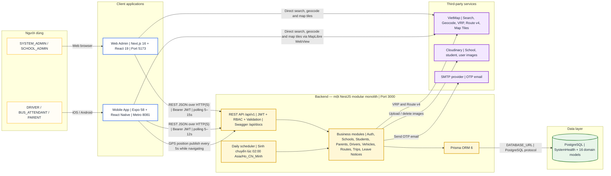

# RoadToSchool v2.0 — System Architecture

> Trạng thái: `AS-IS`, đối chiếu với source code ngày 27/10/2026 (GMT+7).
> Phạm vi: kiến trúc runtime cấp hệ thống; không mô tả chi tiết toàn bộ endpoint hay quan hệ ERD.

## Những điểm kiến trúc đã xác nhận từ code

- Repository có ba project độc lập: `api`, `web`, `mobile`; không dùng monorepo tooling hay shared package.
- Backend là một NestJS modular monolith. Các module gọi Prisma trực tiếp; không có microservice, generic repository, CQRS hay message broker.
- Web và Mobile gọi cùng REST API `/api/v1`, dùng access/refresh JWT và RBAC cho 5 role.
- Đồng bộ trạng thái/GPS hiện dùng REST polling và ghi vị trí định kỳ; chưa có WebSocket/SSE server.
- PostgreSQL là nguồn dữ liệu trung tâm. Prisma schema hiện có `SystemHealth` và 16 model nghiệp vụ.
- VietMap được gọi từ backend cho VRP/Route v4 và trực tiếp từ Web/Mobile cho tìm kiếm, geocode và map tiles.
- Cloudinary lưu ảnh; Nodemailer gửi OTP qua SMTP. Nhánh SMS hiện chỉ log console trong development/test, chưa phải SMS provider production.
- Không có Google OAuth, Gemini, Redis, Amazon S3, Kafka/RabbitMQ hay WebSocket trong implementation hiện tại.

## Ranh giới chưa được xác định trong repository

- Source code không khai báo topology production như reverse proxy, load balancer, container platform, CDN, domain/TLS termination hay managed PostgreSQL provider. Vì vậy sơ đồ không tự suy diễn các thành phần này.
- Sơ đồ mô tả logical/runtime architecture hiện tại; không phải deployment architecture cho production.
