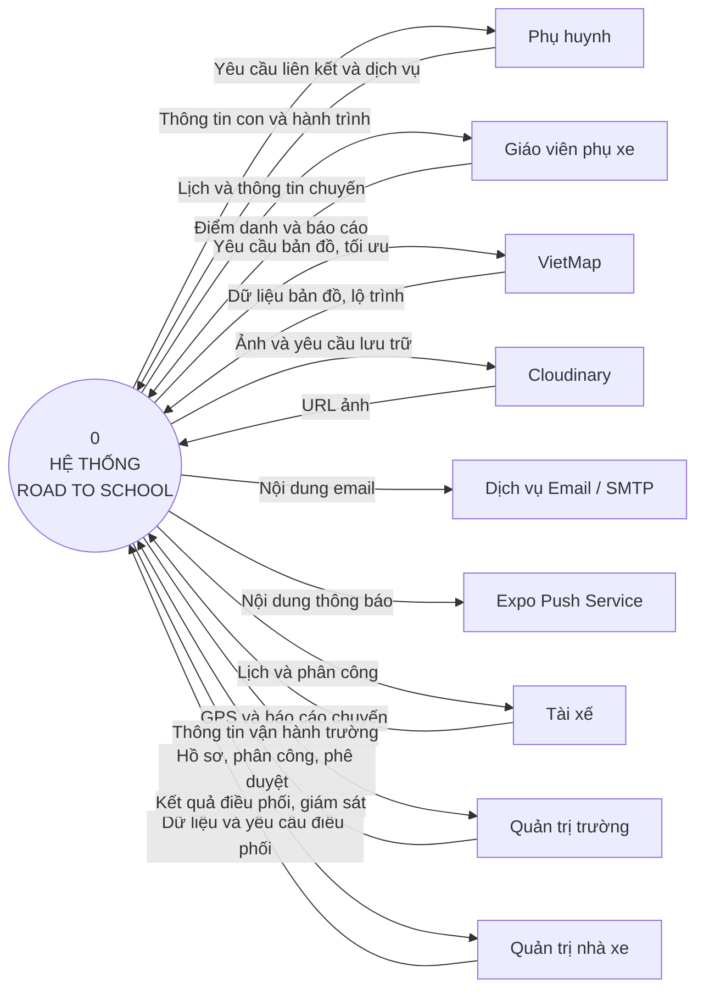

# RoadToSchool — System Context Diagram

Đối chiếu nghiệp vụ và source ngày 16/11/2026. Sơ đồ ngữ cảnh DFD theo mẫu PO cung cấp. Tiến trình 0 ở giữa là hình tròn, tác nhân ngoài là hình chữ nhật, luồng dữ liệu vào và ra được vẽ bằng mũi tên riêng.

[Ảnh PNG](system-context-diagram.png) · [Bản SVG](system-context-diagram.svg)

## Ranh giới hệ thống

- Khối RoadToSchool bao gồm Web Admin, Mobile App, Backend API và PostgreSQL. Không tách chúng thành hệ thống bên ngoài trong context diagram.
- SYSTEM_ADMIN và SCHOOL_ADMIN dùng Web; DRIVER, BUS_ATTENDANT và PARENT dùng Mobile.
- Học sinh là đối tượng được quản lý, chưa có vai trò đăng nhập riêng nên không vẽ thành actor.
- SYSTEM_ADMIN tạo phương án và phân xe/tài xế; SCHOOL_ADMIN phân giáo viên và có quyền duyệt phương án từ DRAFT sang ACTIVE.
- Phụ huynh chỉ được xem dữ liệu con đã liên kết; không có quyền xem hồ sơ học sinh khác.
- Mỗi mũi tên thể hiện một chiều trao đổi dữ liệu. Các nhãn mô tả dữ liệu qua ranh giới hệ thống.
- GPS do thiết bị Mobile của người vận hành cung cấp; chưa có bằng chứng tích hợp thiết bị GPS xe độc lập để vẽ thêm hệ thống ngoài.
- Các dịch vụ ngoài được xác nhận bằng source; sơ đồ không xác nhận cấu hình/key hay khả năng gửi thành công ở môi trường đang chạy.

## Căn cứ

| Nội dung | Nguồn |
| --- | --- |
| Một nhà xe, nhiều trường, năm vai trò | docs/BUSINESS_CONTEXT.md, AGENTS.md |
| Bản đồ, tối ưu và điều hướng | api/src/routes/vietmap-vrp.service.ts, api/src/trips/vietmap-navigation.service.ts |
| Email | api/src/auth/email-delivery.service.ts |
| Push | api/src/notifications/push-delivery.service.ts |
| Ảnh | api/src/schools/cloudinary.service.ts |

## English diagram with individual data flows

[PNG](system-context-diagram-en.png) · [SVG](system-context-diagram-en.svg)

The English diagram shows 43 directional data flows across five user roles and four external services. Each user role has six primary flows. VietMap has six flows, Cloudinary has three, and the Email and Expo services each have two. The central rounded process represents the RoadToSchool system. Its 650 by 650 box is centered on the canvas, with curved connectors for the individual flows.

Parent flows include student linking requests, student leave notices, pickup/drop-off change requests, linked student profiles, trip tracking and attendance, and request results and alerts. Email submission results describe SMTP acceptance or failure. Expo returns push tickets and receipts.
