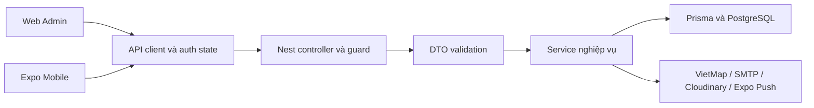

# Kiến trúc và tính năng theo source

## Kiến trúc

Ba project npm độc lập: api NestJS 12/Prisma 6/PostgreSQL, web Next 16 App Router, mobile Expo 58/RN0.88/Expo Router. Phiên bản manifest có range; package-lock là phiên bản thực dùng khi npm ci. Web Next16.4.2, React19.3; Mobile Expo~58.0.19, React19.3, RN0.88.0. Không có shared-package architecture.

`api/src/app.module.ts` đăng ký module; `main.ts` bind0.0.0.0, prefix api/v1, ValidationPipe whitelist/transform/forbidNonWhitelisted và Swagger. Controller nhận request/guard; service kiểm tra quyền đối tượng và điều kiện nghiệp vụ, không chỉ dựa trên menu frontend. Schema là quan hệ dữ liệu; xem data-model.

Web: `web/src/app/admin` chứa route quản trị; `web/src/lib/api-client.ts` là ranh giới HTTP. Mobile: `mobile/services/api-client.ts`, `context/auth-context.tsx`, các hooks và `app` phối hợp state/API/UI; `services/token-storage.ts` quản lý token. Các màn hình phải giữ loading/error/empty/disabled hiện có; không thay dữ liệu bằng mock để trình bày đẹp.

## Phân quyền

| Role | Kênh và trách nhiệm |
| --- | --- |
| SYSTEM_ADMIN | Web, nhà xe; trường/tài xế/xe, tạo phương án, sinh chuyến; không duyệt DRAFT→ACTIVE |
| SCHOOL_ADMIN | Web, phạm vi trường; học sinh/giáo viên phụ xe; duy nhất duyệt phương án; không sinh chuyến thủ công |
| DRIVER | Mobile; lịch, điều hướng, start/arrival/complete theo assignment |
| BUS_ATTENDANT | Mobile; ready, boarding/alighting, QR và sự cố; không có TEACHER riêng |
| PARENT | Mobile; con được liên kết, lịch/theo dõi, yêu cầu/báo nghỉ; privacy masking học sinh khác |

## Các miền đã có implementation

Danh mục route/DTO/service cụ thể ở [source-map](source-map.md) và [API catalog](api-catalog.md). Các hàng dưới là tồn tại implementation, không phải toàn bộ UAT đã PASS.

| Miền | Điểm vào UI và source backend | Luồng, điều kiện và lỗi cần kiểm tra |
| --- | --- | --- |
| Auth/account | Web login/forgot-password; Mobile auth/settings; api/src/auth | Login riêng Web/Mobile, token pair, refresh/session revoke, parent registration OTP, password reset, name/password/avatar. Guard từ chối sai role/inactive/hết phiên; lỗi mạng khác với hết phiên |
| Trường/hợp đồng/lịch | /admin/schools; api/src/schools | Tạo/cập nhật trường, admin/nhân sự, địa điểm/lịch/contract; lifecycle ảnh hưởng routes/trips; lỗi validation, dependency/in-use và quyền trường |
| Học sinh/phụ huynh | /admin/students; Mobile parent/link-student và student-detail; students/parents | Học sinh thuộc trường; linking OTP theo guardian contact; parent chỉ thấy con được phép. Mã không hợp lệ, OTP hết hạn/sai, thiếu quyền không được rò dữ liệu |
| Tài xế, giáo viên, xe/bãi | /admin/drivers, teachers, vehicles, settings; drivers/schools/vehicles/system-settings | CRUD/phân quyền và trạng thái tài nguyên; năng lực xe, lịch/tài nguyên đang dùng quyết định thao tác được phép |
| Yêu cầu cập nhật | /admin/requests; Mobile parent/create-request và update-requests; student-requests | Gửi OTP/xác nhận đề nghị thông tin hoặc địa chỉ; school/system review theo loại/quyền; routing preview và kết quả duyệt; giữ draft/lỗi và trạng thái pending/rejected/approved/cancelled |
| VRP/RoutePlan | /admin/routes/create, plans/[id]; routes | Chuẩn bị dữ liệu, optimize/preview, lưu DRAFT và phân công. School Admin duyệt khi readiness hợp lệ. Giữ xe/xung đột lịch; cancellation/impact có source hiện tại, không dùng ghi chú cũ deferred để kết luận chưa có |
| Chuyến/lịch/điểm danh | /admin/trips; Mobile schedule, trip/[id]; trips | Sinh từ ACTIVE và lịch/hợp đồng; assignment/roster snapshot; ready/start/arrival/boarding/alighting/complete. State và quyền đối tượng quyết định khả năng; lỗi xung đột không được hiển thị thành công |
| Điều hướng/tracking | Mobile trip map, Web trip detail; trip-navigation controller/service | Session/run/checkpoint, publish vị trí, current segment/history, TEST Auto/Joystick hoặc GPS foreground; provider lỗi/quota, stale response và resume phải giữ đúng run |
| Báo nghỉ | /admin/leave-notices; Mobile leave-notices | Options→OTP→confirm→detail, cancellation, replacement/cancel trip theo quyền. Không tự tạo chuyến/record để kiểm tra |
| Sự cố | /admin/incidents; Mobile incidents/trip; incidents | Report thiếu nhân sự, giải trình tự động, resolve/replacement/cancel theo loại; điều kiện và reason nằm DTO/service; loading/disabled/error cần giữ |
| Tổng quan/thông báo | /admin, /admin/notifications; Mobile notifications; overview/notifications | Số liệu theo scope, inbox/unread/target resolver; phân biệt unresolved với unread. Push có implementation nhưng cần cấu hình/credentials/device acceptance riêng |

## Luồng vận hành cốt lõi

TO_SCHOOL: attendant ready → driver start → boarding dọc tuyến → đánh dấu đủ roster → driver xác nhận đến trường → alighting học sinh PRESENT → complete khi đã xuống đủ. TO_PARKING: ready → boarding đủ tại trường → start → trả/alighting dọc tuyến → complete tại bãi khi đủ điều kiện. Không đồng nhất đã đến trường với đã xuống xe.

RoutePlan DRAFT giữ chỗ tài nguyên theo khoảng lịch; ACTIVE mới là đầu vào sinh chuyến. Trip giữ snapshot/roster độc lập. Parent privacy phải dựa vào roster/quyền link thực tế; UI không được suy quyền từ việc biết ID. TEST bỏ một số cửa sổ thời gian nhưng không bỏ RBAC hoặc lifecycle.

## Bảo trì

Thêm màn hình theo Expo Router/App Router hiện có; tái sử dụng auth context/API client, tránh tạo provider remount làm mất draft/token/map. Mọi API thay đổi phải đồng bộ DTO/decorators/Swagger, cập nhật error cases và object authorization. Thêm field/table phải theo quy trình phê duyệt; không cài package hoặc thay package manager để copy nguyên V1.

Đọc service và tests cạnh module trước khi đổi lifecycle, transaction, snapshot, polling hoặc request ownership. Không tự thay engine MapLibre/Leaflet WebView. Các kế hoạch chuyên biệt ở docs/ai-review và docs/architecture là bối cảnh, cần đối chiếu implementation; lý do thiết kế không có bằng chứng phải ghi chưa xác định.

## Giới hạn

Source có QR/GPS/push/simulation không chứng minh camera, GPS foreground/reopen, notification delivery hoặc đồng bộ nhiều role đã nghiệm thu. Cấu hình dịch vụ thiếu có thể khiến một tính năng chưa vận hành dù UI/API có source. V1 restyle mới thực hiện onboarding và ba form auth; xem tài liệu UI cho phạm vi còn lại. Báo cáo/analytics mới hoặc workflow ngoài controller hiện tại không được coi đã có chỉ từ đề xuất lịch sử.
